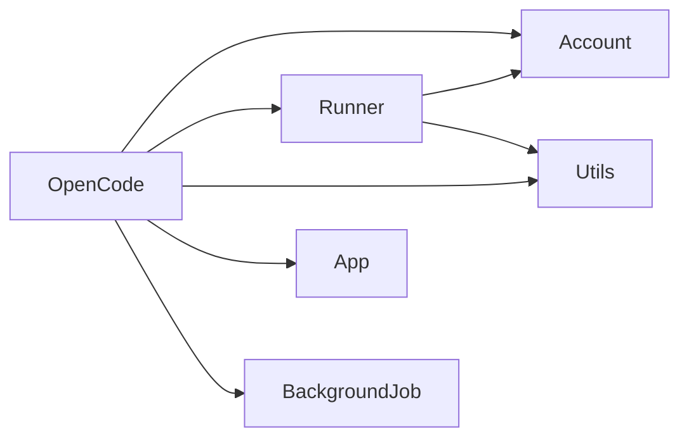
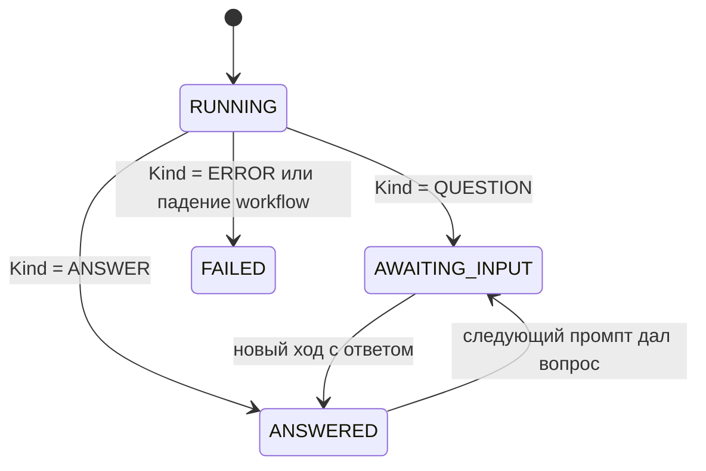
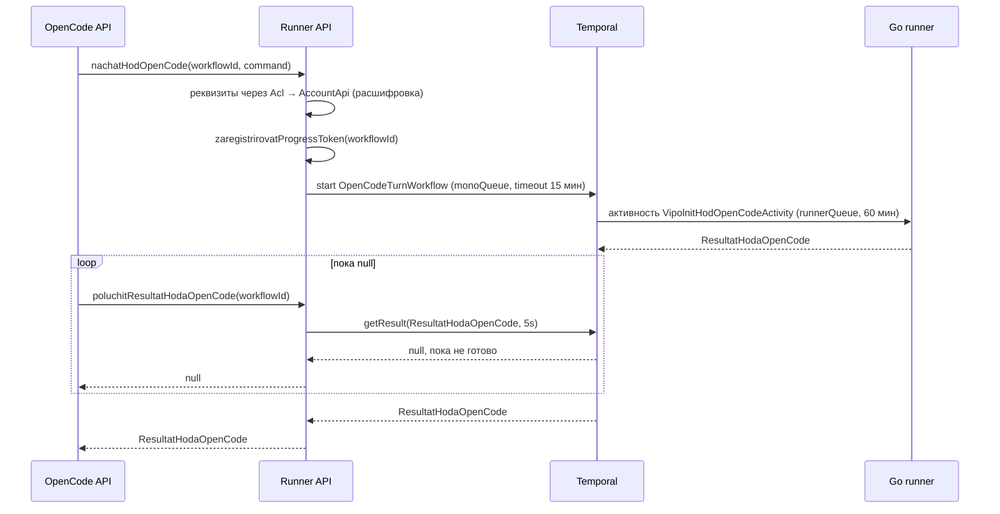

# Сессии OpenCode: промпт → runner → опрос Temporal → ответ

Модуль `src/OpenCode` даёт пользователю диалог с OpenCode через Unitman:
промпт уходит на **Go-раннер**, backend опрашивает **Temporal** короткими
порциями, реквизиты подключения (URL, модель, API-ключ) хранятся в модуле
`Account` и **шифруются**. OpenCode умеет не только отвечать, но и **задавать
вопросы с вариантами выбора** — это часть контракта, а не ошибка.

План и обоснование решений — [`plans/opencode-sessions.md`](plans/opencode-sessions.md:1).

## 1. Граф модулей



Правила, которые нельзя нарушать:

- `OpenCode → Account` только через `AccountApi`, `OpenCode → Runner` только
  через `RunnerApi` (обёрнуты в `Acl`-адаптеры модуля OpenCode);
- `Runner → Account` — только через [`Runner\Acl\AccountAdapter`](src/Runner/Acl/AccountAdapter.php:1)
  и `AccountApi`;
- `Account` не смотрит ни в `Runner`, ни в `OpenCode` — цикла нет;
- `OpenCode` не смотрит в `Unitman`.

Слой объявлен в [`deptrac.yaml`](deptrac.yaml:29), пер-модульные правила —
[`src/OpenCode/deptrac.yaml`](src/OpenCode/deptrac.yaml:1).

## 2. Реквизиты подключения (модуль Account)

У одного пользователя реквизитов может быть много: разные ключи, разные модели.
Реквизиты выбираются **до** первого промпта и фиксируются в сессии.

| Метод | Путь | Тело | Ответ |
|---|---|---|---|
| `GET` | `/api/account/opencode/spisokRekvizitov` | — | массив реквизитов |
| `POST` | `/api/account/opencode/sozdatRekvizity` | `name, url, model, apiKey` | `{ "id": "..." }` |
| `POST` | `/api/account/opencode/izmenitRekvizity` | `id, name?, url?, model?, apiKey?` | `data: null` |
| `POST` | `/api/account/opencode/udalitRekvizity` | `id` | `data: null` |

В `izmenitRekvizity` не переданное поле означает «оставить как есть»; пустой
`apiKey` **не** перезаписывает сохранённый шифротекст.

Элемент списка:

```json
{
  "id": "b1c2...",
  "name": "work-key",
  "url": "https://opencode.example.com",
  "model": "gpt-4o",
  "apiKeyHint": "****abcd",
  "createdAt": 1730000000,
  "updatedAt": 1730000000
}
```

`apiKey` не отдаётся **ни в одном** ответе: только маска последних 4 символов.
Список строится без единой расшифровки.

### 2.1 Шифрование ключа

| Аспект | Решение |
|---|---|
| Алгоритм | AES-256-GCM через `openssl_encrypt`/`openssl_decrypt` |
| Формат | `base64(nonce[12] ‖ tag[16] ‖ ciphertext)` |
| Ключ | env `OPENCODE_CREDENTIALS_KEY` — base64 от 32 сырых байт, **не** `APP_SECRET` |
| AAD | `account_id . ':' . credential_id` — шифротекст нельзя переставить между записями |
| Ротация | `cipher_version` в строке БД; новая версия ключа = новая версия формата |

Реализация — [`OpenSslShifr`](src/Account/Infra/Adapter/OpenSslShifr.php:15) за
портом `UmeetShifrovatSekrety`. Пустое значение `OPENCODE_CREDENTIALS_KEY`
означает «фича реквизитов выключена»: адаптер падает на конструкторе
(`account.opencode_credential.key_not_configured`), чтобы в БД не попал
незашифрованный секрет.

Генерация ключа:

```bash
php -r "echo base64_encode(random_bytes(32));"
```

## 3. Сессии и ходы (модуль OpenCode)

| Метод | Путь | Тело | Ответ |
|---|---|---|---|
| `POST` | `/api/opencode/sozdatSessiyu` | `credentialId, title?` | `{ "id": "<sessionId>" }` |
| `GET` | `/api/opencode/spisokSessiy` | — | массив сессий |
| `POST` | `/api/opencode/prompt` | `sessionId, text` | запуск хода |
| `POST` | `/api/opencode/otvetit` | `turnId, answers[]` | запуск хода |
| `POST` | `/api/opencode/poluchitResultatHoda` | `turnId` | состояние хода |
| `POST` | `/api/opencode/poluchitProgressHoda` | `turnId` | снапшот шагов или `null` |
| `POST` | `/api/opencode/istoriyaSessii` | `sessionId` | массив ходов по возрастанию `seq` |

Все маршруты закрыты JWT. Владелец берётся из токена и проверяется **внутри
UseCase**, поэтому чужой `sessionId`/`turnId` даёт тот же ответ, что и
несуществующий: `opencode.session.not_found` / `opencode.turn.not_found`.

Сессия:

```json
{
  "id": "8f1e...",
  "credentialId": "b1c2...",
  "title": "Разбор падения сборки",
  "externalSessionId": "ext-1",
  "createdAt": 1730000000,
  "updatedAt": 1730000100
}
```

`title` необязателен: если он пуст, при первом промпте подставляется обрезанный
до 256 символов текст промпта. `externalSessionId` заполняется, как только
раннер сообщил id сессии на стороне OpenCode.

### 3.1 Запуск хода

```json
{ "sessionId": "8f1e...", "text": "Почему упал билд?" }
```

Ответ — «квитанция» о старте:

```json
{
  "turnId": "a71c...",
  "status": "RUNNING",
  "progressChannel": "unit_progress#a71c..."
}
```

Поле `progressChannel` вычисляет Runner и передаёт наружу: бизнес-слой OpenCode
не знает формат имени канала Centrifugo.

Ответ на вопрос:

```json
{
  "turnId": "a71c...",
  "answers": [
    { "questionId": "q1", "optionId": "o1", "text": null }
  ]
}
```

`optionId` и `text` логически взаимоисключающие, но вопрос с
`AllowFreeText = true` принимает оба: вариант дополняется комментарием.
Пустые строки нормализуются в `null`, поэтому одна и та же запись в БД и в
истории выглядит одинаково.

Ответ на вопрос запускает **новый** ход: старый уже завершён со статусом
`AWAITING_INPUT` и не переоткрывается.

### 3.2 Состояния хода



| Статус | Значение |
|---|---|
| `RUNNING` | ход принят, результата ещё нет — опрос имеет смысл |
| `AWAITING_INPUT` | OpenCode задал вопрос, ждём `/otvetit` |
| `ANSWERED` | получен финальный ответ |
| `FAILED` | раннер вернул `Kind = ERROR` либо workflow упал |

Ход необратим: как только раннер вернул результат, статус фиксируется и
`finishedAt` проставляется.

Пока последний ход сессии в `AWAITING_INPUT`, `POST /prompt` отклоняется
(`opencode.turn.awaiting_answer`) — сначала нужно ответить.

### 3.3 Опрос результата

`POST /api/opencode/poluchitResultatHoda` с телом `{ "turnId": "a71c..." }`:

```json
{
  "id": "a71c...",
  "sessionId": "8f1e...",
  "seq": 1,
  "status": "AWAITING_INPUT",
  "requestText": "Почему упал билд?",
  "answers": [],
  "result": {
    "Success": true,
    "Kind": "QUESTION",
    "Questions": [
      {
        "Id": "q1",
        "Text": "Какой сервис?",
        "AllowFreeText": false,
        "Options": [
          { "Id": "o1", "Label": "api", "Description": null }
        ]
      }
    ],
    "Answer": null,
    "ErrorKey": null,
    "ExternalSessionId": "ext-1"
  },
  "errorKey": null,
  "createdAt": 1730000000,
  "finishedAt": 1730000200,
  "progressChannel": "unit_progress#a71c..."
}
```

Пока ход не завершён, `status = RUNNING`, `result = null`, `finishedAt = null` —
клиент просто повторяет запрос. Аналогичное поведение у существующего механизма
прогресса задач (см. [`docs/runner-progress-streaming.md`](docs/runner-progress-streaming.md:1)).

### 3.4 История

`POST /api/opencode/istoriyaSessii` с телом `{ "sessionId": "8f1e..." }`
возвращает массив таких же объектов ходов, отсортированных по `seq`.

## 4. Контракт с Go-раннером

Готовое задание для агента, работающего в репозитории Go-раннера, лежит
отдельным самодостаточным документом —
[`plans/runner-opencode-activity-task.md`](plans/runner-opencode-activity-task.md).
Читать PHP-код бэкенда ему не требуется: там собраны имя и очередь активности,
схемы входа и выхода, семантика вопроса, контракт `saveSteps` и словарь
`ErrorKey`.

### 4.1 Команда активити `VipolnitHodOpenCode`

Публичный API модуля Runner реквизитов **не принимает**:

```php
public function nachatHodOpenCode(string $workflowId, NachatHodOpenCode $command): string;
```

[`NachatHodOpenCode`](src/Runner/Business/Command/NachatHodOpenCode.php:14) несёт
`AccountId`, `CredentialId`, `SessionId`, `Prompt`, `Answers`, `History`.
Runner сам забирает реквизиты через `Acl`-адаптер, расшифровывает ключ и только
потом собирает команду активити
[`VipolnitHodOpenCode`](src/Runner/Business/Command/VipolnitHodOpenCode.php:20):

```
SessionId  ?string   — внешний id сессии OpenCode (null на первом ходе)
Prompt     string    — текст промпта либо расшифровка ответов
Answers    []{ QuestionId, OptionId, Text }   — для ответа на вопрос
History    []{ Role, Text }                   — контекст предыдущих реплик
Url        string    — реквизиты подключения
Model      string
ApiKey     string
```

История собирается **до** сохранения нового хода, поэтому раннер получает
контекст предыдущих реплик без текущего промпта — текущий приходит отдельно
полем `Prompt`.

Текст ответа формируется как `«Вопрос: Вариант»`; для нескольких вопросов
строки склеиваются через перевод строки. Именно эта строка становится
`requestText` следующего хода и попадает в историю.

### 4.2 Запуск и опрос



Правила:

- реквизиты забираются **до** старта workflow: если ключ не расшифровывается
  или реквизиты чужие, ошибка возвращается сразу, без «висящего» workflow;
- один ход = один workflow, ни сигналов, ни долгоживущих workflow;
- `workflowId` = `opencode_turn.workflow_id` (unique), он же используется как
  токен прогресса;
- истёкший deadline `getResult(..., 5)` — это «ход ещё выполняется», `null`,
  а не ошибка.

### 4.3 Результат `ResultatHodaOpenCode`

```
Success            bool
Kind               ANSWER | QUESTION | ERROR
Answer             ?string      — при Kind = ANSWER
Questions          []{ Id, Text, AllowFreeText, Options[]{ Id, Label, Description? } }
ErrorKey           ?string      — при Kind = ERROR
ExternalSessionId  ?string      — id сессии на стороне OpenCode
```

Требование к раннеру: **при вопросе он не зависает**, а завершает активити с
`Kind = QUESTION`. Продолжение — новым ходом с заполненным `Answers`.

`Description` в контракте необязателен, доменная модель OpenCode гарантирует
ключ всегда (`string|null`) — приведение делает
[`RunnerAdapter::prevratitVoprosy()`](src/OpenCode/Acl/RunnerAdapter.php:110),
чтобы форма JSON не «прыгала» между ответами.

API-ключа в результате нет принципиально: результат уходит в `result_json` и
отдаётся клиенту.

### 4.4 Ошибки раннера

| Ситуация в `RunnerApi::poluchitResultatHodaOpenCode()` | Результат |
|---|---|
| `TimeoutException` | `null` — ход ещё идёт |
| `WorkflowServiceException` | `Kind = ERROR`, `ErrorKey` = предыдущее исключение или `runner.unknown_error_when_make_result` |
| `WorkflowExecutionFailedException` / `WorkflowFailedException` | `Kind = ERROR`, `ErrorKey` = текст ошибки workflow |

## 5. Прогресс выполнения в реальном времени

Токен прогресса регистрируется **до** старта workflow, поэтому существующий
`POST /api/runner/saveSteps` работает без изменений контракта: `responseId` =
`workflowId` хода.

| Что | Значение |
|---|---|
| Канал Centrifugo | `unit_progress#<workflowId>` |
| Имя канала | формируется только в `RunnerProgressPublisher::kanalDlyaToken()` |
| Push | тот же payload, что и pull-ответ, троттлинг 250 мс на токен |
| Pull | `POST /api/opencode/poluchitProgressHoda` с телом `{ "turnId": "..." }` |
| Хранение | RoadRunner KV, TTL 2 часа |
| Нет прогресса | `data: null` |

Payload прогресса:

```json
{
  "steps": [
    { "command": "opencode run ...", "response": "...", "success": true, "unixtime": 1730000000 }
  ],
  "finished": true,
  "success": true,
  "updatedAt": 1730000100
}
```

Поведение UI:

1. На запуске хода — subscribe на `progressChannel` из ответа `/prompt`
   (**не** собирать имя канала самостоятельно) и один pull-запрос для
   начального состояния: это закрывает гонку подписки.
2. Снапшот всегда полный — просто перезаписывать список шагов.
3. `finished: true` либо терминальный статус хода — отписаться и перечитать
   `poluchitResultatHoda`.
4. Опрос результата и подписка на прогресс независимы: прогресс может
   отсутствовать вовсе (раннер не присылал шагов), это не ошибка.

## 6. Ошибки и локализация

Формат ответа — конверт [`Response`](src/Utils/Model/Reponse/Response.php:9):

- успех: `{"status":"success","data": ...}`;
- отказ: `{"status":"fail","data":{"message":"<переведённый текст>"}}` — с
  HTTP 500 (так работает общий `BaseExceptionListener`, это устоявшийся
  контракт проекта, а не ошибка конкретного эндпоинта);
- нет/битый JWT: HTTP 401 без конверта (отдаёт lexik).

Доменные ошибки бросаются ключами переводов, тексты — в
[`translations/messages.ru.php`](translations/messages.ru.php:126) и
`messages.en.php`.

Реквизиты (`account.opencode_credential.*`): `empty_id`, `empty_account_id`,
`empty_api_key`, `empty_name`, `empty_url`, `empty_model`, `name_too_long`,
`url_too_long`, `model_too_long`, `name_double`, `not_found`,
`decrypt_failed`, `encrypt_failed`, `invalid_key`, `key_not_configured`.

Сессия (`opencode.session.*`): `account_required`, `credential_required`,
`not_found`.

Ход (`opencode.turn.*`): `request_required`, `answers_required`,
`awaiting_answer`, `not_awaiting_answer`, `not_found`, `option_required`,
`unknown_option`, `unknown_question`, `unexpected_kind`, `invalid_status`,
`failed`.

## 7. Хранение

```sql
create table opencode_credential (
    id             varchar(64)  not null primary key,
    account_id     varchar(128) not null,
    name           varchar(128) not null,
    url            varchar(512) not null,
    model          varchar(128) not null,
    api_key_cipher text         not null,   -- только шифротекст
    api_key_hint   varchar(32)  not null,   -- ****abcd
    cipher_version smallint     not null default 1,
    created_at     integer      not null,
    updated_at     integer      not null
);
create unique index opencode_credential_account_name_uq on opencode_credential (account_id, name);

create table opencode_session (
    id                  varchar(64)  not null primary key,
    account_id          varchar(128) not null,
    credential_id       varchar(64)  not null,
    title               varchar(256) not null default '',
    external_session_id varchar(256),
    created_at          integer      not null,
    updated_at          integer      not null
);

create table opencode_turn (
    id           varchar(64) not null primary key,
    session_id   varchar(64) not null,
    seq          integer     not null,
    workflow_id  varchar(64) not null,
    status       varchar(32) not null,
    request_text text        not null,
    answers_json text        not null default '[]',
    result_json  text,
    error_key    varchar(128),
    created_at   integer     not null,
    finished_at  integer
);
create index opencode_turn_session_idx on opencode_turn (session_id, seq);
create unique index opencode_turn_workflow_uq on opencode_turn (workflow_id);
```

`opencode_credential` живёт в модуле Account
([`Version20261114000000`](src/Account/Migrations/Version20261114000000.php:1)),
`opencode_session` и `opencode_turn` — в модуле OpenCode
([`Version20261114100000`](src/OpenCode/Migrations/Version20261114100000.php:1)).

## 8. Остаточный риск: ключ в истории Temporal

Ключ по построению передаётся в payload активити, а значит попадает в историю и
visibility Temporal. Ограничения:

- доступ к Temporal UI и его БД — только круг эксплуатации;
- retention истории ограничен настройками namespace;
- ключ **никогда** не попадает в `result_json`, логи и события Centrifugo;
- при компрометации ключ отзывается в OpenCode, запись правится через
  `izmenitRekvizity`.

Убрать открытый ключ из истории можно без изменения схемы БД: краткоживущая
ссылка в RoadRunner KV с TTL хода либо `PayloadCodec` поверх всех workflow. Оба
варианта — отдельное решение, в текущий объём не входят.

## 9. Эксплуатация и проверки

1. `OPENCODE_CREDENTIALS_KEY` задан (base64 от 32 байт) — иначе реквизиты
   отключены и создание падает с `key_not_configured`.
2. `php bin/console doctrine:migrations:migrate` — миграции Account и OpenCode.
3. `php bin/console cache:clear` внутри контейнера (обязательно до тестов).
4. `composer openapi-dump` — контракт в [`docs/openapi.json`](docs/openapi.json:1)
   должен быть пересобран при изменении схем.
5. `composer check-translations` — каждый новый ключ ошибки должен быть в
   `ru` и `en`.
6. `composer check-deptrac` + `composer check-opencode-deptrac`.
7. `composer all-checks` — psalm, phpunit, все deptrac.
8. `rr reset` внутри контейнера — после изменений workflow/DI: новый
   `OpenCodeTurnWorkflow` зарегистрирован в
   [`config/workflows.php`](config/workflows.php:17), воркеры обязаны
   перечитать реестр.
