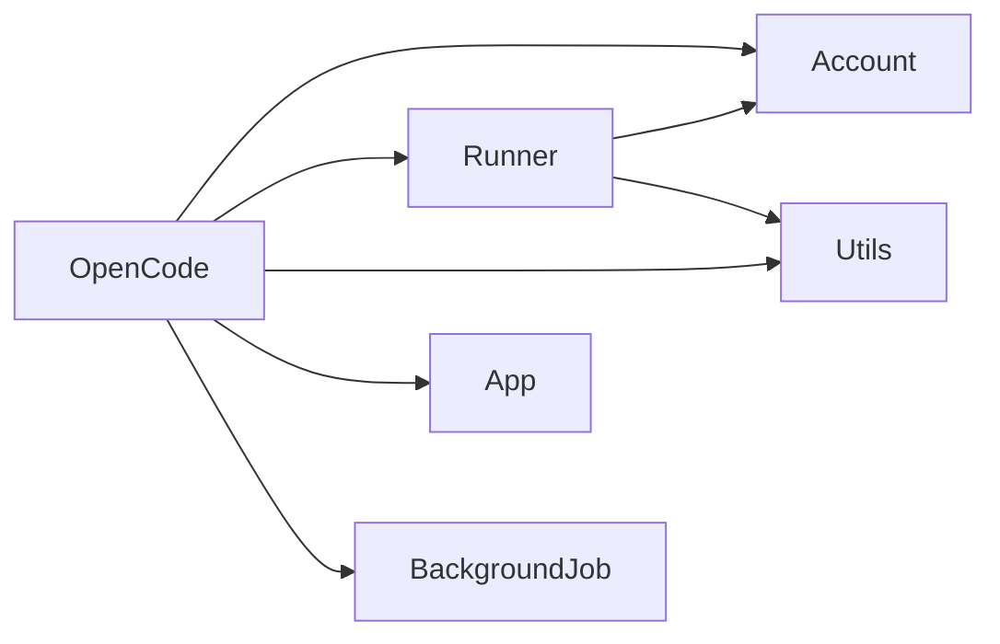
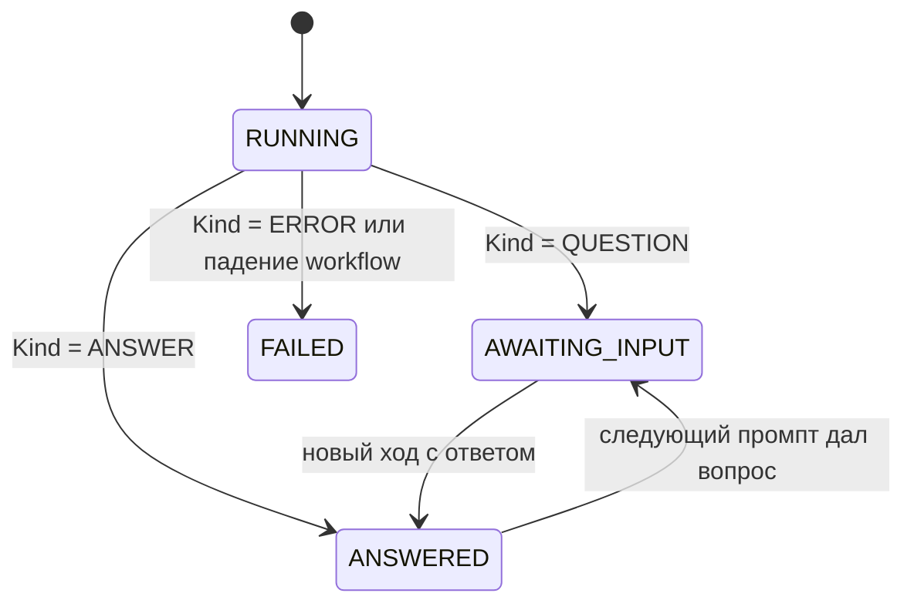
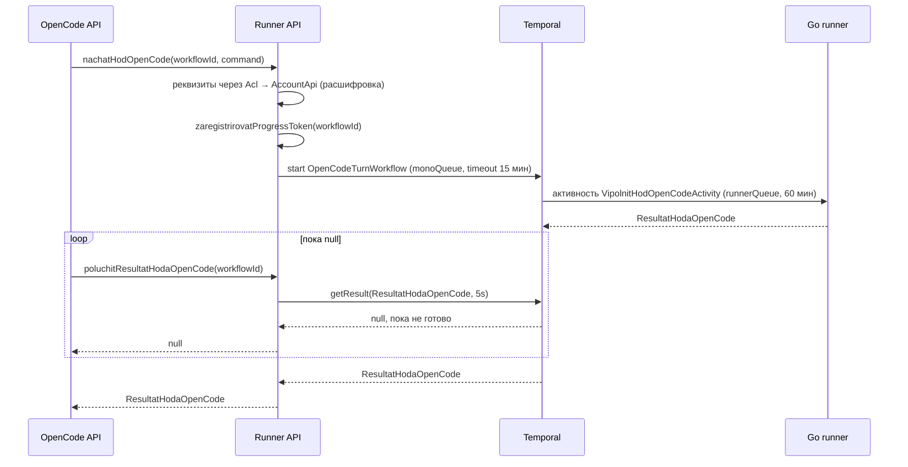

# Сессии OpenCode: промпт → runner → опрос Temporal → ответ

Модуль `src/OpenCode` даёт пользователю диалог с OpenCode через Unitman:
промпт уходит на **Go-раннер**, backend опрашивает **Temporal** короткими
порциями, реквизиты подключения (URL, модель, API-ключ) хранятся в модуле
`Account` и **шифруются**. OpenCode умеет не только отвечать, но и **задавать
вопросы с вариантами выбора** — это часть контракта, а не ошибка.

План и обоснование решений — [`plans/opencode-sessions.md`](plans/opencode-sessions.md:1).

## 1. Граф модулей



Правила, которые нельзя нарушать:

- `OpenCode → Account` только через `AccountApi`, `OpenCode → Runner` только
  через `RunnerApi` (обёрнуты в `Acl`-адаптеры модуля OpenCode);
- `Runner → Account` — только через [`Runner\Acl\AccountAdapter`](src/Runner/Acl/AccountAdapter.php:1)
  и `AccountApi`;
- `Account` не смотрит ни в `Runner`, ни в `OpenCode` — цикла нет;
- `OpenCode` не смотрит в `Unitman`.

Слой объявлен в [`deptrac.yaml`](deptrac.yaml:29), пер-модульные правила —
[`src/OpenCode/deptrac.yaml`](src/OpenCode/deptrac.yaml:1).

## 2. Реквизиты подключения (модуль Account)

У одного пользователя реквизитов может быть много: разные ключи, разные модели.
Реквизиты выбираются **до** первого промпта и фиксируются в сессии.

| Метод | Путь | Тело | Ответ |
|---|---|---|---|
| `GET` | `/api/account/opencode/spisokRekvizitov` | — | массив реквизитов |
| `POST` | `/api/account/opencode/sozdatRekvizity` | `name, url, model, apiKey` | `{ "id": "..." }` |
| `POST` | `/api/account/opencode/izmenitRekvizity` | `id, name?, url?, model?, apiKey?` | `data: null` |
| `POST` | `/api/account/opencode/udalitRekvizity` | `id` | `data: null` |

В `izmenitRekvizity` не переданное поле означает «оставить как есть»; пустой
`apiKey` **не** перезаписывает сохранённый шифротекст.

Элемент списка:

```json
{
  "id": "b1c2...",
  "name": "work-key",
  "url": "https://opencode.example.com",
  "model": "gpt-4o",
  "apiKeyHint": "****abcd",
  "createdAt": 1730000000,
  "updatedAt": 1730000000
}
```

`apiKey` не отдаётся **ни в одном** ответе: только маска последних 4 символов.
Список строится без единой расшифровки.

### 2.1 Шифрование ключа

| Аспект | Решение |
|---|---|
| Алгоритм | AES-256-GCM через `openssl_encrypt`/`openssl_decrypt` |
| Формат | `base64(nonce[12] ‖ tag[16] ‖ ciphertext)` |
| Ключ | env `OPENCODE_CREDENTIALS_KEY` — base64 от 32 сырых байт, **не** `APP_SECRET` |
| AAD | `account_id . ':' . credential_id` — шифротекст нельзя переставить между записями |
| Ротация | `cipher_version` в строке БД; новая версия ключа = новая версия формата |

Реализация — [`OpenSslShifr`](src/Account/Infra/Adapter/OpenSslShifr.php:15) за
портом `UmeetShifrovatSekrety`. Пустое значение `OPENCODE_CREDENTIALS_KEY`
означает «фича реквизитов выключена»: адаптер падает на конструкторе
(`account.opencode_credential.key_not_configured`), чтобы в БД не попал
незашифрованный секрет.

Генерация ключа:

```bash
php -r "echo base64_encode(random_bytes(32));"
```

## 3. Сессии и ходы (модуль OpenCode)

| Метод | Путь | Тело | Ответ |
|---|---|---|---|
| `POST` | `/api/opencode/sozdatSessiyu` | `credentialId, title?, unitIds?, unit?` | `{ "id": "<sessionId>" }` |
| `POST` | `/api/opencode/privezatKUnitu` | `sessionId, unitIds[]` | `data: null` — сессия привязана к юнитам |
| `GET` | `/api/opencode/spisokSessiy` | `onlyActive?`, `search?` (query) | массив сессий |
| `POST` | `/api/opencode/sostoyanieSessii` | `sessionId` | состояние сессии: причина блокировки |
| `POST` | `/api/opencode/prompt` | `sessionId, text` | запуск хода |
| `POST` | `/api/opencode/otvetit` | `turnId, answers[]` | запуск хода |
| `POST` | `/api/opencode/poluchitResultatHoda` | `turnId` | состояние хода |
| `POST` | `/api/opencode/poluchitProgressHoda` | `turnId` | снапшот шагов или `null` |
| `POST` | `/api/opencode/istoriyaSessii` | `sessionId` | массив ходов по возрастанию `seq` |
| `POST` | `/api/opencode/arhivirovatSessiyu` | `sessionId` | `data: null` — сессия в архиве |
| `POST` | `/api/opencode/udalitSessiyu` | `sessionId` | **устаревший алиас** `arhivirovatSessiyu` |

Все маршруты закрыты JWT. Владелец берётся из токена и проверяется **внутри
UseCase**, поэтому чужой `sessionId`/`turnId` даёт тот же ответ, что и
несуществующий: `opencode.session.not_found` / `opencode.turn.not_found`.

Полноценного удаления сессии нет: `arhivirovatSessiyu` помечает сессию
архивной, история ходов (`opencode_turn`) и диалог остаются доступными для
чтения. Маршрут `udalitSessiyu` сохранён для обратной совместимости и делает
ровно то же самое; он помечен `deprecated` в OpenAPI. Пустой `sessionId`
отклоняется ключом `opencode.session.id_required`.

Сессия:

```json
{
  "id": "8f1e...",
  "credentialId": "b1c2...",
  "title": "Разбор падения сборки",
  "externalSessionId": "ext-1",
  "units": [
    { "unitId": "3d7a...", "unitProjectId": "9b04..." },
    { "unitId": "5c1b...", "unitProjectId": "7e28..." }
  ],
  "unitId": "3d7a...",
  "unitProjectId": "9b04...",
  "archived": false,
  "archiveReason": null,
  "createdAt": 1730000000,
  "updatedAt": 1730000100
}
```

`title` необязателен: если он пуст, при первом промпте подставляется обрезанный
до 256 символов текст промпта. `externalSessionId` заполняется, как только
раннер сообщил id сессии на стороне OpenCode.

`units` — упорядоченный список привязанных юнитов в порядке привязки. Первый
элемент задаёт рабочий каталог хода (`cwd`), остальные передаются раннеру как
дополнительные корни workspace (multi-root). У свободной сессии `units: []`.
Проекты в `units` уникальны: модель не даёт привязать два юнита одного проекта.

`unitId` и `unitProjectId` оставлены ради обратной совместимости и дублируют
**первый** юнит из `units`; у свободной сессии оба поля `null`. `archived` —
флаг архивации, `archiveReason` принимает `unit_deleted` (все юниты удалены)
либо `manual` (пользователь вызвал `arhivirovatSessiyu`), у активной сессии
равен `null`.

### 3.1 Сессия и юнит

Сессию можно привязать к юнитам тремя способами. Юнитов может быть несколько
(до `SessiyaOpenCode::MAX_UNITS = 10`); **первый в списке задаёт рабочий
каталог хода (`cwd`), остальные раннер передаёт в OpenCode как дополнительные
корни workspace (multi-root)**.

**Не более одного юнита на проект.** Два каталога одного проекта в workspace
OpenCode неразличимы (общий `.git`, общие конфиги, одинаковый префикс пути),
поэтому вторая привязка юнита с уже занятым `unitProjectId` отклоняется с
`opencode.session.unit_project_conflict`. Проверка идёт по снимку проекта,
сохранённому при привязке в
[`PrivyazkaKUnitu`](src/OpenCode/Business/Model/PrivyazkaKUnitu.php:12), а не
по текущему состоянию юнита в Unitman. При чтении легаси-сессий с дублем
проекта (`restore()`) лишние юниты молча отбрасываются, чтобы история
оставалась доступной.

| Способ | Тело `sozdatSessiyu` | Смысл |
|---|---|---|
| Без юнитов | `credentialId, title?` | свободная сессия, работает в корне проекта |
| К существующим юнитам | `…, unitIds` | проверяется доступ пользователя к каждому юниту |
| С созданием юнита | `…, unit` | новый юнит создаётся от имени владельца |

`unitIds` и `unit` взаимоисключающие — одновременная передача даёт
`opencode.session.unit_source_conflict`. `unitIds` нормализуется: дубликаты
удаляются с сохранением порядка, пустой список равносилен отсутствию поля.
Превышение лимита даёт `opencode.session.too_many_units`. `unit` — нейтральные
для OpenCode параметры [`ParametriSozdaniyaUnita`](src/OpenCode/Business/Model/ParametriSozdaniyaUnita.php:11):
`projectId`, `unitName`, `branch`, `memoryLimit`, `peremenie`, `volumes`.
Создание идёт по обычной логике процессов Unitman, поэтому в ответе сразу
возвращается id сессии, а юнит с этого момента проходит конвейер асинхронно.

Свободную сессию можно привязать позже:

```json
{ "sessionId": "8f1e...", "unitIds": ["3d7a...", "5c1b..."] }
```

Привязка **аддитивна и идемпотентна**: повторная привязка того же юнита
возвращает `success` и не меняет порядок, новые юниты дописываются в конец
списка, поэтому `cwd` (первый юнит) никогда не меняется. Отвязать юнит нельзя.
Привязать архивную сессию нельзя (`opencode.session.archived`). Приватность
обеспечивает `Unitman`: чужой юнит даёт `opencode.session.unit_not_found`,
пустой список — `opencode.session.unit_required`.

Юнит **ничего не знает о сессиях**. Направление зависимости —
`OpenCode → Unitman` (через `Acl/UnitmanAdapter` и публичный `UnitmanApi`),
поэтому соответствие поддерживает модуль OpenCode в модели «pull»:
фоновая задача [`SinhronizaciyaSessiySUnitomBackgroundJob`](src/OpenCode/Infra/BackgroundJob/SinhronizaciyaSessiySUnitom/SinhronizaciyaSessiySUnitomBackgroundJob.php:29)
раз в 5 секунд сверяет активные сессии со всеми их юнитами.

#### Матрица готовности

Пока **хотя бы один** живой юнит собирается, сессия **не принимает
сообщения**. Проверка выполняется на входе в ход гейтом
[`PropuskHodaOpenCode`](src/OpenCode/Business/Utils/PropuskHodaOpenCode.php:20),
поэтому интерфейс не может обойти правило. Единая оценка состояния юнита —
[`OcenkaGotovnostiUnita`](src/OpenCode/Business/Utils/OcenkaGotovnostiUnita.php:16):

| Код состояния юнита | Группа | Ходы |
|---|---|---|
| `USPESHNO_ZAPUSHEN` | `ready` | разрешены |
| любой `OSHIBKA_*` (сборка, подготовка, запуск) | `ready` | разрешены — директория юнита уже создана |
| `UDALEN`, `UDALEN_VRUCHNUYU` | `archived` | юнит исключается из хода и из `units[]` |
| юнит не найден | `archived` | то же: исключается; сессия архивируется, только если удалены все |
| `SOZDAN`, `USPESHNO_SOBRAN`, `USPESHNO_PODGOTOVLEN_K_ZAPUSKU`, `null` | `blocked` | запрещены все ходы, но сессия активна |

Правило по списку целиком:

| Ситуация с `units` | Итог хода |
|---|---|
| юнитов нет (свободная сессия) | ход разрешён, `cwd` = корень проекта |
| есть хотя бы один `blocked` | `opencode.session.unit_not_ready`, ни один юнит не уходит в раннер |
| все `ready` | ход разрешён, в раннер уходят все живые юниты в порядке привязки |
| часть юнитов `archived` | архивные молча исключаются, ход по оставшимся `ready` |
| все юниты `archived` | сессия архивируется (`unit_deleted`), `opencode.session.archived` |

Отказ не «съедает» ход: клиент опрашивает `sostoyanieSessii` и ждёт перехода
всех юнитов в `ready`.

Пока юнит в `blocked`, фоновая задача вызывает
`UnitmanApi::prodvinutCiklUnita()` для каждого такого юнита, чтобы конвейер не
застревал, если пользователь не открывает страницу юнита. Продвижение
идемпотентно: домен пропускает шаг, если предыдущий процесс не завершён, гонки
гасятся `DomainException` и считаются нормой.

#### Причина блокировки для интерфейса

```json
{
  "sessionId": "8f1e...",
  "units": [
    {
      "unitId": "3d7a...",
      "unitProjectId": "9b04...",
      "unitStateCode": "USPESHNO_ZAPUSHEN",
      "group": "ready",
      "deleted": false,
      "ready": true
    },
    {
      "unitId": "5c1b...",
      "unitProjectId": "7e28...",
      "unitStateCode": "USPESHNO_PODGOTOVLEN_K_ZAPUSKU",
      "group": "blocked",
      "deleted": false,
      "ready": false
    }
  ],
  "unitId": "3d7a...",
  "unitProjectId": "9b04...",
  "archived": false,
  "archiveReason": null,
  "unitStateCode": "USPESHNO_PODGOTOVLEN_K_ZAPUSKU",
  "canAcceptMessages": false
}
```

`units` — состояние каждого привязанного юнита в порядке привязки; `group`
принимает `ready` / `blocked` / `archived`, `deleted` = `group === archived`.
`unitId`/`unitProjectId` указывают на первый юнит (обратная совместимость).

`unitStateCode` — код **первого блокирующего** юнита, а если блокировки нет —
код первого юнита; `null` у свободной сессии. `canAcceptMessages` считается
тем же правилом, что и гейт старта хода (не в архиве, есть хотя бы один живой
юнит, все живые юниты `ready`), поэтому UI и бэкенд не расходятся.

#### Занятость юнита ходом OpenCode

Занятость — это встречная блокировка: ход OpenCode не должен стартовать по
юниту, над которым прямо сейчас работает Unitman, а Unitman не должен трогать
юнит, по которому идёт ход. Владелец захвата — строка `unit_zanyatost` модуля
`Unitman` с непрозрачным токеном `opencode:<turnId>`
([`VladelecZanyatostiOpenCode::dlyaHoda()`](src/OpenCode/Business/Utils/VladelecZanyatostiOpenCode.php:19)),
тип захвата — `TipZanyatosti::OPENCODE_HOD` (`opencode_hod`).

Порядок при старте хода
([`ZapuskatelHodaOpenCode`](src/OpenCode/Business/Utils/ZapuskatelHodaOpenCode.php:16)):

1. создаётся запись хода и собирается список id **всех** живых юнитов сессии;
2. [`UmeetBronirovatUniti::zahvatit()`](src/OpenCode/Business/Port/UmeetBronirovatUniti.php:18)
   захватывает их **до** `runner.nachatHod()` — иначе раннер успел бы начать
   работу над ещё свободным юнитом;
3. если раннер не принял ход, захват тут же освобождается, иначе юнит остался
   бы занятым до истечения TTL;
4. захват освобождается по достижении ходом терминального статуса
   ([`PoluchitResultatHodaQuery`](src/OpenCode/Business/UseCase/PoluchitResultatHodaQuery.php:1)).

Захват **мультиюнитный и атомарный**: либо заняты все юниты сессии, либо ни
один. Если хотя бы один юнит занят, `zahvatit()` бросает `\DomainException`
`unit.zanyat`, и ход не начинается вовсе. Освобождение идемпотентно и не
падает, если захват уже истёк.

Занятость в матрице готовности учитывается **после** архивации: удалённый юнит
не «занят», он мёртв. Поэтому `UDALEN`/`UDALEN_VRUCHNUYU` и отсутствующий юнит
дают `archived`, а занятый живой юнит — `blocked` (`unitStateCode` при этом
остаётся прежним, `canAcceptMessages` становится `false`).

В обратную сторону занятость видна и в Unitman: список юнитов отдаёт
`zanyat` и `prichinaZanyatosti` (`opencode_hod` / `prozes` / `null`), а
мутирующие UseCase отвечают `unit.zanyat_hodom_opencode`. События вебхука по
занятому юниту не теряются — они откладываются и применяются после
освобождения, см. [`unitman-config.md`](unitman-config.md#занятость-юнита-и-отложенные-действия).

#### Архивация

| Причина | Триггер | Что дальше |
|---|---|---|
| `unit_deleted` | **все** юниты сессии удалены (задача синхронизации или гейт хода) | сессия в списке, ходы запрещены |
| `manual` | `POST /arhivirovatSessiyu` | сессия в списке, ходы запрещены |

Частичное удаление сессию не архивирует: удалённые юниты выпадают из `units[]`
при проверке хода, оставшиеся продолжают работать. Архивация идемпотентна:
повторный вызов не меняет `archiveReason` и `archived_at`. Архивные сессии
**видны в `spisokSessiy`** по умолчанию.

#### Фильтры списка

`GET /api/opencode/spisokSessiy?onlyActive=true&search=сборка`:

| Параметр | Тип | По умолчанию | Поведение |
|---|---|---|---|
| `onlyActive` | `boolean` | `false` | `true` — только неархивные сессии |
| `search` | `string` | — | подстрока названия, поиск через `LIKE` |

По умолчанию показываются все сессии, включая архивные. `search` обрезается
по краям, строка из одних пробелов игнорируется, длина ограничена 256
символами (совпадает с максимальной длиной `title`).

### 3.2 Запуск хода

```json
{ "sessionId": "8f1e...", "text": "Почему упал билд?" }
```

Ответ — «квитанция» о старте:

```json
{
  "turnId": "a71c...",
  "status": "RUNNING",
  "progressChannel": "unit_progress#a71c..."
}
```

Поле `progressChannel` вычисляет Runner и передаёт наружу: бизнес-слой OpenCode
не знает формат имени канала Centrifugo.

Ответ на вопрос:

```json
{
  "turnId": "a71c...",
  "answers": [
    { "questionId": "q1", "optionId": "o1", "text": null }
  ]
}
```

`optionId` и `text` логически взаимоисключающие, но вопрос с
`AllowFreeText = true` принимает оба: вариант дополняется комментарием.
Пустые строки нормализуются в `null`, поэтому одна и та же запись в БД и в
истории выглядит одинаково.

Ответ на вопрос запускает **новый** ход: старый уже завершён со статусом
`AWAITING_INPUT` и не переоткрывается.

### 3.3 Состояния хода



| Статус | Значение |
|---|---|
| `RUNNING` | ход принят, результата ещё нет — опрос имеет смысл |
| `AWAITING_INPUT` | OpenCode задал вопрос, ждём `/otvetit` |
| `ANSWERED` | получен финальный ответ |
| `FAILED` | раннер вернул `Kind = ERROR` либо workflow упал |

Ход необратим: как только раннер вернул результат, статус фиксируется и
`finishedAt` проставляется.

Пока последний ход сессии в `AWAITING_INPUT`, `POST /prompt` отклоняется
(`opencode.turn.awaiting_answer`) — сначала нужно ответить.

### 3.4 Опрос результата

`POST /api/opencode/poluchitResultatHoda` с телом `{ "turnId": "a71c..." }`:

```json
{
  "id": "a71c...",
  "sessionId": "8f1e...",
  "seq": 1,
  "status": "AWAITING_INPUT",
  "requestText": "Почему упал билд?",
  "answers": [],
  "result": {
    "Success": true,
    "Kind": "QUESTION",
    "Questions": [
      {
        "Id": "q1",
        "Text": "Какой сервис?",
        "AllowFreeText": false,
        "Options": [
          { "Id": "o1", "Label": "api", "Description": null }
        ]
      }
    ],
    "Answer": null,
    "ErrorKey": null,
    "ExternalSessionId": "ext-1"
  },
  "errorKey": null,
  "createdAt": 1730000000,
  "finishedAt": 1730000200,
  "progressChannel": "unit_progress#a71c..."
}
```

Пока ход не завершён, `status = RUNNING`, `result = null`, `finishedAt = null` —
клиент просто повторяет запрос. Аналогичное поведение у существующего механизма
прогресса задач (см. [`docs/runner-progress-streaming.md`](docs/runner-progress-streaming.md:1)).

### 3.5 История

`POST /api/opencode/istoriyaSessii` с телом `{ "sessionId": "8f1e..." }`
возвращает массив таких же объектов ходов, отсортированных по `seq`.

## 4. Контракт с Go-раннером

Готовое задание для агента, работающего в репозитории Go-раннера, лежит
отдельным самодостаточным документом —
[`plans/runner-opencode-activity-task.md`](plans/runner-opencode-activity-task.md).
Читать PHP-код бэкенда ему не требуется: там собраны имя и очередь активности,
схемы входа и выхода, семантика вопроса, контракт `saveSteps` и словарь
`ErrorKey`.

### 4.1 Команда активити `VipolnitHodOpenCode`

Публичный API модуля Runner реквизитов **не принимает**:

```php
public function nachatHodOpenCode(string $workflowId, NachatHodOpenCode $command): string;
```

[`NachatHodOpenCode`](src/Runner/Business/Command/NachatHodOpenCode.php:14) несёт
`AccountId`, `CredentialId`, `SessionId`, `Prompt`, `Answers`, `History`,
`Units[]` (плюс устаревшие `ProjectId`/`UnitId` первого юнита).
Runner сам забирает реквизиты через `Acl`-адаптер, расшифровывает ключ и только
потом собирает команду активити
[`VipolnitHodOpenCode`](src/Runner/Business/Command/VipolnitHodOpenCode.php:20):

```
SessionId  ?string   — внешний id сессии OpenCode (null на первом ходе)
Prompt     string    — текст промпта либо расшифровка ответов
Answers    []{ QuestionId, OptionId, Text }   — для ответа на вопрос
History    []{ Role, Text }                   — контекст предыдущих реплик
Units      []{ ProjectId, UnitId }            — живые юниты в порядке привязки
ProjectId  ?string   — устаревшее: ProjectId первого юнита (null у свободной сессии)
UnitId     ?string   — устаревшее: UnitId первого юнита (null у свободной сессии)
Url        string    — реквизиты подключения
Model      string
ApiKey     string
```

`Units` заполняется живыми готовыми юнитами сессии в порядке привязки; у
свободной сессии список пуст. **Go-раннер сам определяет директории** по этим
парам: PHP-сторона не передаёт пути и не знает схему каталогов.

Семантика multi-root:

- `Units[0]` — рабочий каталог хода (`cwd`): `ProjectId` → каталог проекта,
  `UnitId` → подкаталог юнита;
- `Units[1..]` — дополнительные корни workspace, раннер передаёт их OpenCode
  как `--directory`/workspace roots;
- `Units = []` — ход идёт в корне проекта, как раньше;
- **`ProjectId` в `Units` уникальны** — модель сессии не даёт привязать два
  юнита одного проекта, поэтому раннеру не нужно разрешать коллизии корней;
- если каталог любого юнита не найден, раннер возвращает `Kind = ERROR` с
  `ErrorKey = opencode.turn.unit_directory_not_found`.

Устаревшие `ProjectId`/`UnitId` дублируют `Units[0]` и сохранены, чтобы новый
PHP-код работал со старым раннером: раннер, не знающий про `Units`, продолжит
ходить в первый юнит.

История собирается **до** сохранения нового хода, поэтому раннер получает
контекст предыдущих реплик без текущего промпта — текущий приходит отдельно
полем `Prompt`.

Текст ответа формируется как `«Вопрос: Вариант»`; для нескольких вопросов
строки склеиваются через перевод строки. Именно эта строка становится
`requestText` следующего хода и попадает в историю.

### 4.2 Запуск и опрос



Правила:

- реквизиты забираются **до** старта workflow: если ключ не расшифровывается
  или реквизиты чужие, ошибка возвращается сразу, без «висящего» workflow;
- один ход = один workflow, ни сигналов, ни долгоживущих workflow;
- `workflowId` = `opencode_turn.workflow_id` (unique), он же используется как
  токен прогресса;
- истёкший deadline `getResult(..., 5)` — это «ход ещё выполняется», `null`,
  а не ошибка.

### 4.3 Результат `ResultatHodaOpenCode`

```
Success            bool
Kind               ANSWER | QUESTION | ERROR
Answer             ?string      — при Kind = ANSWER
Questions          []{ Id, Text, AllowFreeText, Options[]{ Id, Label, Description? } }
ErrorKey           ?string      — при Kind = ERROR
ExternalSessionId  ?string      — id сессии на стороне OpenCode
```

Требование к раннеру: **при вопросе он не зависает**, а завершает активити с
`Kind = QUESTION`. Продолжение — новым ходом с заполненным `Answers`.

`Description` в контракте необязателен, доменная модель OpenCode гарантирует
ключ всегда (`string|null`) — приведение делает
[`RunnerAdapter::prevratitVoprosy()`](src/OpenCode/Acl/RunnerAdapter.php:110),
чтобы форма JSON не «прыгала» между ответами.

API-ключа в результате нет принципиально: результат уходит в `result_json` и
отдаётся клиенту.

### 4.4 Ошибки раннера

| Ситуация в `RunnerApi::poluchitResultatHodaOpenCode()` | Результат |
|---|---|
| `TimeoutException` | `null` — ход ещё идёт |
| `WorkflowServiceException` | `Kind = ERROR`, `ErrorKey` = предыдущее исключение или `runner.unknown_error_when_make_result` |
| `WorkflowExecutionFailedException` / `WorkflowFailedException` | `Kind = ERROR`, `ErrorKey` = текст ошибки workflow |

## 5. Прогресс выполнения в реальном времени

Токен прогресса регистрируется **до** старта workflow, поэтому существующий
`POST /api/runner/saveSteps` работает без изменений контракта: `responseId` =
`workflowId` хода.

| Что | Значение |
|---|---|
| Канал Centrifugo | `unit_progress#<workflowId>` |
| Имя канала | формируется только в `RunnerProgressPublisher::kanalDlyaToken()` |
| Push | тот же payload, что и pull-ответ, троттлинг 250 мс на токен |
| Pull | `POST /api/opencode/poluchitProgressHoda` с телом `{ "turnId": "..." }` |
| Хранение | RoadRunner KV, TTL 2 часа |
| Нет прогресса | `data: null` |

Payload прогресса:

```json
{
  "steps": [
    { "command": "opencode run ...", "response": "...", "success": true, "unixtime": 1730000000 }
  ],
  "finished": true,
  "success": true,
  "updatedAt": 1730000100
}
```

Поведение UI:

1. На запуске хода — subscribe на `progressChannel` из ответа `/prompt`
   (**не** собирать имя канала самостоятельно) и один pull-запрос для
   начального состояния: это закрывает гонку подписки.
2. Снапшот всегда полный — просто перезаписывать список шагов.
3. `finished: true` либо терминальный статус хода — отписаться и перечитать
   `poluchitResultatHoda`.
4. Опрос результата и подписка на прогресс независимы: прогресс может
   отсутствовать вовсе (раннер не присылал шагов), это не ошибка.

## 6. Ошибки и локализация

Формат ответа — конверт [`Response`](src/Utils/Model/Reponse/Response.php:9):

- успех: `{"status":"success","data": ...}`;
- отказ: `{"status":"fail","data":{"message":"<переведённый текст>"}}` — с
  HTTP 500 (так работает общий `BaseExceptionListener`, это устоявшийся
  контракт проекта, а не ошибка конкретного эндпоинта);
- нет/битый JWT: HTTP 401 без конверта (отдаёт lexik).

Доменные ошибки бросаются ключами переводов, тексты — в
[`translations/messages.ru.php`](translations/messages.ru.php:126) и
`messages.en.php`.

Реквизиты (`account.opencode_credential.*`): `empty_id`, `empty_account_id`,
`empty_api_key`, `empty_name`, `empty_url`, `empty_model`, `name_too_long`,
`url_too_long`, `model_too_long`, `name_double`, `not_found`,
`decrypt_failed`, `encrypt_failed`, `invalid_key`, `key_not_configured`.

Сессия (`opencode.session.*`): `account_required`, `archive_reason_required`,
`archived`, `credential_required`, `id_required`, `not_found`,
`too_many_units`, `unit_not_found`, `unit_not_ready`,
`unit_project_conflict`, `unit_project_required`, `unit_required`,
`unit_source_conflict`.

Ход (`opencode.turn.*`): `request_required`, `answers_required`,
`awaiting_answer`, `not_awaiting_answer`, `not_found`, `option_required`,
`unknown_option`, `unknown_question`, `unexpected_kind`, `invalid_status`,
`failed`, `unit_directory_not_found`.

## 7. Хранение

```sql
create table opencode_credential (
    id             varchar(64)  not null primary key,
    account_id     varchar(128) not null,
    name           varchar(128) not null,
    url            varchar(512) not null,
    model          varchar(128) not null,
    api_key_cipher text         not null,   -- только шифротекст
    api_key_hint   varchar(32)  not null,   -- ****abcd
    cipher_version smallint     not null default 1,
    created_at     integer      not null,
    updated_at     integer      not null
);
create unique index opencode_credential_account_name_uq on opencode_credential (account_id, name);

create table opencode_session (
    id                  varchar(64)  not null primary key,
    account_id          varchar(128) not null,
    credential_id       varchar(64)  not null,
    title               varchar(256) not null default '',
    external_session_id varchar(256),
    unit_id             varchar(64)  default null,  -- устаревшее: первый юнит сессии
    unit_project_id     varchar(64)  default null,  -- устаревшее: снимок проекта первого юнита
    archived_at         integer      default null,  -- null — сессия активна
    archive_reason      varchar(64)  default null,  -- unit_deleted | manual
    created_at          integer      not null,
    updated_at          integer      not null
);
create index opencode_session_unit_idx on opencode_session (unit_id);

-- упорядоченный список юнитов сессии (multi-root)
create table opencode_session_unit (
    session_id      varchar(64) not null,
    unit_id         varchar(64) not null,
    unit_project_id varchar(64) not null,   -- снимок проекта юнита на момент привязки
    position_index  integer     not null default 0,  -- 0 — первый юнит (cwd), далее — доп. корни
    created_at      integer     not null,
    primary key (session_id, unit_id)
);
create index opencode_session_unit_unit_idx on opencode_session_unit (unit_id);
create index opencode_session_unit_session_idx on opencode_session_unit (session_id);

create table opencode_turn (
    id           varchar(64) not null primary key,
    session_id   varchar(64) not null,
    seq          integer     not null,
    workflow_id  varchar(64) not null,
    status       varchar(32) not null,
    request_text text        not null,
    answers_json text        not null default '[]',
    result_json  text,
    error_key    varchar(128),
    created_at   integer     not null,
    finished_at  integer
);
create index opencode_turn_session_idx on opencode_turn (session_id, seq);
create unique index opencode_turn_workflow_uq on opencode_turn (workflow_id);
```

`opencode_credential` живёт в модуле Account
([`Version20261114000000`](src/Account/Migrations/Version20261114000000.php:1)).
`opencode_session` и `opencode_turn` создаёт модуль OpenCode
([`Version20261114100000`](src/OpenCode/Migrations/Version20261114100000.php:1)),
колонки юнита и архивацию добавляет
[`Version20261120120000`](src/OpenCode/Migrations/Version20261120120000.php:1),
а таблицу нескольких юнитов с бэкфиллом —
[`Version20261120130000`](src/OpenCode/Migrations/Version20261120130000.php:1).

Список юнитов хранится в `opencode_session_unit` отдельной таблицей, потому что
у сессии их до `SessiyaOpenCode::MAX_UNITS = 10`. Первичный ключ
`(session_id, unit_id)` делает привязку идемпотентной, `position_index`
фиксирует порядок: `0` — первый юнит, его директория становится `cwd` хода,
остальные раннер подключает как дополнительные корни workspace. Индексы
`opencode_session_unit_unit_idx`/`opencode_session_unit_session_idx` нужны
обратному поиску «сессии по юниту» (`findAktivnieSUnitom`) и batch-загрузке
юнитов пачки сессий без N+1.

Колонки `opencode_session.unit_id`/`unit_project_id` остаются **снимком первого
юнита** — их читают старые раннеры и внешние потребители, а миграция
`Version20261120130000` бэкфиллит из них таблицу
(`insert … select … on conflict do nothing`). Обе колонки допускают `null`:
свободная сессия работает в корне проекта, а значения появляются при привязке;
при привязке нескольких юнитов туда попадает только первый, поэтому при
противоречии с `opencode_session_unit` источником правды считается side table.
`unit_project_id` — снимок на момент привязки, поэтому перенос юнита в другой
проект не ломает уже запущенные ходы.

`archived_at` и `archive_reason` — единственный признак архива: отдельного
статуса у сессии нет, поэтому «активность» — это `archived_at is null`, и
фильтр `onlyActive` добавляет в `where` ровно это условие. Архив ставится
вручную (`manual`) или когда удалены **все** юниты сессии (`unit_deleted`).

## 8. Остаточный риск: ключ в истории Temporal

Ключ по построению передаётся в payload активити, а значит попадает в историю и
visibility Temporal. Ограничения:

- доступ к Temporal UI и его БД — только круг эксплуатации;
- retention истории ограничен настройками namespace;
- ключ **никогда** не попадает в `result_json`, логи и события Centrifugo;
- при компрометации ключ отзывается в OpenCode, запись правится через
  `izmenitRekvizity`.

Убрать открытый ключ из истории можно без изменения схемы БД: краткоживущая
ссылка в RoadRunner KV с TTL хода либо `PayloadCodec` поверх всех workflow. Оба
варианта — отдельное решение, в текущий объём не входят.

## 9. Эксплуатация и проверки

1. `OPENCODE_CREDENTIALS_KEY` задан (base64 от 32 байт) — иначе реквизиты
   отключены и создание падает с `key_not_configured`.
2. `php bin/console doctrine:migrations:migrate` — миграции Account и OpenCode.
3. `php bin/console cache:clear` внутри контейнера (обязательно до тестов).
4. `composer openapi-dump` — контракт в [`docs/openapi.json`](docs/openapi.json:1)
   должен быть пересобран при изменении схем.
5. `composer check-translations` — каждый новый ключ ошибки должен быть в
   `ru` и `en`.
6. `composer check-deptrac` + `composer check-opencode-deptrac`.
7. `composer all-checks` — psalm, phpunit, все deptrac.
8. `rr reset` внутри контейнера — после изменений workflow/DI: новый
   `OpenCodeTurnWorkflow` зарегистрирован в
   [`config/workflows.php`](config/workflows.php:17), воркеры обязаны
   перечитать реестр.
9. Воркер `php bin/console app:jobs` должен быть запущен: сверку сессий с
   юнитами выполняет [`SinhronizaciyaSessiySUnitomBackgroundJob`](src/OpenCode/Infra/BackgroundJob/SinhronizaciyaSessiySUnitom/SinhronizaciyaSessiySUnitomBackgroundJob.php:29)
   с интервалом 5 секунд. Без него архивные сессии и сессии, застрявшие в
   `blocked`, не обновляются, пока пользователь сам не откроет страницу юнита.
