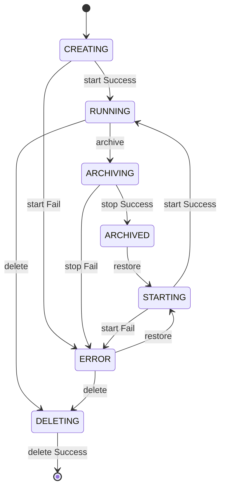

# Workspace-стенды: контейнер с dind, OpenCode и VS Code

Workspace — это **мультипроектная сессия OpenCode** (`tip = workspace`). Вместо
одного юнита она разворачивает набор проектов в один dind-контейнер с OpenCode
и отдельным multi-root VS Code, а дальше ведёт диалог так же, как обычная
сессия: ходы, вопросы, ответы, прогресс, история и уведомления.

- контракты потоков и единственный источник истины —
  [`plans/workspace-contracts.md`](plans/workspace-contracts.md:1);
- проектный план и решения —
  [`plans/opencode-workspaces.md`](plans/opencode-workspaces.md:1);
- общая механика сессий и ходов —
  [`docs/opencode-sessions.md`](opencode-sessions.md:1);
- раскладка и активности Go-раннера — `docs/workspaces.md` в репозитории
  `unitman-runner` (`../../go/src/unitman-runner/docs/workspaces.md`).

## 1. Границы модулей

```
OpenCode --(Acl/UnitmanAdapter, UnitmanApi)--> Unitman
OpenCode --(Acl/RunnerAdapter, RunnerApi)----> Runner
Runner   --(Acl/UnitmanAdapter, UnitmanApi)--> Unitman
Unitman  --X--> OpenCode (запрещено)
```

- `OpenCode` не импортирует внутренности `Unitman` и `Runner` — только
  публичные `UnitmanApi` и `RunnerApiInterface` через собственные `Acl`;
- `Unitman` ничего не знает про OpenCode;
- токен проекта не покидает Runner: OpenCode передаёт только `projectId`,
  токенизированный URL добавляет `RunnerApi` внутри workflow.

## 2. Модель данных

Workspace — это `SessiyaOpenCode` с `tip = workspace`, поэтому
`unit_id`/`unit_project_id` у неё всегда `null`, а `title` — название
workspace. Дополнительные таблицы:

```sql
alter table opencode_session
    add column if not exists tip varchar(16) not null default 'unit';

create unique index if not exists opencode_workspace_name_uq
    on opencode_session (account_id, title)
    where tip = 'workspace';

create table if not exists opencode_workspace (
    session_id                  varchar(64)  not null primary key,
    branch                      varchar(256) not null,
    status                      varchar(32)  not null,
    read_only                   boolean      not null default false,
    initial_prompt              text         not null,
    initial_prompt_started_at   integer      default null,
    error_key                   varchar(128) default null,
    operation                   varchar(32)  not null,  -- create|start|stop|delete
    operation_workflow_id       varchar(64)  not null,
    operation_attempts          integer      not null default 0,
    next_attempt_at             integer      not null default 0,
    created_at                  integer      not null,
    updated_at                  integer      not null
);
create index if not exists opencode_workspace_status_idx
    on opencode_workspace (status, next_attempt_at);

create table if not exists opencode_workspace_project (
    session_id      varchar(64)  not null,
    project_id      varchar(64)  not null,
    project_name    varchar(256) not null,  -- снимок человекочитаемого имени
    project_code    varchar(512) not null,  -- снимок кода репозитория
    can_push        boolean      not null default false,
    position_index  integer      not null default 0,
    created_at      integer      not null,
    primary key (session_id, project_id)
);

create table if not exists opencode_workspace_unit (
    workspace_id    varchar(64)  not null,
    unit_id         varchar(64)  not null,
    project_id      varchar(64)  not null,
    unit_name       varchar(128) not null,
    branch          varchar(256) not null default '',
    created_at      integer      not null,
    primary key (workspace_id, unit_id)
);

alter table opencode_notification
    add column if not exists session_type varchar(16) not null default 'unit';
```

`project_name`/`project_code` — снимок на момент создания: переименование
проекта в Unitman не ломает уже созданный workspace. `can_push` — снимок прав
токена Repo.

## 3. HTTP API

Все маршруты закрыты JWT; владелец проверяется внутри UseCase.

| Метод | Путь | Тело | Ответ |
|---|---|---|---|
| `POST` | `/api/opencode/workspace/sozdat` | `name, branch, projectIds[], prompt, credentialId` | `{id, status}` |
| `POST` | `/api/opencode/workspace/sozdatUniti` | `workspaceId` | `{units: WorkspaceUnit[]}` |
| `GET` | `/api/opencode/workspace/spisok` | query `onlyActive`, `search` | массив workspace |
| `POST` | `/api/opencode/workspace/sostoyanie` | `workspaceId` | состояние workspace |
| `POST` | `/api/opencode/workspace/arhivirovat` | `workspaceId, force?` | `{requiresConfirmation, dirtyProjects, status}` |
| `POST` | `/api/opencode/workspace/vosstanovit` | `workspaceId` | `{status}` |
| `POST` | `/api/opencode/workspace/udalit` | `workspaceId` | `data: null` |

Промпты и ответы используют существующие маршруты с `sessionId = workspaceId`:
`/api/opencode/prompt`, `/api/opencode/otvetit`,
`/api/opencode/poluchitResultatHoda`, `/api/opencode/poluchitProgressHoda`,
`/api/opencode/istoriyaSessii`.

Список сессий `/api/opencode/spisokSessiy` принимает `type=unit|workspace` и
отдаёт у элемента `type`, `workspace` и `ideLink`.

### 3.1 Создание юнитов

`POST /api/opencode/workspace/sozdatUniti` создаёт по одному юниту на каждый
проект workspace. Перед записью Unitman читает `unitman.yaml` всех проектов и
сопоставляет `helper.projectId` с проектами workspace по `projectId` или коду
проекта. Если хелпер указывает на другой проект workspace, переменной
подставляется ссылка на его юнит, а в `svyazi` пишется `targetUnitId`.

Юниты запускаются штатным конвейером: сборка, подготовка, запуск. Результат
сохраняется в `opencode_workspace_unit`; карточка workspace показывает чипсы
созданных юнитов и ведёт на страницу юнитов с фильтром `unitIds`.

Повторный вызов запрещён: при непустом списке units возвращается
`opencode.workspace.units_already_created`, а действие в интерфейсе скрыто.

### 3.2 Состояние workspace

```json
{
  "id": "8f1e...",
  "name": "payments-refactor",
  "branch": "feature/payments",
  "status": "RUNNING",
  "readOnly": false,
  "archived": false,
  "archiveReason": null,
  "errorKey": null,
  "projects": [
    { "projectId": "3d7a...", "projectName": "api", "canPush": true }
  ],
  "ideLink": "https://47000.payments-refactor-1a2b3c4d.workspaces.example.com",
  "canAcceptMessages": true,
  "lastTurnId": "a71c...",
  "lastTurnStatus": "ANSWERED"
}
```

`canAcceptMessages = status === RUNNING && !archived &&` последний ход не
`RUNNING`.

## 4. Жизненный цикл



| Статус | Смысл |
|---|---|
| `CREATING` | контейнер и проекты разворачиваются |
| `RUNNING` | ходы разрешены |
| `ARCHIVING` / `ARCHIVED` | контейнер остановлен, данные и тома сохранены |
| `STARTING` | контейнер поднимается после архива |
| `DELETING` | выполняется финальное удаление |
| `ERROR` | операция не удалась; можно восстановить или удалить |

Переходы выполняет фоновая задача `ObrabotkaWorkspaceBackgroundJob`
(`opencode_workspace_reconcile`, задержка 5 секунд, `getProcessNum(): 1`):

| Статус | Действие |
|---|---|
| `CREATING` | опрос `poluchitResultatZapuskaWorkspace`; успех → `RUNNING` + первый промпт; ошибка → `ERROR` |
| `STARTING` | тот же результат; успех → `RUNNING` + `snovaAktivna`; ошибка → `ERROR` |
| `ARCHIVING` | опрос `poluchitResultatOstanovkiWorkspace`; успех → `ARCHIVED`; ошибка → `ERROR` |
| `DELETING` | опрос `poluchitResultatUdaleniyaWorkspace`; успех → `deleteWorkspace`; ошибка → `ERROR` |
| `RUNNING` | первый промпт, если `initialPromptStartedAt = null` |

В выборку для сверки попадают и **архивные** сессии с транзитным статусом
workspace: удаление архива (`ARCHIVED → DELETING`) и восстановление из архива
(`ARCHIVED → STARTING`) иначе никто бы не досверял, и они навсегда залипали бы
в `DELETING`/`STARTING`.

Защита от двойной обработки — атомарный `perevestiStatusWorkspace` с
ожидаемыми статусами.

### 4.1 Создание

1. владелец `credentialId` проверяется как в обычной сессии;
2. имя, ветка и список проектов нормализуются (`MAX_WORKSPACE_PROJECTS = 20`);
3. `UnitmanApi::poluchitProektiDlyaWorkspace()` проверяет доступ и считает
   `canPush`;
4. `SessiyaOpenCode::createWorkspace()` фиксирует снимок проектов,
   `readOnly = true`, если хотя бы у одного `canPush = false`;
5. сессия сохраняется, затем `UmeetUpravlyatWorkspace::zapustit()` стартует
   Temporal workflow;
6. первый промпт запускает фоновая задача после успешного создания контейнера.

Ошибка старта не теряет workspace: статус становится `ERROR`, `error_key`
сохраняется, id всё равно возвращается, чтобы UI показал причину.

## 5. Архив, восстановление и удаление

### 5.1 Архив

Архив — это **логический статус `ARCHIVED` плюс `docker compose stop`**.
Данные, контейнер и тома не удаляются.

| Что | Где живёт | Переживает архив |
|---|---|---|
| файлы проектов | том `workspace_<WorkspaceId>_app` | да |
| данные вложенного Docker | том `workspace_<WorkspaceId>_docker` | да |
| состояние OpenCode CLI | том `workspace_<WorkspaceId>_opencode` | да |
| контейнер и его writable layer | Docker | да, остановлен |
| `compose.yaml`, `.env`, скрипты | каталог `workspaces/<WorkspaceId>` | да |
| сессия, проекты, ходы, уведомления | PostgreSQL | да |

Перед архивом `ArhivirovatWorkspaceUseCase` вызывает
`poluchitIzmeneniya()`. Если есть незакоммиченные файлы и `force = false`,
возвращается `requiresConfirmation = true` и `dirtyProjects[]`; ничего не
меняется. При `force = true` или чистом дереве выполняется переход
`RUNNING|ERROR → ARCHIVING` и стартует workflow остановки.

Повторный архив уже архивного workspace идемпотентен и не создаёт workflow.

### 5.2 Восстановление

`VosstanovitWorkspaceUseCase` разрешает статусы `ARCHIVED` и `ERROR`,
атомарно переводит в `STARTING` и вызывает `docker compose start` через
workflow. Проекты повторно не клонируются, первый промпт повторно не
запускается. Если OpenCode CLI потерял локальную сессию, `CLIExecutor`
создаст новую и передаст историю из БД.

### 5.3 Удаление

`UdalitWorkspaceUseCase` атомарно переводит в `DELETING` и запускает workflow,
который выполняет `docker compose down -v --remove-orphans`, удаляет каталог и
именованные тома. После успешной активности фоновая задача вызывает
`deleteWorkspace()` и удаляет в одной транзакции
`opencode_workspace_project`, `opencode_workspace`, `opencode_turn`,
`opencode_notification` и `opencode_session`.

## 6. Режим только-чтение

`canPush` вычисляется Unitman в `StorageApiAdapter::canPush()`:

- GitLab: `project_access.access_level >= 30` или
  `group_access.access_level >= 30`;
- GitHub: `permissions.push === true`.

Если у хотя бы одного проекта `canPush = false`:

- `ZapustitWorkspace.ReadOnly = true`;
- `workspace-repo-sync.sh` клонирует проект с токеном, затем удаляет токен из
  `origin` и ставит `pre-push`-хук, запрещающий push;
- OpenCode получает инструкцию не делать `git commit`/`git push`;
- API отдаёт `readOnly = true` и `projects[].canPush = false`.

Это best-effort: защищённые ветки могут запретить push даже при формальном
праве.

## 7. Тома и раскладка на хосте

```text
<RUNNER_WORK_DIR>/workspaces/<WorkspaceId>/
  Dockerfile
  compose.yaml
  .env
  seed/
  entrypoint.sh
  workspace-repo-sync.sh
  ide/
```

Внутри `/workspace` каждый проект лежит в каталоге **`<ProjectId>`** — это
исключает коллизии человекочитаемых имён. Человекочитаемое имя попадает в
`/workspace/workspace.code-workspace` как `name` папки:

```json
{
  "folders": [
    { "path": "/workspace/3d7a...", "name": "api" },
    { "path": "/workspace/5c1b...", "name": "web" }
  ]
}
```

Именованные тома:

```text
workspace_<WorkspaceId>_app
workspace_<WorkspaceId>_docker
workspace_<WorkspaceId>_opencode
```

Они создаются до `compose up` и переживают `docker compose down` без `-v`.
Cleanup хостового Docker выполняет только `docker image prune -af` и
`docker builder prune -af`, поэтому остановленные workspace не теряют образы и
тома.

## 8. Ссылка на VS Code

Workspace привязан к раннеру через `workspace_runner`; в контракте v2 ссылка
строится по публичному адресу (`publicAddress`) этого раннера, который задаёт
администратор. Псевдо-проект — `workspaces`:

```text
{scheme}://{idePort}.{workspaceSlug}.workspaces.{publicAddressHost}[:{proxyPort}]
```

`publicAddressHost` — host (и необязательный порт) из `publicAddress` раннера.

`workspaceSlug = slug(name) + '-' + первые 8 символов id`, только `[a-z0-9-]`,
максимум 48 символов. `container_name` в compose —
`${UNITMAN_WORKSPACE_SLUG}.workspaces`, поэтому proxy раннера находит
контейнер по поддомену. Default/fallback host запрещён: workspace без
привязки к активному раннеру или раннер без `publicAddress` не может быть
выбран — это явная доменная ошибка, а не подстановка чужого адреса.

## 9. Ходы и уведомления

Для workspace `ZapuskatelHodaOpenCode` не захватывает юниты, не перезаписывает
название через `podpisatPoPromptu` и передаёт `WorkspaceKontekst`
(`workspaceId`, `readOnly`, `projects`) в `RunnerAdapter`. Гейт
`PropuskHodaOpenCode` разрешает ход только при `status = RUNNING`; архивный
workspace отклоняется существующим `opencode.session.archived`, не-`RUNNING` —
`opencode.workspace.not_running`.

Уведомления переиспользуют `opencode_notification` с `session_type =
workspace`; payload:

```json
{
  "eventType": "new_message",
  "id": "...",
  "sessionId": "...",
  "sessionType": "workspace",
  "turnId": "...",
  "sessionTitle": "payments-refactor",
  "status": "ANSWERED",
  "kind": "ANSWER",
  "createdAt": 1762000000
}
```

## 10. Контракт Runner

`RunnerApiInterface` расширен семью методами:

```php
public function zapustitWorkspace(string $workflowId, ZapustitWorkspaceZapros $command): string;
public function poluchitResultatZapuskaWorkspace(string $workflowId): ?ResultatZapuskaWorkspace;

public function ostanovitWorkspace(string $workflowId, OstanovitWorkspace $command): string;
public function poluchitResultatOstanovkiWorkspace(string $workflowId): ?ResultatOstanovkiWorkspace;

public function udalitWorkspace(string $workflowId, UdalitWorkspace $command): string;
public function poluchitResultatUdaleniyaWorkspace(string $workflowId): ?ResultatUdaleniyaWorkspace;

public function proveritIzmeneniyaWorkspace(
    ProveritIzmeneniyaWorkspace $command,
): ResultatProverkiIzmeneniyWorkspace;
```

`ZapustitWorkspaceZapros` содержит только `WorkspaceId`, `WorkspaceName`,
`WorkspaceSlug`, `Branch`, `ReadOnly`, `MemoryLimit`, `Projects[]`
(`ProjectId`, `ProjectName`, `ProjectCode`, `CanPush`) — **без `StorageUrl`**.
Внутренняя команда `ZapustitWorkspace` (`ProjectWorkspaceCommand`) добавляет
`StorageUrl` с токеном и уходит только в Temporal.

Workflow: `ZapustitWorkspaceWorkflow`, `OstanovitWorkspaceWorkflow`,
`UdalitWorkspaceWorkflow`, `ProveritIzmeneniyaWorkspaceWorkflow` (очередь
`monoQueue`, синхронная проверка изменений с таймаутом 30 секунд), регистрация
в [`config/workflows.php`](config/workflows.php:1).

`ProveritIzmeneniyaWorkspaceActivity` выполняет `git status --porcelain` в
каждом проекте; пустой вывод — чисто, иначе `Dirty = true` и `Files[]`.

## 11. Ошибки

Ключи `opencode.workspace.*` (в `ru` и `en`):

```text
name_required, name_too_long, name_already_exists,
branch_required, branch_too_long,
projects_required, too_many_projects, project_not_found, project_conflict,
prompt_required, not_found, not_running, archived,
uncommitted_changes, confirmation_required,
delete_in_progress, operation_failed, initial_prompt_failed,
project_branch_not_found, project_clone_failed, read_only_push_forbidden
```

## 12. Проверки

1. `php bin/console cache:clear` (в контейнере, `--env=test` и обычный).
2. `php bin/console doctrine:migrations:migrate`.
3. `composer check-deptrac` и `composer check-opencode-deptrac`.
4. `php bin/console app:translations:audit`.
5. `composer openapi-dump` — контракт в [`docs/openapi.json`](openapi.json:1).
6. `php vendor/bin/phpunit` (полный прогон).
7. `rr reset` — после изменений workflow/DI.
8. В Go: `go test ./...`, `go vet ./...`.
9. E2E: создание workspace с токеном без push (`readOnly = true`,
   `pre-push` блокирует push), архив (`docker compose stop`, тома на месте),
   restore (`docker compose start`), удаление (каталог, тома и записи БД
   исчезли).
