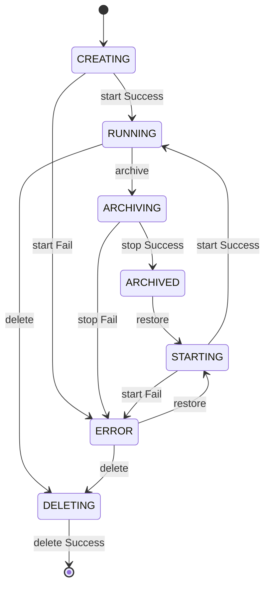

# Workspace-стенды: контейнер с dind, OpenCode и VS Code

Workspace — это **мультипроектная сессия OpenCode** (`tip = workspace`). Вместо
одного юнита она разворачивает набор проектов в один dind-контейнер с OpenCode
и отдельным multi-root VS Code, а дальше ведёт диалог так же, как обычная
сессия: ходы, вопросы, ответы, прогресс, история и уведомления.

- контракты потоков и единственный источник истины —
  [`plans/workspace-contracts.md`](plans/workspace-contracts.md:1);
- проектный план и решения —
  [`plans/opencode-workspaces.md`](plans/opencode-workspaces.md:1);
- общая механика сессий и ходов —
  [`docs/opencode-sessions.md`](opencode-sessions.md:1);
- раскладка и активности Go-раннера — `docs/workspaces.md` в репозитории
  `unitman-runner` (`../../go/src/unitman-runner/docs/workspaces.md`).

## 1. Границы модулей

```
OpenCode --(Acl/UnitmanAdapter, UnitmanApi)--> Unitman
OpenCode --(Acl/RunnerAdapter, RunnerApi)----> Runner
Runner   --(Acl/UnitmanAdapter, UnitmanApi)--> Unitman
Unitman  --X--> OpenCode (запрещено)
```

- `OpenCode` не импортирует внутренности `Unitman` и `Runner` — только
  публичные `UnitmanApi` и `RunnerApiInterface` через собственные `Acl`;
- `Unitman` ничего не знает про OpenCode;
- токен проекта не покидает Runner: OpenCode передаёт только `projectId`,
  токенизированный URL добавляет `RunnerApi` внутри workflow.

## 2. Модель данных

Workspace — это `SessiyaOpenCode` с `tip = workspace`, поэтому
`unit_id`/`unit_project_id` у неё всегда `null`, а `title` — название
workspace. Дополнительные таблицы:

```sql
alter table opencode_session
    add column if not exists tip varchar(16) not null default 'unit';

create unique index if not exists opencode_workspace_name_uq
    on opencode_session (account_id, title)
    where tip = 'workspace';

create table if not exists opencode_workspace (
    session_id                  varchar(64)  not null primary key,
    branch                      varchar(256) not null,
    status                      varchar(32)  not null,
    read_only                   boolean      not null default false,
    initial_prompt              text         not null,
    initial_prompt_started_at   integer      default null,
    error_key                   varchar(128) default null,
    operation                   varchar(32)  not null,  -- create|start|stop|delete
    operation_workflow_id       varchar(64)  not null,
    operation_attempts          integer      not null default 0,
    next_attempt_at             integer      not null default 0,
    created_at                  integer      not null,
    updated_at                  integer      not null
);
create index if not exists opencode_workspace_status_idx
    on opencode_workspace (status, next_attempt_at);

create table if not exists opencode_workspace_project (
    session_id      varchar(64)  not null,
    project_id      varchar(64)  not null,
    project_name    varchar(256) not null,  -- снимок человекочитаемого имени
    project_code    varchar(512) not null,  -- снимок кода репозитория
    can_push        boolean      not null default false,
    position_index  integer      not null default 0,
    created_at      integer      not null,
    primary key (session_id, project_id)
);

create table if not exists opencode_workspace_unit (
    workspace_id    varchar(64)  not null,
    unit_id         varchar(64)  not null,
    project_id      varchar(64)  not null,
    unit_name       varchar(128) not null,
    branch          varchar(256) not null default '',
    created_at      integer      not null,
    primary key (workspace_id, unit_id)
);

alter table opencode_notification
    add column if not exists session_type varchar(16) not null default 'unit';
```

`project_name`/`project_code` — снимок на момент создания: переименование
проекта в Unitman не ломает уже созданный workspace. `can_push` — снимок прав
токена Repo.

Соавторство живёт в отдельных таблицах и не меняет `opencode_workspace`:

```sql
-- Version20261127130000: роли и личные реквизиты участников
create table opencode_session_participant (
    session_id            varchar(64)  not null,
    account_id            varchar(128) not null,
    role                  varchar(16)  not null,  -- owner|writer|viewer
    default_credential_id varchar(64)  null,
    default_model         varchar(128) null,
    invited_by            varchar(128) null,
    ...
    primary key (session_id, account_id)
);

-- Version20261127140000: резервация сессии под активный ход, TTL 900 секунд
create table opencode_session_running_turn (...);

alter table opencode_turn
    add column author_account_id   varchar(128) not null default '',
    add column credential_id       varchar(64)  not null default '',
    add column author_display_name varchar(256) not null default '';
```

Владелец остаётся в `opencode_session.account_id` и дублируется строкой с ролью
`owner`; частичный уникальный индекс допускает ровно одного владельца на
сессию. Если строки участника ещё нет, владелец считается неявным `owner`.

## 3. HTTP API

Все маршруты закрыты JWT; доступ проверяется внутри UseCase по участию в
workspace (см. §3.3).

| Метод | Путь | Тело | Ответ |
|---|---|---|---|
| `POST` | `/api/opencode/workspace/sozdat` | `name, branch, projectIds[], prompt, credentialId` | `{id, status}` |
| `POST` | `/api/opencode/workspace/sozdatUniti` | `workspaceId` | `{units: WorkspaceUnit[]}` |
| `GET` | `/api/opencode/workspace/spisok` | query `onlyActive`, `search` | массив workspace |
| `POST` | `/api/opencode/workspace/sostoyanie` | `workspaceId` | состояние workspace |
| `POST` | `/api/opencode/workspace/arhivirovat` | `workspaceId, force?` | `{requiresConfirmation, dirtyProjects, status}` |
| `POST` | `/api/opencode/workspace/vosstanovit` | `workspaceId` | `{status}` |
| `POST` | `/api/opencode/workspace/udalit` | `workspaceId` | `data: null` |
| `POST` | `/api/opencode/workspace/uchastniki/spisok` | `workspaceId` | `{items: Participant[]}` |
| `POST` | `/api/opencode/workspace/uchastniki/dobavit` | `workspaceId, accountId, role, credentialId?, model?` | `{added: true}` |
| `POST` | `/api/opencode/workspace/uchastniki/izmenit` | `workspaceId, accountId, role, credentialId?, model?` | `{updated: true}` |
| `POST` | `/api/opencode/workspace/uchastniki/udalit` | `workspaceId, accountId` | `{removed: true}` |

Промпты и ответы используют существующие маршруты с `sessionId = workspaceId`:
`/api/opencode/prompt`, `/api/opencode/otvetit`,
`/api/opencode/poluchitResultatHoda`, `/api/opencode/poluchitProgressHoda`,
`/api/opencode/istoriyaSessii`.

Список сессий `/api/opencode/spisokSessiy` принимает `type=unit|workspace` и
отдаёт у элемента `type`, `workspace` и `ideLink`.

### 3.1 Создание юнитов

`POST /api/opencode/workspace/sozdatUniti` создаёт по одному юниту на каждый
проект workspace. Перед записью Unitman читает `unitman.yaml` всех проектов и
сопоставляет `helper.projectId` с проектами workspace по `projectId` или коду
проекта. Если хелпер указывает на другой проект workspace, переменной
подставляется ссылка на его юнит, а в `svyazi` пишется `targetUnitId`.

Юниты запускаются штатным конвейером: сборка, подготовка, запуск. Результат
сохраняется в `opencode_workspace_unit`; карточка workspace показывает чипсы
созданных юнитов и ведёт на страницу юнитов с фильтром `unitIds`.

Повторный вызов запрещён: при непустом списке units возвращается
`opencode.workspace.units_already_created`, а действие в интерфейсе скрыто.

### 3.2 Состояние workspace

```json
{
  "id": "8f1e...",
  "name": "payments-refactor",
  "branch": "feature/payments",
  "status": "RUNNING",
  "readOnly": false,
  "archived": false,
  "archiveReason": null,
  "errorKey": null,
  "projects": [
    { "projectId": "3d7a...", "projectName": "api", "canPush": true }
  ],
  "ideLink": "https://47000.payments-refactor-1a2b3c4d.workspaces.example.com",
  "canAcceptMessages": true,
  "lastTurnId": "a71c...",
  "lastTurnStatus": "ANSWERED",
  "myRole": "owner",
  "canManage": true,
  "participants": [
    { "accountId": "8f1e...", "role": "owner", "owner": true, "displayName": "Алиса" },
    { "accountId": "2c9a...", "role": "writer", "owner": false, "displayName": "Борис" }
  ],
  "myDefaultCredentialId": "b1c2...",
  "myDefaultModel": "gpt-4o"
}
```

`canAcceptMessages` учитывает роль и занятость: `myRole ∈ {owner, writer}`,
`status === RUNNING`, сессия не в архиве, нет обновления проектов/файлов,
последний ход не `RUNNING` и нет свежей резервации хода. `myDefaultCredentialId`
и `myDefaultModel` — личные реквизиты текущего пользователя, которые UI
предвыбирает для промпта.

### 3.3 Участники и роли

| Роль | Права |
|---|---|
| `owner` | управление workspace, состав участников, промпты и ответы |
| `writer` | промпты и ответы, чтение |
| `viewer` | только чтение: история, состояние, прогресс, артефакты, ссылка IDE |

Владелец — неявный `owner`, если строки участника ещё нет. Приглашение
доступно только владельцу, только аккаунту с доступом ко всем проектам и не
более 20 участников; владельца нельзя удалить или понизить. Каждый ход
списывает реквизиты своего автора (см. §9). Пока ход активен, сессия
зарезервирована с TTL 900 секунд: второй промпт получает
`opencode.session.busy`, резервация снимается на терминальном статусе, включая
`AWAITING_INPUT`. Доступ автора ко всем проектам перепроверяется на каждом
ходе — потеря доступа даёт `opencode.workspace.project_access_revoked`.

## 4. Жизненный цикл



| Статус | Смысл |
|---|---|
| `CREATING` | контейнер и проекты разворачиваются |
| `RUNNING` | ходы разрешены |
| `ARCHIVING` / `ARCHIVED` | контейнер остановлен, данные и тома сохранены |
| `STARTING` | контейнер поднимается после архива |
| `DELETING` | выполняется финальное удаление |
| `ERROR` | операция не удалась; можно восстановить или удалить |

Переходы выполняет фоновая задача `ObrabotkaWorkspaceBackgroundJob`
(`opencode_workspace_reconcile`, задержка 5 секунд, `getProcessNum(): 1`):

| Статус | Действие |
|---|---|
| `CREATING` | опрос `poluchitResultatZapuskaWorkspace`; успех → `RUNNING` + первый промпт; ошибка → `ERROR` |
| `STARTING` | тот же результат; успех → `RUNNING` + `snovaAktivna`; ошибка → `ERROR` |
| `ARCHIVING` | опрос `poluchitResultatOstanovkiWorkspace`; успех → `ARCHIVED`; ошибка → `ERROR` |
| `DELETING` | опрос `poluchitResultatUdaleniyaWorkspace`; успех → `deleteWorkspace`; ошибка → `ERROR` |
| `RUNNING` | первый промпт, если `initialPromptStartedAt = null` |

В выборку для сверки попадают и **архивные** сессии с транзитным статусом
workspace: удаление архива (`ARCHIVED → DELETING`) и восстановление из архива
(`ARCHIVED → STARTING`) иначе никто бы не досверял, и они навсегда залипали бы
в `DELETING`/`STARTING`.

Защита от двойной обработки — атомарный `perevestiStatusWorkspace` с
ожидаемыми статусами.

### 4.1 Создание

1. владелец `credentialId` проверяется как в обычной сессии;
2. имя, ветка и список проектов нормализуются (`MAX_WORKSPACE_PROJECTS = 20`);
3. `UnitmanApi::poluchitProektiDlyaWorkspace()` проверяет доступ и считает
   `canPush`;
4. `SessiyaOpenCode::createWorkspace()` фиксирует снимок проектов,
   `readOnly = true`, если хотя бы у одного `canPush = false`;
5. сессия сохраняется, затем `UmeetUpravlyatWorkspace::zapustit()` стартует
   Temporal workflow;
6. первый промпт запускает фоновая задача после успешного создания контейнера.

Ошибка старта не теряет workspace: статус становится `ERROR`, `error_key`
сохраняется, id всё равно возвращается, чтобы UI показал причину.

## 5. Архив, восстановление и удаление

### 5.1 Архив

Архив — это **логический статус `ARCHIVED` плюс `docker compose stop`**.
Данные, контейнер и тома не удаляются.

| Что | Где живёт | Переживает архив |
|---|---|---|
| файлы проектов | том `workspace_<WorkspaceId>_app` | да |
| данные вложенного Docker | том `workspace_<WorkspaceId>_docker` | да |
| состояние OpenCode CLI | том `workspace_<WorkspaceId>_opencode` | да |
| контейнер и его writable layer | Docker | да, остановлен |
| `compose.yaml`, `.env`, скрипты | каталог `workspaces/<WorkspaceId>` | да |
| сессия, проекты, ходы, уведомления | PostgreSQL | да |

Перед архивом `ArhivirovatWorkspaceUseCase` вызывает
`poluchitIzmeneniya()`. Если есть незакоммиченные файлы и `force = false`,
возвращается `requiresConfirmation = true` и `dirtyProjects[]`; ничего не
меняется. При `force = true` или чистом дереве выполняется переход
`RUNNING|ERROR → ARCHIVING` и стартует workflow остановки.

Повторный архив уже архивного workspace идемпотентен и не создаёт workflow.

### 5.2 Восстановление

`VosstanovitWorkspaceUseCase` разрешает статусы `ARCHIVED` и `ERROR`,
атомарно переводит в `STARTING` и вызывает `docker compose start` через
workflow. Проекты повторно не клонируются, первый промпт повторно не
запускается. Если OpenCode CLI потерял локальную сессию, `CLIExecutor`
создаст новую и передаст историю из БД.

### 5.3 Удаление

`UdalitWorkspaceUseCase` атомарно переводит в `DELETING` и запускает workflow,
который выполняет `docker compose down -v --remove-orphans`, удаляет каталог и
именованные тома. После успешной активности фоновая задача вызывает
`deleteWorkspace()` и удаляет в одной транзакции
`opencode_workspace_project`, `opencode_workspace`, `opencode_turn`,
`opencode_notification` и `opencode_session`.

## 6. Режим только-чтение

`canPush` вычисляется Unitman в `StorageApiAdapter::canPush()`:

- GitLab: `project_access.access_level >= 30` или
  `group_access.access_level >= 30`;
- GitHub: `permissions.push === true`.

Если у хотя бы одного проекта `canPush = false`:

- `ZapustitWorkspace.ReadOnly = true`;
- `workspace-repo-sync.sh` клонирует проект с токеном, затем удаляет токен из
  `origin` и ставит `pre-push`-хук, запрещающий push;
- OpenCode получает инструкцию не делать `git commit`/`git push`;
- API отдаёт `readOnly = true` и `projects[].canPush = false`.

Это best-effort: защищённые ветки могут запретить push даже при формальном
праве.

## 7. Тома и раскладка на хосте

```text
<RUNNER_WORK_DIR>/workspaces/<WorkspaceId>/
  Dockerfile
  compose.yaml
  .env
  seed/
  entrypoint.sh
  workspace-repo-sync.sh
  ide/
```

Внутри `/workspace` каждый проект лежит в каталоге **`<ProjectId>`** — это
исключает коллизии человекочитаемых имён. Человекочитаемое имя попадает в
`/workspace/workspace.code-workspace` как `name` папки:

```json
{
  "folders": [
    { "path": "/workspace/3d7a...", "name": "api" },
    { "path": "/workspace/5c1b...", "name": "web" }
  ]
}
```

Именованные тома:

```text
workspace_<WorkspaceId>_app
workspace_<WorkspaceId>_docker
workspace_<WorkspaceId>_opencode
```

Они создаются до `compose up` и переживают `docker compose down` без `-v`.
Cleanup хостового Docker выполняет только `docker image prune -af` и
`docker builder prune -af`, поэтому остановленные workspace не теряют образы и
тома.

## 8. Ссылка на VS Code

Workspace привязан к раннеру через `workspace_runner`; в контракте v2 ссылка
строится по публичному адресу (`publicAddress`) этого раннера, который задаёт
администратор. Псевдо-проект — `workspaces`:

```text
{scheme}://{idePort}.{workspaceSlug}.workspaces.{publicAddressHost}[:{proxyPort}]
```

`publicAddressHost` — host (и необязательный порт) из `publicAddress` раннера.

`workspaceSlug = slug(name) + '-' + первые 8 символов id`, только `[a-z0-9-]`,
максимум 48 символов. `container_name` в compose —
`${UNITMAN_WORKSPACE_SLUG}.workspaces`, поэтому proxy раннера находит
контейнер по поддомену. Default/fallback host запрещён: workspace без
привязки к активному раннеру или раннер без `publicAddress` не может быть
выбран — это явная доменная ошибка, а не подстановка чужого адреса.

Ссылку может получить любой участник (`viewer` и выше): адрес строится от имени
текущего пользователя, а ACL Unitman сам проверяет его доступ к проектам. IDE
остаётся read-only (том `workspace_app:/home/coder/workspace:ro`,
`--auth none`), поэтому ссылка — bearer-capability: аутентифицированный прокси и
режим совместного редактирования — следующая фаза.

## 9. Ходы и уведомления

Для workspace `ZapuskatelHodaOpenCode` не захватывает юниты, не перезаписывает
название через `podpisatPoPromptu` и передаёт `WorkspaceKontekst`
(`workspaceId`, `readOnly`, `projects`) в `RunnerAdapter`. Гейт
`PropuskHodaOpenCode` разрешает ход только при `status = RUNNING`; архивный
workspace отклоняется существующим `opencode.session.archived`, не-`RUNNING` —
`opencode.workspace.not_running`.

Ход всегда списывает реквизиты своего автора: `credentialId` из запроса →
`default_credential_id` участника → реквизиты сессии только владельцу → первые
реквизиты автора. Перед стартом проверяется владение ключом и доступ автора ко
всем проектам (`opencode.workspace.project_access_revoked`). Сессия
резервируется на время хода (`opencode_session_running_turn`, TTL 900 секунд):
второй промпт получает `opencode.session.busy`, резервация снимается на
терминальном статусе, включая `AWAITING_INPUT`.

Уведомления переиспользуют `opencode_notification` с `session_type =
workspace` и рассылаются всем участникам, кроме автора хода (строки уникальны
по `(turn_id, account_id)`); payload:

```json
{
  "eventType": "new_message",
  "id": "...",
  "sessionId": "...",
  "sessionType": "workspace",
  "turnId": "...",
  "sessionTitle": "payments-refactor",
  "status": "ANSWERED",
  "kind": "ANSWER",
  "createdAt": 1762000000
}
```

## 10. Контракт Runner

`RunnerApiInterface` расширен семью методами:

```php
public function zapustitWorkspace(string $workflowId, ZapustitWorkspaceZapros $command): string;
public function poluchitResultatZapuskaWorkspace(string $workflowId): ?ResultatZapuskaWorkspace;

public function ostanovitWorkspace(string $workflowId, OstanovitWorkspace $command): string;
public function poluchitResultatOstanovkiWorkspace(string $workflowId): ?ResultatOstanovkiWorkspace;

public function udalitWorkspace(string $workflowId, UdalitWorkspace $command): string;
public function poluchitResultatUdaleniyaWorkspace(string $workflowId): ?ResultatUdaleniyaWorkspace;

public function proveritIzmeneniyaWorkspace(
    ProveritIzmeneniyaWorkspace $command,
): ResultatProverkiIzmeneniyWorkspace;
```

`ZapustitWorkspaceZapros` содержит только `WorkspaceId`, `WorkspaceName`,
`WorkspaceSlug`, `Branch`, `ReadOnly`, `MemoryLimit`, `Projects[]`
(`ProjectId`, `ProjectName`, `ProjectCode`, `CanPush`) — **без `StorageUrl`**.
Внутренняя команда `ZapustitWorkspace` (`ProjectWorkspaceCommand`) добавляет
`StorageUrl` с токеном и уходит только в Temporal.

Workflow: `ZapustitWorkspaceWorkflow`, `OstanovitWorkspaceWorkflow`,
`UdalitWorkspaceWorkflow`, `ProveritIzmeneniyaWorkspaceWorkflow` (очередь
`monoQueue`, синхронная проверка изменений с таймаутом 30 секунд), регистрация
в [`config/workflows.php`](config/workflows.php:1).

`ProveritIzmeneniyaWorkspaceActivity` выполняет `git status --porcelain` в
каждом проекте; пустой вывод — чисто, иначе `Dirty = true` и `Files[]`.

## 11. Ошибки

Ключи `opencode.workspace.*` (в `ru` и `en`):

```text
name_required, name_too_long, name_already_exists,
branch_required, branch_too_long,
projects_required, too_many_projects, project_not_found, project_conflict,
prompt_required, not_found, not_running, archived,
uncommitted_changes, confirmation_required,
delete_in_progress, operation_failed, initial_prompt_failed,
project_branch_not_found, project_clone_failed, read_only_push_forbidden,
project_access_revoked
```

Участники и доступ к сессии (`opencode.participant.*`, `opencode.session.*`):

```text
participant.account_required, participant.account_too_long,
participant.already_exists, participant.already_owner,
participant.credential_too_long, participant.invalid_role,
participant.limit_exceeded, participant.model_too_long,
participant.not_found, participant.owner_cannot_be_removed,
participant.owner_conflict, participant.owner_role_immutable,
participant.project_access_denied, participant.session_required,
session.busy, session.forbidden
```

## 12. Проверки

1. `php bin/console cache:clear` (в контейнере, `--env=test` и обычный).
2. `php bin/console doctrine:migrations:migrate`.
3. `composer check-deptrac` и `composer check-opencode-deptrac`.
4. `php bin/console app:translations:audit`.
5. `composer openapi-dump` — контракт в [`docs/openapi.json`](openapi.json:1).
6. `php vendor/bin/phpunit` (полный прогон).
7. `rr reset` — после изменений workflow/DI.
8. В Go: `go test ./...`, `go vet ./...`.
9. E2E: создание workspace с токеном без push (`readOnly = true`,
   `pre-push` блокирует push), архив (`docker compose stop`, тома на месте),
   restore (`docker compose start`), удаление (каталог, тома и записи БД
   исчезли).

## 13. Файлы workspace

Файлы нужны агенту для чтения и не являются скриптами. Они попадают в
зарезервированный каталог `/workspace/unitman_files` (рядом с каталогами
проектов) и монтируются в контейнер **только для чтения** (`chmod 0444`).

```text
MEDIATEKA_WORKSPACE_ALLOWED_EXT=png,jpg,jpeg,gif,webp,txt,md,csv,tsv,json,yaml,yml,xml,log
MEDIATEKA_WORKSPACE_MAX_FILE_SIZE=52428800
MEDIATEKA_WORKSPACE_MAX_FILES=20
```

- allowlist расширений настраивается через ENV, но исполняемые и активные
  типы (`sh`, `py`, `js`, `php`, `html`, `svg`, `sql`, `exe` и т.п.) запрещены
  жёстким denylist независимо от конфига;
- изображения проверяются по сигнатуре (`getimagesize`), текст — по UTF-8 и
  отсутствию NUL-байтов;
- имена нормализуются, защищены от path traversal и не могут совпадать с
  `workspace.code-workspace` и `unitman_files`;
- загрузка идёт как черновик Mediateka: `POST /api/mediateka/workspace/upload`
  либо presign (`/api/mediateka/workspace/presign` + `finalize`). После
  загрузки файл валидируется по содержимому, невалидный объект удаляется;
- при запуске контейнера `ZapustitWorkspaceActivity` скачивает файлы на хост,
  копирует через `docker compose cp` и выставляет `0444`;
- `workspace.code-workspace` всегда содержит папку `unitman_files`, если файлы
  есть.

Пользовательские файлы учитываются в лимите `MEDIATEKA_WORKSPACE_MAX_FILES` и
отдаются в UI через `files` read-модели workspace.

## 14. Добавление проектов и файлов после создания

Обновлять можно только `RUNNING` workspace. Новый проект добавляется в
существующий контейнер без пересоздания:

1. клиент создаёт локальную ветку в хранилище тем же API, что и форма
   создания;
2. `POST /api/opencode/workspace/dobavitProekt` проверяет доступ, конфликты,
   лимит проектов и запускает `ObnovitWorkspaceActivity`;
3. `POST /api/opencode/workspace/fayly/prikrepit` привязывает черновики
   Mediateka и запускает то же обновление;
4. `POST /api/opencode/workspace/fayly/udalit` удаляет файл из контейнера.

Состояние обновления хранится в `opencode_workspace_update` и не переводит
workspace в отдельный статус: остаётся `RUNNING`, но `canAcceptMessages=false`
и в read-модели выставляется `updating=true`. Фоновая задача
`opencode_workspace_reconcile` опрашивает результат workflow:

- успех: новые проекты добавляются в снимок, файлы отмечаются применёнными,
  удалённые файлы убираются из реестра, операция и ошибка сбрасываются;
- ошибка: только что привязанные файлы откатываются, операция сбрасывается,
  выставляется `opencode.workspace.update_failed`; workspace остаётся
  `RUNNING`, пользователь может повторить попытку.

Go-раннер в `ObnovitWorkspaceActivity` клонирует **только новые** проекты,
перегенерирует `workspace.code-workspace`, применяет и удаляет файлы. Вход
содержит `NewProjects[]`, `AllProjects[]`, `Files[]` и `FilesToDelete[]`.

## 15. Вложения хода агента

Агент может вернуть вместе с ответом готовые документы: план, отчёт,
спецификацию. Содержимое файлов **не проходит через Temporal**: раннер забирает
их из контейнера и загружает на бэкенд отдельным HMAC-запросом, а в результате
хода остаются только метаданные.

### 15.1 Outbox и инструкция агенту

Для workspace-хода раннер создаёт в контейнере каталог
`/workspace/unitman_artifacts/<workflowId>/` и добавляет в промпт инструкцию:

```text
Если пользователь просит подготовить план, отчёт, спецификацию или другой документ,
сохрани итоговый файл в /workspace/unitman_artifacts/<workflowId>/<краткое-имя>.md.
Файлы из этого каталога автоматически прикрепляются к твоему ответу.
Если пользователь указал конкретный путь, сохрани файл туда и продублируй его в этот каталог.
Не помещай в каталог секреты, ключи, бинарные файлы и больше 5 файлов.
```

`/workspace/unitman_files` — входные файлы workspace, смонтированные только для
чтения; как outbox он не используется. Каталоги проектов
`/workspace/<ProjectId>` не сканируются. Вложения собираются только из каталога
текущего хода на глубине 1: подкаталоги не поддерживаются.

### 15.2 Загрузка на бэкенд

```http
POST <backend>/api/runner/opencode/artifact?workflowId=<id>&workspaceId=<id>&name=<raw name>&contentType=<mime>
X-Runner-Id: <runner id>
X-Runner-Signature: hex(HMAC-SHA256(secret, workflowId + "\n" + rawName + "\n" + rawBody))
Content-Type: application/octet-stream

<сырые байты файла>
```

- тело — raw bytes, без base64 и multipart; подпись считается по тем же байтам;
- имя в подписи — ровно то, что пришло в query; нормализация выполняется после
  проверки подписи;
- маршрут публичный по JWT и защищён подписью раннера
  ([`RunnerArtifactController`](src/OpenCode/Infra/Controller/RunnerArtifactController.php:1));
- повторная загрузка идемпотентна по паре `(turnId, name)`: уникальный
  частичный индекс возвращает существующий файл, а не создаёт дубль;
- порядок проверок: ход существует и `RUNNING` → сессия workspace → совпадение
  `workspaceId` → не архив → имя, содержимое и лимиты
  ([`PrinyatFajlHodaUseCase`](src/OpenCode/Business/UseCase/PrinyatFajlHodaUseCase.php:1)).

### 15.3 Лимиты и допустимые типы

| Лимит | Значение | Где проверяется |
|---|---|---|
| файлов на ход | 5 | раннер и use case |
| размер файла | 2 МиБ (`2097152`) | раннер, контроллер (413), use case |
| суммарный размер хода | 8 МиБ (`8388608`) | раннер и use case |
| размер для preview | 512 КиБ (`524288`) | эндпоинт текста |
| длина имени | 128 символов | раннер и нормализация имени |
| допустимые расширения | `md`, `txt`, `json`, `yaml`, `yml`, `csv`, `log` | allowlist |

Расширения настраиваются через `OPENCODE_ARTIFACT_ALLOWED_EXT`, но активные и
исполняемые типы запрещены жёстким denylist независимо от конфига: `html`,
`htm`, `xhtml`, `svg`, `js`, `mjs`, `ts`, `php`, `sh`, `py`, `exe`, `bin`, `so`,
`dll`, `bat`, `cmd`, `ps1`, `sql`.

Дополнительно отклоняются пустое содержимое, NUL-байты и невалидный UTF-8.

### 15.4 Модель хранения

Артефакт — обычный workspace-файл Mediateka (`kind = workspace`) с привязкой к
ходу:

```sql
alter table mediateka_file
    add column if not exists opencode_turn_id varchar(64) default null;

create index if not exists mediateka_file_opencode_turn_id_idx
    on mediateka_file (opencode_turn_id);

create unique index if not exists mediateka_file_turn_name_uniq
    on mediateka_file (opencode_turn_id, name)
    where opencode_turn_id is not null;
```

`NULL` в `opencode_turn_id` — обычные файлы workspace, частичный индекс их не
касается. Файл принадлежит workspace хода (`workspace_id`) и владельцу сессии
(`uploaded_by`); `applied_at` равен времени регистрации, потому что объект уже
лежит в хранилище.

Байты файла **никогда** не возвращаются через Temporal. Результат хода несёт
только метаданные:

```json
"Attachments": [
  {
    "FileId": "f1c2...",
    "Name": "plan.md",
    "Size": 1234,
    "ContentType": "text/markdown",
    "Previewable": true
  }
]
```

`Previewable` вычисляется по расширению (`md`, `txt`, `json`, `yaml`, `yml`,
`csv`, `log`). Легаси-ходы без поля читаются как `[]`.

### 15.5 Удаление

При удалении workspace артефакты удаляются best effort вместе с остальными
файлами workspace: [`ObrabotkaWorkspaceBackgroundJob`](src/OpenCode/Infra/BackgroundJob/ObrabotkaWorkspace/ObrabotkaWorkspaceBackgroundJob.php:1)
вызывает `udalitFajlyWorkspace()`, а ошибка логируется ключом
`opencode.workspace.files_delete_failed`. Сбой очистки файлов **не блокирует**
переход состояния workspace: запись сессии удаляется штатно, «осиротевшие»
объекты остаются в MinIO до ручной очистки.

### 15.6 Эндпоинты для интерфейса

Оба маршрута закрыты JWT и принимают JSON `{turnId, fileId}`. Владелец берётся
из токена; чужой ход, чужая сессия и чужой файл дают одинаковый 404, чтобы не
раскрывать существование данных.

| Метод | Путь | Ответ |
|---|---|---|
| `POST` | `/api/opencode/fajl/ssylka` | `{fileId, name, contentType, size, url}` — presigned-ссылка |
| `POST` | `/api/opencode/fajl/tekst` | `{fileId, name, contentType, content}` — текст для preview |

`/tekst` дополнительно требует previewable-расширение, размер не больше
`OPENCODE_ARTIFACT_PREVIEW_MAX_BYTES` и валидный UTF-8. Реализация —
[`OpenCodeFileController`](src/OpenCode/Infra/Controller/OpenCodeFileController.php:1)
и [`PoluchitTekstFajlaHodaQuery`](src/OpenCode/Business/UseCase/PoluchitTekstFajlaHodaQuery.php:1).

В чате workspace под ответом агента показываются имя, размер, предпросмотр
(глаз) и скачивание. Preview рендерит Markdown через `marked` и `DOMPurify`:
запрещены `script`, `style`, `iframe`, `object`, `embed`, `form`, `img`,
`video`, `audio`, `link`, `meta`, обработчики событий, `style` и `data-*`;
ссылки открываются в новой вкладке с `rel="noopener noreferrer"`. Для остальных
текстовых расширений содержимое выводится в `<pre>` без интерпретации разметки.

### 15.7 Ошибки

Ошибки загрузки от раннера:

| Ключ | HTTP |
|---|---|
| `runner.invalid_signature` | 401 |
| `runner.not_found` | 404 |
| `opencode.artifact.turn_not_found` | 404 |
| `opencode.artifact.turn_not_running` | 409 |
| `opencode.artifact.file_is_too_large` | 413 |
| `opencode.artifact.workspace_required` | 422 |
| `opencode.artifact.workspace_mismatch` | 422 |
| `opencode.artifact.workspace_archived` | 422 |
| `opencode.artifact.name_is_invalid` | 422 |
| `opencode.artifact.file_type_forbidden` | 422 |
| `opencode.artifact.content_invalid` | 422 |

## 16. Миграция на агрегат `opencode_workspace_session`

Фазы 0–3 переезда (expand, backfill, зеркало, гейт) реализованы; легаси
остаётся источником истины, API не меняется. Полный план и карта полей —
[`plans/workspace-aggregate-migration.md`](plans/workspace-aggregate-migration.md:1).

Новые таблицы (expand-миграции `Version20261127150000`,
`Version20261127151000`):

- `opencode_workspace_participant` — участники нового агрегата, FK на
  `opencode_workspace_session`, роли `owner/writer/viewer`, частичный
  уникальный индекс «ровно один owner»;
- `opencode_workspace_pending_update` — pending-обновление проектов/файлов,
  FK на сессию, payload `jsonb` 1:1 с `opencode_workspace_update`;
- `opencode_workspace_migration_journal` — журнал перенумерации `seq` (только
  целевая таблица; легаси не меняется);
- `opencode_workspace_turn` получил `author_account_id`, `credential_id`,
  `author_display_name`; уникальность `opencode_workspace_notification`
  заменена на `(turn_id, account_id)`.

Команды (все идемпотентны, легаси не пишут):

```bash
php bin/console app:opencode:workspace-migration:audit      # read-only отчёт
php bin/console app:opencode:workspace-migration:backfill   # перенос в новый агрегат
php bin/console app:opencode:workspace-migration:check      # гейт сверки, exit != 0 при расхождениях
```

Зеркало новых легаси-записей включается флагом
`OPENCODE_WORKSPACE_MIRROR_WRITE=1` (по умолчанию `0`). Оно встроено в
легаси-репозитории сессий, ходов, участников и уведомлений; ошибка зеркала
логируется и не ломает легаси-операцию.
| `opencode.artifact.too_many_files` | 422 |
| `opencode.artifact.total_is_too_large` | 422 |

Ошибки эндпоинтов интерфейса:

| Ключ | HTTP |
|---|---|
| `opencode.turn.not_found` | 404 |
| `opencode.session.not_found` | 404 |
| `opencode.artifact.not_found` | 404 |
| `opencode.artifact.preview_unsupported` | 422 |
| `opencode.artifact.preview_too_large` | 422 |
| `opencode.artifact.content_invalid` | 422 |

### 16.1 Фаза 8: cutover, contract и откат

Новые установки по умолчанию работают на самостоятельном агрегате:
`OPENCODE_WORKSPACE_READ=1`, `OPENCODE_WORKSPACE_WRITE=1` в
[`unitman/.env.dist`](.env.dist:1) и
[`unitman-release/.env.example`](../unitman-release/.env.example:1). В
`.env.test` флаги остаются `0`, чтобы легаси-тесты проверяли старый путь;
новые тесты включают флаги явно.

При включённых флагах:

- чат, состояние, история, результат и прогресс обслуживаются маршрутами
  `/api/opencode/workspace-session/*`;
- жизненный цикл и участники остаются на `/api/opencode/workspace/*`:
  бэкенд внутри роутит их по флагам, HTTP-контракты не меняются;
- фоновая сверка при `WRITE=1` без зеркала доводит транзитные статусы
  (`CREATING/STARTING/ARCHIVING/DELETING`) по
  `WorkspaceSessionRepository::findAktivnieVTranzite`;
- union уведомлений и участники продолжают работать при пустых легаси-таблицах.

**Contract.** Команда удаляет только workspace-строки легаси и никогда не
трогает unit-сессии, `opencode_session` unit-строки и `opencode_unit_session*`:

```bash
php bin/console app:opencode:workspace-migration:contract          # dry-run
php bin/console app:opencode:workspace-migration:contract --force  # удаление
```

Перед удалением команда обязательно прогоняет гейт
`app:opencode:workspace-migration:check` и проверку совместимости с
`rollback-sync` (каждая строка нового агрегата имеет пару в легаси). При
расхождении — exit `1` и никаких изменений. Легаси-таблицы не удаляются:
contract очищает только строки.

**Runbook отката** (до contract):

1. Выставить `OPENCODE_WORKSPACE_WRITE=0` (и при необходимости
   `OPENCODE_WORKSPACE_READ=0`), перезапустить воркеры.
2. Выполнить
   `php bin/console app:opencode:workspace-migration:rollback-sync --since=<cutover_ts>`
   — новый агрегат переносится обратно в легаси, ничего не удаляя.
3. Проверить `app:opencode:workspace-migration:check` — exit `0`.

**Runbook contract** (после bake-периода и бэкапа): сначала dry-run, затем
`--force` на копии/боевой БД. Не запускайте `--force` на dev-БД: команда
удалит workspace-строки (unit-сессии сохранятся, но рабочее состояние
workspace будет потеряно).
