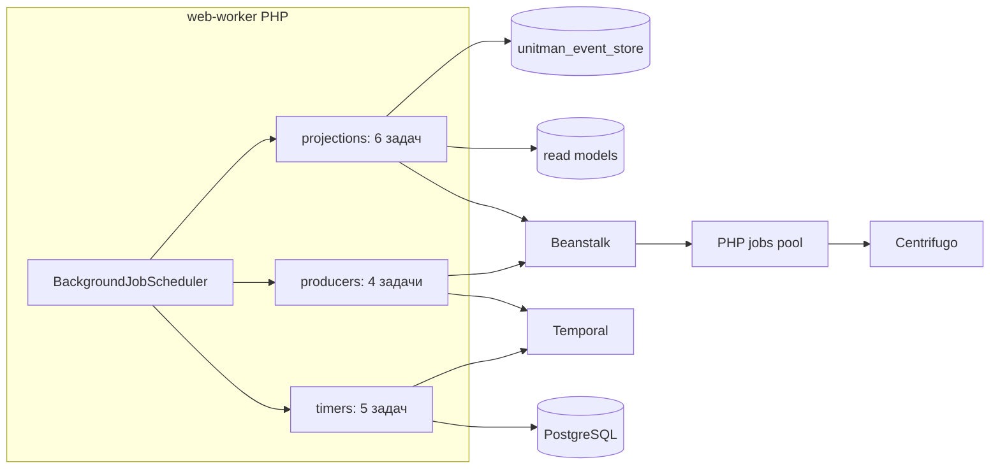
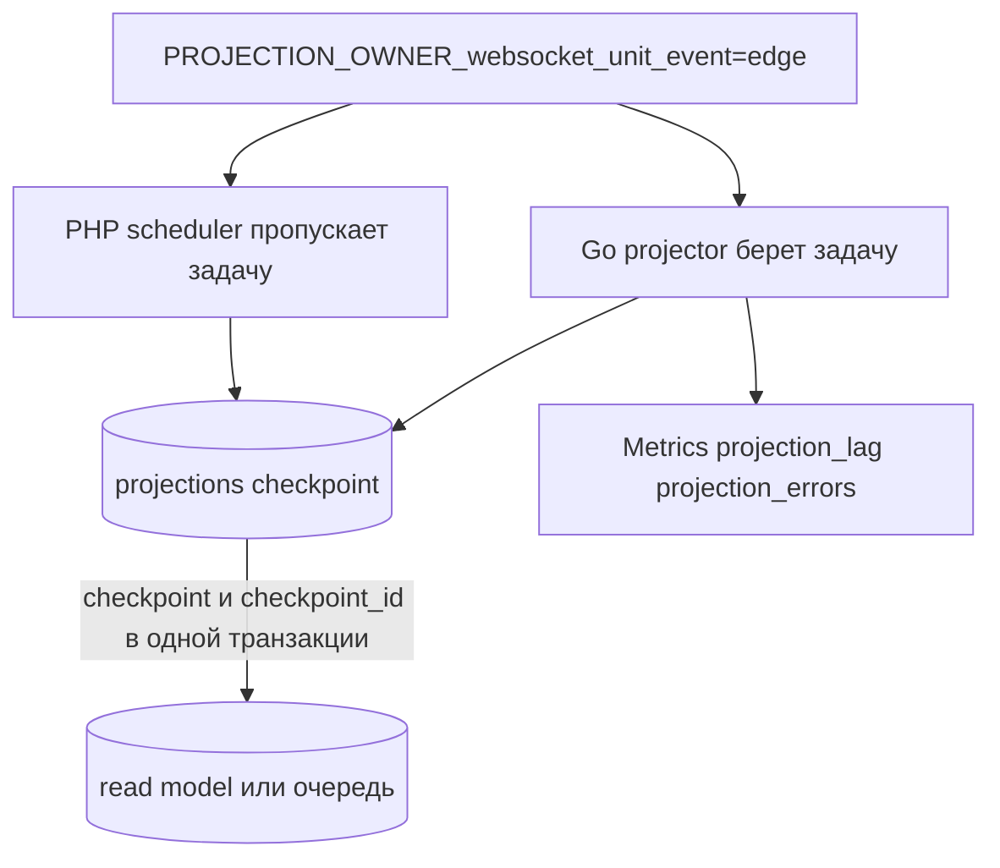
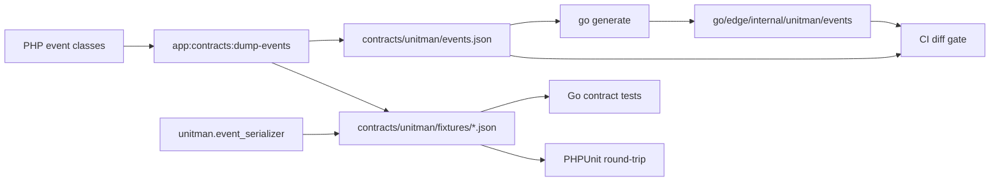

# Фоновые процессы в edge (Go): что выносить, что нет, и как синхронизировать контракты событий Unit

## 1. Контекст

После консолидации фоновых задач в три группы ([`BackgroundJobScheduler`](../src/BackgroundJob/Infra/Service/BackgroundJobScheduler.php:19), [`BackgroundJobGroup`](../src/BackgroundJob/Infra/Service/BackgroundJobGroup.php:10)) фоновый контур — это **3 PHP-процесса** и ~137,6 МБ PSS ([`plans/memory-footprint-reduction.md`](memory-footprint-reduction.md:398)). Дальнейший вынос в Go даёт уже не сотни мегабайт, а:

- снятие с PHP-воркеров парсинга больших payload (шаги раннера, `prozess.jobs[].steps[]`);
- изоляцию сбоев: падение проекции не трогает HTTP и Temporal;
- независимые лимиты и параллелизм по каждой проекции;
- возможность потокового чтения event store вместо `fetchAllAssociative` ([`DoctrineStreamRepository::getStream()`](../src/Utils/EventSauce/Repository/DoctrineStreamRepository.php:118)).

При этом действует ограничение из ADR: домен и Event Sourcing остаются в PHP/PostgreSQL, второго источника истины быть не должно ([`plans/adr-memory-optimization.md`](adr-memory-optimization.md:134)).

Текущая картина:



## 2. Критерии оценки

Кандидат выносится в Go, только если одновременно:

1. **Нет доменных решений** — задача не вызывает агрегаты и не меняет состояние Unit через `UseCase`.
2. **Один писатель** — либо Go становится единственным писателем таблицы, либо запись идёт через outbox.
3. **Контракт формализуем** — структура данных описывается схемой, а не «массивами как получится».
4. **Откат стоит одного флага** — `owner=php|edge` без миграций данных.
5. **Нет выигрыша хуже потерь** — инфраструктурная цена Go (образ, секреты, connection pool, метрики) окупается.

## 3. Инвентаризация и вердикт

| Задача | Группа | Delay | Что делает | Вердикт |
|--------|--------|-------|------------|---------|
| [`ochered_unitov`](../src/Unitman/Infra/BackgroundJob/OcheredUnitov/OcheredUnitovBackgroundJob.php:28) | producers | 1 | Разбирает очередь и запускает процессы юнитов через activity | 🔴 домен |
| [`ochered_proektov`](../src/Unitman/Infra/BackgroundJob/OcheredProektov/OcheredProektovBackgroundJob.php:24) | producers | 1 | То же для проектов | 🔴 домен |
| [`otpravka_zadach_v_ochered`](../src/Unitman/Infra/BackgroundJob/OtpravkaZadachVOchered/OtpravkaZadachVOcheredBackgroundJob.php:32) | producers | 1 | Переносит задачи из таблицы в очереди RoadRunner | 🟡 outbox-диспетчер |
| [`otlozhennie_deistviya`](../src/Unitman/Infra/BackgroundJob/OtlozhennieDeistviya/OtlozhennieDeistviyaBackgroundJob.php:38) | producers | 10 | Страховочное применение отложенных действий | 🔴 домен |
| [`unit_runner_jobs`](../src/Unitman/Infra/BackgroundJob/UnitRunnerJobs/UnitRunnerJobs.php:28) | projections | 1 | `ProzesUnitaProjection`, самый тяжёлый payload | 🟡 высокий приоритет |
| [`project_runner_jobs`](../src/Unitman/Infra/BackgroundJob/ProjectRunnerJobs/ProjectRunnerJobs.php:28) | projections | 1 | `ProjectRunnerJobsProjection` | 🟡 |
| [`websocket_unit_event`](../src/Unitman/Infra/BackgroundJob/WebsocketUnitEvent/WebsocketUnitEventJob.php:25) | projections | 1 | Fan-out событий Unit в очередь Centrifugo | 🟢 первый кандидат |
| [`websocket_project_event`](../src/Unitman/Infra/BackgroundJob/WebsocketProjectEvent/WebsocketProjectEventJob.php:26) | projections | 1 | Fan-out событий Project | 🟢 первый кандидат |
| [`webhook_event_puller`](../src/Unitman/Infra/BackgroundJob/WebhookEvent/WebhookEventProjectionPuller.php:25) | projections | 1 | `WebhookEventProjection` | 🟡 |
| [`statistika_po_proektu`](../src/Unitman/Infra/BackgroundJob/StatistikaPoProektu/StatistikaPoProektuBackgroundJob.php:26) | projections | 10 | Агрегированная статистика | 🟡 лучше materialized view |
| [`webhook_event_sender`](../src/Unitman/Infra/BackgroundJob/WebhookEvent/WebhookEventSender.php:31) | timers | 1 | Outbox вебхуков → очередь | 🟢 второй кандидат |
| [`runner_health_check`](../src/Runner/Infra/BackgroundJob/RunnerHealthCheckWorkflowJob.php:40) | timers | 300 | Запускает Temporal workflow проверки | 🟡 только проба |
| [`ochistka_dockera`](../src/Runner/Infra/BackgroundJob/OchistkaDockerJob.php:40) | timers | 86400 | Temporal workflow очистки Docker | 🟡 низкий приоритет |
| [`udalenie_neaktivnih_unitov`](../src/Unitman/Infra/BackgroundJob/UdalitNeaktivnieUniti/UdalitNeaktivnieUnitiBackgroundJob.php:25) | timers | 86400 | UseCase удаления юнитов | 🔴 домен |
| [`opencode_session_unit_sync`](../src/OpenCode/Infra/BackgroundJob/SinhronizaciyaSessiySUnitom/SinhronizaciyaSessiySUnitomBackgroundJob.php:59) | timers | 5 | Опрос сессий и продвижение юнитов | 🔴 домен |

## 4. Кандидаты: за и против

### 4.1. Outbox-диспетчеры: `webhook_event_sender` и `otpravka_zadach_v_ochered`

**За**

- Механическая работа: выбрать пачку, отправить, обновить статус. Доменных решений нет.
- Go даёт конкурентную отправку, таймауты, retry и backoff без PHP-воркера на каждую пачку.
- `FOR UPDATE SKIP LOCKED` позволяет масштабировать диспетчер без Symfony Lock.
- Убирает из PHP циклический опрос двух таблиц каждую секунду.

**Против**

- Go начинает писать в таблицы `webhook_event` и `zadacha_dly_ocheredi` — нужен явный владелец таблицы и миграции.
- Для `otpravka_zadach_v_ochered` важно сохранить заголовки RoadRunner (`attempts`, `retry-delay`) и семантику `setError`; в Go это либо клиент Beanstalk, либо отдельный HTTP-вход в PHP.
- Дублирование отправки при падении между отправкой и отметкой — нужен идемпотентный ключ и/или lease.

**Вывод.** Выносить после того, как появится таблица-lease и договор владения. Начинать с `webhook_event_sender`: у него проще контракт (HTTP POST во внешний URL).

### 4.2. Fan-out проекции: `websocket_unit_event`, `websocket_project_event`

**За**

- Задача не пишет read-модель: она формирует сообщение и ставит его в очередь ([`WebsocketUnitEventProjection`](../src/Unitman/Infra/Projection/WebsocketUnitEventProjection.php:91)).
- Основная работа — разбор события и публикация; в Go это дешёвые struct-ы и HTTP-вызов Centrifugo.
- Позволяет целиком убрать из PHP 2 из 6 pull-циклов и связанные блокировки.
- Центрифуго-публикация уже есть в `go/edge` (progress gateway), инфраструктура и секреты переиспользуются.

**Против**

- Проекция читает `UnitRepository` и `AccountAdapter`, чтобы получить имя юнита и автора; в Go это либо SQL-запрос, либо данные из конверта события.
- Нужен доступ к `unitman_event_store` и понимание заголовков `__aggregate_root_type`, `__event_type`.
- Появляется второй читатель event store, а значит требуется синхронизация контракта событий (раздел 6).

**Вывод.** Лучший первый шаг: минимальная доменная семантика, высокая частота, понятный откат.

### 4.3. Материализаторы: `unit_runner_jobs`, `project_runner_jobs`, `webhook_event_puller`

**За**

- `ProzesUnitaProjection` — самый дорогой на payload: `prozess.jobs[].steps[]`, до 5000 шагов и 64 КБ на `response` ([`ProzesUnitaProjection::obnovlen()`](../src/Unitman/Infra/Projection/ProzesUnitaProjection.php:70)). В Go это потоковый разбор и константная память.
- Один Go-процесс может вести несколько проекций параллельно и батчево обновлять БД, сняв 6 независимых секундных циклов PHP.
- Появляется возможность keyset-пагинации вместо `OFFSET checkpoint` — сейчас OFFSET растёт линейно с историей.

**Против**

- Go повторяет SQL-запись read-модели байт-в-байт: любое расхождение — тихая порча данных.
- `prozess` — нетипизированный массив, собранный в домене; его форма не описана схемой. Это главный источник дрейфа контракта.
- Нужна транзакционная эквивалентность: PHP пишет read-модель и checkpoint в одной транзакции ([`ProjectionsManager::pullProjectionByName()`](../src/Utils/EventSauce/ProjectionsManager.php:141)), Go обязан делать так же.
- Rebuild/reset остаются в PHP ([`ProjectionsManager::rebuild()`](../src/Utils/EventSauce/ProjectionsManager.php:238)); после переноса нужно поддерживать два механизма или переносить rebuild в Go.
- Ошибка «ядовитого» события должна останавливать checkpoint так же, как сейчас откатывает транзакцию PHP.

**Вывод.** Выносить после контрактного слоя и shadow-проверки. Начинать с `unit_runner_jobs` — там максимальный выигрыш, но и максимальные требования к контракту.

### 4.4. `statistika_po_proektu` — отдельный случай

Это агрегатная проекция с задержкой 10 секунд. Прежде чем переносить её в Go, стоит проверить альтернативу: **materialized view + `REFRESH MATERIALIZED VIEW CONCURRENTLY`** по расписанию. Если запрос выразим в SQL, проекция и фоновый процесс исчезают вовсе — это дешевле, чем новый Go-воркер.

### 4.5. `runner_health_check` и `ochistka_dockera`

Обе задачи — обёртки над Temporal workflow. Выигрыш от переноса в Go невелик: оркестрация, ретраи и видимость уже даёт Temporal, а решение о состоянии раннера принимает домен.

Разумный компромисс: оставить workflow в PHP, а **саму пробу** Docker-контейнеров выполнять в `edge-telemetry`, который уже имеет доступ к `/var/run/docker.sock`. Результат пробы возвращается в PHP через activity. Полный перенос workflow — только если будет приниматься решение убрать Temporal-воркер.

### 4.6. Что не выносить

- `ochered_unitov`, `ochered_proektov`, `otlozhennie_deistviya` — вызывают UseCase/агрегаты, это домен.
- `udalenie_neaktivnih_unitov` — удаление через агрегат.
- `opencode_session_unit_sync` — каждые 5 секунд читает БД и вызывает `prodvinutCiklUnita`; перенос в Go превратит локальный вызов в HTTP-хоп к PHP и увеличит задержку конвейера.

## 5. Перенос асинхронных проекций: архитектура

### 5.1. Два режима интеграции

**Режим A — Go читает event store напрямую.**
Go повторяет выборку PHP: `payload->headers->__aggregate_root_type = 'Unit'`, `ORDER BY id`, checkpoint = число обработанных событий. Плюс: нет изменений в PHP. Минус: Go обязан понимать весь JSON событий, включая исторические.

**Режим B — outbox проекций.**
PHP в той же транзакции, где пишет событие ([`ProjectionsManager::persistAndPullProjections()`](../src/Utils/EventSauce/ProjectionsManager.php:86)), добавляет строку в `projection_outbox` с нормализованным конвертом:

```json
{
  "contractVersion": 1,
  "projection": "unit_runner_jobs",
  "aggregateId": "uuid",
  "eventType": "DobavlenProzesVUnit",
  "occurredAt": "2026-11-19T09:00:00Z",
  "payload": { "unitId": "uuid", "prozess": { "id": "uuid", "jobs": [] } }
}
```

Плюс: Go не интерпретирует доменные события — он применяет проекционную команду; контракт маленький и версионируемый; PHP остаётся единственным источником истины. Минус: дополнительная запись на каждое событие, очистка outbox, задержка применения асинхронной проекции.

**Рекомендация.** Fan-out (`websocket_*`) — режим A с генерацией контракта. Материализаторы (`unit_runner_jobs`, `project_runner_jobs`, `webhook_event_puller`) — режим B: там слишком велик риск повторной интерпретации `prozess` в двух языках.

### 5.2. Владение проекцией и передача checkpoint



Правила:

1. **Единый флаг владения** читают оба контейнера из одного `.env`: `PROJECTION_OWNER_<name>=php|edge`. PHP-планировщик пропускает задачи с `edge`, Go запускает только `edge`.
2. **Общая таблица checkpoint.** Go читает и пишет ту же строку `projections.name`, что и PHP ([`CheckpointStore`](../src/Utils/EventSauce/Repository/CheckpointStore.php:29)).
3. **Эквивалентность checkpoint.** `checkpoint` остаётся числом обработанных событий отфильтрованного потока. Дополнительно добавить nullable `checkpoint_id BIGINT` для keyset-пагинации; Go обновляет оба поля в одной транзакции, PHP при откате продолжает использовать `checkpoint`.
4. **Взаимное исключение.** Go берёт `pg_try_advisory_lock` по имени проекции либо `SELECT ... FOR UPDATE SKIP LOCKED` по строке checkpoint. Symfony Lock из PHP и advisory lock из Go не пересекаются, поэтому на время cutover PHP-задача должна быть выключена флагом, а не только локом.
5. **Атомарность.** read-model запись + checkpoint + снятие lease — одна транзакция. Иначе после падения Go перечитает события (допустимо) или потеряет их (недопустимо).
6. **Ядовитое событие.** Checkpoint не двигается, проекция помечается `paused`, метрика и алерт. Поведение совпадает с текущим откатом транзакции в PHP.
7. **Rebuild.** Пока rebuild остаётся в PHP, Go обязан поддерживать `reset`: остановиться, дождаться сброса checkpoint, начать с нуля. Лучше сразу добавить в Go команду `projection reset --name`, чтобы не зависеть от PHP CLI в момент инцидента.

### 5.3. Shadow-режим перед переключением

1. Go читает поток с того же checkpoint, но пишет в `*_shadow` таблицы или только в лог.
2. Сравнение: количество строк, хеш полезной нагрузки по каждому `aggregateId`, лаг по checkpoint.
3. Расхождений нет N циклов → `PROJECTION_OWNER_<name>=edge`, перезапуск PHP-планировщика и Go.
4. Откат: `owner=php`, остановить Go. Checkpoint совместим, потому что семантика одна.

## 6. Синхронизация контрактов событий Unit

Источник истины — PHP-классы событий и их регистрация в [`ClassNameMapFactory`](../src/Unitman/Business/Utils/ClassNameMapFactory.php:57) и [`UnitmanClassNameMapEnum`](../src/Unitman/Business/Utils/UnitmanClassNameMapEnum.php:5). В event store попадает JSON, собранный `ConstructingMessageSerializer` с `PropertyNormalizer` ([`SerializerFactory`](../src/Utils/Service/SerializerFactory.php:22)), а тип события лежит в `payload->headers->__event_type`.

Проблема: сейчас контракт существует только в PHP-коде. Любое переименование поля или смена типа обнаружится в Go только в рантайме — уже на боевых событиях.

### 6.1. Конвейер контрактов



Состав:

1. **Команда `app:contracts:dump-events`** в `src/Unitman/Infra/Cli`: проходит по карте классов, рефлексией собирает имя события, свойства, типы, обязательность, значения по умолчанию и пишет `contracts/unitman/events.json`. Для `prozess` дополнительно описывает вложенные `$defs`.
2. **Команда `app:contracts:dump-fixtures`**: для каждого события создаёт пример и сериализует его **настоящим** `unitman.event_serializer`, а не руками. Это фиксирует фактические имена полей и формат enum-ов.
3. **Go-кодогенерация** из `events.json` в структуры с тегами `json`. Сгенерированный код коммитится; CI перегенерирует и падает на diff.
4. **Двусторонние контрактные тесты**:
   - PHPUnit: `unserialize(fixture)` → тот же класс → `serialize()` → идентичный JSON;
   - Go: каждый fixture декодируется в структуру, обязательные поля непустые, неизвестные поля игнорируются.
5. **CI-гейт `composer run check-contracts`** объединяет генерацию, diff и оба набора тестов.

### 6.2. Политика совместимости

- **Аддитивные изменения разрешены**: новое необязательное поле. Go-декодер игнорирует неизвестные поля, новые поля — указатели/nullable.
- **Переименование, удаление, смена типа** — только через новое событие (`UnitSozdanV2`) или upcaster. Старое имя типа остаётся в [`UnitmanClassNameMapEnum`](../src/Unitman/Business/Utils/UnitmanClassNameMapEnum.php:5) навсегда.
- **Отсутствующие поля исторических событий** обрабатываются явно: эталон — `unixtimeStart ?? null` ([`ProzesUnitaProjection::obnovlen()`](../src/Unitman/Infra/Projection/ProzesUnitaProjection.php:84)). В Go это `*int64`, а не `int64`.
- **Enum-ы состояний** (`stateAsArray`, `UnitProcessState`) публикуются в `events.json` как закрытые списки. Иначе Go будет молча принимать неизвестное состояние.
- **Журнал изменений** `contracts/unitman/CHANGELOG.md` — обязательное условие для PR, меняющего событие.

### 6.3. Главный долг: типизировать `prozess`

Сейчас `DobavlenProzesVUnit` несёт `array $prozes` без структуры ([`DobavlenProzesVUnit`](../src/Unitman/Business/Model/Unit/Event/DobavlenProzesVUnit.php:5)), а проекция разбирает его «по ключам» ([`ProzesUnitaProjection`](../src/Unitman/Infra/Projection/ProzesUnitaProjection.php:72)). Перенос такой формы в Go — это гарантированный дрейф.

Минимальный шаг до переноса:

1. Ввести в PHP value objects `UnitProcessData`, `UnitProcessJobData`, `UnitProcessStepData` с `toArray()`, собирать `prozess` только через них.
2. Описать их в `events.json` как `$defs` с обязательными полями `command`, `response`, `success`, `unixtime` и необязательным `unixtimeStart`.
3. Зафиксировать golden-fixtures: событие с 1 шагом, с 5000 шагами, с отсутствующим `unixtimeStart`, с пустым `response`.

После этого Go-проекция разбирает поток `json.Decoder`-ом в типизированные структуры и не может «не заметить» изменение формы.

### 6.4. Версионирование конверта outbox

Если выбран режим B, контракт проекции версионируется отдельно от контракта события:

- `contractVersion` в конверте;
- Go поддерживает N и N-1 версии конверта одновременно;
- PHP-писатель outbox и Go-читатель раскатываются независимо: сначала Go учится читать N, потом PHP начинает писать N;
- старые строки outbox дочитываются по своей версии.

Это снимает главный риск режима A — необходимость понимать всю историю форматов.

## 7. План внедрения

### Этап 1. Фундамент контрактов

- Команды `app:contracts:dump-events` и `app:contracts:dump-fixtures`, каталог `contracts/unitman/`.
- Go-кодогенерация и тесты на fixtures.
- CI-гейт `check-contracts` в `composer run all-checks`.
- Типизация `prozess` через value objects в домене.

### Этап 2. Fan-out в Go

- Подкоманда `edgeprojections` или расширение `go/edge` подкомандой `projections`.
- Реализация `websocket_unit_event` и `websocket_project_event` в режиме A.
- Общий checkpoint, advisory lock, shadow-режим, метрики лага и ошибок.
- Флаг `PROJECTION_OWNER_*`, канареечный запуск за `edge-gateway`.

### Этап 3. Outbox-диспетчеры

- Lease-таблица или `SKIP LOCKED` для `webhook_event` и `zadacha_dly_ocheredi`.
- Перенос `webhook_event_sender`, затем `otpravka_zadach_v_ochered`.
- Идемпотентные ключи и метрики retry.

### Этап 4. Материализаторы

- `unit_runner_jobs` первым: максимальный выигрыш по памяти.
- Затем `project_runner_jobs` и `webhook_event_puller`.
- `statistika_po_proektu` — сначала оценить materialized view, Go только если SQL-вариант не подходит.

### Этап 5. Инфраструктурные пробы

- Проба контейнеров раннера в `edge-telemetry` с возвратом результата в PHP.
- Очистка Docker остаётся в Temporal, пока Temporal-воркер не выводится.

## 8. Риски и меры

| Риск | Мера |
|------|------|
| Два писателя в одну read-модель | Флаг владельца + advisory lock + shadow-сравнение |
| Дрейф контракта события | Генерация из PHP-классов, fixtures, CI-гейт, политика версионирования |
| Потеря событий при падении Go | Checkpoint в одной транзакции с read-model, keyset по `id` |
| Расхождение offset и keyset | `checkpoint` для PHP и `checkpoint_id` для Go, оба обновляются вместе |
| «Ядовитое» событие блокирует проекцию | Pause + алерт, без молчаливого пропуска |
| Невозможность отката | `owner=php` и остановка Go; миграция только аддитивная |
| Отсутствие наблюдаемости | `projection_lag_events`, `projection_errors_total`, `projection_batch_duration_seconds` в Prometheus |
| Доменные правила в Go | Ревью-правило: Go применяет только проекционные команды, не вызывает агрегаты |

## 9. Чек-лист

- [ ] Зафиксировать таблицу владельцев проекций и единый формат флага `PROJECTION_OWNER_*`.
- [ ] Реализовать `app:contracts:dump-events` и `app:contracts:dump-fixtures`.
- [ ] Ввести `contracts/unitman/events.json`, fixtures и CI-гейт.
- [ ] Сгенерировать Go-структуры событий и тесты на fixtures.
- [ ] Типизировать `prozess` в PHP value objects и описать в схеме.
- [ ] Добавить `checkpoint_id` миграцией, обновлять вместе с `checkpoint`.
- [ ] Реализовать Go-проекции `websocket_unit_event` и `websocket_project_event`.
- [ ] Прогнать shadow-сравнение и переключить `owner=edge`.
- [ ] Перенести `webhook_event_sender` с lease-семантикой.
- [ ] Перенести `unit_runner_jobs`, затем остальные материализаторы.
- [ ] Проверить `statistika_po_proektu` на возможность materialized view.
- [ ] Добавить метрики лага и алерты в Prometheus.
- [ ] Обновить [`docs/edge-service.md`](../docs/edge-service.md:10) и ADR.
