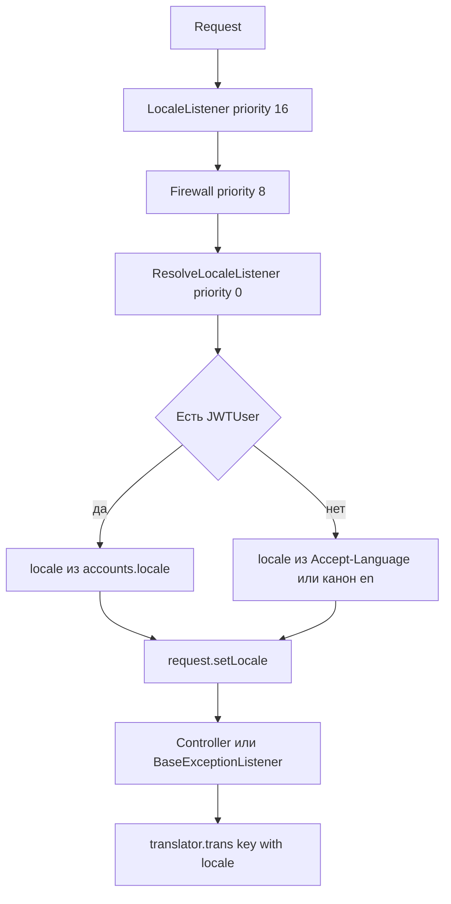
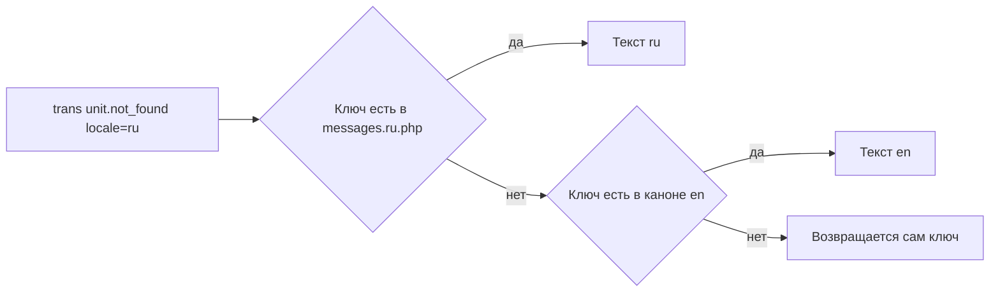

# Перевод сообщений исключений и словари (i18n) — план

## 1. Цель

Сообщения исключений в коде — это **ключи** (`unit.not_found`, `security.access_denied`),
а не готовый текст. Нужно:

1. Определять язык ответа по локали из учётной записи (`accounts.locale`), с разумным
   запасным вариантом для неаутентифицированных запросов.
2. Отдавать клиенту переведённый текст вместо «сырого» ключа.
3. Зафиксировать устройство словарей и порядок внесения правок.
4. Если перевода на языке пользователя нет — брать текст из **дефолтного** языка.

**Канон — английский (`en`)**, русский (`ru`) и любые следующие языки — переводы.
Канон означает: источник истины по составу ключей, язык fallback, язык, который обязателен
на 100 %.

Не-цели: изменение HTTP-статусов и формата конвертов `Reponse`; переименование namespace
`App\Utils\Model\Reponse`; перевод логов и внутренних dev-сообщений; перевод сообщений,
которые приходят из внешних API.

---

## 2. Текущее состояние (факты)

| Что | Где | Проблема |
|---|---|---|
| Слушатель исключений | [`BaseExceptionListener`](../src/Utils/Converter/BaseExceptionListener.php:63) | Вызывает `$this->translator->trans($message)`, но **результат выбрасывает** — в ответ уходит ключ |
| Словари | [`messages.en.php`](../translations/messages.en.php:1), [`messages.ru.php`](../translations/messages.ru.php:1) | Вложенные PHP-массивы → Symfony флэтит их в dot-ключи. Покрыто 12 ключей из ~300 |
| Локаль | [`accounts.locale`](../src/Account/Infra/Repository/JWTUserRepository.php:50) → [`JWTUser::getLocale()`](../src/Account/Business/Model/JWTUser.php:104) | В JWT payload попадает ([`JWTDecodedListener`](../src/Account/Infra/EventListener/JWTDecodedListener.php:25)), но в запросе локаль **никуда не применяется** |
| Конфиг локали | [`translation.yaml`](../config/packages/translation.yaml:2), [`framework.yaml`](../config/packages/framework.yaml:5) | `default_locale: en`, `fallbacks: [en]` — совпадает с новым каноном, но задано дважды и не связано с env |
| Локаль аккаунта по умолчанию | [`.env`](../.env:16) → [`Account/di.php`](../src/Account/di.php:43) | `DEFAULT_LOCALE=ru` одновременно означает «язык приложения» и «локаль новых аккаунтов» — смешение двух смыслов |
| Обход слушателя | [`UnitConroller`](../src/Unitman/Infra/Controller/UnitConroller.php:96), [`ProjectController`](../src/Unitman/Infra/Controller/ProjectController.php:343), [`ProjectWebhookController`](../src/Unitman/Infra/Controller/ProjectWebhookController.php:57), [`MediatekaController`](../src/Mediateka/Infra/Controller/MediatekaController.php:132), [`InitializationController`](../src/Initialization/Infra/Controller/InitializationController.php:50) | `Response::error($e->getMessage())` — минуя `BaseExceptionListener`, перевод не случится |
| Скрытый дефект | [`JWTUser::createFromPayload()`](../src/Account/Business/Model/JWTUser.php:23) | В аргумент `$locale` передаётся `$payload['isBlocked']`, `nickname` — в `$nickname`; локаль из payload не восстанавливается |
| Валидация локали | [`Account::changeMyLocale()`](../src/Account/Business/Model/Account.php:89) | Принимает любую строку, проверяется только «не равна текущей» |

Итог: компонент перевода уже установлен и настроен, но **не подключён к пути ошибки**,
а локаль пользователя не доезжает до транслятора.

---

## 3. Пакет: что «подключаем»

`symfony/translation` уже в [`composer.json`](../composer.json:54) — новых зависимостей
не добавляем (правило 13 `.roorules`). Варианты рассмотрены:

| Вариант | Плюсы | Минусы | Решение |
|---|---|---|---|
| `symfony/translation` (есть) | fallback-цепочка, PHP/CSV/YAML-загрузчики, параметры `%name%`, плюрализация, `TranslatorInterface` уже внедрён | — | **Базовый** |
| `Symfony\Contracts\Translation\TranslatableMessage` (часть установленного `symfony/translation-contracts`) | ленивый перевод, параметры в типизированном виде, удобно логировать | импорт Symfony-типов; недопустим в `Business/Model` (deptrac), только `Infra`/`Utils` | Использовать точечно в новых местах |
| Сторонние `*exception-translator` (nepada, kununu) | автоперевод по классу исключения | новая зависимость, ломает правило «домен без фреймворка», дублирует то, что уже есть | **Не берём** |

«Подключение пакета» в терминах задач — это: (а) явно задать канон `en` и fallback через env,
(б) реально применять транслятор в пути ошибки, (в) включить fallback-цепочку, (г) добавить
инструмент контроля словарей.

---

## 4. Определение языка

### 4.1 Цепочка приоритетов

| # | Источник | Когда применяется |
|---|---|---|
| 1 | `JWTUser::getLocale()` (из `accounts.locale`) | аутентифицированные запросы `^/api` |
| 2 | `Accept-Language` | публичные эндпоинты: `login`, `refreshToken`, `project/(.*)/hook`, `runner/saveSteps`, `initialization/list` |
| 3 | Канон `en` | всё остальное, а также если локаль аккаунта пустая/неизвестная |

Аккаунт имеет приоритет над заголовком — это прямое требование («на основании языка
из учётной записи»).

### 4.2 Где ставим локаль

Новый слушатель `App\Account\Infra\EventListener\ResolveLocaleListener`
(`src/Account/Infra/EventListener/`), на `KernelEvents::REQUEST`:

* приоритет **0** — `Firewall` слушает с приоритетом 8 и срабатывает раньше, значит
  `Security::getUser()` уже доступен; `LocaleListener` (приоритет 16) до нас уже выставил
  локаль из заголовка, мы её осознанно перетираем локалью аккаунта;
* источник — `JWTUser` из `Security`; при `null` оставляем то, что выставил Symfony из
  `Accept-Language` (или канон `en`);
* локаль аккаунта проверяем по списку поддерживаемых, иначе — канон;
* `$request->setLocale($locale)` — только на объекте запроса, **никакого** `translator->setLocale()`.



### 4.3 Поддерживаемые языки и канон

* Канон: `en` — обязательный словарь, язык fallback.
* Поддерживаемые: `en`, `ru` — единый enum `App\Utils\Model\Locale\SupportedLocale`
  (расширение = новая `case` + новый файл словаря).
* Enum используется слушателем и валидацией `changeMyLocale`.
* Метод `SupportedLocale::canon(): self` возвращает канон, чтобы «канон» был в одном месте,
  а не строкой `en` по коду.

### 4.4 Разделение переменных окружения

Сейчас `DEFAULT_LOCALE=ru` делает две работы. Разделяем:

| Переменная | Значение | Смысл | Кто читает |
|---|---|---|---|
| `DEFAULT_LOCALE` | `en` | язык-канон и fallback приложения | [`translation.yaml`](../config/packages/translation.yaml:1) |
| `ACCOUNT_DEFAULT_LOCALE` | `ru` | локаль новых и системных аккаунтов | [`Account/di.php`](../src/Account/di.php:43) |

В [`Account/di.php`](../src/Account/di.php:43) привязка меняется на
`->bind('$defaultLocale','%env(ACCOUNT_DEFAULT_LOCALE)%')`; в
[`.env.dist`](../.env.dist:16), `.env.test` и `.env.local.dist` добавляется
`ACCOUNT_DEFAULT_LOCALE=ru`, а `DEFAULT_LOCALE` становится `en`.

Это сохраняет привычное поведение регистрации (русский интерфейс у новых аккаунтов) и при
этом даёт английский канон.

### 4.5 Правка модели `Account`

`changeMyLocale()` проверяет локаль через `SupportedLocale::tryFrom()` (модуль `Account`
уже зависит от `@utils`) и кидает `account.locale.unsupported`. Заодно чиним
`JWTUser::createFromPayload()`, чтобы `$payload['locale']` доезжал.

---

## 5. Устройство словарей

### 5.1 Раскладка

```
translations/
  messages.en.php      # КАНОН, источник истины, обязателен на 100 %
  messages.ru.php      # перевод
  messages.<lang>.php  # следующий язык = новый файл + новая case в SupportedLocale
```

Один каталог на язык (не по доменам), потому что ключи в коде **уже** содержат домен
первым сегментом (`unit.not_found`) — так их можно менять без правки ~300 мест.

### 5.2 Формат

Вложенный PHP-массив, верхний уровень = модуль. Symfony `ArrayLoader` рекурсивно
флэтит его в dot-ключи:

```php
// translations/messages.en.php  (канон)
return [
    'account' => [
        'not_found' => 'Account not found',
        'refresh_token' => ['empty' => 'The refresh token is missing'],
    ],
    'unit' => [
        'not_found' => 'Unit not found',
        'name_already_exists' => 'A unit with that name already exists',
    ],
];
```

```php
// translations/messages.ru.php  (перевод)
return [
    'account' => [
        'not_found' => 'Учётная запись не найдена',
        'refresh_token' => ['empty' => 'Refresh-токен не передан'],
    ],
    'unit' => [
        'not_found' => 'Юнит не найден',
        'name_already_exists' => 'Юнит с таким именем уже существует',
    ],
];
```

| Ключ в PHP | Ключ в коде |
|---|---|
| `account.refresh_token.empty` | `trans('account.refresh_token.empty')` |
| `unit.not_found` | `trans('unit.not_found')` |

### 5.3 Правила ключей

* `<module>.<object>.<condition>`, ASCII, snake_case, нижний регистр.
* `<module>` ∈ `account`, `unit`, `project`, `repo`, `runner`, `mediateka`,
  `initialization`, `security`, `utils`.
* Ключ описывает **условие**, а не текст: `unit.volume_type.has_files`.
* Переменные — параметры, не конкатенация: `unit.svyaz.project_not_available` +
  `['%project%' => $id]`. Для домена параметры передаются вторым аргументом исключения
  только после отдельного рефакторинга; сейчас конкатенацию в ключах
  (`unit.obrabotka_prozesa.tip_ne_opredelen.<type>`) оставляем как есть — она не находится
  в словаре и ведёт себя как сегодня.
* Существующие «смешанные» ключи (`unit.konfig.actions`, `proekt.webhook.double`,
  `account.nickname_is_empty`) **не переименовываем** в этой итерации: на них завязаны
  тесты. Кандидаты на нормализацию — отдельной задачей.

### 5.4 Fallback: как работает «нет перевода → канон»



Так как канон = дефолтная локаль, цепочка fallback всегда заканчивается на `en`.

Настройка (единый источник — env):

```yaml
# config/packages/translation.yaml
framework:
    default_locale: '%env(DEFAULT_LOCALE)%'   # en
    translator:
        default_path: '%kernel.project_dir%/translations'
        fallbacks: ['%env(DEFAULT_LOCALE)%']  # en
```

`framework.yaml` — убрать дублирующий `default_locale`, оставить ссылку на `translation.yaml`.

Если ключа нет и в каноне — `translator` вернёт сам ключ; `ExceptionTranslator` (§6)
обрабатывает это отдельно и логирует, чтобы дырка в каноне была видна.

### 5.5 Как вносить правки (регламент для разработчика)

1. Пишем в коде ключ: `throw new \DomainException('unit.volume_type.has_files');`
2. Добавляем ключ **сначала в `messages.en.php`** (канон) — вложенно, по модулю.
3. Перевод на другие языки — по возможности; отсутствие допустимо, сработает fallback на `en`.
4. Запускаем `php bin/console app:translations:audit --missing` — команда покажет,
   каких ключей нет в переводах, и каких ключей из кода нет в каноне.
5. `composer run check-translations` (новый script) — строгий режим для CI.

Правило для ревью: PR, добавляющий `throw new ...Exception('new.key')` без строки в
`messages.en.php`, не проходит `check-translations`.

---

## 6. Механика перевода в пути ошибки

Доменные классы остаются без зависимостей от Symfony (deptrac: `Business` не зависит ни от
чего) — они кидают ключ строкой. Перевод происходит **на границе Infra**.

Новый сервис `App\Utils\Service\ExceptionTranslator` (`src/Utils/Service/`):

```php
final class ExceptionTranslator
{
    public function translate(\Throwable $e, string $locale): string
    {
        $message = $e->getMessage();

        if (!preg_match('/^[a-z][a-z0-9_]*(\.[a-z0-9_]+)+$/', $message)) {
            return $message; // dev/сырые сообщения — как есть
        }

        $translated = $this->translator->trans($message, [], 'messages', $locale);

        if ($translated === $message) {
            $this->logger->warning('Перевод не найден', ['key' => $message, 'locale' => $locale]);
            return $message;
        }

        return $translated;
    }
}
```

Ключевые свойства:

* **локаль передаётся аргументом** — никакого `setLocale()` на общем сервисе: воркеры
  RoadRunner живут между запросами, глобальное состояние протечёт;
* если ключа нет ни в одном словаре — возвращается исходная строка (текущее поведение
  сохраняется, тесты на `expectExceptionMessage('unit...')` не ломаются);
* сообщения с кириллицей/пробелами (`Не удалось сохранить файл в хранилище`,
  `Invalid new state - %s`) под регулярку не подходят и отдаются verbatim.

Применение:

| Место | Изменение |
|---|---|
| [`BaseExceptionListener`](../src/Utils/Converter/BaseExceptionListener.php:63) | `makeFail()` / `makeError()` → `$this->exceptionTranslator->translate($exception, $event->getRequest()->getLocale())` |
| [`UnitConroller`](../src/Unitman/Infra/Controller/UnitConroller.php:96) (23 места), [`ProjectController`](../src/Unitman/Infra/Controller/ProjectController.php:343) (4), [`ProjectWebhookController`](../src/Unitman/Infra/Controller/ProjectWebhookController.php:57) (8) | `Response::error($error->getMessage())` → `Response::error($this->exceptionTranslator->translate($error, $request->getLocale()))` |
| [`MediatekaController`](../src/Mediateka/Infra/Controller/MediatekaController.php:132) (5), [`InitializationController`](../src/Initialization/Infra/Controller/InitializationController.php:50) (2) | то же |
| [`BaseRequestListener`](../src/Utils/Converter/BaseRequestListener.php:26) | блокировка: переводить `lockContent`, только если это ключ |

Сервис регистрируется автоматически: [`src/Utils/di.php`](../src/Utils/di.php:21) грузит
`App\Utils\` целиком, `Converter`/`Service` не исключены.

---

## 7. Инструмент контроля словарей

Консольная команда `app:translations:audit`
(`src/Utils/Cli/Command/TranslationsAuditCommand.php`). Терминология отчёта привязана к канону:

| Опция | Поведение |
|---|---|
| `--locale=ru` | отчёт по конкретному языку |
| `--missing` | ключи канона `en`, отсутствующие в языке |
| `--extra` | ключи языка, которых нет в каноне |
| `--used-in-code` | ключи из `throw new ...Exception('...')`, отсутствующие в каноне |
| `--strict` | exit code 1 при любой проблеме (для CI) |

Плюс тест-страж `src/App/Tests/Translations/TranslationsConsistencyTest.php`:

* каждый `messages.*.php` возвращает массив;
* нет пустых значений;
* **канон `en` покрывает все ключи из `throw`-выражений** (regex-скан `src/`);
* наборы ключей в переводах — подмножество канона (лишние → fail);
* в `en` нет кириллицы (защита от копипаста при переводе).

Новый script в [`composer.json`](../composer.json:89):
`"check-translations": "php bin/console app:translations:audit --strict --used-in-code --locale=ru"`
и включение в `all-checks`.

---

## 8. Тесты

| Уровень | Файл | Что проверяем |
|---|---|---|
| Unit | `src/Utils/Tests/Service/ExceptionTranslatorTest` | ключ → перевод; сырой текст → verbatim; ключ без перевода в `ru` → текст `en`; ключ нигде → исходная строка |
| Functional | `src/App/Tests/Translations/ExceptionTranslationTest` (`WebTestCase`) | JWT с `locale=ru` → русский текст; `locale=en` → английский; без JWT + `Accept-Language: ru` → русский; без JWT и без заголовка → английский канон |
| Functional | там же | отсутствующий в `ru` ключ возвращается по-английски |
| Unit | `src/Account/Tests/UseCase/AccountTest` | `changeMyLocale('xx')` → `account.locale.unsupported`; допустимая локаль сохраняется |
| Unit | `src/App/Tests/Translations/TranslationsConsistencyTest` | см. §7 |

Прогон — по правилу 11: `php bin/console cache:clear` в контейнере, затем
`php vendor/bin/phpunit`; после правок — `rr reset`.

---

## 9. Полный список изменений

| # | Файл | Действие |
|---|---|---|
| 1 | [`config/packages/translation.yaml`](../config/packages/translation.yaml:1) | `default_locale` и `fallbacks` из `%env(DEFAULT_LOCALE)%` (=`en`) |
| 2 | [`config/packages/framework.yaml`](../config/packages/framework.yaml:5) | убрать дубль `default_locale` |
| 3 | [`.env.dist`](../.env.dist:16), `.env.test`, `.env.local.dist` | `DEFAULT_LOCALE=en`, новый `ACCOUNT_DEFAULT_LOCALE=ru` |
| 4 | [`src/Account/di.php`](../src/Account/di.php:43) | привязка `$defaultLocale` → `%env(ACCOUNT_DEFAULT_LOCALE)%` |
| 5 | `src/Utils/Model/Locale/SupportedLocale.php` | новый enum (`en`, `ru`, `canon()`) |
| 6 | `translations/messages.en.php` | **канон**: все ключи из кода, сгруппированы по модулям |
| 7 | [`translations/messages.ru.php`](../translations/messages.ru.php:1) | перевод канона |
| 8 | `src/Utils/Service/ExceptionTranslator.php` | новый сервис перевода |
| 9 | [`src/Utils/Converter/BaseExceptionListener.php`](../src/Utils/Converter/BaseExceptionListener.php:39) | использовать сервис, локаль из запроса |
| 10 | `src/Account/Infra/EventListener/ResolveLocaleListener.php` | новый слушатель локали |
| 11 | [`src/Account/Business/Model/Account.php`](../src/Account/Business/Model/Account.php:89) | валидация локали через `SupportedLocale` |
| 12 | [`src/Account/Business/Model/JWTUser.php`](../src/Account/Business/Model/JWTUser.php:23) | исправить маппинг `locale` в `createFromPayload` |
| 13 | Контроллеры Unitman / Mediateka / Initialization | `getMessage()` → `ExceptionTranslator` |
| 14 | `src/Utils/Cli/Command/TranslationsAuditCommand.php` | новая команда |
| 15 | [`composer.json`](../composer.json:89) | script `check-translations`, в `all-checks` |
| 16 | `docs/translations.md` | регламент: канон `en`, как добавить ключ и язык |
| 17 | Тесты §8 | новые |

---

## 10. Риски и как снимаем

| Риск | Решение |
|---|---|
| Смена смысла `DEFAULT_LOCALE` (`ru` → `en`) переключит язык новых аккаунтов | отдельная `ACCOUNT_DEFAULT_LOCALE=ru`; в релиз-нотах — пункт про миграцию env |
| Общий `Translator` + долгоживущие воркеры RoadRunner: глобальная локаль протечёт между запросами | локаль передаётся аргументом `trans(..., $locale)`; `setLocale()` не вызываем |
| Ключ может совпасть с обычным текстом (например, `unit.foo.bar` в пользовательских данных) | строгая регулярка + проверка «перевод совпал с ключом» → verbatim |
| Канон `en` придётся наполнять с нуля (~300 ключей), русские тексты уже есть в коде | ru-файл собирается переносом существующих формулировок, en — перевод канона; порядок работ в §11 |
| Ключ добавлен только в `ru`, забыт в `en` | `check-translations --missing` в CI + тест «канон покрывает все ключи из `throw`» |
| Правка 40+ контроллеров раздувает дифф | замены механические, отдельным коммитом после сервиса и тестов |
| Тесты, ожидающие ключ в `getMessage()` | ключи остаются в исключениях; меняется только HTTP-ответ |
| Смешанные/опечатанные ключи (`proekt.webhook.double`) | фиксируем как есть в каноне, нормализация — отдельной задачей |
| Публичные эндпоинты без аккаунта | цепочка `Accept-Language` → канон `en` |

---

## 11. Порядок работ

1. Env-разделение (`DEFAULT_LOCALE=en`, `ACCOUNT_DEFAULT_LOCALE=ru`), конфиг локали, `SupportedLocale`.
2. Канон `messages.en.php` по факту всех ключей из кода (скан + группировка по модулям).
3. `messages.ru.php` — перенос существующих русских формулировок на ключи канона.
4. `ExceptionTranslator` + правка `BaseExceptionListener`.
5. `ResolveLocaleListener` + валидация локали в `Account` + фикс `createFromPayload`.
6. Замена `getMessage()` в контроллерах Unitman / Mediateka / Initialization.
7. `app:translations:audit` + тест-страж + `composer` script.
8. Тесты §8, `docs/translations.md`, прогон `all-checks`, `rr reset`.
