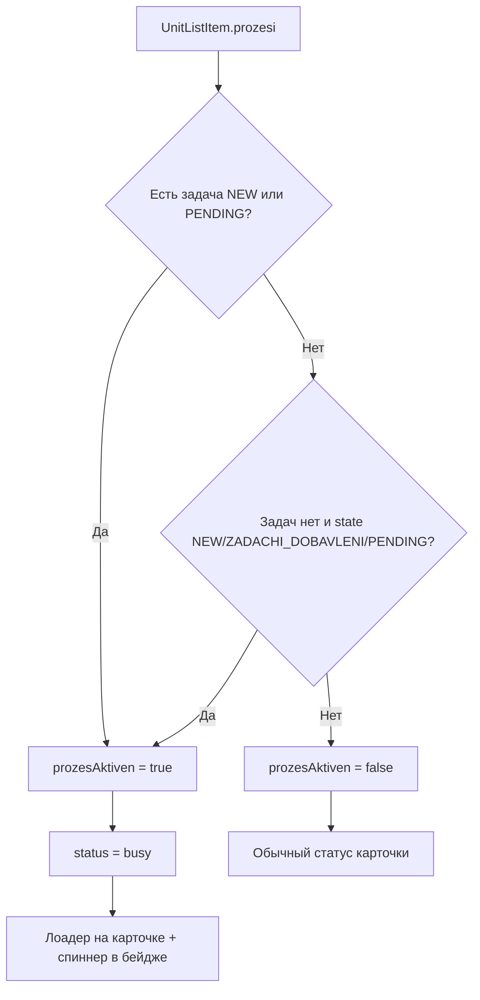

# План: лоадер процесса юнита (PENDING) во фронтенде

## Цель

В списке юнитов показывать лоадер, пока процесс юнита не завершён. Процесс считается
«в процессе», пока хотя бы одна его задача (job) не в терминальном состоянии.
Терминальные состояния задачи: `SUCCESS`, `ERROR`, `CANCLED`.
Лоадер появляется при запуске фоновой работы и снимается автоматически, когда все
задачи процесса завершились, — без перезагрузки страницы.

## Текущее состояние (по коду)

- Бэкенд отдаёт в `UnitListItem.prozesi[]` процесс со `state` и `jobs[]` (у задачи есть `state`).
  Контракт — схемы `UnitProcessBrief` и `UnitProcessBriefJob`.
- [`estNezavershenniyProzes()`](../unitman-front/src/modules/unit/store/SpisokUnitovStore.ts:139)
  проверяет только **последний** процесс и только его `state`, а не задачи.
- [`nazvanieTekusheiZadachi()`](../unitman-front/src/modules/unit/store/SpisokUnitovStore.ts:626)
  отдельно обходит задачи и берёт тип первой незавершённой.
- [`UnitStatusBadge.vue`](../unitman-front/src/modules/unit/view/Unit/SpisokUnitov/UnitStatusBadge.vue:37)
  уже рисует `q-spinner` при статусе `busy`.
- HTTP-лоадеры [`unitLoaders`](../unitman-front/src/modules/unit/store/SpisokUnitovStore.ts:187)
  гаснут сразу после ответа API, хотя фоновый процесс ещё идёт.
- WebSocket `OBNOVLEN` публикуется на job-события (ветка `default` в
  [`WebsocketUnitEventProjection`](../src/Unitman/Infra/Projection/WebsocketUnitEventProjection.php:87)),
  поэтому снятие лоадера в realtime уже обеспечено.

## Правило «процесс активен»

```
процесс активен, если:
  есть хотя бы одна задача в состоянии NEW или PENDING
  ИЛИ задач нет, а state процесса в {NEW, ZADACHI_DOBAVLENI, PENDING}
```

`CANCLED` считается терминальным (как и в бэкендовом `UnitProcess::isFinish`),
иначе отменённый процесс оставил бы лоадер навсегда.



## Изменения по файлам (только `../unitman-front`)

### 1. Утилита статусов — `src/modules/unit/utils/unitStatus.ts`

- Добавить константы терминальных состояний задачи и процесса.
- Добавить чистые функции:
  - `zavershenaZadacha(state: StatusZadachi): boolean`;
  - `estAktivniyProzes(prozesi: ProzesUnitaBezShagov[]): boolean`;
  - `nazvanieAktivnoiZadachi(prozesi): string | null`;
  - `progressProzesa(prozesi): {vsego: number; zaversheno: number}` (для подсказки).
- Расширить `UnitStatusSource`: добавить `prozesAktiven: boolean`.
- Расширить `UnitUiState`: добавить `prozesAktiven: boolean` и `progress`.
- В `deriveUnitUiState`:
  - `status = "busy"`, если `zanyat || prozesAktiven`;
  - `busyText` — тип активной задачи;
  - `canOpenLinks` без изменений;
  - `zanyat` остаётся для внешней занятости (захват OpenCode).

### 2. Стор — `src/modules/unit/store/SpisokUnitovStore.ts`

- Удалить локальную `estNezavershenniyProzes`, использовать `estAktivniyProzes` из утилиты.
- `esliJdemRunner(item) = item.zanyat === true || estAktivniyProzes(item.prozesi)`.
- `nazvanieTekusheiZadachi(item)` заменить на `nazvanieAktivnoiZadachi(item.prozesi)`.
- Добавить геттер `esliEstAktivniyProzes(item): boolean`.
- В `statusiSoSchetchikami` передавать `prozesAktiven` в `deriveUnitUiState`.

### 3. Хуки и списки

- `src/modules/unit/utils/useUnitUiState.ts`: брать `prozesAktiven` из нового геттера.
- `src/modules/unit/view/Unit/SpisokUnitov/UnitListPane.vue`: передавать
  `prozesAktiven` при расчёте `sostoyaniya`.

### 4. Карточка — `src/modules/unit/view/Unit/SpisokUnitov/UnitCard.vue`

- Показывать видимый индикатор при `state.prozesAktiven`:
  - тонкий `q-linear-progress` (indeterminate) сверху карточки и/или
    `q-inner-loading` с подписью текущей задачи;
  - карточка и кнопки остаются интерактивными (не блокирующий оверлей).
- Индикатор скрывается, когда все задачи завершены.

### 5. Бейдж — `src/modules/unit/view/Unit/SpisokUnitov/UnitStatusBadge.vue`

- Спиннер для `busy` уже есть — сохранить.
- Добавить `q-tooltip` с текущей задачей и прогрессом `{done}/{total}`.
- В компактном режиме показывать подпись задачи, если она есть.

### 6. Переводы

- `src/translator/ru.json` и `src/translator/en.json`:
  - подпись лоадера/тултипа, например `unit.spisok_unitov.card.status.process_in_progress`;
  - шаблон прогресса `unit.spisok_unitov.card.status.process_progress`.
- Названия задач переиспользовать из существующего `unit.tipi_zadach.*`.

### 7. Страховка обновлений (опционально)

- В сторе уже есть неиспользуемое поле `pollingId`.
- Если WS недоступен, при наличии активных процессов перезапрашивать
  `obnovitUnit(id)` с интервалом; останавливать при уходе со страницы
  и при отсутствии активных процессов.

## Проверки

- `npm run build` в `../unitman-front` (`vue-tsc --noEmit` + `vite build`).
- `npm run gen:api:check`.
- Ручной сценарий:
  - запуск/сборка юнита — лоадер виден;
  - завершение последней задачи — лоадер исчезает в realtime;
  - ошибка задачи — лоадер исчезает, карточка показывает ошибку;
  - отмена процесса — лоадер исчезает.

## Вне рамок

- Изменения бэкенда не требуются: `prozesi[].jobs[].state` уже приходит,
  события `OBNOVLEN` публикуются на job-события.
