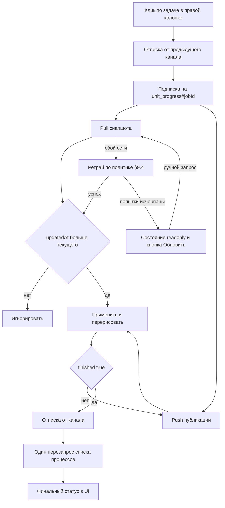
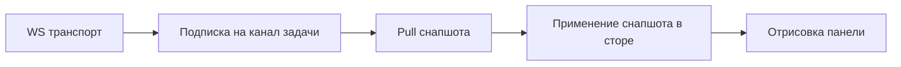

# Задание: живой прогресс выполнения задач runner'а (фронтенд)

Документ-задание для агента, который реализует клиентскую часть потокового прогресса.
Бэкенд уже готов и задеплоен в этой ветке — менять его **не нужно**.

- Репозиторий фронтенда: `../unitman-front` (соседняя папка от корня бэкенда).
- Источник правды по контракту: [`docs/runner-progress-streaming.md`](../unitman/docs/runner-progress-streaming.md).
- Итог работы: панель «Логи задач» (страница юнита) показывает вывод команд runner'а пошагово в реальном времени, без ожидания завершения Temporal-активити.

---

## 1. Что уже работает на бэкенде

### 1.1 Pull-эндпоинт (быстрый снапшот)

`POST /api/unit/poluchitProgressZadachiRunnera`

Запрос (`PoluchitProgressZadachiUnita`, оба поля обязательны, строки):

```json
{ "prozesId": "<id процесса>", "zadachaId": "<id задачи = Temporal workflowId>" }
```

Ответ — стандартный конверт `{"status":"success","data": RunnerJobProgress}`.

`RunnerJobProgress`:

| Поле | Тип | Смысл |
|---|---|---|
| `jobId` | string | id задачи, совпадает с `zadachaId` |
| `steps` | массив `RunnerJobStep` | **полный** снапшот шагов, не дельта |
| `finished` | boolean | задача завершена |
| `success` | boolean | итог (имеет смысл только при `finished: true`) |
| `updatedAt` | integer | unix-время снапшота, `0` — снапшота ещё нет |

`RunnerJobStep`: `{ command: string, response: string, success: boolean, unixtime: integer, unixtimeStart?: integer }`.

- `unixtime` — время **окончания** команды, присутствует всегда.
- `unixtimeStart` — необязательное время **начала** команды. Ключ **отсутствует**,
  если время начала неизвестно (старый Go-раннер, шаги из ранее сохранённых
  событий). Поле появилось позже остальных, поэтому в сгенерированных типах
  оно опциональное — читать как `step.unixtimeStart ?? null`.

Пустой прогресс (раннер ещё ничего не прислал) приходит как `steps: []`, `finished: false`, `success: false`, `updatedAt: 0`.

Ошибки:
- задача не принадлежит указанному процессу → `DomainException` с ключом `unit.runner_job_not_found`;
- нет/просрочен JWT → HTTP 401 (обрабатывается `apiClient` автоматически).

### 1.2 Push-канал Centrifugo

- Канал: `unit_progress#<jobId>` — **отдельный канал на каждую задачу**, не общий.
- Payload публикации **побайтово идентичен** полю `data` pull-ответа (та же структура `RunnerJobProgress`).
- Троттлинг на бэкенде: не чаще одного пуша в 250 мс на задачу; финальный снапшот (`finished: true`) публикуется всегда, минуя троттлинг.
- Снапшот живёт в KV 2 часа. После этого pull вернёт пустой прогресс.
- Centrifugo в этом проекте допускает анонимное подключение и анонимную подписку (`.docker/centrifugo/config.json`: `allow_anonymous_connect_without_token`, `allow_subscribe_for_anonymous`), поэтому **токен на подключение запрашивать не нужно**. JWT-подписка — задача отдельного этапа, в этом задании её не делать.

---

## 2. Стек и ключевые файлы фронтенда

Vue 3.5 + TypeScript 5.6 + Vite 6 + Quasar 2 + Pinia 2 + vue-i18n 11 + `centrifuge ^5.2.2`, типы API — `openapi-typescript` через `yarn gen:api`.

Файлы, которые будут затронуты:

| Файл | Роль |
|---|---|
| [`../unitman-front/src/api/generated/unitman.d.ts`](../unitman-front/src/api/generated/unitman.d.ts) | сгенерированные типы — **сейчас устарели** |
| [`../unitman-front/openapi/unitman.json`](../unitman-front/openapi/unitman.json) | снапшот спецификации для офлайн-генерации |
| [`../unitman-front/src/modules/unit/services/UnitiService.ts`](../unitman-front/src/modules/unit/services/UnitiService.ts) | типизированные вызовы `/unit/*` |
| [`../unitman-front/src/modules/unit/store/SpisokUnitov/StorVipolnenihZadachRunnera.ts`](../unitman-front/src/modules/unit/store/SpisokUnitov/StorVipolnenihZadachRunnera.ts) | стор панели логов |
| [`../unitman-front/src/modules/unit/view/Unit/OknoVipolnenihZadachRunnera.vue`](../unitman-front/src/modules/unit/view/Unit/OknoVipolnenihZadachRunnera.vue) | сама панель (маршрут `unit_jobs`, `:id/jobs`) |
| [`../unitman-front/src/bootstrap/centrifugeClient.ts`](../unitman-front/src/bootstrap/centrifugeClient.ts) | фабрика `useCentrifugo()` |
| [`../unitman-front/src/modules/unit/model/websocket/ModelForChannelSpisokUnitov.ts`](../unitman-front/src/modules/unit/model/websocket/ModelForChannelSpisokUnitov.ts) | образец типа для WS-канала вне OpenAPI |
| [`../unitman-front/src/translator/ru.json`](../unitman-front/src/translator/ru.json) / [`en.json`](../unitman-front/src/translator/en.json) | i18n |
| [`../unitman-front/src/modules/unit/view/SpisokUnitov.vue`](../unitman-front/src/modules/unit/view/SpisokUnitov.vue) | образец подписки на Centrifugo |

Текущее поведение панели: `onMounted` → `store.poluchitVipolnenieZadachiRunnera(unitId)` → список процессов/задач; клик по задаче → `store.select(prozesId, zadachaId)` → `poluchitShagiZadachiRunnera` → шаги **один раз**, без обновления.

---

## 3. Обязательный подготовительный шаг: регенерация типов

В текущем [`unitman.d.ts`](../unitman-front/src/api/generated/unitman.d.ts) есть `RunnerJobStep`, но **отсутствуют** `RunnerJobProgress` и путь `/unit/poluchitProgressZadachiRunnera`. Без регенерации код не скомпилируется.

Порядок:

1. В репозитории бэкенда спецификация уже актуальна: [`docs/openapi.json`](../unitman/docs/openapi.json) содержит и путь, и схему. Если файл вызывает сомнение — пересобрать в бэкенде: `docker exec unitman-web-1 composer run openapi-dump`.
2. Скопировать `../unitman/docs/openapi.json` в `../unitman-front/openapi/unitman.json`.
3. В `../unitman-front` выполнить `yarn gen:api --offline` (либо `yarn gen:api --file ../unitman/docs/openapi.json` — приоритет источников описан в [`scripts/gen-api-types.mjs`](../unitman-front/scripts/gen-api-types.mjs)).

Проверка результата: в генерируемом файле присутствуют `RunnerJobProgress`, `PoluchitProgressZadachiUnita`, `/unit/poluchitProgressZadachiRunnera`; `RunnerJobProgress.steps` — массив `RunnerJobStep`.

> Правку сгенерированного `.d.ts` руками не делать — только генерация. Снапшот `openapi/unitman.json` и результат генерации коммитятся вместе.

---

## 4. Слой API

В [`UnitiService.ts`](../unitman-front/src/modules/unit/services/UnitiService.ts) добавить рядом с `poluchitShagiZadachiRunnera`:

```ts
poluchitProgressZadachiRunnera(params: Schema<"PoluchitProgressZadachiUnita">) {
    return apiClient.post('/unit/poluchitProgressZadachiRunnera', params);
}
```

Важно: `baseURL` в [`apiClient.ts`](../unitman-front/src/bootstrap/apiClient.ts) уже содержит `/api`, путь указывается без префикса. `apiClient` сам разворачивает конверт `{status, data}` и сам обрабатывает 401/refresh — дополнительная авторизация не нужна.

---

## 5. Стор: состояние и жизненный цикл подписки

Расширить [`StorVipolnenihZadachRunnera.ts`](../unitman-front/src/modules/unit/store/SpisokUnitov/StorVipolnenihZadachRunnera.ts):

```ts
type ProgressChannelState = 'live' | 'reconnecting' | 'readonly';

type StorVipolnenihZadachRunneraState = {
    loader: boolean;
    spisok: ProzesUnitaBezShagov[];
    selectJob: { prozesId: string; zadachaId: string; steps: ShagZadachi[] };
    progress: Schema<"RunnerJobProgress"> | null; // текущий снапшот
    channelState: ProgressChannelState;           // см. §9.8
    pullRetryCount: number;                       // номер попытки pull, §9.4
    lastAppliedAt: number;                        // Date.now() последнего применения, §9.7
    oshibkaOtBackenda: string | null;
    unitId: string | null;
};
```

Вне реактивного состояния (`markRaw`-контейнер или поля модуля, не в `state`) держать служебное: ссылку на подписку, `pullInFlight`, `zadachaPokolenie`, идентификаторы таймеров дебаунса/ретраев, `AbortController` (§9.3).

Требования к действиям:

1. `primenitProgress(payload: RunnerJobProgress)` — единственная точка применения снапшота, используется и push-, и pull-веткой.
   - Игнорировать пакет, если он относится к другой задаче: `payload.jobId !== this.selectJob.zadachaId`.
   - Не откатывать состояние назад: применять только если `payload.updatedAt >= (this.progress?.updatedAt ?? 0)`. Pull-ответ может прийти позже более свежего push-пакета — регресс недопустим.
   - Не перерисовывать при полном совпадении `updatedAt` и длины `steps` (защита от дублей pull+push).
   - Дублировать `steps` в `selectJob.steps` не нужно — шаблон переводится на `progress`.
2. `podpisatsyaNaProgress()` — создать подписку и запомнить её (поле модуля стора или отдельный non-reactive контейнер в компоненте):
   - отписаться от предыдущего канала, если он был;
   - `centrifuge.newSubscription('unit_progress#' + zadachaId)`;
   - `sub.on('publication', ctx => this.primenitProgress(ctx.data))`;
   - `sub.subscribe()`;
   - `centrifuge.connect()`;
   - `channelState = 'live'` по событию `subscribed` + дебаунс-pull (§9.3), `channelState = 'reconnecting'` по `unsubscribed`/`error`, а также при `disconnected`/`connecting` транспорта (§9.2, §9.8).
3. `otpisatsyaOtProgressa()` — `sub.unsubscribe()`, сброс ссылки, очистка таймеров дебаунса и ретраев, инкремент поколения, сброс `pullInFlight`.
4. `select(prozesId, zadachaId)` — новая последовательность:
   1. `otpisatsyaOtProgressa()`, `this.progress = null`;
   2. `podpisatsyaNaProgress()` — **до** pull, чтобы не потерять события в окне между pull и подпиской;
   3. один pull `UnitiService.poluchitProgressZadachiRunnera({prozesId, zadachaId})` → `primenitProgress(response.data)`;
   4. бэкенд сам подставляет шаги из БД для завершённых задач (`SUCCESS`/`ERROR`/`CANCLED`) — см. раздел 6.1 в [`runner-progress-streaming.md`](runner-progress-streaming.md). Поэтому фолбэк на `poluchitShagiZadachiRunnera` при `updatedAt === 0` в терминальном состоянии **не обязателен**: pull уже вернёт данные из БД, даже если KV-снапшот истёк по TTL. Дополнительный запрос имеет смысл только как страховка на случай старого бэкенда без DB-ветки; если он выполняется — подписку, открытую на шаге 2, сразу закрыть и выставить `channelState = 'readonly'`, живых публикаций по ней уже не будет.
   5. ошибки: `fail` → `oshibkaOtBackenda = response.data.message`, `error` → `response.message`. Ошибку `unit.runner_job_not_found` не ретраить, показать текст.
5. `zakritOkno()` / `otkritOkno()` — обязательно отписываться: при закрытии панели и при полной перезагрузке списка процессов. Там же — очистка всех таймеров и `AbortController` (§9.3, §9.9).
6. При получении `finished: true`: применить снапшот, отписаться от канала, один раз дозапросить `poluchitVipolnenieZadachiRunnera(unitId)`, чтобы обновить иконки состояний в правой колонке. Дальнейшие пуши по этой задаче не нужны.
7. Экспонировать наружу действие для переподписки после reconnect: по событию `sub.on('subscribed')` (оно приходит и после реконнекта) выполнять pull — это закрывает разрыв, пока соединение было потеряно.
8. `obnovitProgressVruchnuyu()` — ручной pull для кнопки «Обновить» из состояния `readonly`: сбрасывает `pullRetryCount` и запускает один pull с политикой §9.4.
9. `primenitProgress()` при успешном применении обязан обнулять `pullRetryCount` и `oshibkaOtBackenda`, а также выставлять `lastAppliedAt = Date.now()`.

Не создавать `Centrifuge` внутри стора на каждый вызов — использовать [`useCentrifugo()`](../unitman-front/src/bootstrap/centrifugeClient.ts).

---

## 6. Обязательная правка `useCentrifugo()`

Сейчас [`centrifugeClient.ts`](../unitman-front/src/bootstrap/centrifugeClient.ts) создаёт **новый** `Centrifuge` при каждом вызове, то есть новое WebSocket-соединение. Список юнитов уже держит одно соединение, панель логов добавит второе — это лишние сокеты и лишний трафик на каждого пользователя.

Сделать ленивый синглтон с сохранением текущей сигнатуры:

```ts
let instance: Centrifuge | null = null;

export function useCentrifugo(): Centrifuge {
    if (instance === null) {
        instance = new Centrifuge(url);
        // существующие обработчики connecting/connected/disconnected/error
    }
    return instance;
}
```

Требования:
- `SpisokUnitov.vue` продолжает работать без изменений (он вызывает `useCentrifugo()` и `connect()`);
- никто не должен звать `centrifuge.disconnect()` при уходе со страницы — иначе соседний потребитель потеряет соединение. Если нужно освободить ресурсы — только `unsubscribe()` конкретной подписки;
- обратный случай (соединение не установлено, когда нужно) тоже покрыть: `connect()` идемпотентен, вызывать его в `podpisatsyaNaProgress()` можно.

Если решено оставить фабрику как есть — это нужно обосновать в PR: два соединения на пользователя считаются приемлемыми. По умолчанию — синглтон.

---

## 7. UI панели

Файл: [`OknoVipolnenihZadachRunnera.vue`](../unitman-front/src/modules/unit/view/Unit/OknoVipolnenihZadachRunnera.vue).

Сохранить текущую вёрстку левой колонки (моноширинный `pre`, `bash-output`), правила вывода времени (первый шаг — абсолютная дата `dd.MM.yyy H:mm:ss`, последующие — дельта в секундах к предыдущему) и расцветку `response` по `step.success`.

Дополнительно: если у шага есть `unixtimeStart`, показывать **длительность шага** — `unixtime - unixtimeStart` секунд (рядом со временем окончания, не заменяя его). При отсутствии поля длительность не выводить и ничего не рассчитывать от `null`/`0` — шаг остаётся в прежнем виде. Все времена трактовать как unix-секунды.

Добавить:

1. Источник шагов — `progress?.steps ?? []`, с фолбэком на `selectJob.steps` (пункт 5.4).
2. **Статус задачи** над списком шагов:
   - `!finished` и `steps.length > 0` → «Выполняется» (спиннер/пульсирующая иконка, `color="primary"`);
   - `!finished` и `steps.length === 0` → «Ожидание вывода раннера…» (серая плашка, не ошибка);
   - `finished && success` → «Завершено успешно» (`text-positive`, иконка `check_circle`);
   - `finished && !success` → «Завершено с ошибкой» (`text-negative`, иконка `error`).
3. **Время снапшота**: `updatedAt > 0` → подпись «Обновлено: {время}»; `updatedAt === 0` → подпись не показывать.
4. **Индикатор канала**: три состояния по §9.8 — `live` (зелёная точка, «Обновляется в реальном времени»), `reconnecting` (жёлтая точка, «Переподключение…», шаги продолжают отображаться), `readonly` (серая точка, «Только чтение» + кнопка «Обновить», вызывающая `obnovitProgressVruchnuyu()`).
5. **Автоскролл**: после применения снапшота прокручивать контейнер шагов вниз, только если пользователь и так был у нижней границы (порог ~40 px) — иначе не мешать чтению.
6. `onUnmounted` → `store.otpisatsyaOtProgressa()` (внутри уже чистит таймеры и подписку).
7. Ошибка `oshibkaOtBackenda` → показывать блоком над списком (как в других формах проекта, `text-negative`).
8. Все новые строки — через `$t(...)`, ключи добавить и в [`ru.json`](../unitman-front/src/translator/ru.json), и в [`en.json`](../unitman-front/src/translator/en.json) в блок `unit` (предлагаемый префикс: `unit.okno_zadach_runnera.*`: `waiting`, `running`, `finished_success`, `finished_error`, `updated_at`, `live`, `reconnecting`, `readonly`, `refresh_button`, `refresh_failed`).

Не ломать правую колонку: `q-expansion-item` со списком процессов и задач, `select(prozess.id, zadacha.id)` по клику, иконки состояний `NEW`/`ZADACHI_DOBAVLENI`/`PENDING`/`ERROR`/`CANCLED`/`SUCCESS`.

---

## 8. Поведение канала



Правила, которые нельзя нарушать:

- канал — **на задачу**, не общий; при переключении задачи старая подписка обязательна к закрытию;
- снапшот всегда полный, клиент его **перезаписывает**, а не накапливает;
- `updatedAt` — единственный критерий свежести, порядок прихода push/pull не гарантирован;
- `finished: true` → немедленная отписка (бэкенд больше не публикует);
- уход со страницы → отписка, иначе подписки накапливаются и Centrifugo держит мёртвые каналы;
- pull обязателен при открытии задачи и после каждого успешного `subscribed` (в том числе после реконнекта);
- любой разрыв или сбой лечится pull'ом по правилам §9 — не пытаться дособрать пропущенные публикации и не включать `recover` в настройках подписки.

---

## 9. Отказоустойчивость: ретраи и обрыв соединения

Живой прогресс — единственный экран, который должен переживать сетевые сбои без вмешательства пользователя. Ниже — обязательное поведение.

### 9.1 Принципы

1. **Источник правды — pull.** WS-канал только ускоряет доставку. Любой разрыв, реконнект или сомнение в целостности состояния лечится одним `poluchitProgressZadachiRunnera`, а не попытками «дособрать» пропущенные публикации.
2. **Восстановление не требуется.** У канала нет истории: в `.docker/centrifugo/config.json` не заданы `history_size`/`history_ttl`, поэтому `recover: true` не вернёт пропущенные пакеты. Не полагаться на `ctx.wasRecovering`/`ctx.recovered` — после каждого `subscribed` делать pull.
3. **Дедупликация вместо упорядочивания.** Порядок push/pull не гарантирован; единственный критерий — `updatedAt` (§5.1). Повторный пакет с тем же `updatedAt` — no-op, а не ошибка.
4. **Ограниченное число попыток.** Любой ретрай имеет лимит и дедлайн. Бесконечных циклов «pull → fail → pull» быть не должно: после исчерпания попыток UI переходит в «Только чтение» с ручной кнопкой «Обновить».
5. **Отменяемость.** Любой отложенный ретрай и любой in-flight pull обязаны отменяться при смене задачи, закрытии панели или переходе на другой маршрут.

### 9.2 Слои и точки отказа



| Слой | Симптом | Реакция |
|---|---|---|
| Транспорт WS | `centrifuge.on('disconnected')`, `connecting`, `error` | `channelState = 'reconnecting'`, ретраи не запускать — переподключением занимается сам centrifuge-js |
| Подписка | `sub.on('error')`, `sub.on('unsubscribed')` | `channelState = 'reconnecting'`, зафиксировать причину в `console.warn`, дождаться `subscribed` либо ручного обновления |
| Подписка | `sub.on('subscribed')` (в т.ч. после реконнекта) | `channelState = 'live'`, **немедленно** один pull (с дебаунсом ≥ 300 мс) |
| Pull | сетевой сбой, 5xx, `status: "fail"` без признаков доменной ошибки | Ретрай по §9.4 |
| Pull | `status: "error"` (конверт `ErrorEnvelope`) | Показать `message`, ретрай не выполнять |
| Pull | доменная ошибка `unit.runner_job_not_found` | Показать текст, `channelState = 'readonly'`, отписаться, ретраев нет |
| Применение | пакет по другой задаче, `updatedAt` меньше текущего | Игнорировать молча, без ретраев и без ошибки в UI |

### 9.3 Защита от гонок

- **Single-flight pull.** Флаг `pullInFlight` в сторе: пока запрос не завершён, новый pull не стартует; повторный вызов помечается как «нужен ещё один» и выполняется после завершения текущего (не более одного отложенного).
- **Поколение задачи.** При каждом `select()` инкрементировать счётчик `zadachaPokolenie`. Ответ pull и любая публикация применяются только если `pokolenie` не изменилось к моменту ответа. Это закрывает сценарий «переключился на другую задачу, а ответ по старой пришёл позже».
- **Проверка jobId.** Дополнительно сверять `payload.jobId === selectJob.zadachaId` (уже требуется в §5.1) — недостаточно одного поколения, если канал пришёл от чужой подписки.
- **Дебаунс pull после `subscribed`.** Серия событий `subscribed` (реконнект, повторная подписка) не должна порождать шквал запросов: склеивать в один вызов с задержкой 300–500 мс, таймер хранить и сбрасывать.
- **Отмена при смене задачи.** Незавершённые таймеры ретраев и дебаунса очищать в `select()`, `zakritOkno()` и `onUnmounted`. Axios-запрос отменить через `AbortController` — если удобнее, достаточно игнорировать ответ по §9.3 (поколение).

### 9.4 Политика ретраев pull

Экспоненциальная задержка с джиттером, максимум 4 попытки:

| Попытка | Задержка перед запросом |
|---|---|
| 1 (основной вызов) | 0 |
| 2 | 1 с + jitter 0–250 мс |
| 3 | 2 с + jitter 0–500 мс |
| 4 | 4 с + jitter 0–1000 мс |

После исчерпания — остановиться, `channelState = 'readonly'`, показать в панели «Не удалось обновить данные» и кнопку «Обновить», которая повторяет pull вручную и сбрасывает счётчик попыток.

Условия прекращения ретраев независимо от номера попытки:
- `progress.finished === true` (данные уже финальные);
- задача сменилась (`pokolenie` изменилось);
- панель закрыта/компонент размонтирован;
- пришёл `status: "error"` или доменная ошибка (`unit.runner_job_not_found`);
- успешная публикация из WS с `updatedAt` не меньше запрошенного.

### 9.5 Что ретраить нельзя

| Ситуация | Почему | Что делать |
|---|---|---|
| `unit.runner_job_not_found` | Данные не появятся: задача не принадлежит процессу | Показать текст, отписаться |
| HTTP 401 после успешного refresh | Сессия недействительна | `apiClient` уже сбросит сессию; ретраить не нужно |
| `status: "error"` (конверт ошибки бэкенда) | Ошибка детерминированная | Показать `message` |
| `finished: true` | Бэкенд больше не публикует, снапшот финальный | Отписаться, один перезапрос списка процессов |
| Повторный pull при `updatedAt` изменившемся вверх от WS-пакета | Данные уже свежее | Применить WS-пакет, pull не нужен |

### 9.6 Длительный обрыв и устаревание снапшота

1. **Обрыв < 2 часов.** После реконнекта `subscribed` → pull → состояние восстановлено полностью (снапшот в KV ещё жив).
2. **Обрыв > 2 часов.** KV-снапшот истёк. Для незавершённой задачи pull вернёт `steps: []`, `finished: false`, `updatedAt: 0` — оставлять панель в вечном «Ожидание вывода раннера» нельзя, показываем «Только чтение». Для задачи в терминальном состоянии (`SUCCESS`/`ERROR`/`CANCLED`) бэкенд отдаёт шаги из БД прямо в pull-ответе, поэтому `finished: true` и `steps` приходят без истечения снапшота; `channelState = 'readonly'` и отписка — по обычному правилу §6 п. 6.
3. **Бэкенд/centrifugo недоступны целиком.** Панель продолжает работать в pull-режиме: список процессов и шаги читаются REST-ом. Статус канала — «Переподключение», без модальных окон и блокировки интерфейса.
4. **Задача завершилась, пока вкладка была в фоне.** После возврата фокуса (`visibilitychange → visible`) выполнить один pull, если `finished` ещё не был получен; при `finished: true` — отписаться и обновить список процессов.

### 9.7 Фоновая вкладка и несколько вкладок

- Не отключать Centrifugo при `document.hidden`: подписка дешёвая, а реконнект заметен пользователю.
- При возврате фокуса выполнять pull только если с последнего применения снапшота прошло > 5 с либо канал в состоянии не `live` — иначе получится лишний запрос на каждый alt-tab.
- Несколько открытых вкладок с одной задачей — нормальный сценарий: каждая держит свою подписку, снапшоты независимы, дедупликация по `updatedAt` работает в каждой вкладке отдельно.

### 9.8 Индикация состояния в UI

Три состояния вместо бинарного `live` (детализация п. 4 раздела §7):

| Состояние | Условие | Отображение |
|---|---|---|
| `live` | подписка `subscribed`, последний pull успешен | зелёная точка, «Обновляется в реальном времени» |
| `reconnecting` | транспорт не `connected` либо `sub` в состоянии `subscribing`/`unsubscribed` после ошибки | жёлтая точка, «Переподключение…», шаги остаются на экране |
| `readonly` | ретраи исчерпаны, доменная ошибка, снапшот истёк | серая точка, «Только чтение» + кнопка «Обновить» |

Требования: смена состояния не должна сбрасывать уже показанные шаги и не должна скрывать панель за спиннером (спиннер — только на первичной загрузке списка процессов).

### 9.9 Мелочи, обязательные к исправлению

- Убрать отладочный `console.log("AAA", s)` в `convertDate` в [`OknoVipolnenihZadachRunnera.vue`](../unitman-front/src/modules/unit/view/Unit/OknoVipolnenihZadachRunnera.vue); логирование состояний канала — только `console.warn` и только при ошибках.
- Не оставлять «висящих» `setTimeout`: все идентификаторы таймеров хранить в сторе и очищать в `zakritOkno()`/`onUnmounted`.
- При повторном входе в панель не переиспользовать объект подписки от прошлого открытия: создавать новый, старый предварительно `unsubscribe()`.

---

## 10. Ограничения

- Не добавлять новые npm-зависимости: `centrifuge`, `pinia`, `date-fns`, `quasar` уже есть.
- Не менять контракт бэкенда и не править сгенерированный `.d.ts` руками.
- Не реализовывать JWT-подписку Centrifugo — вне рамок задачи.
- Не переносить бизнес-логику в компонент: вычисление статуса, применение снапшота, подписка/отписка — в сторе.
- Не трогать проектную панель логов ([`Proekti/OknoVipolnenihZadachRunnera.vue`](../unitman-front/src/modules/unit/view/Proekti/OknoVipolnenihZadachRunnera.vue)): pull-эндпоинт привязан к юниту, проект получает задачи другим способом. Изменения только для страницы юнита.
- Не переименовывать существующие действия стора (`otkritOkno`, `zakritOkno`, `select`, `poluchitVipolnenieZadachiRunnera`) — они используются в маршрутах и шаблонах.

---

## 11. Проверки и критерии приёмки

Автоматические:

1. `yarn gen:api:check` — снапшот спецификации соответствует сгенерированным типам.
2. `yarn build` (`vue-tsc --noEmit && vite build`) — без ошибок типов и без `any` в новом коде.

Ручные, на стенде (`VITE_CENTRIFUGE_HOST=ws://centrifugo:8000/connection/websocket`, centrifugo `unitman-centrifugo-1`):

3. Запустить сборку юнита, открыть «Логи» (`/unit/<id>/jobs`, кнопка `jobs` в карточке) — шаги появляются по одному по мере выполнения, без ручного обновления страницы.
4. Пока задача идёт, в панели Centrifugo (`http://localhost:8000`, admin-пароль из `dc.*.yml`) виден канал `unit_progress#<jobId>` с одним подписчиком; после завершения подписчик исчезает.
5. Переключение между двумя задачами во время выполнения: шаги предыдущей задачи не примешиваются к новой, число подписок не растёт.
6. Закрытие страницы / переход в список юнитов: подписка исчезает из админки Centrifugo.
7. Перезапуск контейнера Centrifugo при открытой панели: после реконнекта снапшот догоняется одним pull, шаги не теряются и не дублируются.
8. Открытие уже завершённой задачи: сразу показывается финальный статус и полный список шагов; для задачи старше 2 часов (KV-снапшот истёк) шаги берутся из БД-фолбэка, панель в режиме «Только чтение».
9. Задача другого юнита (подмена `zadachaId` в запросе): приходит `unit.runner_job_not_found`, UI показывает текст, `channelState` остаётся/переходит в `readonly`, подписка снимается.
10. `ru.json` и `en.json` содержат одинаковый набор новых ключей, переключение локали не ломает панель.

Проверки отказоустойчивости (§9):

11. Остановить контейнер Centrifugo при открытой панели: индикатор переходит в «Переподключение…», шаги остаются на экране, лишних pull-запросов в Network нет (ретраи pull не запускаются на событие транспорта). Поднять контейнер — индикатор возвращается в `live`, выполняется ровно один pull.
12. Заблокировать сеть в DevTools (Offline) и нажать «Обновить» в состоянии `readonly`: видно не более 4 попыток с нарастающей задержкой, после чего кнопка снова активна и текст ошибки не дублируется; при снятии блокировки повторное нажатие восстанавливает данные.
13. Переключиться на другую задачу в момент, когда pull по предыдущей ещё в полёте: ответ по старой задаче не применяется (ни шагов, ни статуса), в Network нет накопления параллельных pull-запросов (single-flight).
14. Свернуть вкладку (`document.hidden`) на время выполнения задачи, затем вернуться: панель не отключается, после фокуса выполняется один pull (не серия), шаги полные и без дублей. При отключённом `visibilitychange`-хендлере критерий считается невыполненным.

Готово, когда:

- все пункты 1–14 выполнены;
- в новом коде нет `console.log`, `any`, `@ts-ignore`;
- в PR перечислены изменённые файлы и указано, что `centrifuge.disconnect()` нигде не вызывается (§6).