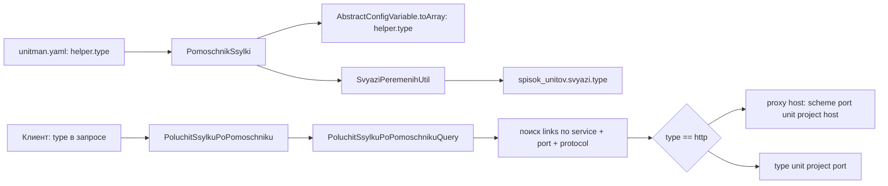

# Протокол (`type`) в хелпере ссылки и генерация ссылок

## 1. Цель

1. В хелпер ([`PomoschnikSsylki`](src/Unitman/Business/Model/Unit/ConfigUnita/PomoschnikSsylki.php:5)) добавить
   свойство `type` (протокол), по умолчанию `http`; учитывать его при генерации ссылки.
2. Проверить обработку `type = ws`:
   - в генерации ссылок юнитов ([`SpisokUnitovProjection`](src/Unitman/Infra/Projection/SpisokUnitovProjection.php:221));
   - в хелпере ([`PoluchitSsylkuPoPomoschnikuQuery`](src/Unitman/Business/UseCase/Unit/PoluchitSsylkuPoPomoschnikuQuery.php:21)).

## 2. Результат проверки (текущее поведение)

| Место | `http` | `ws` | Прочее (`tcp`, ...) |
|---|---|---|---|
| Юниты | `https://<port>.<unit>.<project>.<proxyhost>` (схема из proxy host) | попадает в ветку `else`: `ws://<unit>.<project>:<port>` | `tcp://<unit>.<project>:<port>` |
| Хелпер | `httрs`-ссылка через proxy host | **не находится**: жёсткое условие `protocol === 'http'` в цикле поиска | **не находится** |
| `PomoschnikSsylki` | — | **протокола нет**, клиент не может его передать | — |

Вывод: юниты `ws` обрабатывают (но без proxy host и без `wss`), хелпер `ws` — не обрабатывает.
Принятое решение: юниты не меняем; хелпер повторяет формат юнитов — `ws://<unit>.<project>:<port>`,
без proxy host и без `wss`. `suffix`/`startUri` дописывается так же, как в проекции юнитов.

## 3. Изменения

### 3.1 VO хелпера

[`PomoschnikSsylki`](src/Unitman/Business/Model/Unit/ConfigUnita/PomoschnikSsylki.php:12):

```php
public readonly string $type;                         // протокол, по умолчанию http

public function __construct(?string $projectId, ?string $service, ?int $port, ?string $suffix = null, ?string $type = 'http')
```

- нормализация: `strtolower(trim((string)$type))`, пустая строка/`null` → `http`;
- валидация схемы: `^[a-z][a-z0-9+.-]*$`, иначе `DomainException('unit.config.pomoschnik.type_invalid')`;
- `fromArray()` читает `$data['type'] ?? null` (обратная совместимость со старыми конфигами);
- `toArray()` отдаёт `type` (всегда заполнен — контракт API не ломается).

### 3.2 Нормализация протокола в конфиге

[`PortServisa`](src/Unitman/Business/Model/Unit/ConfigUnita/KonfigServisa/PortServisa.php:12): `type` приводить к
`lowercase/trim` при создании. Это делает сравнение `protocol` в проекции и в хелпере регистронезависимым
(`'HTTP'` → `'http'`) без правки логики проекции.

### 3.3 Проброс `type` в read-модель связей

[`SvyaziPeremenihUtil`](src/Unitman/Business/Utils/SvyaziPeremenihUtil.php:44):

- `poluchitPomoschnikiPoPeremennim()` — добавить `'type' => $helper['type'] ?? 'http'` в элемент результата и в `@return`;
- `sobratSvyaziPoKonfigu()` — переносить `type` хелпера в связь;
- `sobratSvyaziDlyaReadModel()` — при неизвестном конфиге `'type' => (string)($svyaz['type'] ?? 'http')`.

`svyazi_unitov` и миграции не меняются: таблица хранит только `unit_id/variable_id/target_unit_id/project_id`,
ссылка по ней не генерируется.

### 3.4 Команда хелпера

[`PoluchitSsylkuPoPomoschniku`](src/Unitman/Business/Command/Unit/PoluchitSsylkuPoPomoschniku.php:9): новое поле

```php
public readonly ?string $type = null   // null/пусто → http, иначе протокол искомого порта
```

`null` (а не `string $type = 'http'`) — чтобы JSON `"type": null` не ронял десериализацию
([`JsonBodySerializableConverter`](src/Utils/Converter/JsonBodySerializableConverter.php:23)).

### 3.5 Генерация ссылки в хелпере

[`PoluchitSsylkuPoPomoschnikuQuery`](src/Unitman/Business/UseCase/Unit/PoluchitSsylkuPoPomoschnikuQuery.php:21):

1. Вычислить нормализованный протокол: пусто → `http`.
2. В цикле по `$targetUnit->links` сравнивать `$unitLink['protocol'] === $type` вместо `=== 'http'`.
3. `sformirovatSsylku(SpisokUnitovReadModel $targetUnit, string $type, int $port, ?string $suffix)`:
   - `http` — существующая логика: `parse_url(proxyHost)`, `<scheme>://<port>.<unit>.<project>.<host>[:<port>]`;
   - иначе — как в проекции юнитов: `<type>://<unit>.<project>:<port>`;
   - `suffix` дописывается в обоих случаях (с нормализацией ведущего `/`).

Ссылка для `ws` намеренно **не** учитывает схему proxy host и не превращается в `wss`.

### 3.6 OpenAPI

- [`config/packages/nelmio_api_doc.yaml`](config/packages/nelmio_api_doc.yaml:985): `ConfigVariableHelper` —
  `type` (string, `default: http`, `example: ws`) и в `required`;
- `UnitSvyaz` — `type` (string, nullable, описание «протокол из хелпера»);
- `PoluchitSsylkuPoPomoschniku` — `type` (string, nullable, `default: http`, `example: ws`);
- перегенерировать [`docs/openapi.json`](docs/openapi.json:1) через `composer openapi-dump`;
- в [`plans/all-endpoints-strict-contracts.md`](plans/all-endpoints-strict-contracts.md:81) обновить состав
  `ConfigVariableHelper` (`projectId, service, port, suffix, type` — `suffix` там уже отстал).

## 4. Поток



## 5. Тесты

| Файл | Проверка |
|---|---|
| [`ConfigUnitTest`](src/Unitman/Tests/Unit/Unit/ConfigUnitTest.php:143) | `helper.type` по умолчанию `http`; разбор `type: ws`; `toArray` содержит `type` |
| [`PoluchitSsylkuPoPomoschnikuQueryTest`](src/Unitman/Tests/UseCase/Unit/PoluchitSsylkuPoPomoschnikuQueryTest.php:17) | новый конфиг с `ws`-портом: ссылка `ws://<unit>.<project>:<port>` и с `suffix`; `type` по умолчанию для ws-порта → `unit.pomoschnik.servis_ne_naiden` |
| Тест `PortServisa` | `type: 'WS'` нормализуется в `ws` |
| [`UnitUspeshnoOstanovlenIUdalenTest`](src/Unitman/Tests/UseCase/Unit/UnitUspeshnoOstanovlenIUdalenTest.php:154) | не трогаем — фиксирует прежнее поведение юнитов |

Существующие фикстуры [`config_1.yaml`](src/Unitman/Tests/UseCase/Unit/data/config_1.yaml:1) и
[`config_2.yaml`](src/Unitman/Tests/UseCase/Unit/data/config_2.yaml:1) используются другими тестами с
проверкой `links`, поэтому ws-порт добавляется в **новый** файл фикстуры.

## 6. Проверка

В контейнере, после `php bin/console cache:clear`:

- `php vendor/bin/phpunit --filter=PoluchitSsylkuPoPomoschnikuQueryTest`
- `php vendor/bin/phpunit --filter=ConfigUnitTest`
- `composer check-openapi`
- `composer run check-deptrac` и пер-модульные `check-unitman-deptrac`
- `psalm`
- `rr reset` в контейнере
