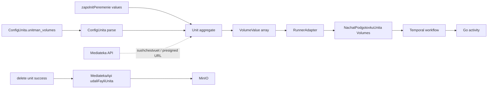

# План: MinIO + модуль Mediateka + `unitman_volumes` в юните

## 1. Цель

1. Поднять MinIO в docker-инфраструктуре; настройки авторизации — только через env.
2. Новый модуль `Mediateka` — **тонкий прокси в MinIO** (без event sourcing): загрузка, получение, удаление файла.
3. Необязательный блок `unitman_volumes` в конфиге юнита; при заполнении переменных можно указать ключ файла; при «подготовке» блок и файлы уходят в `Runner` → в activity; при удалении юнита прикреплённые файлы удаляются.

Ограничения медиатеки (по требованию): для файлов юнита разрешены **только zip-архивы**, размер — **не более 200 МБ**.

## 2. Ключевые решения

| Тема | Решение |
|---|---|
| Хранение в Mediateka | **Без EventSauce.** Одна таблица-реестр `mediateka_file` через DBAL; источник истины — MinIO |
| Владение файлом | Файл принадлежит юниту напрямую: колонка `unit_id` в `mediateka_file`. Отдельной таблицы привязок нет |
| Роль модуля | Проксирование в MinIO: upload / download / delete / presign. Бизнес-логики нет |
| Тип и размер | `application/zip` по mime + проверка локальной сигнатуры `PK\x03\x04`; `<= 209715200` байт |
| Транспорт загрузки | Сырое тело запроса (`application/octet-stream`) + метаданные в query (`unitId`, `name`). В проекте нет multipart-обработки (поиск `multipart|UploadedFile|PsrHttpFactory` — 0 совпадений), а raw-body работает независимо от конвертации RoadRunner → Symfony Request |
| S3-клиент | `aws/aws-sdk-php` — единственная новая зависимость (SigV4, presign, multipart). Альтернатива — SigV4 на `symfony/http-client`; см. D1 |
| Отдача файла | Presigned GET URL через `MINIO_PUBLIC_ENDPOINT` + эндпоинт метаданных |

## 3. Поток данных



## 4. Docker / MinIO

**`common-services.yml`**:

```yaml
  minio:
    image: bitnamilegacy/minio:2025.4.22-debian-12-r1
    container_name: minio
    restart: always
    user: root            # только для chown каталога данных на старте
    environment:
      - MINIO_ROOT_USER=${MINIO_ROOT_USER}
      - MINIO_ROOT_PASSWORD=${MINIO_ROOT_PASSWORD}
      - MINIO_BROWSER_REDIRECT_URL=${MINIO_PUBLIC_ENDPOINT_CONSOLE}
      - MINIO_DATA_DIR=/data
      - MINIO_API_PORT_NUMBER=9000
      - MINIO_CONSOLE_PORT_NUMBER=9001
    ports:
      - "${MINIO_PORT:-9000}:9000"
      - "${MINIO_CONSOLE_PORT:-9001}:9001"
    volumes:
      - ./var/volume/minio:/data
    healthcheck:
      test: ["CMD", "curl", "-fsS", "http://127.0.0.1:9000/minio/health/live"]
      interval: 10s
      timeout: 5s
      retries: 5
      start_period: 10s

  minio-init:
    image: bitnamilegacy/minio-client:latest
    depends_on:
      minio:
        condition: service_healthy
    environment:
      - MINIO_ROOT_USER=${MINIO_ROOT_USER}
      - MINIO_ROOT_PASSWORD=${MINIO_ROOT_PASSWORD}
      - MEDIATEKA_BUCKET=${MEDIATEKA_BUCKET}
    entrypoint: ["/bin/sh", "-c"]
    command:
      - >
        mc --config-dir /tmp/.mc alias set local http://minio:9000 "$$MINIO_ROOT_USER" "$$MINIO_ROOT_PASSWORD" &&
        mc --config-dir /tmp/.mc mb --ignore-existing "local/$$MEDIATEKA_BUCKET" &&
        echo "bucket $$MEDIATEKA_BUCKET is ready"
```

**Почему не официальные образы.** `minio/minio` и `minio/mc` удалены из Docker Hub
(любой тег, включая исторические `RELEASE.*`, отдаёт `not found`), а `quay.io/minio/*`
без авторизации отвечает `401`. Доступное публичное зеркало — `bitnamilegacy/minio`
и `bitnamilegacy/minio-client`. Контракт авторизации у него тот же
(`MINIO_ROOT_USER` / `MINIO_ROOT_PASSWORD`), но запуск идёт через `run.sh`,
поэтому каталог данных и порты передаются переменными (`MINIO_DATA_DIR`,
`MINIO_API_PORT_NUMBER`, `MINIO_CONSOLE_PORT_NUMBER`), а healthcheck использует
`/minio/health/live` — в образе нет предварительно настроенного alias `local`
для `mc ready local`.

**`docker-compose.yml` / `dc.mvp.yml`** — `extends` для `minio` и `minio-init`; в `web.depends_on` добавить `minio` и `minio-init`. Секретов в yml нет.

Проверено: `docker compose up -d minio minio-init` → оба контейнера поднимаются,
`minio-init` создаёт бакет `unitman-mediateka`, `minio:9000/minio/health/live` = 200
из контейнера `web`, полный цикл адаптера (save → exists → presigned → delete)
выполняется против живого MinIO.

**`.env.dist`**:

```
###> minio ###
MINIO_ROOT_USER=unitman
MINIO_ROOT_PASSWORD=change-me-in-env-local
MINIO_PORT=9000
MINIO_CONSOLE_PORT=9001
MINIO_ENDPOINT=http://minio:9000
MINIO_PUBLIC_ENDPOINT=http://localhost:9000
MINIO_REGION=us-east-1
MINIO_USE_PATH_STYLE=true
###< minio ###

###> mediateka ###
MEDIATEKA_BUCKET=unitman-mediateka
MEDIATEKA_PRESIGN_TTL=3600
MEDIATEKA_MAX_FILE_SIZE=209715200
###< mediateka ###
```

Реальные значения — в `.env.local` (в `.rooignore`).

## 5. Модуль `Mediateka`

```
src/Mediateka/
  Api/MediatekaApi.php
  Business/
    Command/ZagruzitFaylUnita.php, PoluchitFaylUnita.php, UdalitFayl.php, PoluchitSpisokFaylovUnita.php
    Model/FaylUnita.php                (read-модель: id, unitId, name, size, mime, storageKey, createdAt)
    Port/FaylUnitaRepository.php, FileStorage.php, CanGenerateGuid.php
    UseCase/ZagruzitFaylUnitaUseCase.php, UdalitFaylUseCase.php,
            PoluchitFaylUnitaQuery.php, PoluchitSpisokFaylovUnitaQuery.php,
            UdaliFayliUnitaUseCase.php, ProveritFayliUnitaUseCase.php
  Infra/
    Adapter/MinioFileStorage.php
    Adapter/RamseyGuidGenerator.php
    Controller/MediatekaController.php
    Repository/SqlFaylUnitaRepository.php
    Migrations/Version..._create_mediateka_file.php
  Tests/
  di.php, routing.php, deptrac.yaml, .modulite.yaml
```

Никаких `event_store`, `projections_manager`, `Projection`, `Infra/Jobs` — по требованию event sourcing не используется.

### 5.1 Реестр файлов (DBAL, без ES)

`src/Mediateka/Migrations/Version...php`:

```sql
CREATE TABLE mediateka_file (
    id            UUID NOT NULL PRIMARY KEY,
    unit_id       UUID NULL,
    name          VARCHAR(255) NOT NULL,
    size          BIGINT NOT NULL,
    mime_type     VARCHAR(127) NOT NULL,
    storage_key   VARCHAR(255) NOT NULL,
    uploaded_by   UUID NULL,
    created_at    TIMESTAMP WITHOUT TIME ZONE NOT NULL
);
CREATE INDEX idx_mediateka_file_unit ON mediateka_file (unit_id);
CREATE UNIQUE INDEX uniq_mediateka_file_storage_key ON mediateka_file (storage_key);
```

`storage_key = fayly/{unitId}/{fileId}.zip`, при отсутствии юнита — `fayly/tmp/{fileId}.zip`. Запись в таблицу удаляется вместе с объектом в MinIO.

### 5.2 Порт хранилища

```php
interface FileStorage
{
    public function save(string $key, string $tmpPath, string $mimeType): void;
    public function delete(string $key): void;
    public function presignedGetUrl(string $key, int $ttl): string;
    public function exists(string $key): bool;
}
```

`MinioFileStorage` — `Aws\S3\S3Client` из `aws/aws-sdk-php` (endpoint `MINIO_ENDPOINT`, `use_path_style_endpoint`). Параметры — через `bind` в `di.php`.

### 5.3 Use cases

- `ZagruzitFaylUnitaUseCase` — проверки: `size <= MEDIATEKA_MAX_FILE_SIZE` (иначе `mediateka.file_too_large`), mime/сигнатура zip (иначе `mediateka.file_not_zip`), `unitId` непустой; генерирует `fileId`, пишет в MinIO, вставляет строку в `mediateka_file`. Возвращает `FaylUnita`.
- `UdalitFaylUseCase` — `delete` в MinIO + `DELETE` строки; идемпотентно (отсутствующий объект не ошибка).
- `PoluchitFaylUnitaQuery` — метаданные + presigned URL.
- `PoluchitSpisokFaylovUnitaQuery` — список по `unit_id`.
- `UdaliFayliUnitaUseCase` — все файлы юнита: удалить объекты в MinIO, удалить строки. Идемпотентно.
- `ProveritFayliUnitaUseCase` — существование набора `fileId` (для валидации в `Unitman`).

### 5.4 Публичный API модуля

```php
final class MediatekaApi
{
    public function zagruzitFaylUnita(string $unitId, string $name, string $tmpPath, int $size): FaylUnita;
    public function sushchestvuetLiFayl(string $fileId): bool;
    public function poluchitFaylUnita(string $fileId): FaylUnita;
    public function poluchitSsylkuDlyaFayla(string $fileId, int $ttl): string;
    public function poluchitFaylyUnita(string $unitId): array;
    public function udaliFayl(string $fileId): void;
    public function udaliFayliUnita(string $unitId): void;
}
```

### 5.5 HTTP

`#[Route('/api/mediateka')]`, тег OpenAPI `Mediateka`, полные пути, конверт `Response::success()`:

| Метод | Путь | Назначение |
|---|---|---|
| POST | `/api/mediateka/upload` | загрузка zip: raw body, query `unitId`, `name` |
| GET | `/api/mediateka/file/{id}` | метаданные + presigned URL по `id` |
| GET | `/api/mediateka/unit/{unitId}` | список файлов по `unitId` |
| DELETE | `/api/mediateka/file/{id}/udalit` | удаление по `id` |

`DELETE` вынесен на отдельный путь с суффиксом `/udalit`: у каждой operation
должен быть уникальный путь (см. `plans/all-endpoints-strict-contracts.md`),
поэтому `DELETE /api/mediateka/file/{id}` конфликтовал бы с `GET` того же пути.

В контроллере — предварительная проверка `Content-Length` (быстрый отказ до чтения тела), затем потоковая запись в `tmpfile()` и передача пути в use case.

## 6. `unitman_volumes` в конфиге юнита

### 6.1 Конфиг

Новый VO `ConfigUnita\VolumeConfig` (`dir`, `name`, `?variable`); парсинг в [`ConfigUnita`](src/Unitman/Business/Model/Unit/ConfigUnita.php:10):

```yaml
unitman_volumes:
  - dir: db
    name: "БД"
    variable: DB_DUMP_ID     # опционально: id переменной, в которой лежит ключ файла
```

Правки [`__construct()`](src/Unitman/Business/Model/Unit/ConfigUnita.php:31), [`toArray()`](src/Unitman/Business/Model/Unit/ConfigUnita.php:79), [`fromArray()`](src/Unitman/Business/Model/Unit/ConfigUnita.php:93). Блок необязателен, дефолт `[]`. Валидация: непустые `dir`/`name`, уникальность `dir`, `variable` (если задан) обязан существовать среди переменных конфига.

### 6.2 `VolumeValue`

`src/Unitman/Business/Model/Unit/VolumeValue.php`, рядом с [`VariableValue`](src/Unitman/Business/Model/Unit/VariableValue.php:5):

```php
final class VolumeValue
{
    public function __construct(
        private string $dir,
        private string $name,
        private ?string $fileId = null,
    ) { /* DomainException на пустые dir/name */ }

    function toArray(): array;                       // ['dir','name','fileId']
    public function getDir(): string;
    public function getName(): string;
    public function getFileId(): ?string;
    public function esliSFaylom(): bool;
    public static function fromArray(array $data): self;
}
```

### 6.3 Агрегат `Unit`

- `/** @var VolumeValue[] */ private array $volumeValues = [];`
- `makeVolumeCollectionByArray(array $values): array` — для каждого `VolumeConfig` берёт `fileId = $config->variable ? ($values[$config->variable] ?? null) : null`; при заданной переменной и пустом значении — `DomainException('unit.volumes.file_not_set')`.
- [`zapolnitPeremenie()`](src/Unitman/Business/Model/Unit.php:647): после `validateValues` заполняет `$this->volumeValues` и кладёт их в событие.
- Событие [`PeremenieUnitaZapolneni`](src/Unitman/Business/Model/Unit/Event/PeremenieUnitaZapolneni.php:5): новый последний параметр `public readonly array $volumes = []` (старые payload'ы валидны).
- [`applyPeremenieUnitaZapolneni()`](src/Unitman/Business/Model/Unit.php:683): восстанавливает `volumeValues` из `$fact->volumes`.
- Геттер `poluchitVolumeUnita(): array` (по аналогии с [`poluchitZnacheniyaPeremenih()`](src/Unitman/Business/Model/Unit.php:1323)).
- [`handlePeremenieUnitaZapolneni()`](src/Unitman/Infra/Projection/SpisokUnitovProjection.php:253): пишет `volumes` в read-модель; миграция `src/Unitman/Migrations` — nullable jsonb-колонка.

### 6.4 Порт + Acl в `Unitman`

- `src/Unitman/Business/Port/MediatekaService.php`: `sushchestvuetLiFayl`, `poluchitSsylkuDlyaFayla`, `poluchitFaylyUnita`, `udaliFayliUnita`.
- `src/Unitman/Acl/MediatekaAdapter.php` — через `Api\MediatekaApi` (единственная точка доступа, как [`Acl/RunnerAdapter.php`](src/Unitman/Acl/RunnerAdapter.php:35)).
- Проверка существования файлов — в [`ZapolnitPeremenieUnitaUseCase`](src/Unitman/Business/UseCase/Unit/ZapolnitPeremenieUnitaUseCase.php:23) **до** `zapolnitPeremenie`.

## 7. Передача в Runner → activity

- `src/Runner/Business/Command/NachatPodgotovkuUnita/Volume.php`:

```php
final class Volume
{
    public function __construct(
        public readonly string $Dir,
        public readonly string $Name,
        public readonly ?string $FileId = null,
        public readonly ?string $Url = null,
        public readonly ?string $FileName = null,
    ) {}
}
```

- [`NachatPodgotovkuUnita`](src/Runner/Business/Command/NachatPodgotovkuUnita.php:7): новый последний параметр `public readonly array $Volumes = []`.
- [`RunnerAdapter::nachatPodgotovkuUnita()`](src/Unitman/Acl/RunnerAdapter.php:79): `makeVolumesListFromUnit(Unit $unit): array` — для каждого `VolumeValue` с `fileId` получает presigned URL через `MediatekaService`.
- [`NachatPodgotovkuUnitaWorkflow`](src/Runner/Infra/Workflow/NachatPodgotovkuUnitaWorkflow.php:20) не меняется; `config/workflows.php` не меняется.
- Go-activity `NachatPodgotovkuUnitaActivity` читает `Volumes[]` (`Dir`, `Name`, `FileId`, `Url`, `FileName`) — внешний контракт, вне этого репозитория.

## 8. Удаление юнита → удаление файлов

- [`UstanovitResultatUdaleniyaUseCase`](src/Unitman/Business/UseCase/Unit/UstanovitResultatUdaleniyaUseCase.php:18): в успешной ветке после `ustanovitUspehUdaleniya` — `mediatekaService->udaliFayliUnita($unitId)`.
- [`UdalitSlomaniyUnitUseCase`](src/Unitman/Business/UseCase/Unit/UdalitSlomaniyUnitUseCase.php:20) — тот же вызов.
- При ошибке удаления файлы не трогаем; операция идемпотентна.

## 9. Архитектура

- Корневой [`deptrac.yaml`](deptrac.yaml:29): новый слой `Mediateka`; `Unitman: [BackgroundJob, Mediateka]`; `Mediateka: []`. `Runner` **не** зависит от `Mediateka` — получает только URL.
- `src/Mediateka/deptrac.yaml` — по образцу существующих.
- `.modulite.yaml`: `name: "@mediateka"`, `export: Api\MediatekaApi`, `require: "@utils"`.
- [`composer.json`](composer.json:109): `check-mediateka-deptrac` + включение в `all-checks`; `aws/aws-sdk-php` в `require`.
- Без ORM-сущностей; без правки namespace `App\Utils\Model\Reponse`.

## 10. OpenAPI

Атрибуты `#[OA\...]` в `MediatekaController` (полные пути, тег один, security bearer); для raw-body upload — `requestBody` c `application/octet-stream`; затем `composer openapi-dump` → обновление [`docs/openapi.json`](docs/openapi.json) → `composer check-openapi`.

## 11. Тесты и проверки

- `src/Mediateka/Tests/Business/` — use cases на фейковом `FileStorage` и in-memory репозитории: zip-валидация, лимит 200 МБ, удаление.
- `src/Mediateka/Tests/Api/MediatekaControllerTest.php`.
- `src/Unitman/Tests/Unit/Unit/VolumeValueTest.php`.
- Расширение [`ConfigUnitTest`](src/Unitman/Tests/Unit/Unit/ConfigUnitTest.php:10): валидный/пустой блок, дубликат `dir`, отсутствующая `variable`.
- Тест `zapolnitPeremenie`: заполнение `volumes`, ошибка при незаданном файле.
- Перед запуском — `php bin/console cache:clear` в контейнере; после правок — `rr reset`.
- Финально: `composer all-checks` + `composer check-openapi`.

## 12. Открытые решения

| # | Вопрос | Рекомендация |
|---|---|---|
| D1 | S3-клиент | `aws/aws-sdk-php`. Если зависимость недопустима — SigV4-подписант на `symfony/http-client` |
| D2 | Загрузка до 200 МБ | raw body + потоковая запись в `tmpfile()`; multipart-мост — отдельная задача, если понадобится |
| D3 | Обязательность `variable` в `unitman_volumes` | Опциональна: том без `variable` — объявление каталога без файла |
| D4 | Публичный доступ к MinIO | presigned URL требует доступного `MINIO_PUBLIC_ENDPOINT`; иначе — проксирование скачивания через API |
| D5 | Один файл на том или несколько | Сейчас — один `fileId` на запись `unitman_volumes`; расширение до списка — отдельная итерация |
