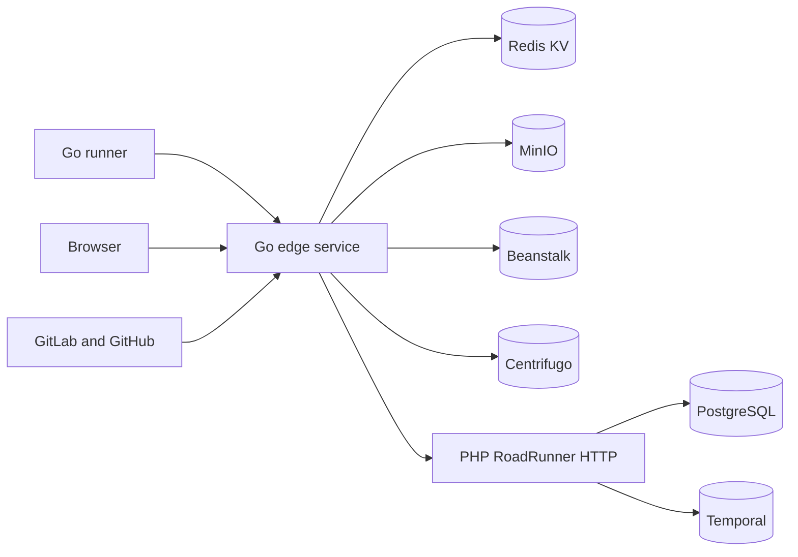

# Уменьшение потребления памяти Unitman без деградации для пользователей

## 1. Главный вывод

Потребление памяти этим приложением определяется не «тяжёлым кодом», а **количеством
одновременно живых PHP‑процессов RoadRunner и их RSS**. Каждый воркер поднимает
полный Symfony‑контейнер и держит его до перезапуска.

Фактический замер на локальном стенде (см. [`plans/memory-baseline/report.md`](plans/memory-baseline/report.md)):

| Пул | Процессов | PSS в idle, МБ | Источник |
|-----|-----------|----------------|----------|
| HTTP | 12 | 253 | `RR_HTTP_NUM_WORKERS:-12` в [`.rr.yaml`](.rr.yaml:31) |
| RoadRunner Jobs | 20 | 362 | `RR_JOBS_NUM_WORKERS:-20` в [`.rr.yaml`](.rr.yaml:74) |
| Temporal | 13 | 391 | `RR_TEMPORAL_NUM_WORKERS:-12` в [`.rr.yaml`](.rr.yaml:40) |
| RR‑сервисы фоновых задач | 24 | 857 | 14 задач: `ochered_unitov` × 10, остальные × 1 (см. [`.rr.yaml`](.rr.yaml:47), [`BackgroundJobService`](src/BackgroundJob/Infra/Service/BackgroundJobService.php:55)) |
| RoadRunner | 1 | 89 | процесс `rr serve` |
| **Итого** | **70** | **1952** | 1.93 GiB по `docker stats` |

Под нагрузкой суммарный PSS растёт до 2314–2417 МБ, а `docker stats` — до
2.31–2.42 GiB. После загрузки файла 199 МБ процесс `rr serve` держит ~310 МБ.

Отсюда приоритет работ:

1. Измерить (без цифр любые оптимизации — гадание).
2. Убрать накладные расходы рантайма и сборки.
3. Сократить число процессов (главный рычаг).
4. Убрать пиковые аллокации на больших payload.
5. Вынести на edge в Go только stateless‑части: прогресс, файлы, вебхуки, телеметрию.

Доменную логику и Event Sourcing в Go **не переносим** — единственный источник
истины остаётся в PHP/PostgreSQL.

## 2. Целевые показатели

| Метрика | Сейчас | Цель |
|---------|--------|------|
| Число PHP‑процессов | 70 | ≤ 25 |
| Суммарный PSS в idle | 1.93 ГБ | ≤ 1.2 ГБ |
| Суммарный PSS после нагрузки | 2.42 ГБ | ≤ 1.6 ГБ |
| `docker stats` в idle | 1.93 GiB | ≤ 1.3 GiB |
| p95 `POST /api/runner/saveSteps`, 2,4 МБ | 219 мс | ≤ 350 мс |
| p95 `saveSteps`, 10 шагов | 43 мс | ≤ 120 мс |
| p95 `POST /api/unit/list` | 72 мс | ≤ 200 мс |
| p95 `POST /api/unit/moi` | 132 мс | ≤ 200 мс |
| Загрузка 199 МБ | 12 с | ≤ 20 с |
| Рестарты воркеров по `max_worker_memory` | 0 за замер | 0 на стабильной нагрузке |
| Рост PSS за полный цикл | замерить | < 10 % |

## 3. Фаза 0. Baseline (выполнено)

Протокол: [`plans/memory-baseline-protocol.md`](plans/memory-baseline-protocol.md).
Результаты: [`plans/memory-baseline/report.md`](plans/memory-baseline/report.md).
Артефакты: `plans/memory-baseline/` — CSV снимков, вывод `rr workers`, результаты `ab`,
`docker stats`, `php -i`, `php -m`, метрики RoadRunner.

Воспроизведение:

```sh
# снимок процессов и PSS
docker exec unitman-web-1 sh /home/containeruser/www/scripts/memory-snapshot.sh \
  /home/containeruser/www/plans/memory-baseline/snapshot.csv

# отчёт по пулам
docker exec unitman-web-1 rr workers -c .rr.yaml > /tmp/rr-workers.txt
python3 scripts/memory-report.py plans/memory-baseline/snapshot.csv /tmp/rr-workers.txt
```

Ограничение: замер снят на dev-образе с Xdebug и xhprof. Абсолютные значения выше
production, поэтому сравнивать «до/после» нужно на одном и том же образе и стенде.

## 4. Фаза 1. Сборка и рантайм без изменения поведения

### 4.1. Production-образ

[`Dockerfile.dist`](Dockerfile.dist:9) устанавливает `xdebug` и `xhprof` в
production‑образ. Замер подтвердил: в контейнере загружены Xdebug 3.4.2 и xhprof.
Это прямые накладные расходы памяти на каждый процесс.

- убрать `xdebug` и `xhprof` из production‑слоя (оставить в dev‑образе
  [`Dockerfile`](Dockerfile));
- [`Dockerfile.dist`](Dockerfile.dist:34): `composer install --no-dev --classmap-authoritative --no-scripts`;
- проверить, что `composer dump-autoload --optimize` не тянет dev‑классы;
- уменьшить итоговый образ: убрать `pgsql` (достаточно `pdo_pgsql`), не ставить
  лишние расширения.

Ожидаемо: −15…40 МБ RSS на процесс, меньше размер образа и время холодного старта.

### 4.2. OPcache и PHP-настройки

[`.docker/php/settings.ini`](.docker/php/settings.ini:1) содержит только
`memory_limit = 512M`. Фактически в контейнере: `opcache.enable_cli=Off`,
`opcache.memory_consumption=128`, `interned_strings_buffer=8`, JIT `tracing`
при `jit_buffer_size=0`. Для 70 CLI‑процессов OPcache в CLI‑режиме выделяет
**отдельный сегмент shared memory на каждый процесс** — при 128 МБ это скрытый
резерв памяти, умноженный на число воркеров.

Предлагаемые значения (уточнить после замера):

```ini
memory_limit = 256M
opcache.enable = 1
opcache.enable_cli = 1
opcache.memory_consumption = 64
opcache.interned_strings_buffer = 8
opcache.max_accelerated_files = 20000
opcache.validate_timestamps = 0
opcache.save_comments = 0
opcache.jit = off
opcache.preload =
realpath_cache_size = 4096K
realpath_cache_ttl = 600
zend.assertions = -1
```

Важно:

- `config/preload.php` в RoadRunner бесполезен: preload не разделяется между
  CLI‑процессами, а только увеличивает RSS каждого. Оставить файл, но не
  включать `opcache.preload`;
- JIT не включать — он повышает память и не нужен для I/O‑нагрузки;
- `memory_limit` снижать только после того, как замеры подтвердят отсутствие
  пиков на загрузке файлов (см. фазу 3).

### 4.3. Размеры пулов

После замера утилизации:

- HTTP: 12 → 4–6;
- Jobs: 20 → 6–8 (учесть `num_pollers: 24` в [`.rr.yaml`](.rr.yaml:70));
- Temporal: 12 → 4–6 (активности в основном ждут внешний Go‑раннер);
- `max_worker_memory`: 100 → 80, `max_jobs` — по фактическому числу задач на воркер.

Все значения уже параметризованы через `RR_*`, но дефолты захардкожены —
вынести их в `.env.dist` с консервативными значениями и описанием.

### 4.4. Разделение ролей RoadRunner

Сейчас один `rr serve` поднимает HTTP, Temporal, Jobs и динамические сервисы
([`.rr.yaml`](.rr.yaml:1)). Разделить на отдельные конфиги и контейнеры:

- `.rr.http.yaml` — только `server` + `http` + `metrics`;
- `.rr.worker.yaml` — только `jobs` + `rpc` + `service` (фоновые задачи);
- `.rr.temporal.yaml` — только `temporal`.

Это даёт:

- независимые лимиты и рестарты (падение Jobs не трогает HTTP);
- прозрачный `docker stats` по ролям;
- возможность вынести worker‑роль на отдельный узел без изменения кода.

Требуется аккуратно перенести общие секции `logs`, `metrics`, `rpc`, `kv`,
`beanstalk` в общий include (RoadRunner поддерживает несколько конфигов через
`-c`).

### 4.5. Неиспользуемые возможности Symfony

- Сессии не используются (JWT stateless, поиск по `getSession`/`SessionInterface`
  в `src/` не дал результатов) — отключить `framework.session`.
- Twig нужен только для dev‑профайлера и `/api/doc`; вынести TwigBundle в
  `dev`/`test`, если HTML‑документация не является пользовательским сценарием.
  Если является — оставить, эффект небольшой.
- `cache.app` на файлах — допустимо; переход на Redis не даст выигрыша по памяти.

## 5. Фаза 2. Консолидация фоновых задач (самый большой выигрыш)

### 5.1. Проблема

Каждая из 14 задач запускается отдельным RR‑сервисом
([`BackgroundJobService::start()`](src/BackgroundJob/Infra/Service/BackgroundJobService.php:48)),
то есть отдельным PHP‑процессом с полным контейнером. Замер показал 24 процесса:
10 из них — [`OcheredUnitovBackgroundJob`](src/Unitman/Infra/BackgroundJob/OcheredUnitov/OcheredUnitovBackgroundJob.php:48)
с `getProcessNum() = 10`, остальные 13 задач — по одному процессу.
`StatistikaPoProektuBackgroundJob` и `OtlozhennieDeistviyaBackgroundJob` возвращают
`10` из `getDelay()`, а не из `getProcessNum()`, поэтому процессов у них по одному.
Итого 24 процесса и 857 МБ PSS — 44 % всей памяти приложения.

### 5.2. Решение

Ввести группы задач и один процесс‑планировщик на группу:

```php
interface BackgroundJobInterface {
    // ...
    public function getGroup(): string; // projections | producers | timers
}
```

- `projections` — долгоживущие pull‑циклы (`unit_runner_jobs`, `project_runner_jobs`,
  puller'ы проекций);
- `producers` — обработчики очередей (`ochered_unitov`, `ochered_proektov`,
  `otpravka_zadach_v_ochered`, `statistika_po_proektu`, `otlozhennie_deistviya`);
- `timers` — редкие задачи (`runner_health_check`, `ochistka_dockera`,
  `udalenie_neaktivnih_unitov`, `opencode_session_unit_sync`, вебхук‑отправители).

`app:services:scheduler <group>` держит один процесс на группу, хранит для
каждой задачи `nextRunAt`, выполняет задачи последовательно, ловит `Throwable`
по каждой задаче отдельно, применяет `getDelay()` и существующие блокировки
`LockService`. Семафор `processNum` заменяется на конкурентность через
блокировки/очередь, а не на количество процессов.

Результат: 24 → 3 процесса (по одному на группу), поведение и интервалы
сохраняются. Ожидаемая экономия — до 750 МБ PSS. При необходимости `producers`
можно временно масштабировать через `process_num` в `.rr.yaml`.

### 5.3. Дополнительно

- Проверить, что каждая задача очищает состояние между итерациями
  (`ResetInterface`, откат незавершённых транзакций DBAL, сброс кэшей
  сериализатора). Это напрямую влияет на утечки, из‑за которых сейчас
  срабатывает `max_worker_memory`.
- Для `OcheredUnitovBackgroundJob` с `processNum = 10` явно проверить
  идемпотентность: переход на один процесс не должен уменьшить пропускную
  способность. При необходимости — оставить 2–3 процесса только для этой задачи
  как отдельную группу.

## 6. Фаза 3. Пиковые аллокации и потоковая обработка

Эти правки не уменьшают idle‑память, но убирают пики, из‑за которых воркеры
рестартуют и теряют прогретые кэши.

### 6.1. `saveSteps`

[`RunnerController::saveSteps()`](src/Runner/Infra/Controller/RunnerController.php:104)
принимает до 2,5 МБ JSON и делает `json_decode` в массив, затем нормализацию
`array_map`, затем повторную сериализацию в KV. Пик в 5–10 раз выше размера
payload на каждый одновременный запрос.

Замер подтвердил эффект: после нагрузки с payload 2,4 МБ HTTP-пул вырос
с 253 до 606 МБ PSS, средний PSS воркера — с 21 до 50 МБ, а пиковый RSS
достиг 97,3 МБ при лимите `max_worker_memory: 100`. Ещё немного — и начнутся
рестарты прямо во время работы пользователя.

- проверять `strlen` **до** `json_decode` (уже частично есть, но после проверки токена);
- не декодировать дважды: сохранять нормализованный JSON один раз и использовать
  его и для KV, и для публикации;
- ограничить число шагов и суммарный размер `response` одного шага;
- при переносе в Go (фаза 4) PHP‑путь оставить только как fallback.

### 6.2. Mediateka

[`MinioFileStorage::save()`](src/Mediateka/Infra/Adapter/MinioFileStorage.php:33)
уже работает потоково, но файл проходит цепочку «multipart → временный файл
PHP → второй временный файл → поток в MinIO». Память константна, а вот диск и
время — нет; плюс лимит 200 МБ в [`ZagruzitFaylUnitaUseCase`](src/Mediateka/Business/UseCase/ZagruzitFaylUnitaUseCase.php:75)
заставляет держать большие лимиты на всех воркерах.

Замер показал два дополнительных эффекта:

- после загрузки 199 МБ процесс `rr serve` держит ~310 МБ и не возвращает их
  после паузы; `max_worker_memory` на процесс RoadRunner не действует;
- файл ровно 200 МБ отклоняется: `Content-Length` включает multipart-обёртку
  и превышает `MEDIATEKA_MAX_FILE_SIZE`, хотя размер самого файла равен лимиту.
  Фактический максимальный размер файла меньше заявленного.

- добавить presigned `PUT` для прямой загрузки в MinIO и отдельный
  `finalize`‑эндпоинт для записи метаданных;
- до этого — снизить `MEDIATEKA_MAX_FILE_SIZE`, если 200 МБ не является
  реальным сценарием;
- убедиться, что `post_max_size`/`upload_max_filesize`/`memory_limit` не
  завышены глобально ради одного эндпоинта.

### 6.3. Вебхуки и большие чтения

- [`GithubAdapter`](src/Unitman/Infra/Jobs/SobitiyaIzHranilisha/StorageTypeAdapter/GithubAdapter.php:14)
  и [`GitlabAdapter`](src/Unitman/Infra/Jobs/SobitiyaIzHranilisha/StorageTypeAdapter/GitlabAdapter.php:17)
  декодируют payload целиком в массив; ввести лимит размера на входе и
  декодировать один раз на задачу;
- для больших списков (юниты, проекты, шаги) использовать `symfony/json-streamer`
  и/или пагинацию вместо `fetchAllAssociative` без `LIMIT`;
- не собирать промежуточные массивы `array_map` по большим выборкам.

## 7. Фаза 4. Go edge-сервис

### 7.1. Что выносить и в каком порядке

| Приоритет | Компонент | Почему Go | Что остаётся в PHP |
|-----------|-----------|-----------|--------------------|
| 1 | Progress gateway: `saveSteps`, чтение прогресса, HMAC, троттлинг, публикация в Centrifugo | Высокая частота, пиковые JSON до 2,5 МБ, простая stateless‑логика, уже есть готовый Go‑раннер | Регистрация токена и доменные события |
| 2 | Media gateway: потоковая загрузка/выдача в MinIO, проверка zip по сигнатуре, presigned URL | Константная память на 200 МБ, нет смысла держать это в PHP‑воркере | Метаданные файлов и привязка к юниту |
| 3 | Webhook ingress: приём GitLab/GitHub, проверка подписи, нормализация, постановка в Beanstalk | Всплески трафика, большие payload, дешёвая валидация | Доменная обработка события |
| 4 | Docker telemetry agent: `docker stats`, health‑check, очистка | Постоянный polling, доступ к Docker socket, отсутствие бизнес‑логики | Решения о состоянии юнита |
| 5 | Temporal worker на Go | Радикально дешевле по памяти, но требует переписывания workflow/activity | Домен и Event Sourcing |

Пункт 5 **не делать** в первой итерации: риск несовместимости и реплея
workflow высок, а выигрыш достигается уже пунктами 1–4 и снижением
`RR_TEMPORAL_NUM_WORKERS`.

### 7.2. Архитектура



Один бинарник с подкомандами (`progress`, `media`, `webhook`, `telemetry`)
вместо четырёх микросервисов: проще деплой, общие конфиги и метрики,
суммарно 30–60 МБ RSS на все edge‑функции.

### 7.3. Контракты и совместимость

- HTTP‑контракт не меняется: те же пути, коды, тела и заголовок
  `X-Runner-Signature` (см. [`docs/runner-progress-streaming.md`](docs/runner-progress-streaming.md:51));
- имена ключей Redis и каналов Centrifugo сохраняются
  ([`RunnerProgressKvStorage`](src/Runner/Infra/Adapter/RunnerProgressKvStorage.php:25),
  [`RunnerProgressPublisher::CHANNEL_PREFIX`](src/Runner/Infra/Service/RunnerProgressPublisher.php:25));
- Go не пишет в доменные таблицы и event store — только Redis, S3, очередь;
- PHP обращается к Go через порт в `Business/Port` и адаптер в `Infra/Adapter`
  (по правилам deptrac), либо трафик переключается на уровне reverse proxy;
- feature flag на маршрутизацию: старый PHP‑путь остаётся рабочим для отката;
- контрактные тесты: OpenAPI + интеграционные тесты на одинаковые ответы
  PHP и Go.

### 7.4. Что это даёт

- HTTP‑воркеры перестают обрабатывать самые тяжёлые и частые запросы —
  можно уменьшить пул и `memory_limit`;
- загрузка файлов вообще уходит из PHP;
- вебхук‑всплески не занимают PHP‑воркеры;
- телеметрия контейнеров перестаёт быть PHP‑циклом.

## 8. Порядок внедрения и откат

1. Baseline и дашборды.
2. Production‑образ без xdebug/xhprof + OPcache/пулы (обратимо конфигом).
3. Разделение ролей RoadRunner (обратимо конфигом).
4. Планировщик фоновых задач (фича‑флаг: старый режим сервисов остаётся).
5. Потоковые правки payload.
6. Go progress gateway → media gateway → webhook ingress → telemetry.
7. Снижение пулов и `memory_limit` до целевых значений.

Каждый шаг: замер до/после, сравнение p95 и лагов, возможность отката
конфигом или фича‑флагом без миграций БД.

## 9. Риски и границы

- **Не** переносить домен и Event Sourcing в Go: две модели записи недопустимы.
- **Не** снижать число воркеров без нагрузочного теста: очередь запросов
  увеличит p95, что и будет деградацией для пользователя.
- **Не** включать JIT и preload «для скорости» — в RoadRunner это память без выигрыша.
- Снижение `max_worker_memory` без устранения утечек увеличит частоту рестартов
  и холодных стартов — сначала утечки, потом лимит.
- Observability (Prometheus/Grafana/логи) не урезать: иначе эффект изменений
  невозможно доказать.

## 10. Post-optimization state (2026-11-19)

### 10.1. Архитектура

**Три роли RoadRunner** вместо одного процесса. Один образ, три команды; старый
`.rr.yaml` остаётся fallback-конфигом одиночного процесса.

| Роль | Контейнер | Конфиг | Что делает | RPC | Метрики |
|------|-----------|--------|------------|-----|---------|
| HTTP | `web` | [`.rr.http.yaml`](.rr.http.yaml) | HTTP-пул, публичный API | 6001 | `:2112` |
| Jobs + scheduler | `web-worker` | [`.rr.worker.yaml`](.rr.worker.yaml) | пул jobs, три сервиса планировщика | 6002 | `:2113` |
| Temporal activities | `web-temporal` | [`.rr.temporal.yaml`](.rr.temporal.yaml) | `temporal:workflow:runtime` | 6003 | `:9091` |

**Планировщик фоновых задач.** 15 задач объединены в три группы; на каждую группу
один процесс `app:services:scheduler <group>`. Вместо 24 сервисных процессов —
3 процесса.

| Группа | Задачи |
|--------|--------|
| `projections` | `unit_runner_jobs`, `project_runner_jobs`, `websocket_unit_event`, `websocket_project_event`, `webhook_event_puller`, `statistika_po_proektu` |
| `producers` | `ochered_unitov`, `ochered_proektov`, `otpravka_zadach_v_ochered`, `otlozhennie_deistviya` |
| `timers` | `runner_health_check`, `ochistka_dockera`, `udalenie_neaktivnih_unitov`, `opencode_session_unit_sync`, `webhook_event_sender` |

**Go edge-профиль.** Один бинарник с подкомандами `progress`, `media`, `webhook`,
`telemetry` плюс канареечный nginx-шлюз. Профиль `edge` **opt-in** и по умолчанию
не запускается; после smoke он остановлен. Дефолтный API остаётся на PHP
(`UNITMAN_API_PORT`, 8082). Контракты сохранены: те же пути, `X-Runner-Signature`,
ключи Redis и каналы Centrifugo. Подробности — [`docs/edge-service.md`](docs/edge-service.md).

**Production-образ и рантайм.** xdebug/xhprof в прод не ставятся, зависимости —
`composer install --no-dev --classmap-authoritative`; в [`.docker/php/settings.ini`](.docker/php/settings.ini)
включён OPcache для CLI, JIT и preload отключены, `memory_limit = 256M`.
Обоснование и откат — [`plans/adr-memory-optimization.md`](plans/adr-memory-optimization.md).

### 10.2. Измеренные значения

Снимок после включения планировщика
([`plans/memory-baseline/13-after-scheduler.csv`](plans/memory-baseline/13-after-scheduler.csv)):

| Роль | Процессов | PSS, МБ |
|------|-----------|---------|
| HTTP | 32 | 886,0 |
| Temporal | 13 | 510,2 |
| Scheduler (`projections`/`producers`/`timers`) | 3 | 137,6 |
| `rr serve` | 1 | 92,7 |
| **Итого** | **49** | **1626,6** |

- Фоновые сервисы: **3 процесса вместо 24**, вместе с ними ушло ~720 МБ PSS.
- Всего процессов: **49 вместо 70**; PSS в idle: **1626,6 МБ вместо 1952,3 МБ** (−16,7 %).
- После разделения ролей `docker stats` показывает: `web` — 468,5 MiB,
  `web-worker` — 772,6 MiB, `web-temporal` — 573,3 MiB, итого **~1814 MiB (~1,77 GiB)**.
  Сумма выше PSS, потому что общие страницы учитываются в каждом контейнере отдельно.

### 10.3. Дрейф и финальный k6

Дрейф (сокращённый цикл 600 секунд, [`drift-report.md`](plans/memory-baseline/drift-report.md)):
HTTP-контейнер +108 МиБ после 200 запросов `saveSteps`, worker +0,7 МиБ,
temporal +2,3 МиБ. Память HTTP не возвращается за окно наблюдения; вынос
`saveSteps` в Go остаётся приоритетным следующим шагом.

Финальный k6 на PHP-пути (edge остановлен):

| Сценарий | Baseline p95, мс | Final p95, мс |
|----------|------------------|---------------|
| `unit/list` | 72 | 46 |
| `unit/moi` | 132 | 43 |
| `saveSteps` 10 шагов | 43 | 20,2 |
| `saveSteps` 500 шагов | 50 | 28,8 |
| `saveSteps` 2,4 МБ | 219 | 149,7 |

Все сценарии укладываются в SLO. Память: 49 процессов и 1626,6 МБ PSS в idle
против 70 процессов и 1952,3 МБ в baseline; три роли суммарно ~1,77 GiB по
`docker stats`.

### 10.4. Что осталось измерить

- Production-образ без xdebug/xhprof: абсолютные значения на dev-образе выше.
- Полный суточный дрейф вместо сокращённого десятиминутного окна.
- Решение о снижении `RR_HTTP_NUM_WORKERS` / `RR_JOBS_NUM_WORKERS` /
  `RR_TEMPORAL_NUM_WORKERS` после включения edge-профиля в canary.

## 11. Чек-лист

- [x] Зафиксировать baseline: PSS/RSS по процессам, число процессов, p95 ключевых эндпоинтов — см. [`plans/memory-baseline/report.md`](plans/memory-baseline/report.md).
- [x] Убрать xdebug/xhprof из production‑образа (A) — [`Dockerfile.dist`](Dockerfile.dist:13).
- [x] Перейти на `composer install --no-dev` и оптимизированный автолоадер в prod (A2) — [`Dockerfile.dist`](Dockerfile.dist:60).
- [x] Настроить OPcache/realpath/assertions для CLI‑воркеров (A) — [`.docker/php/settings.ini`](.docker/php/settings.ini:1).
- [x] Параметризовать пулы HTTP/Jobs/Temporal через `RR_*` (A) — [`.rr.http.yaml`](.rr.http.yaml:31), [`.rr.worker.yaml`](.rr.worker.yaml:39), [`.rr.temporal.yaml`](.rr.temporal.yaml:29); снижение значений отложено до drift/k6.
- [x] Разделить RoadRunner на роли HTTP, worker, temporal (H) — [`common-services.yml`](common-services.yml:1), [`.rr.http.yaml`](.rr.http.yaml), [`.rr.worker.yaml`](.rr.worker.yaml), [`.rr.temporal.yaml`](.rr.temporal.yaml).
- [x] Ввести группы фоновых задач и единый планировщик на группу (G) — [`BackgroundJobScheduler`](src/BackgroundJob/Infra/Service/BackgroundJobScheduler.php), [`SchedulerCommand`](src/BackgroundJob/Infra/Cli/SchedulerCommand.php); флаг `BACKGROUND_JOB_SCHEDULER`.
- [x] Убрать двойное декодирование и ограничить payload в `saveSteps` (C) — [`RunnerController`](src/Runner/Infra/Controller/RunnerController.php:31).
- [x] Ввести presigned upload и потоковую выдачу в Mediateka (B) — `/api/mediateka/presign` и `/api/mediateka/finalize` в [`MediatekaController`](src/Mediateka/Infra/Controller/MediatekaController.php:146); старый `/upload` сохранён.
- [x] Ограничить размер и кратность декодирования вебхуков (D) — [`SobitiePayloadDecoder`](src/Unitman/Infra/Jobs/SobitiyaIzHranilisha/SobitiePayloadDecoder.php:26), [`SobitiaIzHranilishaActivity`](src/Unitman/Infra/Jobs/SobitiyaIzHranilisha/SobitiaIzHranilishaActivity.php).
- [x] Реализовать Go progress gateway с сохранением контрактов (F1) — `go/edge` подкоманда `progress`, [`docs/edge-service.md`](docs/edge-service.md).
- [x] Реализовать Go media gateway (F2) — подкоманда `media`, потоковые `PUT/GET/DELETE /media/{key}`.
- [x] Реализовать Go webhook ingress и docker telemetry (F3) — подкоманды `webhook` и `telemetry`.
- [x] Добавить k6‑тесты и SLO‑пороги по памяти и задержкам (E) — [`tests/load/README.md`](tests/load/README.md).
- [x] Оформить ADR и план отката (I) — [`plans/adr-memory-optimization.md`](plans/adr-memory-optimization.md).
- [x] Сокращённый замер дрейфа PSS (600 с): HTTP +108 МиБ после `saveSteps`, worker/temporal стабильны — [`drift-report.md`](plans/memory-baseline/drift-report.md).
- [x] Финальное сравнение k6 с baseline: все SLO уложились, `saveSteps` 2,4 МБ p95 149,7 мс против 219 мс — [`report.md`](plans/memory-baseline/report.md:187).
- [ ] Полный суточный дрейф и замер production-образа без xdebug/xhprof; только после них — снижение `memory_limit`/пулов.
