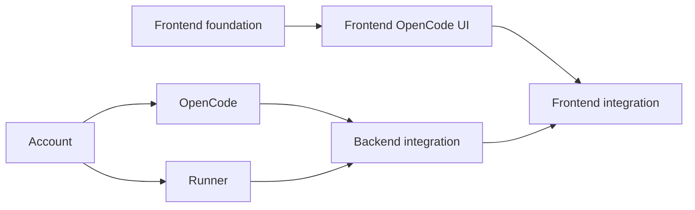

# Делегирование: провайдеры и модели OpenCode

Источник истины по требованиям — [`plans/opencode-providers-models.md`](plans/opencode-providers-models.md:1). Этот файл фиксирует контракты, владение файлами и волны параллельной реализации.

## 1. Правила параллельной работы

- Контракты из §2 заморожены: агенты не меняют имена полей, сигнатуры портов и JSON-ключи.
- Каждый агент правит только свои файлы из §3. Чужие модули и общие файлы не трогает.
- Тесты пишет каждый агент для своего модуля в своей зоне.
- `translations/messages.*.php`, `docs/openapi.json` и итоговые проверки — только волна 2.
- `../unitman-front/src/api/generated/unitman.d.ts` — только агент G, после бэкенд-волны.
- Если для компиляции нужен метод из чужого модуля, агент пишет вызов по замороженному контракту, не создавая временных заглушек в чужом коде.

## 2. Замороженные контракты

### 2.1 AccountApi

```php
public function poluchitRekvizityOpenCodeDlyVladelca(
    string $accountId,
    string $credentialId,
    ?string $model = null,
): OpenCodeCredentialSecretReadModel;

public function poluchitModeliRekvizitovOpenCodeDlyVladelca(
    string $accountId,
    string $credentialId,
): OpenCodeCredentialModelsReadModel;
```

`OpenCodeCredentialModelsReadModel`:

```php
public string $defaultModel;
/** @var list<string> */
public array $models;
```

`OpenCodeCredentialSecretReadModel` — поля в порядке: `id`, `accountId`, `provider`, `url`, `models`, `defaultModel`, `model`, `apiKey`. Где `model` — разрешённая модель хода, `defaultModel` — дефолт реквизитов.

`OpenCodeCredentialReadModel` — поля: `id`, `name`, `provider`, `url`, `models`, `defaultModel`, `model`, `apiKeyHint`, `createdAt`, `updatedAt`.

### 2.2 OpenCode port

```php
interface UmeetProveryatRekvizityOpenCode
{
    public function tekuschiiAccountId(): string;
    public function trebovatVladelca(string $accountId, string $credentialId): void;
    public function poluchitModeli(string $accountId, string $credentialId): RekvizityOpenCodeModeliReadModel;
    public function razreshitModel(string $accountId, string $credentialId, ?string $preferred): string;
}
```

`RekvizityOpenCodeModeliReadModel`: `defaultModel`, `models` (`list<string>`).

Поведение `razreshitModel`: пустой `$preferred` → `defaultModel`; непустой `$preferred` обязан входить в `models`, иначе `DomainException('account.opencode_credential.model_not_available')`.

### 2.3 Runner port

```php
public function poluchitRekvizity(
    string $accountId,
    string $credentialId,
    ?string $model = null,
): RekvizityOpenCode;
```

`Runner\Business\Model\OpenCode\RekvizityOpenCode` не меняется.

### 2.4 UmeetVypolnyatHodOpenCode

Новый параметр добавляется **в конец** списка, чтобы не ломать позиционные вызовы:

```php
public function nachatHod(
    string $workflowId,
    string $accountId,
    string $credentialId,
    ?string $sessionId,
    array $units,
    string $prompt,
    array $answers,
    array $history,
    ?WorkspaceKontekst $workspace = null,
    bool $readOnly = false,
    ?string $token = null,
    ?string $model = null,
): string;
```

Все вызовы передают модель именованным аргументом `model: $model`.

### 2.5 DTO и модели

- `NachatHodOpenCode`: `public readonly ?string $Model = null` в конце конструктора.
- `SozdatSessiyu`: `public ?string $model = null` в конце.
- `SozdatWorkspace`: `public ?string $model = null` в конце.
- `NachatPrompt`: `public ?string $model = null` в конце.
- `OtvetitNaVopros`: `public ?string $model = null` в конце.
- `SozdatRekvizityOpenCode`: существующие `name, url, model, apiKey`, затем `provider = 'custom'`, `models = []`, `defaultModel = ''`.
- `IzmenitRekvizityOpenCode`: существующие `id, name, url, model, apiKey`, затем `provider = null`, `models = null`, `defaultModel = null`.
- `SessiyaOpenCode::create(...)` и `createWorkspace(...)`: `?string $model = null` после `int $now`.
- `SessiyaOpenCode::restore(...)` и `restoreWorkspace(...)`: `?string $model = null` после `int $updatedAt`.
- `UnitSession::create(...)`/`restore(...)`, `WorkspaceSession::create(...)`/`restore(...)`: `?string $model = null` последним параметром.
- `HodOpenCode::create(...)`: `?string $model = null` после `int $now`; `restore(...)`: после `?int $finishedAt`.
- Read-модели сессий и ходов: `?string $model = null` последним параметром, `toArray()` добавляет ключ `model`.

### 2.6 JSON API

Новые/расширенные поля:

- реквизиты: `provider`, `models: string[]`, `defaultModel: string`, legacy `model`;
- создание сессии/workspace/unit-сессии: `model?: string`;
- промпт и ответ: `model?: string`;
- `GET /api/account/opencode/providers`: массив `{code, name, baseUrl, modelsPath, authStyle, supportsModelList, models}`;
- `POST /api/account/opencode/spisokModelei`: тело `{provider, apiKey?, credentialId?}`, ответ `{provider, models, source, errorKey}`.

## 3. Владение файлами

| Агент | Зона | Не трогает |
|---|---|---|
| A. Account | `src/Account/**` | `src/OpenCode`, `src/Runner`, `translations`, `docs` |
| B. OpenCode | `src/OpenCode/**` | `src/Account`, `src/Runner`, `translations`, `docs` |
| C. Runner | `src/Runner/**` | `src/Account`, `src/OpenCode`, `translations`, `docs` |
| D. Frontend foundation | `../unitman-front/src/components/ui/GhSelect.vue`, `../unitman-front/src/modules/account/**`, `../unitman-front/src/translator/ru.json`, `../unitman-front/src/translator/en.json` | `src/modules/opencode/**`, `src/api/generated/**` |
| E. Frontend OpenCode UI | `../unitman-front/src/modules/opencode/**` | `components/ui`, `modules/account`, `translator`, `api/generated` |
| F. Backend integration | `translations/messages.ru.php`, `translations/messages.en.php`, `docs/openapi.json`, `docs/**` | `src/Account`, `src/OpenCode`, `src/Runner` |
| G. Frontend integration | `../unitman-front/src/api/generated/unitman.d.ts`, точечные правки после typecheck в зонах D/E по согласованию | новые фичи |

## 4. Волна 1: параллельно A, B, C, D, E

### Агент A — Account

1. Enum `ProvayderOpenCode` с каталогом из плана.
2. Read-model `ProvayderOpenCodeReadModel`.
3. Расширение агрегата `OpenCodeCredential`: `provider`, `models`, `defaultModel`.
4. Миграция `Version20261124100000`: `provider`, таблица `opencode_credential_model`, бэкфилл.
5. `SqlOpenCodeCredentialRepository`: batch-чтение, транзакционная замена моделей.
6. Команды `SozdatRekvizityOpenCode`, `IzmenitRekvizityOpenCode`.
7. Read-модели `OpenCodeCredentialReadModel`, `OpenCodeCredentialSecretReadModel`, новая `OpenCodeCredentialModelsReadModel`.
8. UseCase создания/изменения/списка реквизитов.
9. Порт `ZaprositModeliProvaydera` и HTTP-адаптер на `symfony/http-client`.
10. Контроллер: `GET providers`, `POST spisokModelei`, обновлённые атрибуты.
11. `AccountApi`: новые методы и разрешение модели.
12. Тесты Account.

Критерий: модульные тесты Account зелёные; новые методы AccountApi доступны по контракту; ключ никогда не логируется и не возвращается.

### Агент B — OpenCode

1. Миграция `Version20261124110000`: `model` в трёх таблицах сессий и трёх таблицах ходов.
2. Порт `UmeetProveryatRekvizityOpenCode` + read-model `RekvizityOpenCodeModeliReadModel`; `Acl/AccountAdapter`.
3. `OpredelitelModeliHodaOpenCode`.
4. Модели `SessiyaOpenCode`, `UnitSession`, `WorkspaceSession`: поле `model`.
5. Создание сессий и workspace: разрешение и сохранение модели.
6. `NachatPrompt`/`OtvetitNaVopros`: поле `model`; модель хода в `HodOpenCode`.
7. Репозитории сессий и ходов: запись и чтение `model` во всех таблицах.
8. Read-модели сессий и ходов: `model`.
9. UseCase промптов и ответов: приоритет модель запроса → модель сессии → дефолт реквизитов.
10. `UmeetVypolnyatHodOpenCode` и `RunnerAdapter`: `model` в конце, вызовы именованным аргументом.
11. Контроллеры и OpenAPI-атрибуты в зоне OpenCode.
12. Тесты OpenCode.

Критерий: при создании без модели сохраняется дефолт; при промпте модель запроса переопределяет модель сессии; недопустимая модель даёт `account.opencode_credential.model_not_available`; модель хода видна в API.

### Агент C — Runner

1. `NachatHodOpenCode`: `?string $Model = null`.
2. `UmeetPoluchatRekvizityOpenCode`: nullable `$model`.
3. `Runner\Acl\AccountAdapter`: передача модели в `AccountApi`.
4. `RunnerApi::nachatHodOpenCode`: `$command->Model` в `poluchitRekvizity`, затем `$rekvizity->model` в `VipolnitHodOpenCode`.
5. Тесты Runner: DTO и `RunnerApi`.

Критерий: при `Model = null` поведение прежнее; при непустом `Model` в активность уходит именно он; существующие контракты `VipolnitHodOpenCode` не меняются.

### Агент D — Frontend foundation

1. `GhSelect`: `multiple`, `useChips`, массив в `modelValue`, обновлённый emit; старые вызовы компилируются.
2. `OpenCodeCredentialService`: `providers()`, `spisokModelei()`.
3. `FormaRekvizitovOpenCodeStore`: `provider`, `models`, `defaultModel`, загрузка провайдеров и live-моделей.
4. `StorSpiskaRekvizitovOpenCode`: типы и подписи моделей.
5. `FormaRekvizitovOpenCode.vue`: провайдер, автоподстановка URL, multiple-модели, кнопка live-загрузки, дефолтная модель.
6. `SpisokRekvizitovOpenCode.vue`: дефолт и количество моделей.
7. i18n-ключи для провайдеров и реквизитов в `ru.json` и `en.json`; также добавить ключи, перечисленные агентом E (если E завершится раньше — взять из его отчёта).

Критерий: форма создаёт и редактирует реквизиты с несколькими моделями; смена провайдера подставляет `baseUrl`; live-загрузка не блокирует ручной ввод; typecheck зоны D проходит.

### Агент E — Frontend OpenCode UI

1. Сторы создания unit-сессии, сессии и workspace: поле `model`, список моделей выбранных реквизитов, сброс на `defaultModel` при смене реквизитов.
2. Формы `FormaSozdaniyaSessiiUnita.vue`, `FormaSozdaniyaSessii.vue`, `FormaSozdaniyaWorkspace.vue`: `GhSelect` модели с поиском.
3. `OpenCodeService`, `UnitSessionService`, `WorkspaceService`: `model` в `sozdat`, `prompt`, `otvetit`.
4. Чат `ChatOpenCode.vue` и сторы чата: компактный выбор модели, дефолт из сессии/последней использованной/реквизитов.
5. Модель хода в метаданных, если пришла с бэкенда.
6. Список i18n-ключей для агента D — в отчёте.

Критерий: модель выбирается при создании и перед каждым промптом; запросы содержат `model`; при смене реквизитов модель сбрасывается на дефолт; typecheck зоны E проходит после появления D.

## 5. Волна 2: после слияния A, B, C

### Агент F — Backend integration

1. Добавить в `translations/messages.ru.php` и `messages.en.php` все ключи Account и OpenCode из отчётов A и B.
2. `php bin/console cache:clear`, миграции на тестовой БД.
3. `composer openapi-dump`, `composer check-openapi`.
4. `docs/openapi.json` и `docs/opencode-providers.md`, правки `docs/opencode-sessions.md`.
5. Прогнать `check-account-deptrac`, `check-opencode-deptrac`, `check-runner-deptrac`, `check-deptrac`, `check-psalm`, `check-phpunit`, `check-translations`.
6. Исправить только стыки контрактов; фичи в чужих зонах не переписывать.

Критерий: все бэкенд-проверки зелёные; OpenAPI содержит провайдеров, модели и поле `model` во всех схемах.

### Агент G — Frontend integration

1. После обновления `docs/openapi.json` выполнить `yarn gen:api`.
2. Заменить локальные временные типы на сгенерированные.
3. `yarn typecheck`, `yarn lint`, `yarn check:i18n`.
4. Исправить только стыки D и E.

Критерий: фронтенд собирается, i18n синхронен, в сгенерированных типах есть `provider`, `models`, `defaultModel`, `model`.

## 6. Порядок слияния



- A сливается первым: он добавляет аддитивные методы AccountApi.
- B и C сливаются после A; конфликтов нет из-за разных модулей.
- D и E работают параллельно на замороженном контракте `GhSelect` и `OpenCodeCredential`.
- F запускается после A, B, C; G — после F и D/E.
