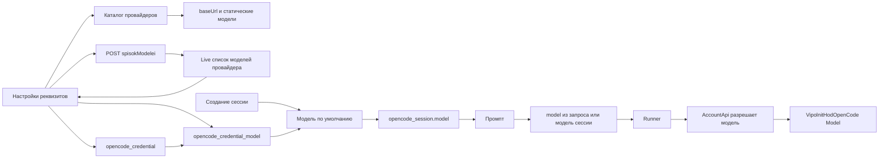

# План: провайдеры, несколько моделей и выбор модели в OpenCode

## 1. Цель и принятые решения

- В настройках реквизитов OpenCode пользователь выбирает провайдера из готового списка; базовый URL подставляется автоматически.
- У одних реквизитов может быть несколько моделей; одна из них — дефолтная.
- Во всех местах, где используются реквизиты (unit-сессия, сессия, workspace), модель выбирается из списка моделей реквизитов; по умолчанию — дефолтная.
- Модель можно менять перед каждым промптом; приоритет: `model` из запроса → модель, выбранная при создании сессии → дефолтная модель реквизитов.
- Если провайдер умеет отдавать список моделей, бэкенд проксирует запрос `GET /models`; иначе фронтенд показывает статический список-подсказку и позволяет ввести модель вручную.
- Делаем бэкенд `unitman` и фронтенд `../unitman-front`.

Допущение: поле `url` реквизитов — это базовый URL OpenAI-совместимого API провайдера. Модель передаётся в раннер без префикса провайдера, как её вернул провайдер; выбор провайдера уже выражен через `url`.

## 2. Поток данных



## 3. Каталог провайдеров

Новый доменный enum `src/Account/Business/Model/OpenCode/ProvayderOpenCode.php` и read-model `src/Account/Business/ReadModel/ProvayderOpenCodeReadModel.php`.

Статический каталог содержит: код, название, `baseUrl`, `modelsPath`, способ авторизации, поддержку live-списка и стартовый список моделей.

| Код | Название | baseUrl | Авторизация | Live-список |
|---|---|---|---|---|
| `openai` | OpenAI | `https://api.openai.com/v1` | Bearer | да |
| `anthropic` | Anthropic | `https://api.anthropic.com/v1` | `x-api-key` + `anthropic-version` | да |
| `google` | Google Gemini | `https://generativelanguage.googleapis.com/v1beta/openai` | Bearer | да |
| `openrouter` | OpenRouter | `https://openrouter.ai/api/v1` | Bearer | да |
| `deepseek` | DeepSeek | `https://api.deepseek.com/v1` | Bearer | да |
| `mistral` | Mistral | `https://api.mistral.ai/v1` | Bearer | да |
| `groq` | Groq | `https://api.groq.com/openai/v1` | Bearer | да |
| `xai` | xAI | `https://api.x.ai/v1` | Bearer | да |
| `together` | Together AI | `https://api.together.xyz/v1` | Bearer | да |
| `ollama` | Ollama | `http://localhost:11434/v1` | без ключа | нет |
| `opencode` | OpenCode Zen | `https://api.opencode.ai` | Bearer | нет |
| `custom` | Другой OpenAI-совместимый | — | Bearer | нет |

Стартовые списки моделей — только подсказка; источник истины при live-запросе — ответ провайдера. Для `custom` URL обязателен и вводится вручную, live-запрос не выполняется.

Правила безопасности live-запроса:
- для известных провайдеров URL берётся только из каталога, `baseUrl` из запроса игнорируется;
- ключ не попадает в query-строку и логи;
- таймаут 5 секунд, лимит ответа 1 МБ, разбор `data[].id` и `models[].name`;
- ошибка провайдера не ломает форму: возвращается статический список и ключ ошибки.

## 4. Хранение реквизитов

### 4.1 Миграция Account `Version20261124100000`

```sql
alter table opencode_credential
    add column if not exists provider varchar(64) not null default 'custom';

create table if not exists opencode_credential_model (
    credential_id varchar(64)  not null,
    model         varchar(128) not null,
    is_default    boolean      not null default false,
    created_at    integer      not null,
    primary key (credential_id, model)
);

create unique index if not exists opencode_credential_model_default_uq
    on opencode_credential_model (credential_id) where is_default;

create index if not exists opencode_credential_model_credential_idx
    on opencode_credential_model (credential_id);

insert into opencode_credential_model (credential_id, model, is_default, created_at)
select c.id, c.model, true, c.created_at
from opencode_credential c
where not exists (
    select 1 from opencode_credential_model m where m.credential_id = c.id
);
```

Колонка `opencode_credential.model` остаётся ради обратной совместимости и всегда равна дефолтной модели. Дефолт хранится и в `opencode_credential.model`, и в строке `is_default = true`; репозиторий синхронизирует оба значения в одной транзакции.

### 4.2 Доменная модель

`src/Account/Business/Model/OpenCode/OpenCodeCredential.php`:
- поля `provider`, `models` (`list<string>`), `defaultModel`;
- `getModel()` возвращает дефолтную модель для старых потребителей;
- валидации: провайдер известен или `custom`, моделей от 1 до 50, каждая непустая и не длиннее 128, дубликаты отклоняются, дефолт входит в список;
- `izmenit()` принимает nullable `provider`, `models`, `defaultModel`; `null` означает «не менять».

Новые коды ошибок: `account.opencode_credential.empty_models`, `account.opencode_credential.model_not_available`, `account.opencode_credential.unknown_provider`, `account.opencode_credential.empty_provider`, `account.opencode_credential.too_many_models`.

### 4.3 Репозиторий и порт

`SqlOpenCodeCredentialRepository`:
- читает модели batch-запросом и собирает агрегат без N+1;
- `save()`/`update()` пишут строку реквизитов и набор моделей в транзакции; при обновлении набор заменяется;
- если строк моделей нет (старые данные), агрегат восстанавливается из `opencode_credential.model`.

Порт `OpenCodeCredentialRepository` по составу методов не меняется.

### 4.4 Read-модели

`OpenCodeCredentialReadModel`: добавить `provider`, `models` (`list<string>`), `defaultModel`; поле `model` оставить как синоним дефолтной модели.

`OpenCodeCredentialSecretReadModel`: добавить `provider`, `models`, `defaultModel`; поле `model` — фактически разрешённая модель для хода.

## 5. API реквизитов и провайдеров

Все маршруты — в `OpenCodeCredentialController`, ответы через `Response::success()`.

| Метод | Маршрут | Тело | Ответ |
|---|---|---|---|
| GET | `/api/account/opencode/providers` | — | `ProviderOpenCode[]` |
| POST | `/api/account/opencode/spisokModelei` | `provider, apiKey?, credentialId?` | `{provider, models, source, errorKey}` |
| POST | `/api/account/opencode/sozdatRekvizity` | `name, provider, url?, models[], defaultModel?, apiKey, model?` | `{id}` |
| POST | `/api/account/opencode/izmenitRekvizity` | `id, provider?, url?, models?, defaultModel?, apiKey?, model?` | `data: null` |
| GET | `/api/account/opencode/spisokRekvizitov` | — | `OpenCodeCredential[]` с моделями |

`POST spisokModelei`:
- владелец берётся из JWT;
- если передан `credentialId`, ключ расшифровывается из сохранённых реквизитов и проверяется владение; `apiKey` в этом случае не нужен;
- если передан только `apiKey`, он используется один раз и не сохраняется;
- известный провайдер → запрос на каталоговый `baseUrl + modelsPath`;
- `custom` и `ollama` → `source: "static"`, live-запрос не выполняется;
- ошибка провайдера → `source: "static"`, статический список и `errorKey`, HTTP 200.

`provider` в создании/изменении:
- известный провайдер и пустой `url` → подставляется `baseUrl` каталога;
- `custom` с пустым `url` → `account.opencode_credential.empty_url`;
- пустой `models` и заполненный legacy `model` → `[model]`, дефолт = `model`;
- пустой `defaultModel` → первая модель.

## 6. AccountApi и порты между модулями

`AccountApi`:
- `poluchitRekvizityOpenCodeDlyVladelca(accountId, credentialId, ?string $model = null)` — если модель не передана, возвращает дефолтную; если передана, проверяет, что она входит в модели реквизитов;
- `poluchitModeliRekvizitovOpenCodeDlyVladelca(accountId, credentialId): OpenCodeCredentialModelsReadModel` — дефолт и список моделей;
- `trebovatRekvizityOpenCodeVladelca` остаётся без изменений.

Новая read-model `OpenCodeCredentialModelsReadModel` с полями `defaultModel`, `models`.

## 7. OpenCode: модель сессии и модель хода

### 7.1 Миграция OpenCode `Version20261124110000`

```sql
alter table opencode_session             add column if not exists model varchar(128) null;
alter table opencode_unit_session        add column if not exists model varchar(128) null;
alter table opencode_workspace_session   add column if not exists model varchar(128) null;

alter table opencode_turn                add column if not exists model varchar(128) null;
alter table opencode_unit_session_turn   add column if not exists model varchar(128) null;
alter table opencode_workspace_turn      add column if not exists model varchar(128) null;
```

`null` в существующих строках означает «взять дефолтную модель реквизитов при следующем ходе».

### 7.2 Порт проверки реквизитов

`UmeetProveryatRekvizityOpenCode`:
- `poluchitModeli(accountId, credentialId): RekvizityOpenCodeModeliReadModel`;
- `razreshitModel(accountId, credentialId, ?string $preferred): string` — проверяет предпочтительную модель и возвращает её либо дефолт.

`OpenCode\Acl\AccountAdapter` реализует оба метода через `AccountApi`.

### 7.3 Выбор модели

Новый сервис `src/OpenCode/Business/Utils/OpredelitelModeliHodaOpenCode.php`:
- `opredelit(accountId, credentialId, ?modelIzZaprosa, ?modelSessii): string`;
- приоритет: запрос → модель сессии → дефолт реквизитов;
- любая выбранная модель проверяется через `razreshitModel`.

Используется в:
- `ZapuskatelHodaOpenCode` для legacy сессий и workspace;
- `NachatPromptSessiiUnitaUseCase` и `OtvetitNaVoprosSessiiUnitaUseCase`;
- `NachatPromptWorkspaceUseCase` и `OtvetitNaVoprosWorkspaceUseCase`.

### 7.4 Создание сессий

- `SozdatSessiyu` и `SozdatSessiyuUseCase`: новое nullable-поле `model`; при создании разрешается и сохраняется в `SessiyaOpenCode`.
- `SozdatWorkspace` и `SozdatWorkspaceUseCase`: новое nullable-поле `model`; сохраняется в `SessiyaOpenCode::createWorkspace`.
- `UnitSessionController::sozdat` читает `model`; `SozdatSessiyuUnitaUseCase` принимает `?string $model`; `UnitSession` хранит модель.
- `WorkspaceSession` и его репозиторий получают поле `model` для полноты; отдельного write-path у агрегата пока нет.

### 7.5 Ходы

- `NachatPrompt` и `OtvetitNaVopros`: новое nullable-поле `model`.
- `HodOpenCode` получает `?string $model`, сохраняет его в `create()`/`restore()`.
- Все три репозитория ходов (`opencode_turn`, `opencode_unit_session_turn`, `opencode_workspace_turn`) пишут и читают `model`.
- `HodOpenCodeReadModel` и `toArray()` отдают `model`.
- Read-модели сессий (`SessiyaOpenCodeReadModel`, `UnitSessionReadModel`, `WorkspaceReadModel`) отдают `model`, чтобы фронтенд предвыбирал модель в промпте.

## 8. Runner и контракт активности

- `OpenCode\Business\Port\UmeetVypolnyatHodOpenCode::nachatHod` получает `?string $model` рядом с `$credentialId`.
- `OpenCode\Acl\RunnerAdapter` передаёт модель в `NachatHodOpenCode`.
- `Runner\Business\Command\NachatHodOpenCode` получает `?string $Model`.
- `Runner\Business\Port\UmeetPoluchatRekvizityOpenCode::poluchitRekvizity` получает `?string $model`.
- `Runner\Acl\AccountAdapter` передаёт модель в `AccountApi`.
- `RunnerApi::nachatHodOpenCode` передаёт `$command->Model` в `poluchitRekvizity`; `AccountApi` возвращает уже разрешённую модель, она уходит в `VipolnitHodOpenCode->Model`.
- Go-раннер не меняется: поле `Model` уже есть в контракте активности.

## 9. Фронтенд `../unitman-front`

### 9.1 GhSelect

Расширить `src/components/ui/GhSelect.vue`: поддержка `multiple`, `useChips`, `modelValue` как массива, обновление типа emit. Остальные вызовы не должны измениться.

### 9.2 Настройки реквизитов

`FormaRekvizitovOpenCodeStore`:
- поля `provider`, `url`, `models: string[]`, `defaultModel`, `apiKey`, `name`;
- действия `zagruzitProvayderov()`, `zagruzitModeli()` с `apiKey` или `credentialId`;
- при смене провайдера: если URL пуст или равен `baseUrl` предыдущего провайдера — заменить на новый `baseUrl`;
- при загрузке live-моделей объединять их со статическими и уже выбранными без дублей;
- валидация: имя, URL, хотя бы одна модель, дефолт входит в модели, ключ обязателен при создании.

`FormaRekvizitovOpenCode.vue`:
- `GhSelect` провайдера с поиском и подписью `baseUrl`;
- `GhInput` URL, редактируемый;
- `GhSelect multiple` моделей с поиском;
- кнопка «Загрузить модели у провайдера» и индикатор загрузки;
- `GhSelect` дефолтной модели из выбранных;
- поле API-ключа как сейчас.

`SpisokRekvizitovOpenCode.vue`: в колонке модели показывать дефолт и количество дополнительных моделей.

### 9.3 Формы сессий и workspace

- `StorFormiSozdaniyaSessii`, `StorFormiSozdaniyaSessiiUnita`, `StorFormiSozdaniyaWorkspace`: поле `model`, вычисляемый список моделей выбранных реквизитов, сброс модели на дефолт при смене реквизитов.
- Соответствующие `.vue`: `GhSelect` модель после выбора реквизитов, поиск включён.
- В запросы `sozdatSessiyu`, `unit-session/sozdat`, `workspace/sozdat` добавляется `model`.

### 9.4 Чат и промпты

- `ChatOpenCode.vue` и сторы чата: компактный `GhSelect` модели рядом с полем промпта; по умолчанию модель сессии, затем последняя использованная, затем дефолт реквизитов.
- `OpenCodeService.prompt`, `otvetit`; `UnitSessionService.prompt`, `otvetit`; `WorkspaceService.prompt`, `otvetit` передают `model`.
- В метаданных хода показывать модель, если она есть.
- После ответа сохранять выбранную модель в сторе чата.

### 9.5 Типы и i18n

- После `composer openapi-dump` перегенерировать `src/api/generated/unitman.d.ts` штатной командой проекта.
- Добавить ключи в `src/translator/ru.json` и `src/translator/en.json`: провайдеры, модели, загрузка списка, дефолтная модель, ошибки.
- Новые компоненты использовать только из `@/components/ui`, без новых npm-зависимостей.

## 10. OpenAPI, документация, переводы бэкенда

- Атрибуты `OA\*` на новые маршруты и поля; схемы `ProviderOpenCode`, `SpisokModelei`, расширенные `SozdatRekvizityOpenCode`, `IzmenitRekvizityOpenCode`, `OpenCodeCredential`, `SozdatSessiyu`, `SozdatWorkspace`, `NachatPrompt`, `OtvetitNaVopros`, `OpenCodeTurn`.
- `composer openapi-dump` и `composer check-openapi`.
- `docs/opencode-sessions.md`: провайдеры, несколько моделей, приоритет выбора модели.
- Новый `docs/opencode-providers.md`: каталог, live-запрос, безопасность, коды ошибок.
- Ключи в `translations/messages.ru.php` и `translations/messages.en.php`.

## 11. Тесты и проверки

Бэкенд:
- Account: модель агрегата (несколько моделей, дефолт, дубликаты, пустой список), репозиторий, миграционный бэкфилл, API реквизитов, каталог провайдеров, `spisokModelei` с мок-клиентом.
- OpenCode: `OpredelitelModeliHodaOpenCode`, создание сессий с моделью и без, приоритет модели в промпте, сохранение модели хода, read-модели.
- Runner: `RunnerApi` использует переданную модель, `NachatHodOpenCode`/`VipolnitHodOpenCode` DTO.
- Обновить существующие тесты, где создаются реквизиты с одним `model`.

Команды:
- `php bin/console cache:clear` внутри контейнера перед проверками;
- `composer run check-account-deptrac`, `check-opencode-deptrac`, `check-runner-deptrac`, `check-deptrac`;
- `composer run check-psalm`, `check-phpunit`, `check-translations`, `check-openapi`;
- `rr reset` внутри контейнера после изменений DI/воркеров.

Фронтенд:
- `yarn gen:api` после обновления `docs/openapi.json`;
- `yarn typecheck` и `yarn lint`, `yarn check:i18n` согласно `package.json`.

## 12. Порядок внедрения

1. Каталог провайдеров и модель агрегата реквизитов.
2. Миграция Account и репозиторий моделей.
3. Команды, UseCase, read-модели, API реквизитов.
4. Live-список моделей через порт и HTTP-адаптер.
5. AccountApi и порты для OpenCode/Runner.
6. Миграция OpenCode: модель сессии и хода.
7. Доменные модели сессий и ходов, репозитории.
8. Выбор модели при создании сессий и в промптах.
9. Runner: DTO, адаптер, `RunnerApi`.
10. OpenAPI и переводы бэкенда.
11. Фронтенд: `GhSelect multiple`.
12. Фронтенд: форма и список реквизитов.
13. Фронтенд: формы сессий/workspace и чат.
14. Регенерация типов и i18n.
15. Тесты, deptrac, psalm, phpunit, фронтенд-проверки.
16. Документация и `rr reset`.
