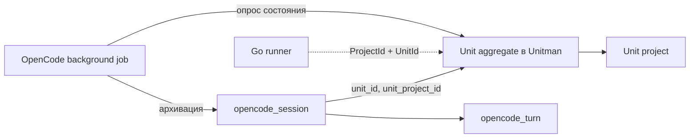

# План: сессия OpenCode, привязанная к юниту

## 1. Цель

1. При создании сессии OpenCode можно указать юнит, в рамках которого она работает. Два способа: **создать юнит от имени пользователя** по текущей логике процессов юнита либо **прикрепиться к существующему юниту**. Привязка возможна и позже, к уже созданной «свободной» сессии; после привязки все последующие ходы идут только в директории юнита.
2. Пока юнит не прошёл цикл `сборка → подготовка → запуск`, сессия **не принимает сообщения**.
3. Если цикл завершился ошибкой (`OSHIBKA_SBORKI`, `OSHIBKA_PODGOTOVKI`, `OSHIBKA_ZAPUSKA`), сессия **разблокируется**: работать в директории юнита можно и с нерабочим стендом.
4. Если привязанный юнит удалён, сессия переходит в состояние **«архив»**: остаётся в списке, но новые ходы запрещены.
5. Юнит **ничего не знает о сессии**: Unitman не импортирует OpenCode и не шлёт событий в OpenCode. Обнаружение удаления — pull-опрос на старте хода и в фоновой задаче.
6. Ходы получают `ProjectId` и `UnitId`, **директорию юнита вычисляет Go-раннер**, PHP пути не считает.
7. Полное удаление сессии убирается: текущий эндпоинт удаления становится архивацией. В списке появляется флаг архива и фильтры «только активные» (по умолчанию — все) и поиск по названию через `LIKE`.

## 2. Принятые решения

| # | Тема | Решение |
|---|---|---|
| 1 | Направление зависимости | Разрешаем `OpenCode → Unitman` в корневом [`deptrac.yaml`](deptrac.yaml:68) и читаем состояние только через [`UnitmanApi`](src/Unitman/Api/UnitmanApi.php:9). Цикла нет: `Unitman` про `OpenCode` не знает |
| 2 | Источник истины по состоянию юнита | Не проекция `SpisokUnitovReadModel` (в ней нет кода состояния и она стирает строку при удалении), а событийный агрегат: новый запрос `PoluchitSostoyanieUnitaQuery` поверх `UnitRepository::getById` |
| 3 | Форма ответа о готовности | Unitman отдаёт **нейтральный снапшот** `{exists, code, projectId, name, branch}`. Классификацию «блокировать / разблокировать / архив» делает OpenCode — это политика сессии, а не знание Unitman о сессиях |
| 4 | Разблокировка | Только `USPESHNO_ZAPUSHEN` или любой `OSHIBKA_*`. Всё остальное, включая `SLOMAN` и все `JDET_RESULTATI_*`, `VOCHEREDI_NA_*`, `USPESHNO_SOBRAN`, `USPESHNO_PODGOTOVLEN_K_ZAPUSKU`, `SOZDAN`, — блокировка |
| 5 | Архивация | `UDALEN`, `UDALEN_VRUCHNUYU` либо юнит не найден в агрегате. Причина хранится в сессии (`archive_reason`), чтобы UI объяснил, почему ходы запрещены |
| 6 | Продвижение цикла | Конвейер юнита не самодвижущийся: `ObrabotatProzesiUnitaUseCase` выполняет только уже добавленные процессы. Чтобы «полный цикл» действительно доходил до `ZAPUSHEN`, Unitman получает идемпотентный публичный метод `prodvinutCiklUnita` — он по коду состояния ставит в очередь следующий этап. Метод не знает про сессии, его можно вызвать и вручную |
| 7 | Автор процессов при продвижении | Не `getCurrentUserId()` (в фоновой задаче это системный пользователь), а **владелец сессии**: добавляются варианты `handleDlyaPolzovatelya(unitId, userId)` у существующих `DobavitProzes*UseCase` |
| 8 | Снимок проекта | `unit_project_id` копируется в сессию при привязке: ход не зависит от доступности Unitman, а раннеру достаточно `ProjectId` + `UnitId` |
| 9 | Гейт хода | Один Business-guard `PropuskHodaOpenCode`, вызываемый из `NachatPromptUseCase` и `OtvetitNaVoprosUseCase`. Логика не дублируется, контроллер ничего не проверяет |
| 10 | Архивация «по касанию» | Гейт при обнаружении удалённого юнита сам архивирует сессию и сохраняет её. Фоновая задача — только подстраховка для сессий, в которые долго не пишут |
| 11 | Удаление сессии | Убирается полностью: `SessiyaOpenCodeRepository::delete` и `HodOpenCodeRepository::deleteBySessionId` из сценария уходят. Роут `/udalitSessiyu` остаётся алиасом архивации и помечается `deprecated` |
| 12 | Поиск по названию | `title LIKE %...%` с экранированием `%`, `_`, `\`. Отдельный индекс по `title` **не добавляем**: ведущий wildcard его всё равно не использует, выборка ограничена `account_id` |
| 13 | Очерёдность при создании с юнитом | Сначала юнит, потом сессия. Валидация юнита (`unit.name_already_exists`, `unit.project_is_disabled` и т.д.) падает до появления сессии; риск осиротевшего юнита при редком сбое записи сессии принимаем |

## 3. Схема данных



### 3.1 Изменения `opencode_session` (модуль `OpenCode`)

```sql
alter table opencode_session add column if not exists unit_id         varchar(64) null;
alter table opencode_session add column if not exists unit_project_id varchar(64) null;
alter table opencode_session add column if not exists archived_at     integer     null;
alter table opencode_session add column if not exists archive_reason  varchar(64) null;

create index if not exists opencode_session_unit_idx on opencode_session (unit_id);
```

Семантика:

| Поле | Смысл |
|---|---|
| `unit_id` | `null` — свободная сессия; иначе сессия навсегда привязана к юниту |
| `unit_project_id` | Снимок проекта юнита на момент привязки; идёт в активити хода |
| `archived_at` | `null` — сессия активна; иначе — архив, ходы запрещены |
| `archive_reason` | `unit_deleted` (автоматически) или `manual` (пользователь нажал «в архив») |

Индексы `account_id` и `credential_id` из [`Version20261114100000`](src/OpenCode/Migrations/Version20261114100000.php:32) переиспользуются как есть.

Новая миграция: `src/OpenCode/Migrations/Version20261120120000.php`, `down()` — снять индекс и колонки в обратном порядке.

## 4. Модульность и deptrac

1. Корневой [`deptrac.yaml`](deptrac.yaml:45): в ruleset `OpenCode` добавляется `Unitman` с комментарием «состояние юнита — только через `UnitmanApi`». Разрешённых циклов не появляется.
2. Пер-модульные правила [`src/OpenCode/deptrac.yaml`](src/OpenCode/deptrac.yaml:23) не меняются: новый порт живёт в `Business/Port`, адаптер — в `Acl`.
3. `Unitman` не получает ни одного импорта из `OpenCode`; проверяется `composer run check-deptrac`.

## 5. Модель `SessiyaOpenCode`

Файл [`src/OpenCode/Business/Model/SessiyaOpenCode.php`](src/OpenCode/Business/Model/SessiyaOpenCode.php:13): в конструктор добавляются `?string $unitId`, `?string $unitProjectId`, `?int $archivedAt`, `?string $archiveReason`.

Новые константы и методы:

```php
private const ARCHIVE_REASON_UNIT_DELETED = 'unit_deleted';
private const ARCHIVE_REASON_MANUAL = 'manual';

public static function create(
    string $id, string $accountId, string $credentialId, ?string $title,
    ?string $unitId, ?string $unitProjectId, int $now,
): self;   // unitId задан => unitProjectId обязателен

public static function restore(
    string $id, string $accountId, string $credentialId, string $title,
    ?string $externalSessionId, ?string $unitId, ?string $unitProjectId,
    ?int $archivedAt, ?string $archiveReason, int $createdAt, int $updatedAt,
): self;

public function privezatKUnitu(string $unitId, string $unitProjectId, int $now): void;
// opencode.session.unit_already_attached, если unitId уже задан
// opencode.session.archived, если сессия в архиве

public function arhivirovat(string $reason, int $now): void; // идемпотентно
public function estArhiv(): bool;
public function getUnitId(): ?string;
public function getUnitProjectId(): ?string;
public function getArchivedAt(): ?int;
public function getArchiveReason(): ?string;
public function trebovatAktivnuyu(): void; // opencode.session.archived
public function privezanaKUnitu(): bool;
```

Инварианты в конструкторе и `restore`/`create`: пустая строка в `unitId` нормализуется в `null`; `unitId !== null` требует `unitProjectId`; `archivedAt !== null` требует `archiveReason`.

## 6. Порты и ACL модуля `OpenCode`

### 6.1 Модели-значения

`src/OpenCode/Business/Model/SostoyanieUnita.php`:

```php
final class SostoyanieUnita
{
    public const GROUP_READY = 'ready';
    public const GROUP_BLOCKED = 'blocked';
    public const GROUP_ARCHIVED = 'archived';

    public function __construct(
        public readonly bool $exists,
        public readonly ?string $code,
        public readonly ?string $projectId,
        public readonly ?string $name,
        public readonly ?string $branch,
        public readonly string $group,
    ) {}
}
```

`src/OpenCode/Business/Model/ParametriSozdaniyaUnita.php` — нейтральный для OpenCode DTO запроса на создание юнита: `projectId`, `unitName`, `branch`, `memoryLimit`, `peremenie` (`list<array{id,value,type,targetUnitId}>`), `volumes`.

### 6.2 Порт `UmeetUpravlyatUnitami`

```php
interface UmeetUpravlyatUnitami
{
    public function poluchitSostoyanieUnita(string $unitId): SostoyanieUnita;

    public function proveritDostupKUnitu(string $unitId, string $accountId): bool;

    public function sozdatUnit(ParametriSozdaniyaUnita $parametri, string $accountId): string;

    public function prodvinutCiklUnita(string $unitId, string $accountId): void;
}
```

`src/OpenCode/Acl/UnitmanAdapter.php` — единственное место, где OpenCode трогает Unitman. Маппинг:

- `poluchitSostoyanieUnita` → `UnitmanApi::poluchitSostoyanieUnita` → `SostoyanieUnita`, где `group` вычисляет `OcenkaGotovnostiUnita` (см. §7.1);
- `proveritDostupKUnitu` → `UnitmanApi::proveritDostupKUnitu`;
- `sozdatUnit` → конструирует `App\Unitman\Business\Command\Unit\SozdatUnit` (по образцу [`Runner\Acl\UnitmanAdapter`](src/Runner/Acl/UnitmanAdapter.php:10), который так же собирает чужую команду) и зовёт `UnitmanApi::sozdatUnitDlyaPolzovatelya`;
- `prodvinutCiklUnita` → `UnitmanApi::prodvinutCiklUnita`.

Биндинг в [`src/OpenCode/di.php`](src/OpenCode/di.php:39): `$services->set(UmeetUpravlyatUnitami::class, UnitmanAdapter::class);`.

### 6.3 Расширение `UmeetVypolnyatHodOpenCode`

В [`src/OpenCode/Business/Port/UmeetVypolnyatHodOpenCode.php`](src/OpenCode/Business/Port/UmeetVypolnyatHodOpenCode.php:27) у `nachatHod` добавляются два аргумента **перед** `history`:

```php
public function nachatHod(
    string $workflowId, string $accountId, string $credentialId,
    ?string $sessionId, ?string $unitProjectId, ?string $unitId,
    string $prompt, array $answers, array $history,
): string;
```

### 6.4 Репозиторий сессий

[`SessiyaOpenCodeRepository`](src/OpenCode/Business/Port/SessiyaOpenCodeRepository.php:9):

```php
public function save(SessiyaOpenCode $session): void;
public function update(SessiyaOpenCode $session): void;
public function getById(string $id): SessiyaOpenCode;
public function findById(string $id): ?SessiyaOpenCode;
public function findByAccountId(string $accountId, SessiyaOpenCodeFilter $filter): array;
public function findByCredentialId(string $credentialId): array;
/** @return list<SessiyaOpenCode> активные сессии с привязанным юнитом */
public function findAktivnieSUnitom(int $limit): array;
```

`delete` удаляется из порта (решение 11). `src/OpenCode/Business/Model/SessiyaOpenCodeFilter.php` — `bool $onlyActive = false`, `?string $search = null`.

SQL в [`SqlSessiyaOpenCodeRepository`](src/OpenCode/Infra/Repository/SqlSessiyaOpenCodeRepository.php:12): в `insert`/`update` добавляются новые колонки; `findByAccountId` собирает `WHERE account_id = :account_id` плюс `AND archived_at IS NULL` при `onlyActive` и `AND title LIKE :search ESCAPE '\\'` при поиске; фильтр по-прежнему `ORDER BY updated_at DESC, id`.

## 7. Use cases

### 7.1 `OcenkaGotovnostiUnita` — матрица готовности

`src/OpenCode/Business/Utils/OcenkaGotovnostiUnita.php`, чистый класс без зависимостей:

```php
public function ocenit(bool $exists, ?string $code): string
```

| Условие | Результат |
|---|---|
| `!$exists` | `GROUP_ARCHIVED` |
| `code === 'UDALEN'` или `'UDALEN_VRUCHNUYU'` | `GROUP_ARCHIVED` |
| `code === 'USPESHNO_ZAPUSHEN'` | `GROUP_READY` |
| `str_starts_with($code, 'OSHIBKA_')` | `GROUP_READY` |
| всё остальное, включая `SLOMAN` и `null` | `GROUP_BLOCKED` |

### 7.2 `SozdatSessiyuUseCase`

Расширяется команда [`SozdatSessiyu`](src/OpenCode/Business/Command/SozdatSessiyu.php:15):

```php
public string $credentialId = '';
public ?string $title = null;
public ?string $unitId = null;              // привязка к существующему
public ?ParametriSozdaniyaUnita $unit = null; // создание юнита от имени пользователя
```

Порядок в `handle`:

1. `$accountId = credentials->tekuschiiAccountId()`, `trebovatVladelca($accountId, credentialId)` — как сейчас.
2. Если заданы одновременно `unitId` и `unit` → `DomainException('opencode.session.unit_source_conflict')`.
3. Если `unit` задан: `$unitId = $this->unitami->sozdatUnit($command->unit, $accountId)`; `$unitProjectId = $command->unit->projectId`.
4. Если `unitId` задан: `proveritDostupKUnitu($unitId, $accountId)` → иначе `opencode.session.unit_not_found`; `$unitProjectId` берётся из `poluchitSostoyanieUnita($unitId)->projectId`; если группа `GROUP_ARCHIVED` → `opencode.session.unit_not_found`.
5. `SessiyaOpenCode::create(..., $unitId, $unitProjectId, time())` + `save`.

### 7.3 `PrivezatSessiyuKUnituUseCase` — новая привязка «свободной» сессии

`handle(PrivezatSessiyuKUnitu $command)`: владелец → `unitId` не пуст → доступ → состояние не `GROUP_ARCHIVED` → `$session->privezatKUnitu(...)` → `update`. После привязки ходы идут только в директории юнита, менять или отвязывать юнит нельзя (решение 1).

### 7.4 `ArhivirovatSessiyuUseCase` — вместо `UdalitSessiyuUseCase`

Переименование [`UdalitSessiyuUseCase`](src/OpenCode/Business/UseCase/UdalitSessiyuUseCase.php:1) → `ArhivirovatSessiyuUseCase`. Остаётся только:

```php
$session = $this->sessionRepository->getById($command->sessionId);
$session->trebovatVladelca($accountId);
$session->arhivirovat(SessiyaOpenCode::ARCHIVE_REASON_MANUAL, time());
$this->sessionRepository->update($session);
```

`turnRepository->deleteBySessionId` и `sessionRepository->delete` больше не вызываются. Команда `UdalitSessiyu` заменяется на `ArhivirovatSessiyu` с тем же полем `sessionId`.

### 7.5 `PropuskHodaOpenCode` — гейт старта хода

`src/OpenCode/Business/Utils/PropuskHodaOpenCode.php`:

```php
public function proverit(SessiyaOpenCode $session): void
{
    $session->trebovatAktivnuyu();          // opencode.session.archived

    if (!$session->privezanaKUnitu()) {
        return;
    }

    $sostoyanie = $this->unitami->poluchitSostoyanieUnita($session->getUnitId());

    if ($sostoyanie->group === SostoyanieUnita::GROUP_ARCHIVED) {
        $session->arhivirovat(SessiyaOpenCode::ARCHIVE_REASON_UNIT_DELETED, time());
        $this->sessionRepository->update($session);
        throw new \DomainException('opencode.session.archived');
    }

    if ($sostoyanie->group !== SostoyanieUnita::GROUP_READY) {
        throw new \DomainException('opencode.session.unit_not_ready');
    }
}
```

Вызывается в [`NachatPromptUseCase`](src/OpenCode/Business/UseCase/NachatPromptUseCase.php:1) и [`OtvetitNaVoprosUseCase`](src/OpenCode/Business/UseCase/OtvetitNaVoprosUseCase.php:1) сразу после `trebovatVladelca` и до `launcher->zapustit`. Сообщение `opencode.session.unit_not_ready` в переводе содержит текущий код состояния и подсказку — деталь для UI.

### 7.6 `ZapuskatelHodaOpenCode` — передача юнита в активити

В [`ZapuskatelHodaOpenCode`](src/OpenCode/Business/Utils/ZapuskatelHodaOpenCode.php:1) вызов становится:

```php
$this->runner->nachatHod(
    $turn->getWorkflowId(), $session->getAccountId(), $session->getCredentialId(),
    $session->getExternalSessionId(), $session->getUnitProjectId(), $session->getUnitId(),
    $prompt, $answers, $history,
);
```

Порядок «сначала раннер, потом запись» сохраняется.

### 7.7 `PoluchitSpisokSessiyQuery` — фильтры

`handle(PoluchitSpisokSessiy $query): array`, новые поля команды: `bool $onlyActive = false`, `?string $search = null`. Запрос прокидывает их в `findByAccountId`. `SessiyaOpenCodeReadModel` получает `?string $unitId`, `?string $unitProjectId`, `bool $archived`, `?string $archiveReason`.

### 7.8 `PoluchitSostoyanieSessiiQuery` — причина блокировки для UI

Новый запрос: `handle(PoluchitSostoyanieSessii $command)` → владелец → если привязан юнит, читает состояние через порт; возвращает read-модель `SostoyanieSessiiReadModel`:

```php
sessionId, unitId, unitProjectId, archived, archiveReason,
unitStateCode,      // null для свободной сессии
canAcceptMessages,  // estArhiv() === false && group === ready
```

Это позволяет фронтенду показать «юнит собирается» вместо ошибки после неудачного промпта. Гейт и этот запрос используют один и тот же `OcenkaGotovnostiUnita`.

## 8. HTTP API

| Метод | Маршрут | Изменение |
|---|---|---|
| `POST` | `/api/opencode/sozdatSessiyu` | тело расширяется: `unitId?` либо `unit?` |
| `POST` | `/api/opencode/privezatKUnitu` | **новый**: `{sessionId, unitId}` |
| `GET` | `/api/opencode/spisokSessiy` | **новые query-параметры** `onlyActive` (bool, по умолчанию `false`), `search` (string) |
| `POST` | `/api/opencode/sostoyanieSessii` | **новый**: `{sessionId}` |
| `POST` | `/api/opencode/arhivirovatSessiyu` | **новый**: `{sessionId}` — архивация |
| `POST` | `/api/opencode/udalitSessiyu` | **алиас** архивации, `deprecated: true`, тело и ответ те же |

Поскольку `GET` не имеет тела, фильтры принимаются из query string. В контроллере они читаются из `Request $request` и складываются в команду; валидация — `(bool) $request->query->getBoolean('onlyActive', false)` и `trim((string) $request->query->get('search', ''))`. Альтернатива — `#[MapQueryString]`, но в проекте такого приёма нет, поэтому не вводим новый паттерн.

[`OpenCodeController`](src/OpenCode/Infra/Controller/OpenCodeController.php:36): у `spisokSessiy` появляется `Request $request`, у остальных методов — новые команды. Внутри контроллера никаких проверок прав не добавляется (правило проекта: проверки в UseCase).

## 9. Unitman: публичное API для OpenCode

[`UnitmanApi`](src/Unitman/Api/UnitmanApi.php:9) получает четыре метода:

```php
public function poluchitSostoyanieUnita(string $unitId): SostoyanieUnitaReadModel;
public function proveritDostupKUnitu(string $unitId, string $accountId): bool;
public function sozdatUnitDlyaPolzovatelya(SozdatUnit $command, string $accountId): string;
public function prodvinutCiklUnita(string $unitId, string $accountId): void;
```

Новые классы модуля `Unitman`:

- `Business/ReadModel/Unit/SostoyanieUnitaReadModel.php` — `exists`, `code`, `projectId`, `name`, `branch`, `authorId`;
- `Business/Command/Unit/PoluchitSostoyanieUnita.php` — `{unitId}`;
- `Business/UseCase/Unit/PoluchitSostoyanieUnitaQuery.php` — `getById` в `try/catch` по `DomainException` и возврат `exists = false` при любом отказе агрегата; иначе `Unit::poluchitKodSostoyaniya()`, `getProjectId()`, `getName()`, `getBranch()`, `getAuthorId()`;
- `Business/Model/Unit.php` — публичный аксессор `poluchitKodSostoyaniya(): ?string` (`return $this->state?->getCode();`), сейчас состояние читается только внутри модели;
- `Business/UseCase/Unit/ProveritDostupKUnituUseCase.php` — юнит существует и его проект входит в список проектов пользователя через `UmeetPoluchatSpisokProektovDlyPolzovatelya` (тот же приём, что в [`SozdatUnitUseCase`](src/Unitman/Business/UseCase/Unit/SozdatUnitUseCase.php:49));
- `Business/UseCase/Unit/ProdvinutCiklUnitaUseCase.php` — идемпотентный шаг конвейера:

| Код состояния | Действие |
|---|---|
| `USPESHNO_SOBRAN` | `DobavitProzesPodgotovkiUseCase::handleDlyaPolzovatelya(unitId, userId)` |
| `USPESHNO_PODGOTOVLEN_K_ZAPUSKU` | `DobavitProzesZapuskaUseCase::handleDlyaPolzovatelya(unitId, userId)` |
| `USPESHNO_ZAPUSHEN`, любой `OSHIBKA_*`, `UDALEN`, `UDALEN_VRUCHNUYU`, `SLOMAN` | ничего |
| остальные (`SOZDAN`, все `JDET_RESULTATI_*`, `VOCHEREDI_NA_*`, `JDET_RESULTAT_*`) | ничего — этап уже в работе или в очереди |

Дополнительная защита от дублей: перед добавлением процесса проверяется `!$unit->esliEstNeobrabotanieProzesi()`, иначе `unit.prozesi_est`. Гонки не страшны: `dobavitProzesPodgotovki`/`dobavitProzesZapuska` уже вызывают `provrkaNeobrabotanihProzesov()` и бросают доменную ошибку, которую `ProdvinutCiklUnitaUseCase` глотает как «уже продвинуто».

Рефакторинг ради явного пользователя:

- `DobavitProzesPodgotovkiUseCase` и `DobavitProzesZapuskaUseCase` получают `handleDlyaPolzovatelya(string $unitId, string $userId)`; текущий `handle` становится обёрткой над ним с `getCurrentUserId()`;
- `SozdatUnitUseCase` получает `handleDlyaPolzovatelya(SozdatUnit $command, string $userId)`; тело `handle` сводится к вызову с `getCurrentUserId()`.

## 10. Фоновая задача `OpenCode`

Каталог `src/OpenCode/Infra/BackgroundJob/SinhronizaciyaSessiySUnitom/` — модуль пока фоновых задач не имеет, каталог создаётся впервые.

```php
final class SinhronizaciyaSessiySUnitomBackgroundJob extends AbstractBackgroundJob
{
    public function getName(): string { return 'opencode_session_unit_sync'; }
    public function getDelay(): int   { return 5; }
    public function getProcessNum(): int { return 1; }
    public function run(): bool;      // true — всегда, чтобы цикл не останавливался
}
```

`run()` — reconcile-цикл по `findAktivnieSUnitom(200)`:

1. `poluchitSostoyanieUnita($session->getUnitId())`.
2. `GROUP_ARCHIVED` → `arhivirovat(unit_deleted), update`.
3. `GROUP_BLOCKED` → `prodvinutCiklUnita(unitId, accountId)` — конвейер не застревает, если пользователь не открывает страницу юнита.
4. `GROUP_READY` → ничего.

Исключения на уровне отдельной сессии логируются и не прерывают проход; на уровне задачи `run()` возвращает `true`, иначе RoadRunner снимет задачу с повтора.

Регистрация: класс попадает в контейнер по маске `App\OpenCode\` из [`src/OpenCode/di.php`](src/OpenCode/di.php:25) (каталог `Infra` уже включён) и тегируется через `BackgroundJobInterface` — дополнительных записей не нужно.

## 11. Контракт с Go-раннером

> **Обновлено при переходе к нескольким юнитам.** Исходный объём описывал один
> юнит на сессию; итоговая реализация передаёт в раннер **упорядоченный список**
> `Units[]`, где `Units[0]` — `cwd` хода, а `Units[1..]` — дополнительные корни
> workspace (multi-root). Пары `ProjectId`/`UnitId` верхнего уровня сохранены
> только для обратной совместимости и равны `Units[0]`.

### 11.1 PHP-сторона

- [`NachatHodOpenCode`](src/Runner/Business/Command/NachatHodOpenCode.php:1): `public readonly array $Units = []` (`list<array{ProjectId: string, UnitId: string}>`), плюс устаревшие `?string $ProjectId`/`?string $UnitId`.
- [`VipolnitHodOpenCode`](src/Runner/Business/Command/VipolnitHodOpenCode.php:1): те же поля; в JSON активити попадают как `Units`, `ProjectId`, `UnitId` (PascalCase, как остальные поля).
- [`RunnerApi::nachatHodOpenCode`](src/Runner/Api/RunnerApi.php:481): переносит поля из команды в `VipolnitHodOpenCode`; порядок «сначала реквизиты, потом workflow» не меняется.
- [`OpenCode\Acl\RunnerAdapter`](src/OpenCode/Acl/RunnerAdapter.php:1): пробрасывает список привязок (`unitProjectId`/`unitId` каждого юнита) в команду Runner в порядке привязки.

Отсутствие привязки (`Units = []`) — текущее поведение: раннер работает в своём рабочем каталоге.

### 11.2 Сторона раннера

1. `Units[]` указывает на юниты; **каталоги вычисляет раннер** по своей существующей схеме раскладки юнитов: `<workdir>/<ProjectId>/<UnitId>`.
2. `Units[0]` становится рабочим каталогом хода (`cwd`), `Units[1..]` подключаются к OpenCode как дополнительные корни workspace (multi-root), порядок значим. `ProjectId` в `Units` уникальны — бэкенд не привязывает два юнита одного проекта (`opencode.session.unit_project_conflict`).
3. Если хотя бы один каталог не найден → завершение с `ErrorKey = opencode.turn.unit_directory_not_found`, без частичного запуска; в остальном семантика трёх состояний (`Text`, `Questions`, `Error`) из [`plans/runner-opencode-activity-task.md`](plans/runner-opencode-activity-task.md:194) не меняется.
4. Ошибка каталога **не** ретраится: повтор не создаст каталог.

### 11.3 Правка задания для раннера

В [`plans/runner-opencode-activity-task.md`](plans/runner-opencode-activity-task.md:1) обязательно:

- §3 «Входные данные» — добавить `Units[]` (`{ProjectId, UnitId}`) и пометить `ProjectId`/`UnitId` как устаревшее дублирование `Units[0]`;
- §5 «Семантика хода» — убрать утверждение «никаких `unitId` в payload нет и не будет», заменить описанием выбора каталогов и multi-root;
- §9.2 «Разрешённые значения `ErrorKey`» — добавить `opencode.turn.unit_directory_not_found` (хотя бы один каталог отсутствует);
- §9.3 «Матрица решений» — строка «каталог любого юнита из `Units` отсутствует → ошибка без ретрая и без частичного запуска»;
- §13 «Чек-лист приёмки» — пункт про `cwd = Units[0]` и дополнительные корни.

## 12. Ошибки и локализация

Новые ключи в [`translations/messages.ru.php`](translations/messages.ru.php:126) и `messages.en.php`:

| Ключ | RU |
|---|---|
| `opencode.session.unit_source_conflict` | Нельзя одновременно указать юнит и создать новый |
| `opencode.session.unit_not_found` | Юнит не найден или недоступен |
| `opencode.session.unit_not_ready` | Юнит ещё собирается или запускается — дождитесь завершения |
| `opencode.session.unit_project_conflict` | К сессии можно привязать только один юнит в рамках одного проекта |
| `opencode.session.too_many_units` | Превышен лимит юнитов в сессии (не более 10) |
| `opencode.session.archived` | Сессия в архиве: новые ходы недоступны |
| `opencode.turn.unit_directory_not_found` | Каталог юнита не найден на раннере |

`opencode.session.archived` используется и для ручной архивации, и для архивации по удалённому юниту — различие объясняет `archiveReason` в ответе API. `TranslationsAuditCommand` должен остаться зелёным: ключи добавляются в оба файла.

Существующие `opencode.session.not_found`, `opencode.session.id_required`, `opencode.turn.*` не меняются.

## 13. OpenAPI

Правки в [`config/packages/nelmio_api_doc.yaml`](config/packages/nelmio_api_doc.yaml:279):

- `SozdatSessiyu`: свойства `unitId` (nullable) и `unit` (ref `SozdatSessiyuUnit`);
- новый `SozdatSessiyuUnit`: `projectId`, `unitName`, `branch`, `memoryLimit`, `peremenie`, `volumes` — по образцу схемы `SozdatUnit`;
- `SpisokSessiyFilter`: `onlyActive` (boolean, default `false`), `search` (string, nullable) — описывается как параметры `in: query` в `OA\Get`;
- `OpenCodeSession`: `unitId`, `unitProjectId`, `archived`, `archiveReason`;
- новый `PrivezatKUnitu`, `ArhivirovatSessiyu`, `SostoyanieSessii` (ответ: `sessionId`, `unitId`, `unitProjectId`, `archived`, `archiveReason`, `unitStateCode`, `canAcceptMessages`);
- `UdalitSessiyu`: описание меняется на «архивация», `deprecated: true`.

Документация валидируется [`OpenApiDocumentationTest`](src/App/Tests/Documentation/OpenApiDocumentationTest.php:1) — новые `ref` должны существовать.

## 14. Тесты

Модельные и юнит-тесты:

- `SessiyaOpenCodeTest`: `create` с юнитом без проекта → ошибка; `privezatKUnitu` повторно → `unit_already_attached`; `arhivirovat` идемпотентна; `trebovatAktivnuyu` на архивной сессии → `archived`.
- новый `OcenkaGotovnostiUnitaTest`: полная матрица кодов, включая `SLOMAN`, `SOZDAN`, каждый `JDET_RESULTATI_*`, все `OSHIBKA_*`, `UDALEN`, `UDALEN_VRUCHNUYYU` и `exists = false`.
- новый `PropuskHodaOpenCodeTest` на моках порта: свободная сессия пропускается без обращения к Unitman; `GROUP_BLOCKED` → `unit_not_ready`; `GROUP_READY` → без исключения; `GROUP_ARCHIVED` → сессия архивируется, `update` вызван ровно один раз, брошен `archived`.
- `PoluchitSpisokSessiyQueryTest`: `onlyActive`, поиск с `%` в строке и экранированием.

Интеграционные (WebTestCase, по образцу [`OpenCodeControllerTest`](src/OpenCode/Tests/Api/OpenCodeControllerTest.php:1)):

- создание сессии с `unitId` доступного юнита → в ответе `id`, в БД `unit_id` и `unit_project_id`;
- создание сессии с `unit` → создаётся юнит, у сессии выставлены оба поля, процессы сборки поставлены;
- `unitId` чужого проекта → `opencode.session.unit_not_found`;
- промпт при `JDET_RESULTATI_SBORKI` → `opencode.session.unit_not_ready`, ход не записан;
- промпт при `USPESHNO_ZAPUSHEN` и при `OSHIBKA_SBORKI` → ход стартует, имитация раннера получает `ProjectId`/`UnitId` (проверяется через `ImitaciyaVypolneniyaHoda`);
- промпт после удаления юнита → `opencode.session.archived`, в БД `archived_at` и `archive_reason = unit_deleted`;
- `arhivirovatSessiyu` и алиас `udalitSessiyu` → сессия остаётся в `spisokSessiy` с `archived = true`;
- `spisokSessiy?onlyActive=true` исключает архивные, `search` фильтрует по подстроке;
- `sostoyanieSessii` отдаёт `canAcceptMessages = false` при сборке.

Unitman-стороны:

- `PoluchitSostoyanieUnitaQueryTest`: существующий юнит возвращает код, удалённый — `exists = false`;
- `ProdvinutCiklUnitaUseCaseTest`: `USPESHNO_SOBRAN` добавляет процесс подготовки, `USPESHNO_ZAPUSHEN` и `OSHIBKA_*` — ничего, повторный вызов при уже добавленном процессе не бросает исключение;
- существующие тесты `SozdanieUnitaTest` и `ZapolnitPeremenieUnitaUseCaseTest` должны пройти без правок — рефакторинг `handle` на `handleDlyaPolzovatelya` сохраняет поведение.

## 15. Порядок работ

1. Миграция `opencode_session`: колонки `unit_id`, `unit_project_id`, `archived_at`, `archive_reason` + индекс.
2. `SessiyaOpenCode`: поля, `create`/`restore`, `privezatKUnitu`, `arhivirovat`, `trebovatAktivnuyu`; тесты модели.
3. `SessiyaOpenCodeRepository` + `SqlSessiyaOpenCodeRepository`: фильтр, `findAktivnieSUnitom`, убрать `delete`; `SessiyaOpenCodeFilter`; `SessiyaOpenCodeReadModel`.
4. Unitman: `Unit::poluchitKodSostoyaniya`, `SostoyanieUnitaReadModel`, `PoluchitSostoyanieUnitaQuery`, `ProveritDostupKUnituUseCase`, `handleDlyaPolzovatelya` у `DobavitProzesPodgotovkiUseCase`, `DobavitProzesZapuskaUseCase`, `SozdatUnitUseCase`, `ProdvinutCiklUnitaUseCase`, четыре метода `UnitmanApi`.
5. `deptrac.yaml`: `Unitman` в ruleset `OpenCode`; прогон `check-deptrac`.
6. OpenCode: `SostoyanieUnita`, `ParametriSozdaniyaUnita`, порт `UmeetUpravlyatUnitami`, `Acl/UnitmanAdapter`, биндинг в `di.php`.
7. `OcenkaGotovnostiUnita` + `PropuskHodaOpenCode`; подключить в `NachatPromptUseCase` и `OtvetitNaVoprosUseCase`.
8. `SozdatSessiyu` (новые поля) и `SozdatSessiyuUseCase`; `PrivezatSessiyuKUnitu` + use case; `ArhivirovatSessiyu` вместо `UdalitSessiyu`; `PoluchitSpisokSessiy` с фильтрами; `PoluchitSostoyanieSessiiQuery`.
9. Ходы: `ProjectId`/`UnitId` в `NachatHodOpenCode`, `VipolnitHodOpenCode`, `UmeetVypolnyatHodOpenCode`, `RunnerAdapter`, `ZapuskatelHodaOpenCode`, `RunnerApi::nachatHodOpenCode`.
10. Контроллер: новые маршруты, query-параметры списка, алиас удаления; OpenAPI в контроллере и `nelmio_api_doc.yaml`.
11. Тексты: ключи в `messages.ru.php` и `messages.en.php`.
12. Фоновая задача `SinhronizaciyaSessiySUnitomBackgroundJob`.
13. Тесты по §14, включая интеграционные.
14. Документация: `docs/opencode-sessions.md` (граф модулей, раздел «Сессия и юнит», состояния сессии, фильтры), `plans/runner-opencode-activity-task.md` (§11.3 этого плана).

## 16. Проверки

1. `php bin/console cache:clear` внутри контейнера.
2. `php bin/console doctrine:migrations:migrate` — миграция применяется на существующей БД с сессиями.
3. `composer run check-opencode-deptrac` и `composer run check-deptrac` — `OpenCode → Unitman` разрешён, обратного импорта нет.
4. `composer run check-unitman-deptrac` — Unitman по-прежнему не знает про OpenCode.
5. `vendor/bin/psalm --no-cache` — уровень 1, без новых `@psalm-suppress`; особое внимание `?string` в `SessiyaOpenCode::create` и `restore`.
6. `vendor/bin/phpunit` — все сьюты, включая `src/OpenCode/Tests` и `src/Unitman/Tests`.
7. `php bin/console app:translations-audit` — ключи есть в обоих файлах.
8. `rr reset` внутри контейнера — новая фоновая задача подхватывается воркером.

## 17. Открытые вопросы

1. `SLOMAN` сейчас попадает в блокировку. Если стенд в этом состоянии ещё имеет каталог, его, возможно, стоит разблокировать как терминальную ошибку — решение сознательно отложено, чтобы не расширять формулировку «любой `OSHIBKA_*`».
2. Нужен ли автоматический отвязчик: сессия, привязанная к юниту, при его удалении архивируется безвозвратно. Восстановления нет by design, но если понадобится «перепривязать к новому юниту», это отдельная задача с явным подтверждением пользователя.
3. Лимит `200` сессий за проход фоновой задачи выбран наугад; при росте числа привязанных сессий потребуется пагинация или выборка «только те, у кого юнит изменился».
4. Создание юнита из сессии не прокидывает `volumes` и связи переменных из UI сессии — если такой сценарий нужен, набор полей `ParametriSozdaniyaUnita` расширяется, новых слоёв это не требует.
