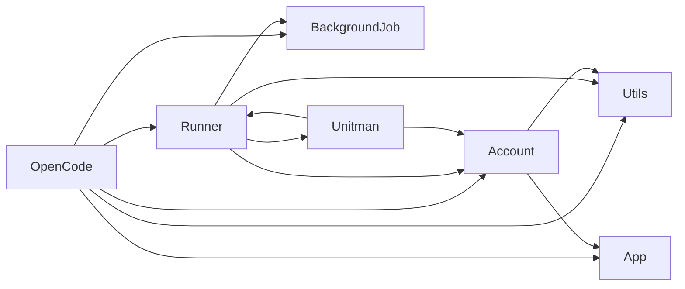
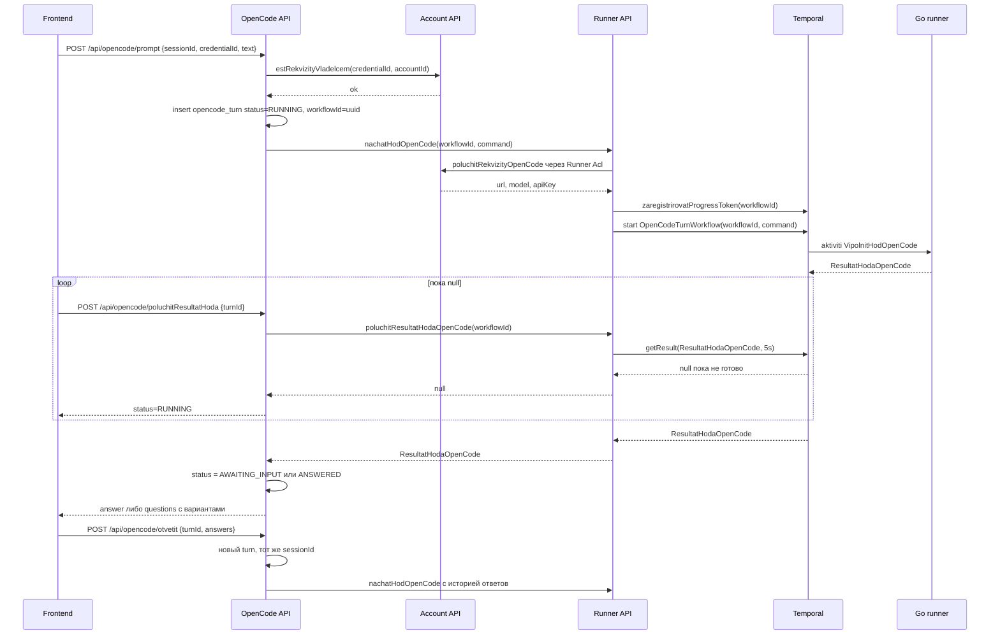
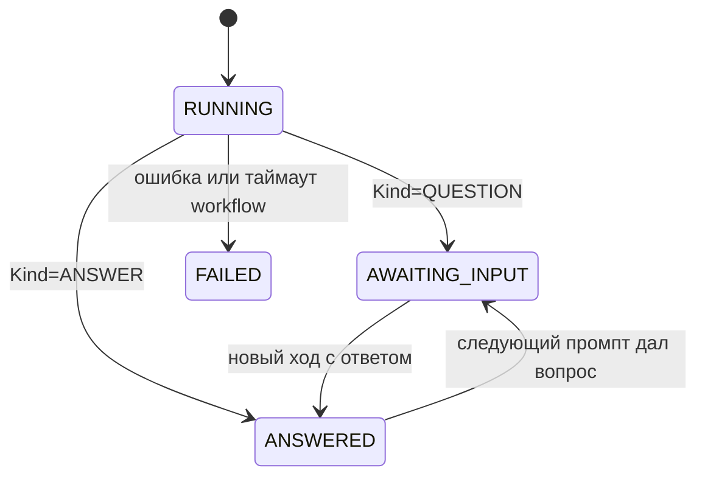

# Сессии OpenCode: промпт → runner → опрос Temporal → ответ, с вопросами и вариантами выбора

## 1. Цель

Дать пользователю возможность вести диалог с OpenCode через Unitman:

- пользователь вводит промпт;
- **Go-раннер** выполняет его на своей стороне (у него есть доступ к OpenCode API);
- **бэкенд опрашивает Temporal** (`getResult($type, 5)`) до получения ответа;
- для подключения нужны **API-ключ, URL и модель** — они хранятся в модуле **Account**, их может быть **много** у одного пользователя;
- **перед отправкой промпта пользователь выбирает реквизиты** (ключ/модель);
- OpenCode может не просто выполнить команду, но **задать вопрос или предложить варианты выбора** — это полноценная часть контракта, а не ошибка.

## 2. Принятые архитектурные решения

| Решение | Выбор | Почему |
|---|---|---|
| Где живёт домен сессий | **новый модуль `src/OpenCode`** | Утверждено пользователем. `Unitman` не разрастается, `Account` не тянет исполнение |
| Зависимости нового слоя | `OpenCode → Account, App, BackgroundJob, Runner, Utils` | Реквизиты берём через `AccountApi`, исполнение — через `RunnerApiInterface` |
| Зависимость `Runner → Account` | **разрешаем**, но только через `Runner\Acl\AccountAdapter` + `AccountApi` | Утверждено пользователем. `Account` при этом **не** смотрит в `Runner` — цикла нет |
| Где хранятся реквизиты | **модуль Account, обычная DBAL-таблица** `opencode_credential` | «Реквизитов много» — это отдельная таблица, прецедент есть: [`refresh_token`](src/Account/Migrations/Version20261031000000.php:17). Event sourcing избыточен |
| Защита секрета | **шифрование AES-256-GCM на уровне приложения**; в БД — шифротекст + хвост ключа | Утверждено пользователем. Symfony Secrets не подходит: vault не настроен (нет `config/secrets`, в [`framework.yaml`](config/packages/framework.yaml:5) только `APP_SECRET`) и он рассчитан на статичные секреты деплоя, а не на N пользовательских записей |
| Кто шифрует/расшифровывает | **модуль Account**, порт `UmeetShifrovatSekrety` + адаптер на `openssl` | Ключ шифрования знает только бэкенд; исходный код Go-раннера секрета не получает |
| Как реквизиты попадают в workflow | `Runner` **сам** получает их через `Runner\Acl\AccountAdapter` → `AccountApi` и кладёт в команду активити `VipolnitHodOpenCode` | `Runner` может зависеть от `Account` через Acl+Api; `OpenCode` не обязан знать про расшифровку |
| Модель интерактивности | **один Temporal workflow на один «ход»** | Утверждено пользователем. Совпадает с паттерном старт + `getResult(5)`; нет висящих workflow и сигналов |
| Где живёт workflow | `src/Runner/Infra/Workflow/OpenCodeTurnWorkflow.php` | Воркфлоу и очередь раннера — территория модуля Runner |
| Прогресс/стриминг | переиспользуем существующий механизм `saveSteps` + KV + pull | [`RunnerController::saveSteps()`](src/Runner/Infra/Controller/RunnerController.php:103), [`RunnerProgressKvStorage`](src/Runner/Infra/Adapter/RunnerProgressKvStorage.php:23) |

## 3. Граф зависимостей после изменений



Правило остаётся ациклическим: `Account` **не** смотрит в `Runner` и не смотрит в `OpenCode`; `OpenCode` **не** смотрит в `Unitman`.

Что правится в правилах:

- корневой [`deptrac.yaml`](deptrac.yaml:1) — новый слой `OpenCode` (`./src/OpenCode/.*`) и правило `OpenCode: [Account, App, BackgroundJob, Runner, Utils]`;
- в существующем правиле `Runner` добавляется `Account` (сейчас `Runner: [App, BackgroundJob, Unitman, Utils]`);
- `src/OpenCode/deptrac.yaml` — копия шаблона модуля ([`src/Account/deptrac.yaml`](src/Account/deptrac.yaml:1)): `Business` не зависит ни от чего, `Infra → Business`, `Api`/`Acl → Business + Infra`;
- `.modulite.yaml` для `OpenCode` и для `Runner` **не заводим**: у `Runner`, `Unitman`, `Initialization`, `BackgroundJob` его нет, а `@runner → @unitman → @runner` дал бы цикл. Зависимости фиксируются в `deptrac.yaml`, как это уже сделано для этих модулей;
- в `export` модуля Account добавляем новые публичные типы, если они появятся в `Account\Api` (см. [`src/Account/.modulite.yaml`](src/Account/.modulite.yaml:1)).

## 4. Поток одного хода



### Состояния хода



## 5. Схема БД

### 5.1 Account: `opencode_credential`

```sql
create table opencode_credential (
    id             varchar(64)  not null primary key,
    account_id     varchar(128) not null,
    name           varchar(128) not null,
    url            varchar(512) not null,
    model          varchar(128) not null,
    api_key_cipher text         not null,
    api_key_hint   varchar(32)  not null,
    cipher_version smallint     not null default 1,
    created_at     integer      not null,
    updated_at     integer      not null
);
create unique index opencode_credential_account_name_uq on opencode_credential (account_id, name);
create index opencode_credential_account_id_idx on opencode_credential (account_id);
```

- `api_key_cipher` — только шифротекст, открытого ключа в БД нет.
- `api_key_hint` — последние 4 символа (`sk-****abcd`) для списков. Позволяет отдавать список **без единой расшифровки**.
- `cipher_version` — версия формата/ключа, нужна для ротации.

### 5.2 Шифрование ключа

| Аспект | Решение |
|---|---|
| Алгоритм | AES-256-GCM через `openssl_encrypt`/`openssl_decrypt` (`OPENSSL_RAW_DATA`), расширение `openssl` входит в PHP по умолчанию — новых зависимостей в `composer.json` не нужно |
| Формат | `base64(nonce[12] + tag[16] + ciphertext)`; при разборе — строгая проверка длины и `base64_decode(..., true)` |
| Ключ | отдельная env-переменная `OPENCODE_CREDENTIALS_KEY` (base64 от 32 сырых байт), **не** `APP_SECRET`; биндится в [`src/Account/di.php`](src/Account/di.php:1) |
| AAD | `account_id . ':' . credential_id` — шифротекст нельзя переставить между пользователями или записями: расшифровка с чужим AAD падает |
| Где живёт логика | порт `App\Account\Business\Port\UmeetShifrovatSekrety` (`zashifrovat(string $plain, string $aad): string`, `rasshifrovat(string $cipher, string $aad): string`) + `Infra\Adapter\OpenSslShifr`. `Business` не зависит от `openssl`, поэтому порт в `Business/Port`, реализация в `Infra/Adapter` |
| Что хранит доменная модель | только шифротекст и hint. Расшифровка — в Query/UseCase, который отдаёт наружу готовое значение |
| Ошибки | `opencode.credential.decrypt_failed`, `opencode.credential.invalid_key` — строковыми ключами, через `ExceptionTranslator` |
| Ротация | новая версия ключа → `cipher_version = 2`, CLI-команда перешифровки по `cipher_version = 1`; чтение поддерживает обе версии по номеру из строки |
| Psalm | `openssl_encrypt` возвращает `string\|false` — нужна явная обработка, иначе level 1 упадёт |
| Запреты | полный ключ не попадает в логи, в `result_json`, в Centrifugo-события, в тексты ошибок и в ответы HTTP |

Дополнительно в `.env.dist` появляется:

```
OPENCODE_CREDENTIALS_KEY=
# base64 от 32 случайных байт: php -r "echo base64_encode(random_bytes(32));"
# В прод задаётся секретом окружения. Пустое значение = фича реквизитов отключена.
```

### 5.3 OpenCode: сессии и ходы

```sql
create table opencode_session (
    id                  varchar(64)  not null primary key,
    account_id          varchar(128) not null,
    credential_id       varchar(64)  not null,
    title               varchar(256) not null default '',
    external_session_id varchar(256),
    created_at          integer      not null,
    updated_at          integer      not null
);

create table opencode_turn (
    id             varchar(64) not null primary key,
    session_id     varchar(64) not null,
    seq            integer     not null,
    workflow_id    varchar(64) not null,
    status         varchar(32) not null,
    request_text   text        not null,
    answers_json   text        not null default '[]',
    result_json    text,
    error_key      varchar(128),
    created_at     integer     not null,
    finished_at    integer
);
create index opencode_turn_session_idx on opencode_turn (session_id, seq);
```

`status`: `RUNNING`, `AWAITING_INPUT`, `ANSWERED`, `FAILED`.

В `result_json` **никогда** не пишется API-ключ: только текст ответа, вопросы и варианты.

## 6. HTTP API

### Account — управление реквизитами

Все под JWT, владение проверяется в UseCase через `SecurityService`.

- `POST /api/account/opencode/sozdatRekvizity` — `name, url, model, apiKey` → `id`
- `POST /api/account/opencode/izmenitRekvizity` — `id, name?, url?, model?, apiKey?` (пустой `apiKey` = не менять)
- `POST /api/account/opencode/udalitRekvizity` — `id`
- `GET  /api/account/opencode/spisokRekvizitov` — список с `apiKeyHint`, без расшифровки

### OpenCode — сессии и ходы

- `POST /api/opencode/sozdatSessiyu` — `credentialId, title?` → `sessionId`
- `POST /api/opencode/prompt` — `sessionId, text` → `turnId, workflowId`
- `POST /api/opencode/otvetit` — `turnId, answers[]` (`{questionId, optionId?, text?}`) → `turnId, workflowId`
- `POST /api/opencode/poluchitResultatHoda` — `turnId` → `status`, `answer?`, `questions[]`
- `POST /api/opencode/poluchitProgressHoda` — `turnId` → снапшот шагов из Runner KV
- `GET  /api/opencode/spisokSessiy` / `GET /api/opencode/istoriyaSessii` — `sessionId` → ходы

Формат ответа — существующий конверт [`Response::success()`](src/Utils/Model/Reponse/Response.php:9). Все маршруты закрыты JWT, публичных путей в [`security.yaml`](config/packages/security.yaml:1) добавлять не нужно.

## 7. Контракт с Go-раннером

### 7.1 Команда активити `VipolnitHodOpenCode`

Формируется в модуле `Runner`: `RunnerApi::nachatHodOpenCode()` получает `credentialId` + `accountId`, через `Runner\Acl\AccountAdapter` → `AccountApi::poluchitRekvizityOpenCode()` забирает реквизиты и подставляет их в команду.

```
SessionId      — внешний id сессии OpenCode (null на первом ходе)
Prompt         — текст промпта либо текст выбранного варианта ответа
Answers        — список { QuestionId, OptionId, Text } для ответа на вопрос
History        — последние N сообщений (role + text) как контекст
Url, Model, ApiKey — реквизиты подключения, заполняются в Runner
```

### 7.2 Результат `ResultatHodaOpenCode`

```
Success  bool
Kind     ANSWER | QUESTION | ERROR
Answer   ?string              — заполнен при Kind=ANSWER
Questions []{ Id, Text, Options[]{ Id, Label, Description? }, AllowFreeText }  — при Kind=QUESTION
ErrorKey ?string              — при Kind=ERROR
ExternalSessionId ?string     — id сессии на стороне OpenCode
```

Требование к раннеру: **при вопросе он не зависает, а завершает активити** с `Kind=QUESTION`. Продолжение диалога — новым ходом с `Answers`.

### 7.3 Прогресс

Токен регистрируется бэкендом до старта workflow, поэтому существующий `POST /api/runner/saveSteps` работает без изменений контракта: `responseId` = `workflowId` хода.

### 7.4 Остаточный риск: ключ в истории Temporal

Так как ключ по требованию передаётся в workflow, он попадает в payload активити, а значит — в историю и visibility Temporal. Что это значит практически и как ограничивать:

- доступ к Temporal UI и его БД должен быть ограничен кругом эксплуатации (это инфраструктурное требование, не код);
- retention истории ограничен настройками namespace — старые записи удаляются;
- ключ **никогда** не попадает в `result_json`, логи и Centrifugo;
- при компрометации ключ отзывается в OpenCode, запись правится через `izmenitRekvizity`.

Если позже потребуется убрать открытый ключ из истории, замена делается **внутри модуля Runner без изменения схемы БД**:

- краткоживущая ссылка: в команду кладётся `SecretRef`, а сами реквизиты — в RoadRunner KV ([`.rr.yaml`](.rr.yaml:101), обёртка [`RedisService::setWithTtl()`](src/Runner/Infra/Service/RedisService.php:29)) с TTL хода; Go-раннер забирает их публичным HMAC-эндпоинтом по образцу [`saveSteps`](src/Runner/Infra/Controller/RunnerController.php:103) и [`RunnerCallbackSignatureChecker`](src/Runner/Infra/Service/RunnerCallbackSignatureChecker.php:26);
- либо шифрование всего payload Temporal через `PayloadCodec` — но это инфраструктура на все workflow, а [`SymfonyConverter`](src/App/Infra/Workflow/SymfonyConverter.php:11) является `Converter`, а не `PayloadCodec`, т.е. писать с нуля.

Оба варианта — отдельное решение, в текущий объём не входят.

## 8. Порядок реализации

Разбит на чек-лист `update_todo_list`. Ключевые точки внимания:

- новый слой `OpenCode` в корневом `deptrac.yaml` + расширение правила `Runner` до `Account`;
- `Runner` получает реквизиты **только** через `Acl`-адаптер: `src/Runner/Acl/AccountAdapter.php` реализует порт `Runner\Business\Port\UmeetPoluchatRekvizityOpenCode` и оборачивает `App\Account\Api\AccountApi`, как это уже сделано для [`UnitmanAdapter`](src/Runner/Acl/UnitmanAdapter.php:10);
- регистрация порта в [`src/Runner/di.php`](src/Runner/di.php:31) по образцу `UmeetObnovlyatStatistikuPoUnitam`;
- изменение `RunnerApiInterface` **требует** обновить тестовый двойник [`MemoryRunnerService`](src/Unitman/Acl/MemoryRunnerService.php:27) — иначе тесты упадут;
- новый воркфлоу обязан быть в [`config/workflows.php`](config/workflows.php:5);
- новая миграционная папка — в [`doctrine_migrations.yaml`](config/packages/doctrine_migrations.yaml:6);
- новый DI-биндинг `OPENCODE_CREDENTIALS_KEY` — в `src/Account/di.php`;
- новые маршруты обязаны быть покрыты OpenAPI-аннотациями, иначе упадёт [`OpenApiDocumentationTest`](src/App/Tests/Documentation/OpenApiDocumentationTest.php:107);
- новые ключи ошибок — в `translations/messages.en.php` и `messages.ru.php`, иначе упадёт `check-translations`.

## 9. Проверки перед сдачей

1. `php bin/console cache:clear` внутри контейнера (обязательно до тестов).
2. `php bin/console doctrine:migrations:migrate`.
3. `composer openapi-dump` + коммит `docs/openapi.json`.
4. `composer check-translations`.
5. `composer check-deptrac` и `composer check-opencode-deptrac` (новый скрипт).
6. `composer all-checks` (psalm + phpunit + все deptrac).
7. `rr reset` внутри контейнера — после изменений воркфлоу/DI.
