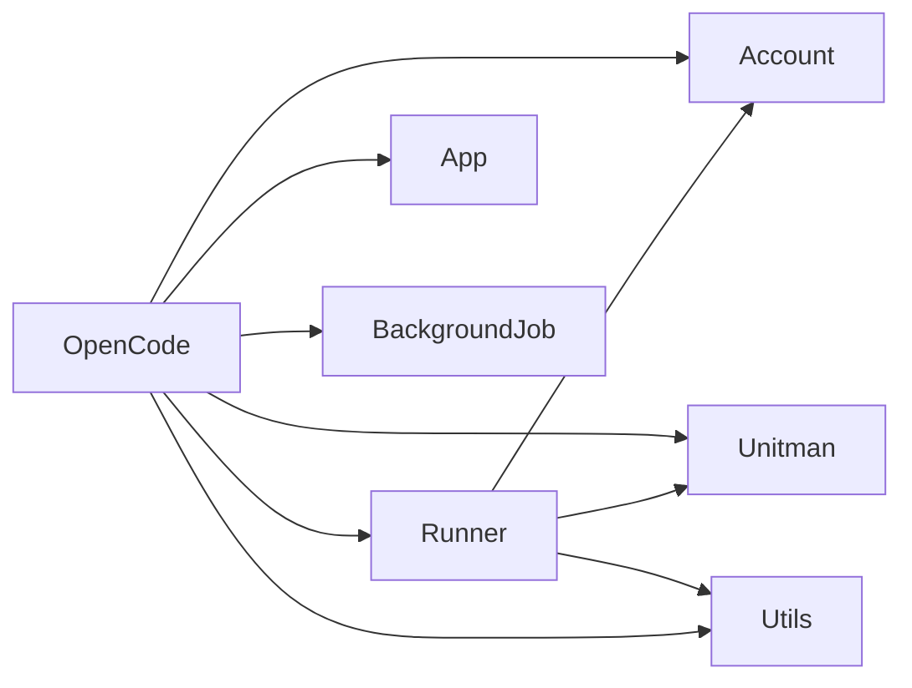

# Workspace: контейнер с dind, OpenCode и VS Code

## 1. Цель

Добавить в модуль `OpenCode` новый тип сессии — **Workspace**. Пользователь
создаёт workspace, указывая:

- название workspace;
- общую для всех проектов ветку;
- список проектов;
- первоначальный промпт;
- `credentialId` реквизитов OpenCode.

После создания Runner:

1. создаёт отдельный контейнер workspace с `docker-in-docker` и `opencode`;
2. создаёт каталог workspace и разворачивает каждый проект в отдельный подкаталог;
3. поднимает VS Code с multi-root workspace на все проекты;
4. запускает OpenCode с первоначальным промптом;
5. дальше диалог работает по аналогии с сессиями OpenCode юнитов: ходы,
   вопросы, ответы, прогресс, уведомления.

Дополнительно:

- архив workspace проверяет незакоммиченные файлы и требует подтверждения;
- архив останавливает контейнер, но **не удаляет** тома и каталог;
- восстановление = запуск уже существующего контейнера, без повторного деплоя;
- удаление workspace окончательное: контейнер, тома, каталог и записи БД;
- если токен Repo не имеет прав на push, workspace переходит в режим
  только-чтение.

## 2. Принятые решения

| # | Тема | Решение |
|---|---|---|
| 1 | Модуль | Расширяем `src/OpenCode`, новый модуль не создаём |
| 2 | Тип сессии | Workspace — это `SessiyaOpenCode` с `tip = workspace`; юнит-сессии остаются `tip = unit` |
| 3 | Реквизиты OpenCode | `credentialId` обязателен, проверяется по владельцу как в обычной сессии |
| 4 | Проекты | Только проекты, доступные пользователю; дубликаты запрещены |
| 5 | Ветка | Одна общая ветка на все проекты; ошибка клонирования проекта переводит workspace в `ERROR` |
| 6 | Токен и push | Используется токен Repo проекта; `canPush` вычисляется Unitman и сохраняется снимком |
| 7 | Read-only | Если хотя бы у одного проекта `canPush = false`, workspace работает в режиме только-чтение |
| 8 | VS Code | Отдельный `ide`-контейнер в network namespace workspace, multi-root, RW-том, ссылка через существующий proxy |
| 9 | Тома | Именованные тома; архив их сохраняет, удаление удаляет |
| 10 | Архив | `docker compose stop`; восстановление — `docker compose start` |
| 11 | Удаление | `docker compose down -v --remove-orphans`, удаление каталога и записей БД |
| 12 | Ходы | Переиспользуем `opencode_turn`, `ZavershenieHodaOpenCode`, прогресс и уведомления |
| 13 | Первый промпт | Запускается фоновой задачей после успешного создания контейнера |
| 14 | Имя workspace | Уникально в рамках аккаунта; частичный уникальный индекс `where tip = 'workspace'` |

## 3. Границы модулей

Новых слоёв deptrac нет. Используем существующие разрешения:



Правила:

- `OpenCode` не импортирует внутренние классы `Unitman` и `Runner`;
- проектные данные идут через `OpenCode/Acl/UnitmanAdapter` и `UnitmanApi`;
- lifecycle workspace идёт через `OpenCode/Acl/RunnerAdapter` и `RunnerApi`;
- `Unitman` по-прежнему ничего не знает про OpenCode;
- `Runner` получает URL клонирования только через собственный `Acl`-адаптер.

## 4. Модель данных

### 4.1 `opencode_session`

Добавляем признак типа:

```sql
alter table opencode_session
    add column if not exists tip varchar(16) not null default 'unit';

create index if not exists opencode_session_account_tip_idx
    on opencode_session (account_id, tip, updated_at);
```

`title` workspace-сессии — это название workspace. Для workspace-сессий
`unit_id` и `unit_project_id` остаются `null`, таблица `opencode_session_unit`
не заполняется.

### 4.2 `opencode_workspace`

```sql
create table if not exists opencode_workspace (
    session_id                  varchar(64)  not null primary key,
    branch                      varchar(256) not null,
    status                      varchar(32)  not null,
    read_only                   boolean      not null default false,
    initial_prompt              text         not null,
    initial_prompt_started_at   integer      default null,
    error_key                   varchar(128) default null,
    operation                   varchar(32)  not null,
    operation_workflow_id       varchar(64)  not null,
    operation_attempts          integer      not null default 0,
    next_attempt_at             integer      not null default 0,
    created_at                  integer      not null,
    updated_at                  integer      not null
);
create index if not exists opencode_workspace_status_idx
    on opencode_workspace (status, next_attempt_at);
```

### 4.3 `opencode_workspace_project`

```sql
create table if not exists opencode_workspace_project (
    session_id      varchar(64)  not null,
    project_id      varchar(64)  not null,
    project_name    varchar(256) not null,
    project_code    varchar(512) not null,
    can_push        boolean      not null default false,
    position_index  integer      not null default 0,
    created_at      integer      not null,
    primary key (session_id, project_id)
);
create index if not exists opencode_workspace_project_session_idx
    on opencode_workspace_project (session_id, position_index);
```

`project_name` и `project_code` — снимок на момент создания: переименование
проекта не ломает уже созданный workspace. `can_push` — снимок прав токена.

### 4.4 `opencode_notification`

Добавляем тип владельца, чтобы фронтенд знал, куда вести пользователя:

```sql
alter table opencode_notification
    add column if not exists session_type varchar(16) not null default 'unit';
```

### 4.5 Уникальность имени

```sql
create unique index if not exists opencode_workspace_name_uq
    on opencode_session (account_id, title)
    where tip = 'workspace';
```

## 5. Доменная модель

### 5.1 `TipSessiiOpenCode`

`src/OpenCode/Business/Model/TipSessiiOpenCode.php`:

```php
enum TipSessiiOpenCode: string
{
    case UNIT = 'unit';
    case WORKSPACE = 'workspace';
}
```

### 5.2 `Workspace`

`src/OpenCode/Business/Model/Workspace.php` — value object внутри сессии:

- `branch`;
- `initialPrompt`;
- `status` — enum `StatusWorkspace`;
- `readOnly`;
- `projects` — `list<ProektWorkspace>`;
- `errorKey`;
- `operation` — `create|start|stop|delete`;
- `operationWorkflowId`;
- `operationAttempts`;
- `nextAttemptAt`;
- `initialPromptStartedAt`.

`StatusWorkspace`:

```text
CREATING -> RUNNING | ERROR
RUNNING -> ARCHIVING | DELETING
ARCHIVING -> ARCHIVED | ERROR
ARCHIVED -> STARTING | DELETING
STARTING -> RUNNING | ERROR
ERROR -> STARTING | DELETING
DELETING -> [deleted]
```

`ProektWorkspace`:

- `projectId`;
- `projectName`;
- `projectCode`;
- `canPush`;
- `positionIndex`.

### 5.3 Изменения `SessiyaOpenCode`

Добавляем:

```php
public static function createWorkspace(
    string $id,
    string $accountId,
    string $credentialId,
    string $name,
    string $branch,
    array $projects,
    string $initialPrompt,
    int $now,
): self;

public static function restoreWorkspace(...): self;

public function getTip(): TipSessiiOpenCode;
public function getWorkspace(): ?Workspace;
public function estWorkspace(): bool;
```

Инварианты:

- workspace не имеет юнитов;
- хотя бы один проект;
- проекты уникальны по `projectId`;
- имя и ветка не пустые, имя ≤ 256, ветка ≤ 256;
- `readOnly = true`, если хотя бы у одного проекта `canPush = false`;
- `initialPrompt` не пустой;
- `archivedAt` для workspace означает архив, как и у юнит-сессии;
- `podpisatPoPromptu()` не перезаписывает название workspace.

`SessiyaOpenCodeReadModel` получает:

- `type` — `unit|workspace`;
- `workspace` — `?WorkspaceReadModel`;
- `ideLink` — `?string` (для workspace).

### 5.4 Репозиторий

`SessiyaOpenCodeRepository` получает:

```php
public function save(SessiyaOpenCode $session): void;
public function update(SessiyaOpenCode $session): void;
public function getById(string $id): SessiyaOpenCode;
public function findById(string $id): ?SessiyaOpenCode;
public function findByAccountId(string $accountId, SessiyaOpenCodeFilter $filter): array;
public function findAktivnieWorkspace(int $limit): array;
public function perevestiStatusWorkspace(string $sessionId, array $from, string $to): bool;
public function deleteWorkspace(string $sessionId): void;
```

`SqlSessiyaOpenCodeRepository`:

- сохраняет и обновляет `opencode_session`, `opencode_workspace`,
  `opencode_workspace_project` в одной транзакции;
- при чтении batch-загружает workspace и проекты без N+1;
- `findByAccountId` поддерживает фильтр `type` (`unit|workspace|null`);
- `perevestiStatusWorkspace` — атомарный `update ... where status = any(...)`,
  возвращает `rowCount() > 0`; это защита от двойного запуска фоновой задачей;
- `deleteWorkspace` удаляет workspace-проекты, workspace, ходы, уведомления и
  строку `opencode_session` в одной транзакции.

`SessiyaOpenCodeFilter` получает `?TipSessiiOpenCode $type`.

## 6. Unitman: данные проектов и push

### 6.1 Read-модель

`src/Unitman/Business/ReadModel/Project/ProektDlyaWorkspaceReadModel.php`:

```php
final class ProektDlyaWorkspaceReadModel
{
    public function __construct(
        public readonly string $projectId,
        public readonly string $projectName,
        public readonly string $projectCode,
        public readonly ?string $proxyHost,
        public readonly bool $canPush,
        public readonly string $storageUrl,
        public readonly int $idePort,
    ) {}
}
```

`storageUrl` возвращается только для Runner. OpenCode получает эту же модель
через `UnitmanApi`, но `storageUrl` не должна попадать в HTTP-ответы OpenCode.

### 6.2 Проверка push

В `StorageApiAdapter` добавляем:

```php
public function canPush(Repo $repo, Project $project): bool;
```

Реализации:

- GitLab: `projects()->show($project->getCode())['permissions']`;
  push разрешён при `project_access.access_level >= 30` или
  `group_access.access_level >= 30`;
- GitHub: `repositories()->show($login, $code)['permissions']['push'] === true`.

Это best-effort: защищённые ветки и правила хостинга могут запретить push
даже при формальном праве. Поэтому режим только-чтение дополнительно
фиксируется в Runner.

### 6.3 Unitman API

Добавляем в `UnitmanApi`:

```php
/**
 * @param list<string> $projectIds
 * @return list<ProektDlyaWorkspaceReadModel>
 */
public function poluchitProektiDlyaWorkspace(array $projectIds, string $accountId): array;

/**
 * URL клонирования с токеном. Только для Runner.
 */
public function poluchitUrlKlonaProekta(string $projectId): string;
```

`poluchitProektiDlyaWorkspace`:

1. получает доступные пользователю проекты через
   `UmeetPoluchatSpisokProektovDlyPolzovatelya`;
2. проверяет, что каждый `projectId` доступен;
3. для каждого проекта читает `Repo` и вызывает `canPush`;
4. возвращает порядок, переданный клиентом.

`poluchitUrlKlonaProekta` использует `RepoRepository` и
`StorageApiAdapterFactory::getUrlForInitProject`.

Ошибки:

- `opencode.workspace.project_not_found` — проект не найден или недоступен;
- `opencode.workspace.project_conflict` — дубликат проекта.

## 7. Runner: контракты PHP

### 7.1 Команды

`src/Runner/Business/Command/Workspace/ZapustitWorkspace.php`:

```php
final class ZapustitWorkspace
{
    /**
     * @param list<ProektWorkspaceCommand> $Projects
     */
    public function __construct(
        public readonly string $WorkspaceId,
        public readonly string $WorkspaceName,
        public readonly string $WorkspaceSlug,
        public readonly string $Branch,
        public readonly bool $ReadOnly,
        public readonly int $MemoryLimit,
        public readonly array $Projects,
    ) {}
}
```

`ProektWorkspaceCommand`: `ProjectId`, `ProjectName`, `ProjectCode`,
`StorageUrl`, `CanPush`.

`OstanovitWorkspace`: `WorkspaceId`.

`UdalitWorkspace`: `WorkspaceId`.

`ProveritIzmeneniyaWorkspace`: `WorkspaceId`, `Projects[]` с
`ProjectId` и `ProjectName`.

### 7.2 Результаты

- `ResultatZapuskaWorkspace` — `Success`, `Steps`, `ResponseId`,
  `Projects[]` с `ProjectId`, `Name`, `Success`, `ErrorKey`;
- `ResultatOstanovkiWorkspace` — `Success`, `Steps`, `ResponseId`;
- `ResultatUdaleniyaWorkspace` — `Success`, `Steps`, `ResponseId`;
- `ResultatProverkiIzmeneniyWorkspace` — `Success`, `Projects[]` с
  `ProjectId`, `Name`, `Dirty`, `Files[]`.

### 7.3 Workflow и активности

Новые workflow в `src/Runner/Infra/Workflow/`:

- `ZapustitWorkspaceWorkflow`;
- `OstanovitWorkspaceWorkflow`;
- `UdalitWorkspaceWorkflow`;
- `ProveritIzmeneniyaWorkspaceWorkflow`.

Имена активностей Go-раннера:

- `ZapustitWorkspaceActivity`;
- `OstanovitWorkspaceActivity`;
- `UdalitWorkspaceActivity`;
- `ProveritIzmeneniyaWorkspaceActivity`.

Все workflow регистрируются в `config/workflows.php`.

`RunnerApiInterface` получает:

```php
public function zapustitWorkspace(string $workflowId, ZapustitWorkspace $command): string;
public function poluchitResultatZapuskaWorkspace(string $workflowId): ?ResultatZapuskaWorkspace;

public function ostanovitWorkspace(string $workflowId, OstanovitWorkspace $command): string;
public function poluchitResultatOstanovkiWorkspace(string $workflowId): ?ResultatOstanovkiWorkspace;

public function udalitWorkspace(string $workflowId, UdalitWorkspace $command): string;
public function poluchitResultatUdaleniyaWorkspace(string $workflowId): ?ResultatUdaleniyaWorkspace;

public function proveritIzmeneniyaWorkspace(
    ProveritIzmeneniyaWorkspace $command,
): ResultatProverkiIzmeneniyWorkspace;
```

`RunnerApi::zapustitWorkspace` сам собирает `StorageUrl`:

- получает проекты через `Runner\Acl\UnitmanAdapter`;
- для каждого проекта вызывает `UnitmanApi::poluchitUrlKlonaProekta`;
- передаёт в команду `ZapustitWorkspace` готовый URL.

Токен не попадает в OpenCode, только в Temporal-команду Runner.

## 8. Runner: Go-реализация

### 8.1 Новый образ workspace

В репозитории Go-раннера:

```text
temporal/activity/workspace/
  activity.go
  exec.go
  docker-dind/
    Dockerfile.temp
    compose.dind.yaml
    entrypoint.sh
    workspace-repo-sync.sh
    ide/
      Dockerfile
      entrypoint.sh
      settings.json
```

`Dockerfile.temp`:

- база `asdozzz/dind-unit:latest` уже содержит `opencode`, `git`, `bash`;
- добавляем `openssh-client`, `findutils`, `jq`, `make` при необходимости;
- копируем `workspace-entrypoint.sh` и `workspace-repo-sync.sh`;
- ENTRYPOINT — entrypoint workspace, а не unit.

Новый образ собирается как `asdozzz/dind-workspace:latest` отдельно от
`asdozzz/dind-unit:latest`.

`compose.dind.yaml`:

```yaml
services:
  workspace:
    container_name: ${UNITMAN_WORKSPACE_SLUG}.workspaces
    runtime: sysbox-runc
    image: asdozzz/dind-workspace:latest
    mem_limit: ${UNITMAN_MEMORY_LIMIT:-3g}
    memswap_limit: ${UNITMAN_MEMORY_LIMIT:-3g}
    working_dir: /workspace
    healthcheck:
      test: ["CMD-SHELL", "test -f /tmp/.workspace_ready && test -S /var/run/docker.sock && docker info >/dev/null 2>&1"]
    volumes:
      - ${UNITMAN_WORKSPACE_APP_VOLUME}:/workspace
      - ${UNITMAN_WORKSPACE_DOCKER_VOLUME}:/var/lib/docker
      - ${UNITMAN_WORKSPACE_OPENCODE_VOLUME}:/root/.local/share/opencode
      - ./seed:/seed:ro

  ide:
    image: asdozzz/unitman-workspace-ide:latest
    build:
      context: ./ide
    network_mode: service:workspace
    depends_on:
      - workspace
    read_only: true
    mem_limit: 512m
    volumes:
      - ${UNITMAN_WORKSPACE_APP_VOLUME}:/home/coder/workspace:rw
    tmpfs:
      - /tmp
      - /run
```

Тома:

- `workspace_app` — все проекты и файлы workspace;
- `workspace_docker` — данные вложенного Docker;
- `workspace_opencode` — состояние OpenCode CLI, чтобы `--session` выживал
  рестарт контейнера.

### 8.2 Entrypoint и repo sync

`entrypoint.sh`:

1. удаляет `/tmp/.workspace_ready`;
2. запускает `dockerd` как в unit-образе;
3. создаёт `/workspace`;
4. поднимает флаг готовности;
5. ждёт сигнал остановки.

`workspace-repo-sync.sh`:

- вход: `WORKSPACE_PROJECT_DIR`, `WORKSPACE_REPO_URL`,
  `WORKSPACE_REPO_BRANCH`, `WORKSPACE_READ_ONLY`;
- если `$WORKSPACE_PROJECT_DIR` уже существует и содержит `.git` — обновляет
  `origin` и делает `git fetch`/`checkout` без потери локальных изменений;
- иначе клонирует ветку в каталог;
- настраивает `user.name`/`user.email`;
- если `WORKSPACE_READ_ONLY=1`, убирает токен из `origin` и ставит
  `pre-push`-хук, который завершает push с понятной ошибкой;
- если ветки нет — завершает с отдельным кодом, который активность
  превращает в `workspace.project_branch_not_found`.

### 8.3 Активность `ZapustitWorkspaceActivity`

Вход — `ZapustitWorkspace` (PascalCase, как остальные команды).

Порядок:

1. `workspacePath = <RUNNER_WORK_DIR>/workspaces/<WorkspaceId>`;
2. `MkdirAll`, копирование шаблонов из `temporal/activity/workspace/docker-dind`;
3. генерация `Dockerfile` и `compose.yaml`;
4. запись `.env`:
   - `UNITMAN_WORKSPACE_ID`;
   - `UNITMAN_WORKSPACE_NAME`;
   - `UNITMAN_WORKSPACE_SLUG`;
   - `UNITMAN_MEMORY_LIMIT`;
   - `UNITMAN_READ_ONLY`;
   - `COMPOSE_PROJECT_NAME`;
   - имена томов;
5. `docker compose up -d --build`;
6. ожидание healthcheck workspace и IDE;
7. для каждого проекта — `workspace-repo-sync` внутри workspace-контейнера
   в каталог `/workspace/<ProjectId>`;
8. генерация `/workspace/workspace.code-workspace`: `path` — `<ProjectId>`,
   `name` — человекочитаемое имя проекта;
9. отдача шагов через `saveSteps` с `ResponseId = workflowId`;
10. результат `ResultatZapuskaWorkspace`.

Ошибка одного проекта не откатывает уже склонированные, но результат содержит
`Projects[]` с ошибками, а workspace переводится в `ERROR`. Повторный запуск
идемпотентен: существующие каталоги обновляются, а не пересоздаются.

### 8.4 `OstanovitWorkspaceActivity`

Выполняет `docker compose stop` в каталоге workspace.

- контейнеры и тома остаются;
- сеть и compose-состояние остаются;
- восстановление — `docker compose start`.

#### Что такое архив workspace

Архив — это **логический статус** `ARCHIVED` в БД плюс остановка контейнера.
Архив не удаляет ни данные, ни контейнер, ни тома. Это позволяет вернуть
workspace в работу без повторного клонирования проектов и без потери
OpenCode-сессии.

Что сохраняется при архиве:

| Что | Где живёт | Переживает `docker compose stop` |
|---|---|---|
| Файлы всех проектов | именованный том `workspace_<WorkspaceId>_app` | да |
| Данные вложенного Docker | именованный том `workspace_<WorkspaceId>_docker` | да |
| Состояние OpenCode CLI, включая `--session` | именованный том `workspace_<WorkspaceId>_opencode` | да |
| Сам контейнер workspace и его writable layer | Docker | да, контейнер остаётся остановленным |
| `compose.yaml`, `Dockerfile`, `.env`, служебные скрипты | каталог `workspaces/<WorkspaceId>` на хосте | да |
| Записи БД: сессия, проекты, ходы, уведомления | PostgreSQL | да |

Поэтому восстановление — это именно `docker compose start`, а не новый
`docker compose up` с пересозданием контейнера. Проекты заново не клонируются,
первый промпт повторно не запускается. Если OpenCode CLI всё же потерял
локальную сессию, `CLIExecutor` создаст новую и передаст историю из БД.

`docker compose down` при архиве **не используется**: он удаляет контейнеры и
сеть, хотя тома без `-v` сохраняются. Для удаления workspace используется
отдельная операция с `docker compose down -v`.

#### Демон очистки Docker

Фоновый cleanup раннера (`monitor.RunCleanup`) каждые два часа выполняет
только:

```text
docker image prune -af
docker builder prune -af
```

Он **не** выполняет `docker container prune`, `docker volume prune`,
`docker system prune` и не использует `--volumes`. Это зафиксировано
регрессионным тестом `monitor/cleanup_test.go`.

Почему остановленные unit/workspace не затираются:

- `docker image prune -a` удаляет только образы, на которые не ссылается ни
  один контейнер; остановленный контейнер продолжает ссылаться на свой образ,
  поэтому образ workspace и образы остановленных юнитов сохраняются;
- `docker builder prune` чистит только кэш сборки хостового Docker, а не
  контейнеры и не тома;
- вложенный Docker workspace живёт в томе `workspace_<WorkspaceId>_docker` и
  для хостового cleanup вообще не виден;
- тома `workspace_<WorkspaceId>_app`, `workspace_<WorkspaceId>_docker`,
  `workspace_<WorkspaceId>_opencode` cleanup не трогает.

Дополнительно в план тестов добавляется проверка, что cleanup не содержит
`container prune`, `volume prune`, `system prune` и `--volumes`. Если в будущем
появится очистка остановленных контейнеров, она должна учитывать
`unitman.keep=true`-метку или явный allow-list, иначе архивные workspace
потеряют контейнер до восстановления.

### 8.5 `ProveritIzmeneniyaWorkspaceActivity`

Для каждого проекта выполняет внутри workspace-контейнера:

```sh
git -C /workspace/<project-dir> status --porcelain
```

Пустой вывод — чисто. Непустой — `Dirty = true`, `Files[]` с обрезанным
списком строк. Игнорируемые файлы в `--porcelain` не попадают.

### 8.6 `UdalitWorkspaceActivity`

1. `docker compose down -v --remove-orphans`;
2. удаление каталога `workspaces/<WorkspaceId>` на хосте;
3. результат `ResultatUdaleniyaWorkspace`.

`down -v` удаляет именованные тома, включая `workspace_app`,
`workspace_docker`, `workspace_opencode`.

### 8.7 OpenCode в workspace

`opencode.CLIExecutor` обобщается:

- `ExecUnit` — функция запуска команды в контейнере;
- `HostWorkDir` — каталог на хосте;
- `ContainerWorkDir` — `/app` для юнита и `/workspace` для workspace.

Для workspace создаётся исполнитель, который вызывает
`workspace.ExecInWorkspaceContainerContext`.

`HodCommand` получает поля:

```go
WorkspaceID       string
WorkspaceProjects []WorkspaceProject
WorkspaceReadOnly bool
```

`WorkspaceProject`: `ProjectId`, `ProjectName`, `ProjectCode`, `CanPush`.

`resolveWorkDirs`:

- если `WorkspaceID != ""` — `cwd = <base>/workspaces/<WorkspaceID>`,
  `roots =` все проектные подкаталоги;
- иначе — существующая логика юнитов.

`cliPrompt` для workspace добавляет:

- перечень проектов и их каталогов;
- при `WorkspaceReadOnly=true` — запрет на `git commit` и `git push`,
  только локальные изменения.

## 9. OpenCode: порты и UseCase

### 9.1 Новые порты

`UmeetUpravlyatProektamiWorkspace`:

```php
/** @param list<string> $projectIds */
public function poluchitProekti(array $projectIds, string $accountId): array;
```

Реализация — `OpenCode/Acl/UnitmanAdapter` через
`UnitmanApi::poluchitProektiDlyaWorkspace`.

`UmeetUpravlyatWorkspace`:

```php
public function zapustit(SessiyaOpenCode $session): void;
public function ostanovit(SessiyaOpenCode $session): void;
public function vosstanovit(SessiyaOpenCode $session): void;
public function udalit(SessiyaOpenCode $session): void;
public function poluchitIzmeneniya(SessiyaOpenCode $session): RezultatProverkiIzmeneniyWorkspace;
public function obrabotatOperaciyu(SessiyaOpenCode $session): ?string;
```

Реализация — `OpenCode/Acl/RunnerAdapter` через `RunnerApi`, потому что
OpenCode не должен знать про Temporal и Go-раннер.

### 9.2 Команды

- `SozdatWorkspace`: `name`, `branch`, `projectIds[]`, `prompt`,
  `credentialId`.
- `PoluchitSpisokWorkspace`: `onlyActive`, `search`.
- `PoluchitSostoyanieWorkspace`: `workspaceId`.
- `ArhivirovatWorkspace`: `workspaceId`, `force`.
- `VosstanovitWorkspace`: `workspaceId`.
- `UdalitWorkspace`: `workspaceId`.

### 9.3 UseCase

#### `SozdatWorkspaceUseCase`

1. `accountId = credentials->tekuschiiAccountId()`;
2. `credentials->trebovatVladelca($accountId, $credentialId)`;
3. нормализация имени, ветки, списка проектов;
4. проверка лимита проектов `Workspace::MAX_PROJECTS = 20`;
5. `projectami->poluchitProekti($projectIds, $accountId)` — проверка доступа;
6. создание `SessiyaOpenCode::createWorkspace(...)`;
7. `sessionRepository->save($session)`;
8. `workspace->zapustit($session)` — старт Temporal workflow;
9. при ошибке старта: статус `ERROR`, `error_key`, сохранение; id всё равно
   возвращается, чтобы UI показал ошибку.

#### `PoluchitSpisokWorkspaceQuery`

Возвращает `list<WorkspaceReadModel>`, фильтры `onlyActive` и `search`.
`search` ищет по названию, как в сессиях.

#### `PoluchitSostoyanieWorkspaceQuery`

Возвращает:

- `id`, `name`, `branch`, `status`, `readOnly`, `archived`,
  `archiveReason`, `errorKey`;
- `projects[]` с `projectId`, `projectName`, `canPush`;
- `ideLink`;
- `canAcceptMessages` — `status === RUNNING && !archived &&` последний ход
  не `RUNNING`;
- `lastTurnStatus` и `lastTurnId`.

#### `ArhivirovatWorkspaceUseCase`

1. владелец;
2. если `force=false` — `workspace->poluchitIzmeneniya($session)`;
3. если есть `Dirty`:
   - ничего не менять;
   - вернуть `RezultatArhivaciiWorkspace` с `requiresConfirmation=true`
     и `dirtyProjects[]`;
4. если чисто или `force=true`:
   - атомарный переход `RUNNING|ERROR -> ARCHIVING`;
   - `workspace->ostanovit($session)`;
   - вернуть `requiresConfirmation=false`, `status=ARCHIVING`.

Идемпотентность: повторный архив уже архивного workspace возвращает
`requiresConfirmation=false` без новых workflow.

#### `VosstanovitWorkspaceUseCase`

1. владелец;
2. допустимые статусы: `ARCHIVED`, `ERROR`;
3. атомарный переход в `STARTING`;
4. `workspace->vosstanovit($session)`;
5. вернуть `status=STARTING`.

Первый промпт не перезапускается. Если OpenCode CLI потерял сессию,
`CLIExecutor` начнёт новую с историей из БД.

#### `UdalitWorkspaceUseCase`

1. владелец;
2. атомарный переход в `DELETING`;
3. `workspace->udalit($session)`;
4. финальное удаление БД выполняет background job после успеха активности.

### 9.4 Фоновая задача

`src/OpenCode/Infra/BackgroundJob/ObrabotkaWorkspace/ObrabotkaWorkspaceBackgroundJob.php`:

- имя `opencode_workspace_reconcile`;
- задержка 5 секунд;
- `getProcessNum(): 1`;
- `run(): bool` всегда `true`.

Обход `findAktivnieWorkspace(50)`:

| Статус | Действие |
|---|---|
| `CREATING` | опрос `poluchitResultatZapuskaWorkspace`; успех → `RUNNING` + запуск первого промпта; ошибка → `ERROR` |
| `STARTING` | опрос того же результата; успех → `RUNNING` + очистка `archived_at`; ошибка → `ERROR` |
| `ARCHIVING` | опрос `poluchitResultatOstanovkiWorkspace`; успех → `ARCHIVED`; ошибка → `ERROR` |
| `DELETING` | опрос `poluchitResultatUdaleniyaWorkspace`; успех → `deleteWorkspace`; ошибка → `ERROR` |
| `RUNNING` | запуск первого промпта, если `initialPromptStartedAt = null` |

Защита от двойной обработки — `perevestiStatusWorkspace` с ожидаемыми
статусами. Ошибка по одному workspace логируется и не прерывает пачку.

После успешного создания:

1. статус `RUNNING`;
2. `ZapuskatelHodaOpenCode->zapustit($session, $initialPrompt, [], [])`;
3. `initialPromptStartedAt = now`.

Если старт первого хода упал, workspace остаётся `RUNNING`, ошибка видна в
ходе и уведомлении; пользователь может отправить промпт вручную.

## 10. Ходы и уведомления

### 10.1 `UmeetVypolnyatHodOpenCode`

Метод `nachatHod` получает последний аргумент
`?WorkspaceKontekst $workspace = null`:

```php
final class WorkspaceKontekst
{
    public function __construct(
        public readonly string $workspaceId,
        public readonly bool $readOnly,
        public readonly array $projects,
    ) {}
}
```

`OpenCode/Acl/RunnerAdapter`:

- для workspace передаёт `WorkspaceId`, `WorkspaceReadOnly`,
  `WorkspaceProjects`;
- для юнит-сессии поведение не меняется.

`ZapuskatelHodaOpenCode`:

- если `session->estWorkspace()` — не захватывает юниты, передаёт
  `WorkspaceKontekst`;
- не вызывает `podpisatPoPromptu` для workspace;
- остальная логика (история, ход, сохранение) общая.

### 10.2 `PropuskHodaOpenCode`

Добавляем ветку:

```php
if ($session->estWorkspace()) {
    $session->trebovatAktivnuyu();
    if ($session->getWorkspace()->status !== StatusWorkspace::RUNNING) {
        throw new \DomainException('opencode.workspace.not_running');
    }
    return [];
}
```

Архивный workspace отклоняется существующим `opencode.session.archived`.

### 10.3 `poluchitResultatHoda` и история

Работают без изменений: `turn->sessionId` — это id workspace-сессии.
`ZavershenieHodaOpenCode` при завершении:

- освобождает юниты только у юнит-сессий (у workspace список пуст);
- запоминает `external_session_id`;
- создаёт уведомление с `sessionType = workspace`.

`IstoriyaSessii` и `PoluchitProgressHoda` переиспользуются без изменений.

### 10.4 Уведомления

`UvedomlenieONovomSoobsheniiOpenCode` получает `sessionType`.

Payload:

```json
{
  "eventType": "new_message",
  "id": "...",
  "sessionId": "...",
  "sessionType": "workspace",
  "turnId": "...",
  "sessionTitle": "Название workspace",
  "status": "ANSWERED",
  "kind": "ANSWER",
  "createdAt": 1762000000
}
```

`SqlUvedomleniyaOpenCodeRepository` сохраняет `session_type`.
Старые строки читаются как `unit`.

## 11. HTTP API

Новый контроллер `src/OpenCode/Infra/Controller/WorkspaceController.php`,
`#[Route('/api/opencode/workspace')]`.

| Метод | Путь | Тело | Ответ |
|---|---|---|---|
| POST | `/sozdat` | `name, branch, projectIds[], prompt, credentialId` | `{id, status}` |
| GET | `/spisok` | query `onlyActive`, `search` | массив workspace |
| POST | `/sostoyanie` | `workspaceId` | состояние workspace |
| POST | `/arhivirovat` | `workspaceId, force?` | `{requiresConfirmation, dirtyProjects, status}` |
| POST | `/vosstanovit` | `workspaceId` | `{status}` |
| POST | `/udalit` | `workspaceId` | `data: null` |

Промпты и ответы:

- `POST /api/opencode/prompt` с `sessionId = workspaceId` — существующий
  endpoint, гейт сам поймёт тип;
- `POST /api/opencode/otvetit` — без изменений;
- `POST /api/opencode/poluchitResultatHoda` — без изменений;
- `POST /api/opencode/poluchitProgressHoda` — без изменений;
- `POST /api/opencode/istoriyaSessii` — без изменений.

Список сессий `/api/opencode/spisokSessiy` получает query-параметр
`type=unit|workspace` и в элементе ответа — `type`.

`ideLink` — только для workspace; для юнит-сессий остаётся `redaktorLink` в
проекции юнитов.

## 12. Режим только-чтение

`canPush` вычисляется Unitman и передаётся в Runner.

При `readOnly = true`:

- в `ZapustitWorkspace` уходит `ReadOnly = true`;
- `workspace-repo-sync.sh` для проектов с `CanPush = false`:
  - клонирует с токеном;
  - затем убирает токен из `origin`;
  - ставит `pre-push`-хук, который завершает push с сообщением
    `workspace is read-only`;
- OpenCode получает инструкцию не делать `git commit`/`git push`;
- API `sostoyanie` и список возвращают `readOnly = true` и
  `projects[].canPush = false`;
- UI показывает предупреждение.

Если `canPush = true`, токен остаётся в `origin`, чтобы push работал.

## 13. Ссылка на VS Code

Workspace не привязан к одному проекту, поэтому используем первого проекта
как источник `proxyHost` и псевдо-проект `workspaces`.

Формула:

```text
{scheme}://{idePort}.{workspaceSlug}.workspaces.{proxyHostHost}[:{proxyHostPort}]
```

`workspaceSlug`:

- `slug(name)`;
- суффикс `-<первые 8 символов id>`;
- только `[a-z0-9-]`, максимум 48 символов.

`container_name` в compose — `${UNITMAN_WORKSPACE_SLUG}.workspaces`,
поэтому существующий proxy находит контейнер по поддомену.

Если `proxyHost` первого проекта пуст, `ideLink = null`; UI показывает
причину, контейнер при этом работает.

## 14. Ошибки и переводы

Новые ключи `opencode.workspace.*` в
`translations/messages.ru.php` и `translations/messages.en.php`:

- `name_required`, `name_too_long`, `name_already_exists`;
- `branch_required`, `branch_too_long`;
- `projects_required`, `too_many_projects`, `project_not_found`,
  `project_conflict`;
- `prompt_required`;
- `not_found`, `not_running`, `archived`;
- `uncommitted_changes`, `confirmation_required`;
- `delete_in_progress`, `operation_failed`;
- `initial_prompt_failed`;
- `project_branch_not_found`, `project_clone_failed`;
- `read_only_push_forbidden`.

`composer check-translations` должен остаться зелёным.

## 15. OpenAPI

Обновить:

- `config/packages/nelmio_api_doc.yaml` — схемы `SozdatWorkspace`,
  `Workspace`, `WorkspaceProject`, `SostoyanieWorkspace`,
  `ArhivirovatWorkspace`, `RezultatArhivaciiWorkspace`;
- `docs/openapi.json` — пересобрать `composer openapi-dump`;
- `OpenCodeSession` — поля `type`, `workspace`, `ideLink`;
- уведомления — поле `sessionType`.

## 16. Тесты

### PHP

- `WorkspaceTest` / `SessiyaOpenCodeTest`: инварианты, read-only, статусы,
  архив, restore, удаление.
- `SozdatWorkspaceUseCaseTest`: доступ к проектам, дубликаты, имя, ветка,
  `canPush`.
- `PropuskHodaOpenCodeTest`: workspace в `CREATING`/`STARTING`/`ARCHIVED`
  блокируется; `RUNNING` пропускается.
- `ArhivirovatWorkspaceUseCaseTest`: чистый архив, грязный без `force`,
  грязный с `force`, идемпотентность.
- `VosstanovitWorkspaceUseCaseTest`, `UdalitWorkspaceUseCaseTest`.
- `ObrabotkaWorkspaceBackgroundJobTest`: переходы статусов, запуск первого
  промпта, защита от повторного запуска.
- `WorkspaceControllerTest` (WebTestCase): создание, список, состояние,
  архив с подтверждением, restore, delete, prompt-gating.
- `SqlSessiyaOpenCodeRepositoryTest`: тип сессии, workspace-проекты,
  атомарный переход статуса, каскадное удаление.
- `RunnerAdapter` / `RunnerApi` тесты: маппинг workspace-полей, отсутствие
  утечки токена в результат/лог.

### Go

- `ZapustitWorkspaceActivity` на фейковом исполнителе: порядок шагов,
  идемпотентность, ошибки проектов.
- `ProveritIzmeneniyaWorkspaceActivity`: чисто, modified, untracked.
- `OstanovitWorkspaceActivity`: именно `docker compose stop`.
- `UdalitWorkspaceActivity`: `docker compose down -v` и удаление каталога.
- `WorkspaceCLIExecutor`: команда `opencode run`, рабочая директория
  `/workspace`, read-only инструкция, парсинг NDJSON.
- `resolveWorkDirs` для workspace.
- `workspace-repo-sync`: ветка, read-only, отсутствие ветки.

## 17. Проверки

1. `php bin/console cache:clear` внутри контейнера.
2. `php bin/console doctrine:migrations:migrate`.
3. `composer all-checks`.
4. `php bin/console app:translations:audit`.
5. `composer openapi-dump` и `composer check-openapi`.
6. `rr reset` внутри контейнера после новых workflow/фоновых задач.
7. В Go-репозитории: `go test ./...`, `golangci-lint run`.
8. Пересобрать `asdozzz/dind-workspace:latest` и
   `asdozzz/unitman-workspace-ide:latest`.
9. Проверить создание workspace с токеном без push: `readOnly = true`,
   `pre-push` блокирует push.
10. Проверить архив: `docker compose stop`, тома на месте; restore:
    `docker compose start`, OpenCode-сессия продолжается.
11. Проверить удаление: каталог и тома исчезли, записи БД удалены.

## 18. Порядок реализации

1. Миграция OpenCode и модели `TipSessiiOpenCode`, `Workspace`,
   `ProektWorkspace`, `StatusWorkspace`; обновление `SessiyaOpenCode` и
   репозитория.
2. Unitman: `ProektDlyaWorkspaceReadModel`, `canPush`, branch/clone API,
   `UnitmanApi::poluchitProektiDlyaWorkspace` и `poluchitUrlKlonaProekta`.
3. Runner PHP: команды/результаты, `RunnerApi`, workflow, ACL-адаптер.
3а. Обновить `src/Unitman/Acl/MemoryRunnerService` (`#[When(env: 'test')]`)
    под новые workspace-методы `RunnerApiInterface`; правка выполняется в
    потоке B (Unitman) или F (интеграция), не в потоке E. Без этого test-ядро
    не компилируется и не проходят `cache:clear`, `app:translations:audit`,
    `nelmio:apidoc:dump` и `WebTestCase`.
4. Go runner: образ workspace, compose, entrypoint, repo sync, активности
   create/stop/check/delete, CLI executor.
5. OpenCode: порты, `SozdatWorkspaceUseCase`, list/status/archive/restore/
   delete, гейт хода, `ZapuskatelHodaOpenCode`, уведомления.
6. Background job обработки workspace.
7. Контроллер, OpenAPI, переводы.
8. Тесты PHP и Go.
9. Документация `docs/opencode-sessions.md` и `docs/workspaces.md`.
10. Финальные проверки и `rr reset`.

## 19. Остаточные риски

- `canPush` — best-effort: защищённые ветки могут запретить push даже при
  формальном праве; реальный отказ увидит OpenCode/пользователь.
- Токен Repo попадает в `.git/config` проектов с `canPush = true`; это
  неизбежно для push. Для read-only проектов токен удаляется после клона.
- `docker compose stop` останавливает dockerd, но вложенные контейнеры
  workspace могут не перезапуститься автоматически; после restore OpenCode
  продолжит сессию, а проектные контейнеры пользователь запускает сам.
- Runner monitor сейчас обходит только `projects/*/units/*`; workspace
  не попадает в health/mismatch. В MVP состояние workspace ведётся по
  статусам и результатам активностей; расширение monitor — отдельная задача.
- Имя workspace уникально в рамках аккаунта, но `slug` для proxy может
  совпасть у разных аккаунтов; суффикс id это исключает.
