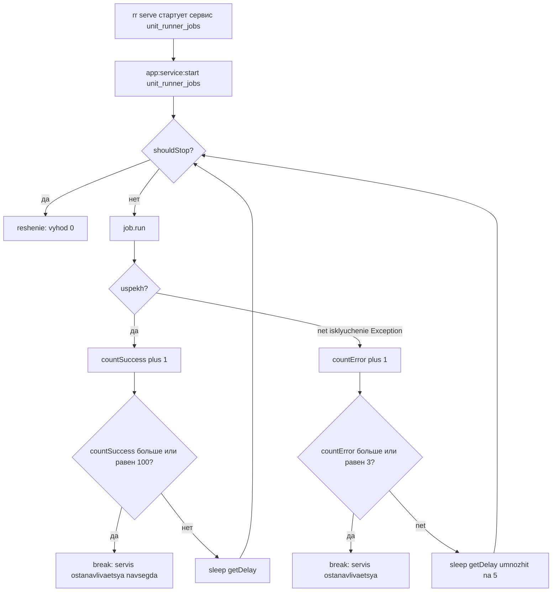

# Аудит проекта Unitman: ошибки и неточности

Дата: 2026-11-12. Область: статический анализ кода, конфигураций, DI, deptrac, инфраструктуры и окружения.
Все утверждения ниже проверены чтением файлов; ссылки вида `путь:строка` указывают на конкретное место.

> **Статус исправлений.** Этап 1 (блокирующие дефекты) выполнен и проверен: Psalm level 1 — без ошибок,
> `cache:clear` и `debug:router` в контейнере проходят, `composer validate` — valid. Пункты 1–7
> сводной таблицы закрыты. Подробности — в разделе «Этап 1» плана исправлений ниже.

---

## 1. Сводка по критичности

| # | Проблема | Критичность | Файл |
|---|---|---|---|
| 1 | `SIGTERM`/`SIGINT` используются без `ext-pcntl` в зависимостях | 🔴 Critical | [`RoadrunnerServiceCommand.php:36`](../src/BackgroundJob/Infra/Cli/RoadrunnerServiceCommand.php:36) |
| 2 | Фоновый сервис самоостанавливается через 100 итераций | 🔴 Critical | [`RoadrunnerServiceCommand.php:70`](../src/BackgroundJob/Infra/Cli/RoadrunnerServiceCommand.php:70) |
| 3 | Перехват `PharIo\Version\Exception` вместо ошибок Temporal | 🔴 Critical | [`OchistkaDockerJob.php:8`](../src/Runner/Infra/BackgroundJob/OchistkaDockerJob.php:8) |
| 4 | Redis фактически без пароля (`user default on nopass`) | 🔴 Critical | [`common-services.yml:88`](../common-services.yml:88) |
| 5 | Пароль JWT в `unitman.yaml` не совпадает с `.env.dist` | 🔴 Critical | [`unitman.yaml:22`](../unitman.yaml:22) |
| 6 | Публичный debug-эндпоинт `/test` с хардкод-GUID | 🟠 High | [`TestController.php:19`](../src/Unitman/Infra/Controller/TestController.php:19) |
| 7 | `^/api/login roles: [ROLE_USER,ROLE_ADMIN]` — логическая И | 🟠 High | [`security.yaml:34`](../config/packages/security.yaml:34) |
| 8 | 5 из 6 модульных deptrac-конфигов проверяют несуществующие папки | 🟠 High | [`Unitman/deptrac.yaml:15`](../src/Unitman/deptrac.yaml:15) |
| 9 | Корневой deptrac исключает все `Acl`-файлы | 🟠 High | [`deptrac.yaml:6`](../deptrac.yaml:6) |
| 10 | `JobRepository::init()` создаёт Postgres-only таблицу в рантайме | 🟠 High | [`JobRepository.php:17`](../src/BackgroundJob/Infra/Repository/JobRepository.php:17) |
| 11 | `phpunit.xml.dist` несовместим с PHPUnit 11 | 🟠 High | [`phpunit.xml.dist:23`](../phpunit.xml.dist:23) |
| 12 | `dc.mvp.yml`: `build:` вместо `image:` | 🟠 High | [`dc.mvp.yml:38`](../dc.mvp.yml:38) |
| 13 | `App\Unitman\...` импортируется из `Utils` (обратная зависимость) | 🟠 High | [`ProjectionsManager.php:5`](../src/Utils/EventSauce/ProjectionsManager.php:5) |
| 14 | `TEMPORAL_*` и `MONOLOG_SOCKET_HOST` отсутствуют в `.env.dist` при обязательности | 🟡 Medium | [`.env.dist:96`](../.env.dist:96) |
| 15 | `RR_RPC` объявлен, но везде захардкожен | 🟡 Medium | [`.env.dist:67`](../.env.dist:67) |
| 16 | `ProjectionsManager` обрабатывает максимум 200 событий за проход | 🟡 Medium | [`ProjectionsManager.php:91`](../src/Utils/EventSauce/ProjectionsManager.php:91) |
| 17 | `entrypoint.sh` нигде не подключён | 🟡 Medium | [`entrypoint.sh`](../entrypoint.sh) |
| 18 | Секреты в коммитируемом `.env.dist` | 🟡 Medium | [`.env.dist:55`](../.env.dist:55) |
| 19 | Двойная регистрация `MigrationFactoryDecorator` | 🟡 Medium | [`Utils/di.php:31`](../src/Utils/di.php:31) |
| 20 | Опечатки в именах классов/namespace | 🟡 Medium | [`UnitConroller.php:62`](../src/Unitman/Infra/Controller/UnitController.php:62) |

---

## 2. BackgroundJob и RoadRunner-сервисы

### 2.1 Отсутствует `ext-pcntl` при использовании сигналов — 🔴 Critical
[`RoadrunnerServiceCommand.php:36`](../src/BackgroundJob/Infra/Cli/RoadrunnerServiceCommand.php:36) возвращает `[SIGTERM, SIGINT]`. Это константы расширения `pcntl`. Если расширение не загружено, обращение к неопределённой константе — фатальная ошибка (`Error`), а не исключение.

В [`composer.json`](../composer.json) объявлен `ext-grpc`, но **не объявлен `ext-pcntl`**. Нужно добавить `"ext-pcntl": "*"` и проверить наличие расширения в образе ([`Dockerfile.dist`](../Dockerfile.dist), [`.docker/php/settings.ini`](../.docker/php/settings.ini)).

### 2.2 Сервис навсегда останавливается после 100 успешных итераций — 🔴 Critical
[`RoadrunnerServiceCommand.php:70-73`](../src/BackgroundJob/Infra/Cli/RoadrunnerServiceCommand.php:70):

```php
if ($countSuccess >= 100) {
    $this->logger->error('Max count success with service '.$serviceName);
    break;
}
```

`unit_runner_jobs` объявлен в [`.rr.yaml:44-52`](../.rr.yaml:44) как постоянный сервис (`remain_after_exit: true`, `restart_sec: 1`, `exec_timeout: 0s`). Счётчик никогда не сбрасывается, поэтому после 100 циклов сервис выходит штатно и больше ничего не делает. RR перезапустит процесс, счётчик снова дойдёт до 100 — то есть каждые ~100 * `getDelay()` секунд сервис простаивает и «стучится» в лог с уровнем `error`. Для долгоживущего сервиса лимит успехов бессмыслен: ограничение по числу ошибок имеет смысл, по числу успехов — нет.

**Исправление:** убрать блок `$countSuccess`, либо сбрасывать счётчик; заменять процесс по `max_jobs` средствами самого RoadRunner.

### 2.3 Счётчик ошибок не сбрасывается — 🔴 Critical
[`RoadrunnerServiceCommand.php:76`](../src/BackgroundJob/Infra/Cli/RoadrunnerServiceCommand.php:76): `$countError++` без обнуления при успехе. Три любых сбоя за всё время жизни процесса (даже разделённые сутками успешной работы) останавливают сервис. Ожидаемая семантика — «3 ошибки подряд».

### 2.4 Ловятся только `\Exception`, а не `\Throwable` — 🟠 High
[`RoadrunnerServiceCommand.php:75`](../src/BackgroundJob/Infra/Cli/RoadrunnerServiceCommand.php:75) и `:88`. `TypeError`, `Error`, `DivisionByZeroError` из джобы убивают процесс без записи в лог. Внешний `catch` того же типа не спасает. Нужен `\Throwable`.

### 2.5 Результат `run()` игнорируется — 🟡 Medium
[`RoadrunnerServiceCommand.php:68`](../src/BackgroundJob/Infra/Cli/RoadrunnerServiceCommand.php:68): `$job->run();` — при `return false` (что делают [`OchistkaDockerJob`](../src/Runner/Infra/BackgroundJob/OchistkaDockerJob.php) и [`RunnerHealthCheckWorkflowJob`](../src/Runner/Infra/BackgroundJob/RunnerHealthCheckWorkflowJob.php)) джоба считается успешной, `$countSuccess++`.

### 2.6 `sleep(0)` — потенциальный busy-loop — 🟡 Medium
[`RoadrunnerServiceCommand.php:74`](../src/BackgroundJob/Infra/Cli/RoadrunnerServiceCommand.php:74): `sleep($job->getDelay())`. Контракт [`BackgroundJobInterface.php`](../src/BackgroundJob/Infra/Service/BackgroundJobInterface.php) допускает `int<0, max>`. При `0` цикл крутится без паузы и выжигает CPU. Нужен `max(1, $job->getDelay())`.

### 2.7 Неиспользуемый импорт и отсутствие `strict_types` — 🟢 Low
- `use App\Utils\EventSauce\ProjectionsManager;` в [`RoadrunnerServiceCommand.php:6`](../src/BackgroundJob/Infra/Cli/RoadrunnerServiceCommand.php:6) не используется.
- Нет `declare(strict_types=1);` в [`RoadrunnerServiceCommand.php`](../src/BackgroundJob/Infra/Cli/RoadrunnerServiceCommand.php), [`OchistkaDockerJob.php`](../src/Runner/Infra/BackgroundJob/OchistkaDockerJob.php), [`RunnerHealthCheckWorkflowJob.php`](../src/Runner/Infra/BackgroundJob/RunnerHealthCheckWorkflowJob.php), [`AbstractBackgroundJob.php`](../src/BackgroundJob/Infra/Service/AbstractBackgroundJob.php), [`JobRepository.php`](../src/BackgroundJob/Infra/Repository/JobRepository.php) — при том что [`.roorules`](../.roorules) требует `strict_types=1` везде.

### 2.8 Неверный класс исключения в Runner-джобах — 🔴 Critical
[`OchistkaDockerJob.php:8`](../src/Runner/Infra/BackgroundJob/OchistkaDockerJob.php:8):

```php
use PharIo\Version\Exception;
```

и далее `catch (Exception)` на [строке 44](../src/Runner/Infra/BackgroundJob/OchistkaDockerJob.php:44). Это внутренний класс транзитивной зависимости `phar-io/version` (тянется composer'ом). Никакое исключение Temporal/RoadRunner в него не превратится, поэтому `catch` не срабатывает никогда, а реальные ошибки (`ConnectionException`, `TimeoutException` Temporal) улетают в цикл сервиса и инкрементируют `$countError`. То же — в [`RunnerHealthCheckWorkflowJob.php`](../src/Runner/Infra/BackgroundJob/RunnerHealthCheckWorkflowJob.php).

**Исправление:** `catch (\Throwable $e)` с логированием, либо конкретные исключения `Temporal\Client\GRPC\Exception\...`. Импорт `PharIo` удалить.

### 2.9 Дублирование базового класса и потерянная видимость методов — 🟡 Medium
[`OchistkaDockerJob.php`](../src/Runner/Infra/BackgroundJob/OchistkaDockerJob.php) и [`RunnerHealthCheckWorkflowJob.php`](../src/Runner/Infra/BackgroundJob/RunnerHealthCheckWorkflowJob.php) реализуют `BackgroundJobInterface` напрямую, дублируя `getDelay()`/`getProcessNum()`, хотя есть [`AbstractBackgroundJob`](../src/BackgroundJob/Infra/Service/AbstractBackgroundJob.php). Плюс в `AbstractBackgroundJob` и в джобах методы объявлены как `function getName(): string` — **без модификатора видимости** (`:19` в `OchistkaDockerJob`). Это валидный PHP, но противоречит стилю проекта (`public` явно) и ломает Psalm-настройки.

Также в `OchistkaDockerJob` неиспользуемый импорт `RunnerHealthCheckWorkflow` ([`:7`](../src/Runner/Infra/BackgroundJob/OchistkaDockerJob.php:7)).

### 2.10 `RR_RPC` игнорируется — 🟡 Medium
[`.env.dist:67`](../.env.dist:67) объявляет `RR_RPC=tcp://127.0.0.1:6001`, но [`BackgroundJobService.php`](../src/BackgroundJob/Infra/Service/BackgroundJobService.php) и [`LockService.php`](../src/Utils/Service/LockService.php) создают `RPC::create('tcp://127.0.0.1:6001')` жёстко. Переменная окружения мертва: смена RPC-порта в [`.rr.yaml:21-22`](../.rr.yaml:21) тихо ломает управление сервисами.

### 2.11 Динамическое создание сервиса с именем статического — 🟡 Medium
[`.rr.yaml:44-52`](../.rr.yaml:44) объявляет сервис `unit_runner_jobs` статически, а `BackgroundJobService::start()` создаёт сервис с тем же именем через RPC. Возможны дубли процессов и конфликт `process_num`. Нужно выбрать одну модель. Плюс расхождение `restart_sec: 1` (в `.rr.yaml`) против `restartSec: 10` (в коде).

### 2.12 `JobRepository`: DDL в рантайме, Postgres-only — 🟠 High
[`JobRepository.php:14-25`](../src/BackgroundJob/Infra/Repository/JobRepository.php:14):

```php
$this->connection->executeQuery("create table IF NOT EXISTS $table
    ( id serial constraint background_jobs_pk primary key, ... );
");
```

- `serial` — только PostgreSQL. В репозитории есть скрипты для `mysql`/`mariadb` ([`config/scripts/mysql`](../config/scripts/mysql), [`config/scripts/mariadb`](../config/scripts/mariadb)), значит поддержка других СУБД предполагалась.
- `executeQuery` для DDL — семантически неверно, нужен `executeStatement`.
- Нет `unique` индекса на `name`, хотя весь API строится на «одна строка на имя» (`getRunIdByName`, `start`). При гонке двух воркеров появятся дубли, и `fetchAssociative` вернёт произвольную строку.
- `const TABLE` без видимости и типа ([`:9`](../src/BackgroundJob/Infra/Repository/JobRepository.php:9)).
- Смешение языков в исключениях: `'Процесс не найден'` ([`:55`](../src/BackgroundJob/Infra/Repository/JobRepository.php:55)) при англоязычных сообщениях в остальном коде.
- `pause`/`unpause` не используются нигде.

**Исправление:** Doctrine-миграция для `background_jobs` (в модуле `BackgroundJob`), `unique(name)`, `executeStatement`, `private const string TABLE`.

---

## 3. DI и границы модулей

### 3.1 Модульные deptrac-конфиги проверяют пустые слои — 🟠 High
[`src/Unitman/deptrac.yaml:15-22`](../src/Unitman/deptrac.yaml:15) объявляет слои `Infrastructure` (`regex: ./Infrastructure`) и `Domain` (`regex: ./Domain`), но в проекте папки называются `Infra` и `Business`. Аналогично в [`Account`](../src/Account/deptrac.yaml), [`BackgroundJob`](../src/BackgroundJob/deptrac.yaml), [`Runner`](../src/Runner/deptrac.yaml), [`Initialization`](../src/Initialization/deptrac.yaml).

Следствие: слои совпадают с **нулём** файлов, `Api`/`Acl` collectors тоже без `.*` (`regex: ./Api`), и все проверки вида «Domain ничего не импортирует» проходят вхолостую. Реальную защиту даёт только [`src/Mediateka/deptrac.yaml`](../src/Mediateka/deptrac.yaml), где корректно указаны `./Api/.*`, `./Acl/.*`, `./Business/.*`, `./Infra/.*`.

Это ложная уверенность: `composer run check-unitman-deptrac` зелёный независимо от нарушений слоёв.

### 3.2 Корневой deptrac исключает все ACL-адаптеры — 🟠 High
[`deptrac.yaml:6`](../deptrac.yaml:6): `- '#Acl\.*#'` в `exclude_files`. Регулярка исключает **любой** путь, содержащий `Acl`. Все антикоррупционные адаптеры выведены из-под контроля, включая те, что тянут чужие модули.

Плюс `- '#.*test.*#'` ([`:5`](../deptrac.yaml:5)) регистрозависимо не покрывает папки `Tests` (её закрывает только `#Tests\.*#`, и то как подстрока).

### 3.3 Нет правила для `Initialization`, но зависимость есть — 🟠 High
В [`ruleset`](../deptrac.yaml:33) перечислены `Account`, `BackgroundJob`, `Mediateka`, `Runner`, `Unitman`. Слоя `Initialization` в правилах **нет**, значит модулю запрещено зависеть от кого-либо. При этом [`Initialization/Acl/Adapter/UnitmanAdapter.php`](../src/Initialization/Acl/Adapter/UnitmanAdapter.php) импортирует `App\Unitman\Api\UnitmanApi` — прямое нарушение, замаскированное пунктом 3.2.

Также `App` и `Utils` не объявлены слоями и не контролируются вовсе.

### 3.4 Обратная зависимость `Utils` → `Unitman` — 🟠 High
[`ProjectionsManager.php:5`](../src/Utils/EventSauce/ProjectionsManager.php:5):

```php
use App\Unitman\Infra\Projection\ProzesUnitaProjection;
```

`Utils` — разделяемый кернел, а импортирует внутренний класс `Infra` конкретного модуля. Импорт нигде не используется — достаточно удалить. Но он же показывает, что `Utils` не защищён deptrac и дрейф уже произошёл.

### 3.5 Двойная регистрация `MigrationFactoryDecorator` — 🟡 Medium
[`Utils/di.php:22-33`](../src/Utils/di.php:22): сервис подхватывается автозагрузкой `load('App\\Utils\\', './')`, а затем явно объявляется ещё раз и декорирует `doctrine.migrations.migrations_factory`.

При этом [`doctrine_migrations.yaml:12-13`](../config/packages/doctrine_migrations.yaml:12) отдельно задаёт `services: {'Doctrine\Migrations\Version\MigrationFactory': App\Utils\Service\MigrationFactoryDecorator}` — то есть декоратор назначается фабрикой миграций **и** декорирует `doctrine.migrations.migrations_factory`. Двойное связывание одного класса: как минимум избыточно, как максимум — циклическая декорация/«service already initialized». Нужно оставить один способ (`decorate`).

Побочно: `Serializer::class` регистрируется вручную ([`:28-29`](../src/Utils/di.php:28)) и затеняет фреймворковый `serializer`, а биндинг `$defaultLocale` дублирует биндинг FrameworkBundle.

### 3.6 Пробелы внутри списков `exclude` — 🟢 Low
В `di.php` всех модулей используется `exclude(['./{di.php,di_test.php, routing.php, Migrations, Tests}'])` — обратите внимание на пробелы после запятых внутри glob-группы. Glob-шаблон не матчит `' Migrations'`/`' Tests'`, поэтому исключения **не работают**: тесты и миграции попадают в контейнер как сервисы. Проявляется это или нет — зависит от того, являются ли эти классы валидными сервисами.

Дополнительно [`src/App/di.php`](../src/App/di.php) не включает `Api` в список загрузки, хотя [`src/App/Api/AppApi.php`](../src/App/Api/AppApi.php) существует — класс может быть незарегистрирован.

### 3.7 Мёртвый сервис Elasticsearch — 🟢 Low
[`src/App/di.php`](../src/App/di.php) регистрирует `ElasticsearchLogstashHandler` на `http://elasticsearch:9200`, но сервиса `elasticsearch` нет ни в одном compose-файле.

---

## 4. Event Sourcing и проекции

### 4.1 Ограничение 200 событий за проход — 🟡 Medium
[`ProjectionsManager.php:91`](../src/Utils/EventSauce/ProjectionsManager.php:91) и `:113`: `handleEventsByCheckpoint($projection, $checkpoint, 200)`.

Если sync-проекция отстала более чем на 200 событий, за один вызов она продвинется частично, а вызывающий код (HTTP-запрос или джоба) посчитает работу выполненной. Для `pullProjectionByName` это означает «частичная проекция + успех». Нужен цикл до исчерпания либо явный признак «остались события».

### 4.2 Молчаливый выход при невзятой блокировке — 🟡 Medium
[`ProjectionsManager.php:100-102`](../src/Utils/EventSauce/ProjectionsManager.php:100): если лок занят, метод просто `return`. Джоба, вызвавшая `pullProjectionByName`, отрапортует успех, хотя ничего не сделала.

### 4.3 Магические числа и `sleep` в `rebuild()` — 🟢 Low
[`ProjectionsManager.php:166-206`](../src/Utils/EventSauce/ProjectionsManager.php:166): `$disableReset !== 1`, `sleep(3)`, `$deep = 100`. Значения не именованы и меняют поведение неявно.

### 4.4 Нестрогое сравнение окружения — 🟢 Low
[`ProjectionsManager.php:85`](../src/Utils/EventSauce/ProjectionsManager.php:85): `$this->appEnv != 'test'` — `!=` вместо `!==`. Подавлено глобальным `RiskyTruthyFalsyComparison` в [`psalm.xml`](../psalm.xml), то есть подавление маскирует реальную небрежность.

---

## 5. Тесты и инструменты качества

### 5.1 `phpunit.xml.dist` несовместим с PHPUnit 11 — 🟠 High
- `convertDeprecationsToExceptions="false"` ([`:9`](../phpunit.xml.dist:9)) — атрибут удалён с PHPUnit 10, вызовет предупреждение схемы.
- `<coverage processUncoveredFiles="true">` ([`:33`](../phpunit.xml.dist:33)) — параметр переименован в `includeUncoveredFiles`, будет проигнорирован.
- `<listeners><listener class="Symfony\Bridge\PhpUnit\SymfonyTestsListener"/>` ([`:39-41`](../phpunit.xml.dist:39)) — listeners удалены в PHPUnit 10, нужен `<extensions>`.
- `<server name="SYMFONY_PHPUNIT_VERSION" value="9.5"/>` ([`:17`](../phpunit.xml.dist:17)) при `phpunit/phpunit ^11` в `require-dev` — прямое противоречие.
- `<directory suffix=".php">src/*/Tests</directory>` ([`:23`](../phpunit.xml.dist:23)) — элемент `directory` не раскрывает glob-шаблоны. Миграция на suite-конфигурацию или `<directory>src</directory>` с `suffix="Test.php"` обязательна; иначе набор тестов может быть пустым.

### 5.2 Несогласованные пути к phpunit — 🟡 Medium
[`composer.json:100`](../composer.json:100) `coverage` использует `php bin/phpunit`, но в [`bin/`](../bin) есть только `console`. Остальные скрипты (`:102`, `:108`) корректно используют `vendor/bin/phpunit`. Скрипт покрытия нерабочий.

### 5.3 `check-openapi` не входит в `all-checks` — 🟡 Medium
[`composer.json:116-127`](../composer.json:116): `all-checks` включает psalm, phpunit, translations и шесть deptrac, но **не** `check-openapi` ([`:108`](../composer.json:108)). Тест [`OpenApiDocumentationTest::test_committed_document_is_up_to_date`](../src/App/Tests/Documentation/OpenApiDocumentationTest.php:141) существует, но в общем прогоне не гарантирован (зависит от того, попадут ли тесты в discovery — см. 5.1).

### 5.4 Psalm подавляет слишком много — 🟡 Medium
[`psalm.xml`](../psalm.xml) при `level="1"` включает 9 `issueHandlers` с `errorLevel="suppress"`, в том числе `RiskyTruthyFalsyComparison`, `ArgumentTypeCoercion`, `MissingConstructor`, `PossiblyUnusedMethod`. Level 1 с такими подавлениями даёт мало сигнала. Дополнительно `findUnusedBaselineEntry="true"` без baseline-файла.

Исключены из анализа [`MigrationFactoryDecorator.php`](../src/Utils/Service/MigrationFactoryDecorator.php) и [`TestController.php`](../src/Unitman/Infra/Controller/TestController.php) — второй скрывает публичный debug-эндпоинт.

---

## 6. Конфигурация окружения

### 6.1 Секреты в `unitman.yaml` не совпадают с `.env.dist` — 🔴 Critical
[`unitman.yaml:22-23`](../unitman.yaml:22):

```yaml
- openssl genpkey ... -pass pass:asd243815
```

При этом [`.env.dist:55`](../.env.dist:55): `JWT_PASSPHRASE=1a0a60af3a1c06431ec9091ca330ae48`. `prepare` копирует `.env.dist` → `.env`, а ключ генерируется с другим паролем. Lexik при подписи JWT не сможет открыть приватный ключ — аутентификация падает. Дефолт для MVP-стенда нерабочий.

### 6.2 Секреты закоммичены в `.env.dist` — 🟡 Medium
Файл сам предупреждает «DO NOT DEFINE PRODUCTION SECRETS» ([`:11`](../.env.dist:11)), но содержит: `APP_SECRET` ([`:23`](../.env.dist:23)), `JWT_PASSPHRASE` ([`:55`](../.env.dist:55)), `DB_PASS=123` ([`:32`](../.env.dist:32)), `REDIS_PASSWORD`/`REDIS_USER_PASSWORD` ([`:87-89`](../.env.dist:87)), `CENTRIFUGO_API_KEY`/`SECRET` ([`:70-72`](../.env.dist:70)). Плюс `redis:latest` в compose и `MINIO_ROOT_PASSWORD=change-me-in-env-local` ([`:111`](../.env.dist:111)) — плейсхолдер, который легко забыть.

### 6.3 Обязательные переменные отсутствуют в `.env.dist` — 🟡 Medium
- [`config/packages/temporal.yaml:4`](../config/packages/temporal.yaml:4) требует `TEMPORAL_WORKER_QUEUE`, а `TEMPORAL_CLI_ADDRESS` читается в `App`/`temporal`. Обе заданы только в `environment:` сервиса `web` ([`common-services.yml:15-16`](../common-services.yml:15)) — вне compose (CLI, CI, локальный запуск) контейнер не соберётся.
- [`monolog.yaml:25`](../config/packages/monolog.yaml:25) требует `MONOLOG_SOCKET_HOST` ([`.env.dist:96`](../.env.dist:96)) — ок, но `MONOLOG_DEFAULT_CHANNEL=socket` ([`:95`](../.env.dist:95)) нигде не используется: мёртвая переменная.
- `.env.dist` содержит блок `###> prooph/pdo-event-store ###` ([`:46`](../.env.dist:46)), хотя prooph не подключён в `composer.json` — устаревший комментарий.

### 6.4 `unitman.yaml`: `FIRST_SERVICE_HOST:` с двоеточием — 🟡 Medium
[`unitman.yaml:2`](../unitman.yaml:2): `- id: FIRST_SERVICE_HOST:` — YAML распарсит id как строку `"FIRST_SERVICE_HOST:"`. Инструмент оркестрации получит id с двоеточием, а подстановка `${...}` не сработает.

### 6.5 `unitman.yaml`: несоответствие базового образа и легаси-команд — 🟢 Low
`yum install -y openssl` ([`:21`](../unitman.yaml:21)) предполагает CentOS/RHEL-хост, тогда как образ собирается на Alpine (`apk` в [`Dockerfile.dist`](../Dockerfile.dist)). Также `docker-compose logs` ([`:70`](../unitman.yaml:70), [`:97`](../unitman.yaml:97)) — устаревшая форма против `docker compose` в `up` ([`:31-33`](../unitman.yaml:31)), а action назван `"podman-compose logs"` ([`:41`](../unitman.yaml:41)).

### 6.6 `docker-compose.yml`: dev-логи в никуда — 🟡 Medium
`MONOLOG_SOCKET_HOST=127.0.0.1:9913` ([`.env.dist:96`](../.env.dist:96)) внутри контейнера `web` указывает на сам контейнер. Buggregator в [`docker-compose.yml`](../docker-compose.yml) закомментирован, и даже при включении адрес должен быть `buggregator:9913`. Отладочные логи в dev-режиме не доставляются никогда.

### 6.7 `.env.test` и `SYMFONY_DEPRECATIONS_HELPER` — 🟢 Low
Конфликт: [`phpunit.xml.dist:18`](../phpunit.xml.dist:18) задаёт `disabled`, а [`.env.test`](../.env.test) — `999999` (синтаксис, устаревший с phpunit-bridge 7). Также `.env.test` содержит `PANTHER_*`, хотя `symfony/panther` не установлен.

---

## 7. Инфраструктура (Docker/Compose)

### 7.1 Redis фактически без аутентификации — 🔴 Critical
[`common-services.yml:85`](../common-services.yml:85) пишет `requirepass $REDIS_PASSWORD`, а [строка 88](../common-services.yml:88) перезаписывает пользователя по умолчанию:

```
user default on nopass ~* +@all
```

ACL-файл имеет приоритет: `default` получает `nopass` и полные права. Порт проброшен на хост как `6380:6379` ([`:70`](../common-services.yml:70)) с `bind 0.0.0.0` ([`:84`](../common-services.yml:84)). Итог: неаутентифицированный Redis, доступный из сети. Правильно: `user default off` либо `>${REDIS_PASSWORD}`.

Дополнительно: тело `command` использует `${REDIS_PASSWORD}` без экранирования (`$$`), хотя healthcheck рядом написан корректно через `$$` ([`:91` и далее](../common-services.yml:91)) — compose подставляет значения хоста, а не контейнера.

### 7.2 `dc.mvp.yml`: `build:` со ссылкой на образ — 🟠 High
[`dc.mvp.yml:38`](../dc.mvp.yml:38):

```yaml
unitman-front:
  build: asdozzz/unitman-front:0.0.9
```

`build` ожидает путь к контексту; `asdozzz/unitman-front:0.0.9` будет воспринят как каталог и сборка упадёт (или создаст пустой образ). Нужно `image:`.

### 7.3 `dc.mvp.yml`: неверный адрес Centrifugo — 🟠 High
[`dc.mvp.yml:43`](../dc.mvp.yml:43): `VITE_CENTRIFUGE_HOST: ws://web:8000/connection/websocket`. Порт 8000 слушает контейнер `centrifugo` ([`common-services.yml:56`](../common-services.yml:56)), а `web` слушает 8080 ([`.rr.yaml:25`](../.rr.yaml:25)). Нужно `ws://centrifugo:8000/connection/websocket`.

### 7.4 `dc.mvp.yml`: JWT-ключи монтируются поверх сгенерированных — 🟡 Medium
[`dc.mvp.yml:30-31`](../dc.mvp.yml:30) монтирует `./config/jwt` в контейнер, при этом `entrypoint.sh` генерирует ключи в том же пути при старте. Монтирование пустого каталога перекрывает образ и делает генерацию бессмысленной. Плюс `APP_ENV=prod` ([`:20`](../dc.mvp.yml:20)) в связке с `PHP_DISPLAY_ERRORS=On` ([`:24`](../dc.mvp.yml:24)) — недопустимо для прода.

### 7.5 `entrypoint.sh` — мёртвый код — 🟡 Medium
[`entrypoint.sh`](../entrypoint.sh) не подключён ни в [`Dockerfile`](../Dockerfile), ни в [`Dockerfile.dist`](../Dockerfile.dist). При этом в нём живёт вся логика инициализации: миграции и `app:projections:rebuild all` при **каждом** старте контейнера. Пока файл не подключён, миграции автоматически не применяются, а если подключить как есть — полный ребилд проекций на каждый рестарт (долго и рискованно). Нет `exec` для проброса сигналов.

### 7.6 `Dockerfile.dist` без `CMD`/`ENTRYPOINT` — 🟡 Medium
[`Dockerfile.dist`](../Dockerfile.dist): все строки запуска закомментированы. Образ собирается, но контейнер из него не запускает приложение.

### 7.7 Мелочи compose — 🟢 Low
- `redis:latest` без пина ([`common-services.yml:63`](../common-services.yml:63)).
- `deploy.resources` ([`:73-80`](../common-services.yml:73)) игнорируется обычным `docker compose`.
- Порты без кавычек (`2112:2112`, `30000:30000`, [`:11-12`](../common-services.yml:11)) — риск YAML-интерпретации как sexagesimal.
- `user: root` + монтирование `docker.sock` ([`:13`](../common-services.yml:13)).
- `networks.default.external: unitman_default` требует ручного `docker network create` (есть в [`unitman.yaml:29`](../unitman.yaml:29), но не в `Makefile`).

### 7.8 RoadRunner: потенциально неверное размещение `beanstalk.addr` — 🟡 Medium
[`.rr.yaml:57-58`](../.rr.yaml:57) задаёт `addr` на верхнем уровне, а пайплайны ([`:73-85`](../.rr.yaml:73)) описывают только `driver` и `priority`. В RR v3 адрес драйвера задаётся внутри `pipelines.<name>.config.addr`. Если верхнеуровневый ключ не подхватывается, джобы пойдут на `127.0.0.1:11300` внутри контейнера `web`, где beanstalkd нет — очереди молча не работают. Требует проверки на стенде.

### 7.9 RoadRunner: слишком агрессивный лимит памяти — 🟡 Medium
[`.rr.yaml:29`](../.rr.yaml:29) и [`:31`](../.rr.yaml:31): `max_jobs: 100` для HTTP-пула и `max_worker_memory: 100` (МБ). Symfony-воркер с полным контейнером легко превышает 100 МБ, поэтому воркеры будут пересоздаваться почти на каждом запросе — потеря производительности и «холодный» кеш DI.

---

## 8. HTTP/безопасность

### 8.1 Публичный debug-эндпоинт `/test` — 🟠 High
[`TestController.php:19`](../src/Unitman/Infra/Controller/TestController.php:19) — `#[Route('/test', methods: ['GET'])]`, `PUBLIC_ACCESS` в [`security.yaml:28`](../config/packages/security.yaml:28), читает строку по хардкод-GUID `0199907b-8736-7334-bd1a-f0d72286a9cb` и возвращает её. Нет типа возврата, класс исключён из Psalm. Мёртвый отладочный код в проде, доступный без токена.

### 8.2 `access_control` для логина использует логическое И — 🟠 High
[`security.yaml:34`](../config/packages/security.yaml:34):

```yaml
- { path: ^/api/login, roles: [ROLE_USER,ROLE_ADMIN]  }
```

Массив ролей означает «нужны все перечисленные». Пользователь с одной ролью не пройдёт проверку. В рецепте Symfony для формы логина — `PUBLIC_ACCESS`. Сейчас может «работать» лишь потому, что `json_login` аутентифицирует в том же запросе, но намерение выражено неверно и поведение хрупкое.

### 8.3 `info.php` в корне репозитория — 🟡 Medium
[`info.php`](../info.php): `<?php echo phpinfo();`. Лежит вне `public/`, но при неверном корне веб-сервера или монтировании — прямой канал раскрытия конфигурации.

### 8.4 Публичный `runner/saveSteps` — 🟡 Medium
[`security.yaml:30`](../config/packages/security.yaml:30) открывает `^/api/runner/saveSteps$` без аутентификации. Если это не подписано общим секретом внутри use case — запись шагов сборки может быть подделана. Требует подтверждения, что проверка есть в use case.

### 8.5 Опечатка в имени класса контроллера — 🟡 Medium
[`UnitConroller.php:62`](../src/Unitman/Infra/Controller/UnitController.php:62) — класс `UnitConroller` (пропущена `t`). Не ломает работу, но ломает поиск, автодополнение и любой рефакторинг; 24 эндпоинта в одном 988-строчном контроллере. Файл и класс нужно переименовать в `UnitController`.

### 8.6 Наследие опечаток в контрактах
- Namespace `App\Utils\Model\Reponse` ([`Reponse/Response.php`](../src/Utils/Model/Reponse/Response.php)) — переименовать **нельзя** без миграции контракта; [`.roorules`](../.roorules) прямо это запрещает. Фиксируем как осознанный долг, но стоит добавить комментарий-предупреждение, если его нет.
- `CanGeneateGuid` (порт в `Unitman`) — опечатка `Geneate` → `Generate`.
- `NachatOstanvkuUnitaWorkflow` (в [`config/workflows.php`](../config/workflows.php)) против команды `NachatOstanovkuUnita` — рассогласование имён.
- `Sobitie`/`Sobitiya` — разное написание в разных местах.

---

## 9. План устранения (по приоритетам)

### Этап 1 — блокирующие дефекты (без них стенд нерабочий/небезопасный)
1. Привести пароль JWT в [`unitman.yaml:22-23`](../unitman.yaml:22) в соответствие с `.env.dist` (или брать из переменной, а не хардкодить).
2. Закрыть Redis: `user default off` / пароль для `default`, экранировать `$` в `command`.
3. Добавить `ext-pcntl` в `composer.json` и в образ.
4. Исправить [`RoadrunnerServiceCommand`](../src/BackgroundJob/Infra/Cli/RoadrunnerServiceCommand.php): убрать лимит успехов, сбрасывать `$countError`, ловить `\Throwable`, учитывать результат `run()`, `max(1, ...)` для `sleep`.
5. Заменить `PharIo\Version\Exception` на корректные исключения в [`OchistkaDockerJob`](../src/Runner/Infra/BackgroundJob/OchistkaDockerJob.php) и [`RunnerHealthCheckWorkflowJob`](../src/Runner/Infra/BackgroundJob/RunnerHealthCheckWorkflowJob.php).
6. Удалить [`TestController`](../src/Unitman/Infra/Controller/TestController.php), `PUBLIC_ACCESS` для `/test` и `info.php`.
7. Исправить `access_control` для `^/api/login` на `PUBLIC_ACCESS`.

### Этап 2 — целостность архитектурных проверок
8. Переписать 5 модульных [`deptrac.yaml`](../src/Unitman/deptrac.yaml) по образцу [`Mediateka`](../src/Mediateka/deptrac.yaml): слои `Api`/`Acl`/`Business`/`Infra`, регэкспы с `/.*`.
9. Убрать `#Acl\.*#` из [`deptrac.yaml:6`](../deptrac.yaml:6), добавить правила для `Initialization`, `App`, `Utils`.
10. Удалить импорт `App\Unitman\...` из [`ProjectionsManager.php:5`](../src/Utils/EventSauce/ProjectionsManager.php:5).
11. Оставить одну регистрацию `MigrationFactoryDecorator`; убрать пробелы в `exclude`-глобах всех `di.php`.
12. Синхронизировать [`.roorules`](../.roorules) с фактическим `ruleset` (Unitman зависит от Mediateka).

### Этап 3 — инфраструктура и окружение
13. `dc.mvp.yml`: `image:` вместо `build:`, адрес Centrifugo, убрать `PHP_DISPLAY_ERRORS=On` в prod.
14. Подключить или удалить [`entrypoint.sh`](../entrypoint.sh); добавить `CMD` в [`Dockerfile.dist`](../Dockerfile.dist).
15. Дополнить `.env.dist` переменными `TEMPORAL_CLI_ADDRESS`, `TEMPORAL_WORKER_QUEUE`; удалить `MONOLOG_DEFAULT_CHANNEL` и блок prooph.
16. Исправить `MONOLOG_SOCKET_HOST` на `buggregator:9913` и включить buggregator в dev.
17. Вынести `RR_RPC` в конфиг вместо хардкода в `BackgroundJobService`/`LockService`; согласовать `restart_sec`.
18. Проверить размещение `beanstalk.addr` относительно `pipelines.*.config` в `.rr.yaml`.
19. Добавить миграцию для таблицы `background_jobs` с `unique(name)` в модуль `BackgroundJob`.

### Этап 4 — тесты и качество
20. Обновить [`phpunit.xml.dist`](../phpunit.xml.dist) под PHPUnit 11: убрать `convertDeprecationsToExceptions`, `processUncoveredFiles` → `includeUncoveredFiles`, `<listeners>` → `<extensions>`, починить `<directory>` (убрать glob), убрать `SYMFONY_PHPUNIT_VERSION=9.5`.
21. Исправить путь `bin/phpunit` → `vendor/bin/phpunit` в скрипте `coverage`.
22. Добавить `check-openapi` в `all-checks`.
23. Сузить подавления в [`psalm.xml`](../psalm.xml), убрать `TestController` из исключений после его удаления.
24. Согласовать `SYMFONY_DEPRECATIONS_HELPER` между [`phpunit.xml.dist`](../phpunit.xml.dist) и [`.env.test`](../.env.test).
25. Разобраться с `ProjectionsManager`: цикл до исчерпания событий вместо лимита 200, явный результат при невзятой блокировке.

### Этап 5 — гигиена и читаемость
26. Переименовать `UnitConroller` → `UnitController` (файл + класс), разбить на несколько контроллеров по доменам.
27. Убрать неиспользуемые импорты, добавить `declare(strict_types=1)` в файлы без него, проставить `public` явно.
28. Убрать `PharIo`-импорт, `RunnerHealthCheckWorkflow` из `OchistkaDockerJob`, мёртвый `ElasticsearchLogstashHandler`.
29. Починить `unitman.yaml`: id без двоеточия, единая форма `docker compose`, согласовать пакетный менеджер в `prepare`.
30. Опечатки в именах: `CanGeneateGuid`, `NachatOstanvkuUnitaWorkflow`, `Sobitie`/`Sobitiya` — привести к единому написанию (кроме `Reponse`, менять который запрещено правилами).

---

## 10. Схема потока управления сервисом (для контекста пунктов 2.1–2.6)



Проблемные ветки помечены `Z2` и `Z3`: обе ведут к постоянной остановке сервиса, причём `Z2` срабатывает на **успешной** работе, а `I` не ловит `Error`/`TypeError`.
