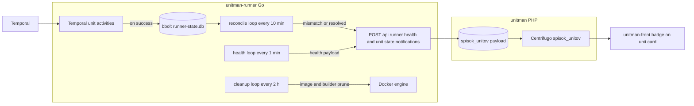

# Состояние контейнеров юнитов, health-push и очистка на стороне unitman-runner

## 1. Цель

Перенести в `unitman-runner` ответственность за наблюдение за контейнерами юнитов:

1. Хранить в лёгкой встроенной БД ожидаемое и фактическое состояние контейнера каждого юнита.
2. Обновлять ожидаемое состояние только после успешного завершения Temporal-активности.
3. Раз в 10 минут сверять ожидаемое состояние с фактическим.
4. При расхождении отправлять уведомление в unitman; unitman обновляет read-модель `spisok_unitov` и пушит событие `OBNOVLEN` в существующий канал Centrifugo `spisok_unitov`.
5. Удалить Temporal-активность `OchistkaDockeraActivity`; очистка образов и build-cache выполняется внутри раннера раз в 2 часа.
6. Удалить Temporal-активность `RunnerHealthCheckActivity`; раннер сам отправляет health-информацию в unitman раз в минуту.

Принятые решения:

- Ожидаемое состояние коммитится только при `Success == 1` активности; при ошибке остаётся прежним.
- Проверка фактического состояния — раз в 10 минут.
- Очистка — только `docker image prune -af` и `docker builder prune -af`; тома не трогаем.
- Старые Temporal workflows, background jobs и Go-активности удаляются полностью.
- Хранилище — bbolt: чистый Go, один файл, без CGO и миграций.
- Уведомления показываются на карточке юнита как поля read-модели, отдельная лента не создаётся.

## 2. Архитектура



## 3. Модель состояния в раннере

### 3.1. Хранилище

Файл: `RUNNER_STATE_DB`, по умолчанию `runner-state.db` в рабочем каталоге раннера.

bbolt:

- bucket `units`;
- ключ — `UnitId`;
- значение — JSON структуры `UnitState`;
- bucket `meta` с версией схемы.

Структура:

```go
type ExpectedState string // "running" | "absent"

type ActualState string // "running" | "stopped" | "absent" | "unknown"

type UnitState struct {
    UnitID             string        `json:"unitId"`
    ProjectID          string        `json:"projectId"`
    UnitName           string        `json:"unitName"`
    ProjectName        string        `json:"projectName"`
    ContainerName      string        `json:"containerName"`
    Expected           ExpectedState `json:"expectedState"`
    ExpectedUpdatedAt  int64         `json:"expectedUpdatedAt"`
    Actual             ActualState   `json:"actualState"`
    ActualCheckedAt    int64         `json:"actualCheckedAt"`
    MismatchSince      int64         `json:"mismatchSince"`
    LastNotifiedActual ActualState   `json:"lastNotifiedActual"`
    LastNotifiedAt     int64         `json:"lastNotifiedAt"`
}
```

`ContainerName` вычисляется так же, как `container_name` в compose:
`UnitName + "." + ProjectName`.

### 3.2. Обновление ожидаемого состояния по активностям

| Активность | Успех | Ожидаемое состояние |
|---|---|---|
| `NachatPodgotovkuUnitaActivity` | да | `running` |
| `NachatZapuskUnitaActivity` | да | `running` |
| `NachatObnovlenieUnitaActivity` | да | `running` |
| `NachatDeistvieUnitaActivity` | да | `running`, если записи ещё нет |
| `NachatSbrosPodgotovkiUnitaActivity` | да | `absent` |
| `NachatUdalenieUnitaActivity` | да | запись удаляется |
| `NachatOstanokuUnitaActivity` | да | не меняется, контейнер остаётся запущенным |
| `NachatSborkuUnitaActivity` | да | не меняется |
| `ProveritKonteinerUnitaActivity` | любой | обновляется только `Actual` |
| `VipolnitHodOpenCodeActivity` | — | не меняется |

Обновление выполняется через `defer` вNamed-return функциях активностей, чтобы видеть финальный `result.Success`.

### 3.3. Bootstrap при старте

Если БД пустая или потеряна:

1. Просканировать `<workdir>/projects/*/units/*`.
2. Для каталогов с `compose.yaml` и `.env` прочитать `UNITMAN_UNIT_ID`, `UNITMAN_UNIT_NAME`, `UNITMAN_PROJECT_NAME`.
3. Определить фактическое состояние.
4. Если фактическое состояние `running` или `absent` — записать ожидаемое равным фактическому.
5. Если `stopped` или `unknown` — не создавать запись до первой успешной активности.

Это защищает от шторма ложных уведомлений после перезапуска раннера.

### 3.4. Сверка

Раз в 10 минут:

1. Одной командой получить состояние всех контейнеров:
   `docker ps -a --format '{{json .}}'`.
2. Построить карту `ContainerName -> State`.
3. Для каждой записи в bbolt вычислить `Actual`:
   - `running` — контейнер найден и запущен;
   - `stopped` — контейнер найден, но не запущен;
   - `absent` — контейнер не найден;
   - `unknown` — команда docker завершилась ошибкой, сверку пропустить.
4. Сравнить:
   - `expected = running` — расхождение, если `actual != running`;
   - `expected = absent` — расхождение, если `actual != absent`.
5. При переходе в расхождение запомнить `MismatchSince`.
6. Уведомлять:
   - сразу при смене `Actual` или переходе в расхождение;
   - напоминание не чаще раза в 30 минут;
   - при восстановлении отправить `resolved`.
7. После успешного HTTP-ответа обновить `LastNotifiedAt` и `LastNotifiedActual`.

## 4. HTTP-контракты

### 4.1. Подпись

Все новые публичные callback-эндпоинты используют HMAC-SHA256 по сырому телу запроса
с per-runner секретом:

```text
X-Runner-Id: <runnerId>
X-Runner-Signature: hex(HMAC-SHA256(rawBody, perRunnerSecret))
```

`perRunnerSecret` выводится бэкендом из `RUNNER_SECRET_MASTER_KEY` (fallback —
`APP_SECRET`); глобального секрета нет. Заголовок и формат совпадают с
существующим `saveSteps`.

### 4.2. Health

`POST /api/runner/health` — публичный, без JWT.

```json
{
  "runnerId": "runner-host",
  "taskQueue": "unitman-runner-queue",
  "active": true,
  "dockerStats": "{\"Container\":\"...\",\"Name\":\"...\"}\n...",
  "memInfo": "MemTotal: ...\nMemAvailable: ...\n",
  "unixtime": 1730000000
}
```

Ограничение тела — 2 МиБ. Ответ — `true`.

### 4.3. Уведомления о состоянии

`POST /api/runner/unitStateNotifications` — публичный, без JWT.

```json
{
  "runnerId": "runner-host",
  "notifications": [
    {
      "unitId": "0192...",
      "projectId": "0192...",
      "unitName": "feature-a",
      "projectName": "shop",
      "expectedState": "running",
      "actualState": "absent",
      "eventType": "mismatch",
      "detectedAt": 1730000000
    },
    {
      "unitId": "0192...",
      "projectId": "0192...",
      "unitName": "feature-b",
      "projectName": "shop",
      "expectedState": "running",
      "actualState": "running",
      "eventType": "resolved",
      "detectedAt": 1730000000
    }
  ]
}
```

`eventType`: `mismatch` или `resolved`.

Ограничение тела — 1 МиБ. Ответ — `true`.

## 5. Изменения в unitman-runner

### 5.1. Новые пакеты

```text
state/
  state.go
  bolt_store.go
  bolt_store_test.go
monitor/
  client.go
  client_test.go
  health.go
  health_test.go
  actual_state.go
  reconciler.go
  reconciler_test.go
  cleanup.go
  cleanup_test.go
```

### 5.2. Зависимости и конфигурация

- Добавить `go.etcd.io/bbolt` в `go.mod`/`go.sum` через `go get` и `go mod tidy`.
- Переменные окружения:
  - `RUNNER_STATE_DB` — путь к bbolt, по умолчанию `runner-state.db`;
  - `RUNNER_ID` — идентификатор раннера, по умолчанию `os.Hostname()`;
  - авторизация callback-запросов — `X-Runner-Id` + `X-Runner-Signature` (per-runner secret);
  - `RUNNER_WORK_DIR` — корень раскладки `projects/`, уже используется OpenCode.
- Добавить `runner-state.db` в `.gitignore`.
- Добавить `docs/runner-state.md`: назначение БД, переменные окружения, persist-требования, расписание циклов.

### 5.3. `state` пакет

- `Init(path)` открывает bbolt, создаёт bucket `units`.
- `Close()` закрывает БД.
- `Default()` возвращает глобальный store или no-op реализацию.
- Методы:
  - `RecordActivityResult(activity, projectID, unitID, unitName, projectName string, success bool)`;
  - `Get(unitID)`, `List()`, `Upsert`, `Delete`;
  - `SetActual(unitID, actual, checkedAt)`;
  - `MarkNotified(unitID, actual, at)`.
- Все операции потокобезопасны; bbolt сериализует запись.

### 5.4. `monitor` пакет

- `Client`:
  - `BaseURL`, `Secret`, `RunnerID`, `TaskQueue`, `HTTPClient`;
  - `SendHealth(payload) error`;
  - `SendNotifications(payload) error`;
  - подпись тела, заголовок `X-Runner-Signature`, проверка HTTP 200.
- `RunHealth(ctx)`:
  - первый запуск сразу, далее тикер 1 минута;
  - `memInfo` — чтение `/proc/meminfo`;
  - `dockerStats` — `docker stats --no-stream --format json`;
  - ошибка docker не отменяет отправку: health уходит с `active=true`, пустыми stats и логом ошибки.
- `RunReconciler(ctx)`:
  - bootstrap, затем тикер 10 минут;
  - `docker ps -a --format '{{json .}}'` одной командой;
  - сравнение, дедупликация, batch-отправка уведомлений.
- `RunCleanup(ctx)`:
  - тикер 2 часа;
  - `docker image prune -af`, затем `docker builder prune -af`;
  - ошибки логируются, цикл продолжается;
  - `--volumes` не используется.
- Все циклы получают контекст, отменяемый по SIGINT/SIGTERM.

### 5.5. `temporal/main.go`

- Заменить хардкод очереди на константу `TaskQueue`.
- Удалить регистрацию:
  - `runner.RunnerHealthCheckActivity`;
  - `runner.OchistkaDockeraActivity`.
- Инициализировать `state` и `monitor` после парсинга конфига.
- Запустить горутины `RunHealth`, `RunReconciler`, `RunCleanup` с общим контекстом.
- `w.Run(worker.InterruptCh())` оставить как есть; контекст циклов отменяется через `signal.NotifyContext`.

### 5.6. Хуки в активностях

- В `NachatPodgotovkuUnitaActivity`, `NachatZapuskUnitaActivity`, `NachatObnovlenieUnitaActivity`, `NachatSbrosPodgotovkiUnitaActivity`, `NachatUdalenieUnitaActivity`, `NachatDeistvieUnitaActivity`:
  - перейти на именованные возвраты;
  - добавить `defer state.RecordActivityResult(...)`;
  - для удаления — `state.Delete(unitID)` при успехе.
- В `ProveritKonteinerUnitaActivity` обновлять `Actual` по результату проверки.
- Убедиться, что при `Success == 0` ожидаемое состояние не меняется.

### 5.7. Удаление старых активностей

Удалить файлы:

- `temporal/activity/runner/RunnerHealthCheckActivity.go`;
- `temporal/activity/runner/OchistkaDockeraActivity.go`.

## 6. Изменения в unitman, PHP

### 6.1. Безопасность

В `config/packages/security.yaml` добавить:

```yaml
- { path: ^/api/runner/health$, roles: PUBLIC_ACCESS }
- { path: ^/api/runner/unitStateNotifications$, roles: PUBLIC_ACCESS }
```

### 6.2. Runner-модуль

Новые команды:

- `Business/Command/ZaregistrirovatHealthRunnera.php`;
- `Business/Command/ZaregistrirovatUvedomleniyaOSostoyaniiKonteynera.php`;
- `Business/Command/UvedomlenieOSostoyaniiKonteynera.php`.

Новые use case:

- `Business/UseCase/ZaregistrirovatHealthRunneraUseCase.php`:
  - найти раннера по `runnerId`;
  - если не найден — создать с `taskQueue`;
  - обновить `active`, `dockerStats`, `memInfo`, `unixtimeLastHealth`;
  - сохранить;
  - вызвать `UmeetObnovlyatStatistikuPoUnitam`.
- `Business/UseCase/ZaregistrirovatUvedomleniyaOSostoyaniiKonteyneraUseCase.php`:
  - провалидировать элементы;
  - для каждого вызвать порт `UmeetObnovlyatSostoyanieKonteyneraUnita`.

Новый порт:

- `Business/Port/UmeetObnovlyatSostoyanieKonteyneraUnita.php`.

Новый парсер:

- `Business/Utils/RunnerHealthPayloadParser.php` — общий разбор `dockerStats` и `memInfo` для старого и нового use case.

Модель и репозиторий:

- `RunnerState`:
  - добавить `unixtimeLastHealth`;
  - добавить `isHealthFresh(int $ttl, ?int $now = null)`;
  - добавить фабрику `sozdatRunner(string $id, string $taskQueue)`.
- `RunnerRepository`:
  - добавить `findById(string $id): ?RunnerState`.
- `SqlRunnerStateRepository`:
  - реализовать `findById`;
  - `getDefaultRunnerState()` выбирает запись с максимальным `unixtimeLastHealth`.
- `RunnerCallbackSignatureChecker`:
  - добавить `estPodpisTelaValidna(string $body, ?string $signature): bool`.
- `RunnerController`:
  - `POST /health`;
  - `POST /unitStateNotifications`;
  - проверка подписи по сырому телу;
  - ограничения размера тела;
  - OA-атрибуты.
- `Acl/UnitmanAdapter`:
  - реализовать новый порт через `UnitmanApi::obnovitSostoyanieKonteyneraUnita`.
- `di.php`:
  - привязать порт к адаптеру;
  - удалить регистрацию `UstanovitResultatRabotosposobnostiRunneraActivity`.

Удалить:

- `Infra/Workflow/RunnerHealthCheckWorkflow.php`;
- `Infra/Workflow/OchistkaDockeraWorkflow.php`;
- `Infra/BackgroundJob/RunnerHealthCheckWorkflowJob.php`;
- `Infra/BackgroundJob/OchistkaDockerJob.php`;
- `Infra/Activity/UstanovitResultatRabatosposobnostiRunneraActivity.php`;
- записи из `config/workflows.php`.

### 6.3. Unitman-модуль

Команда и порты:

- `Business/Command/Unit/ObnovitSostoyanieKonteyneraUnita.php`;
- `Business/Port/Unit/UmeetObnovlyatSostoyanieKonteyneraUnita.php`;
- `Business/Port/Unit/UmeetOpoveshatObIzmeneniiUnita.php`.

Use case:

- `Business/UseCase/Unit/ObnovitSostoyanieKonteyneraUnitaUseCase.php`:
  - атомарно обновить payload `spisok_unitov`;
  - если строка обновлена — отправить push через порт.

Read-модель:

- `Business/ReadModel/Unit/SpisokUnitovReadModel.php`:
  - добавить поля в конец конструктора:
    - `containerStateMismatch` (bool, default false);
    - `containerStateMismatchExpected` (?string, default null);
    - `containerStateMismatchActual` (?string, default null);
    - `containerStateMismatchDetectedAt` (?int, default null);
  - сохранить их в `copyAndUpdateData`.

Репозиторий:

- `Infra/Repository/Unit/SpisokUnitovRepository.php`:
  - реализовать `UmeetObnovlyatSostoyanieKonteyneraUnita`;
  - обновление одним SQL-запросом без read-modify-write:
    ```sql
    update spisok_unitov
    set payload = payload || cast(:patch as jsonb)
    where id = :id
    ```
  - для `mismatch` patch содержит `true` и значения;
  - для `resolved` patch содержит `false` и `null`;
  - вернуть `bool` — была ли обновлена строка.

Push:

- `Infra/Service/WebsocketUnitEventNotifier.php`:
  - собирает `WebsocketUnitEventReadModel` с типом `OBNOVLEN`;
  - ставит задачу в очередь `websocket_unit_event` через `ZadachaDlyOcherediService`;
  - ошибки Centrifugo/очереди логирует и не ломает ответ раннеру.

API:

- `Api/UnitmanApi.php`:
  - добавить `obnovitSostoyanieKonteyneraUnita(ObnovitSostoyanieKonteyneraUnita $command): void`.

DI:

- `di.php`: привязать порты к `SpisokUnitovRepository` и `WebsocketUnitEventNotifier`.

### 6.4. Переводы

Добавить в `translations/messages.ru.php` и `translations/messages.en.php`:

- `runner.health_payload_too_large`;
- `runner.unit_state_payload_too_large`;
- `runner.unit_state_payload_empty`;
- `runner.health_runner_id_empty`.

### 6.5. Документация

Добавить `docs/unit-container-state.md`:

- поля `containerStateMismatch*` в `spisok_unitov`;
- событие `OBNOVLEN` в Centrifugo `spisok_unitov`;
- семантика `expectedState` и `actualState`;
- как фронт показывает бейдж/баннер.

## 7. Как это отражается на front

Фронт получает обновление по существующему каналу `spisok_unitov` с типом `OBNOVLEN` и перечитывает список юнитов. В строке юнита появляются поля:

```json
{
  "containerStateMismatch": true,
  "containerStateMismatchExpected": "running",
  "containerStateMismatchActual": "absent",
  "containerStateMismatchDetectedAt": 1730000000
}
```

Рекомендуемое поведение: бейдж или баннер на карточке юнита с текстом вида
«Контейнер не запущен, ожидалось running, фактически absent» и временем обнаружения.
После события `resolved` поля очищаются, бейдж исчезает.

## 8. Тесты и проверки

### Go

- `state/bolt_store_test.go`: CRUD, сохранение после переоткрытия БД.
- `monitor/actual_state_test.go`: разбор `docker ps --format json`.
- `monitor/reconciler_test.go`:
  - переход `running -> absent` даёт `mismatch`;
  - повторная проверка без изменений не спамит;
  - восстановление даёт `resolved`;
  - `unknown` не вызывает уведомлений.
- `monitor/health_test.go`: httptest-сервер проверяет payload и HMAC.
- `monitor/cleanup_test.go`: проверяет, что вызываются только `image prune -af` и `builder prune -af`.
- Тесты хуков активностей: успех меняет `Expected`, ошибка не меняет.

Команды:

```sh
go test ./...
golangci-lint run
```

### PHP

- `src/Runner/Tests/Infra/Controller/RunnerControllerHealthTest.php`:
  - валидная подпись;
  - невалидная подпись;
  - превышение размера;
  - обновление `runner_state` и статистики.
- `src/Runner/Tests/Infra/Controller/RunnerControllerUnitStateTest.php`:
  - `mismatch` выставляет поля;
  - `resolved` очищает;
  - неизвестный юнит не ломает запрос.
- `src/Runner/Tests/UseCase/Runner/SozdatDefoltniiRunnerTest.php`:
  - обновить под новое поле `unixtimeLastHealth`;
  - проверить `isHealthFresh`.
- `src/Unitman/Tests/UseCase/Unit/ObnovitSostoyanieKonteyneraUnitaUseCaseTest.php`:
  - атомарное обновление payload не стирает `statistikaKonteinera`;
  - push вызывается только при обновлении строки.

Команды (в контейнере, после очистки кэша):

```sh
php bin/console cache:clear
composer run all-checks
```

`composer run all-checks` включает psalm, phpunit и deptrac. Дополнительно:

```sh
composer run check-deptrac
```

## 9. Удаление и совместимость

Удаляются полностью:

- `RunnerHealthCheckWorkflow`, `RunnerHealthCheckWorkflowJob`;
- `OchistkaDockeraWorkflow`, `OchistkaDockerJob`;
- `UstanovitResultatRabotosposobnostiRunneraActivity`;
- Go-активности `RunnerHealthCheckActivity`, `OchistkaDockeraActivity`;
- записи в `config/workflows.php`;
- регистрация активностей в Temporal worker.

Совместимость:

- `saveSteps` не меняется; дополнительно можно подписывать его тем же helper-ом, чтобы секрет работал и для старого эндпоинта.
- Существующая таблица `runner_state` не требует миграции: `payload` — `jsonb`, новое поле добавляется при сохранении.
- `spisok_unitov` не требует миграции: новые поля добавляются в `payload` через `jsonb`.
- Старые записи `SpisokUnitovReadModel` без новых полей десериализуются с значениями по умолчанию.

## 10. Порядок выката

1. Остановить раннер.
2. Выполнить миграции unitman (если появятся; по плану новых таблиц нет).
3. Задеплоить PHP:
   - новые публичные эндпоинты;
   - обновлённая read-модель и push;
   - удалённые workflows/jobs/activity.
4. Задеплоить Go-раннер:
   - bbolt;
   - health/reconcile/cleanup циклы;
   - удалённые активности.
5. Запустить раннер.
6. Выполнить `php bin/console cache:clear` и `rr reset` в unitman.
7. Проверить:
   - в `runner_state` появляется свежий `unixtimeLastHealth`;
   - `docker stats` обновляет статистику юнитов;
   - при остановленном контейнере в `spisok_unitov` появляется `containerStateMismatch`;
   - после запуска контейнера приходит `resolved`;
   - старые Temporal workflows не запускаются.

Откат:

- вернуть предыдущие версии PHP и Go;
- bbolt-файл можно удалить: при старте раннер заново соберёт состояние из каталогов юнитов;
- старые Temporal workflows вернутся вместе с предыдущей версией PHP.

## 11. Риски

- `docker ps` и `docker stats` в Podman могут отличаться форматом JSON. Сверка должна логировать нераспознанные строки и считать состояние `unknown`, не спамя уведомлениями.
- `docker builder prune` может отсутствовать в Podman. Команда выполняется best-effort, ошибка только логируется.
- bbolt-файл должен лежать на постоянном диске. Если раннер запускается в контейнере без volume, состояние теряется при перезапуске; bootstrap восстановит его из каталогов юнитов.
- Одновременный выкат PHP и Go обязателен: старый PHP будет вызывать удалённые Go-активности, новый Go не зарегистрирует старые активности.
- Агрессивная очистка образов раз в 2 часа может замедлить последующие сборки. Это осознанное решение; тома не затрагиваются.
- Per-runner секреты выводятся из `RUNNER_SECRET_MASTER_KEY` (fallback — `APP_SECRET`); при поэтапном выкате мастер-ключ должен совпадать на бэкенде и в окружении, где проверяются подписи.

## 12. Критерии приёмки

- Раннер хранит `Expected`/`Actual` в bbolt и переживает перезапуск.
- Успешные активности обновляют `Expected`; ошибки не меняют его.
- Раз в 10 минут выполняется сверка; расхождения уходят в unitman не чаще одного раза в 30 минут.
- Раз в минуту unitman получает health-информацию; `runner_state` становится неактивным при отсутствии health дольше 3 минут.
- `spisok_unitov` содержит поля `containerStateMismatch*`, а Centrifugo получает `OBNOVLEN`.
- `docker system prune` больше не вызывается через Temporal; очистка образов и build-cache идёт в раннере раз в 2 часа без удаления томов.
- Все старые workflows/jobs/активности удалены.
- `go test ./...`, `golangci-lint run`, `composer run all-checks` проходят.
- `docs/openapi.json` перегенерирован, `rr reset` выполнен.
