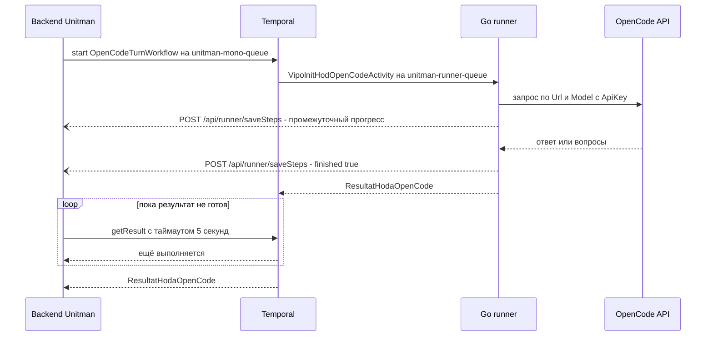

# Задание: активность `VipolnitHodOpenCodeActivity` в Go-раннере

Документ-задание для агента, работающего в **репозитории Go-раннера**.
Бэкенд Unitman уже реализован и задеплоен в текущей ветке — менять его **не нужно**,
и **читать PHP-код из репозитория бэкенда не требуется**: всё необходимое для
реализации собрано здесь.

- Итог работы: worker раннера умеет выполнять Temporal-активность
  `VipolnitHodOpenCodeActivity` — один «ход» диалога с OpenCode.
- Ход либо возвращает финальный ответ, либо (если OpenCode задал вопрос)
  завершается, отдавая список вопросов с вариантами. Ожидания ответа
  пользователя внутри активности **нет**.
- Попутно раннер стримит пошаговый прогресс в бэкенд тем же способом, каким это
  уже делает для сборок юнитов.

---

## 1. Общая картина

Пользователь вводит промпт в Unitman. Бэкенд стартует Temporal-workflow на каждый
ход и **опрашивает результат короткими порциями**, пока ход не завершится.
Реквизиты подключения к OpenCode (URL, модель, API-ключ) бэкенд расшифровывает
сам и кладёт в payload активности — раннер ничего не запрашивает и не хранит.



Ключевые параметры, зашитые на стороне бэкенда:

| Параметр | Значение | Комментарий |
|---|---|---|
| Имя активности | `VipolnitHodOpenCodeActivity` | **ровно так, без префикса и namespace** |
| Очередь | `unitman-runner-queue` | та же, что у активностей сборки и запуска юнитов |
| `StartToCloseTimeout` | 3600 c | задаётся вызывающей стороной, менять не нужно |
| `HeartbeatTimeout` | не задан | heartbeat-ы для продления не обязательны |
| `ScheduleToCloseTimeout` | не задан | — |
| `RetryPolicy` | не задан | действует политика Temporal по умолчанию, см. § 10 |
| Таймаут workflow | 15 минут | реальный бюджет хода, см. § 10 |
| Аргументов у активности | ровно 1 | объект команды целиком |

> **Важно про имя.** Workflow вызывает активность по литеральному имени
> `"VipolnitHodOpenCodeActivity"`. Если зарегистрировать метод под другим
> именем (например, добавив префикс структуры), вызов упадёт с
> `NotFound: activity not found`. Регистрируйте с явным именем (§ 3).

---

## 2. Регистрация активности

Активность регистрируется на worker'е, который слушает очередь
`unitman-runner-queue`:

```go
w := worker.New(client, "unitman-runner-queue", worker.Options{ /* как сейчас */ })

acts := &opencode.Activities{
    BackendURL: os.Getenv("RUNNER_BACKEND_URL"), // база API бэкенда, напр. https://unitman.example/api
    Secret:     os.Getenv("RUNNER_CALLBACK_SECRET"),
    Client:     &http.Client{Timeout: 10 * time.Second},
    OpenCode:   opencodeClient, // существующий клиент OpenCode
}

w.RegisterActivityWithOptions(
    acts.VipolnitHodOpenCodeActivity,
    activity.RegisterOptions{Name: "VipolnitHodOpenCodeActivity"},
)
```

Два требования к воркеру:

1. `RUNNER_CALLBACK_SECRET` должен совпадать со значением на бэкенде. Если на
   бэкенде секрет пуст, проверка подписи отключена; на раннере пустой секрет
   означает «не подписывать», ошибкой это не считается.
2. Ход занимает слот конкурентности воркера на всё время выполнения. Если
   `MaxConcurrentActivityExecutionSize` мал, длинные ходы начнут вытеснять
   сборки юнитов — учтите это в конфигурации воркера.

---

## 3. Входные данные

Payload — JSON-объект. Имена полей **PascalCase, регистр критичен**: бэкенд
сериализует структуру-команду «как есть».

```json
{
  "SessionId": null,
  "Prompt": "Создай юнит для ветки feature/login",
  "Answers": [],
  "History": [],
  "Url": "https://opencode.internal/api",
  "Model": "gpt-5-codex",
  "ApiKey": "sk-..."
}
```

| Поле | JSON-тип | Обязательность | Смысл |
|---|---|---|---|
| `SessionId` | `string` или `null` | всегда есть, может быть `null` | id сессии **на стороне OpenCode**, который раннер вернул в прошлом ходе. `null` — первый ход диалога |
| `Prompt` | `string` | всегда, непустой | текст, который нужно отправить в OpenCode как новую реплику пользователя |
| `Answers` | массив объектов | всегда, может быть `[]` | структурированные ответы на вопросы предыдущего хода |
| `History` | массив объектов | всегда, может быть `[]` | контекст предыдущих реплик, **без текущего промпта** |
| `Url` | `string` | всегда, непустой | базовый URL OpenCode API |
| `Model` | `string` | всегда, непустой | идентификатор модели |
| `ApiKey` | `string` | всегда, непустой | секрет; см. § 8 |

### 3.1 `Answers[]`

```json
{ "QuestionId": "q1", "OptionId": "o2", "Text": null }
```

| Поле | Тип | Смысл |
|---|---|---|
| `QuestionId` | `string`, непустой | `Id` вопроса, который раннер вернул в предыдущем ходе |
| `OptionId` | `string` или `null` | `Id` выбранного варианта; `null` — свободный ответ |
| `Text` | `string` или `null` | свободный текст ответа либо комментарий к выбранному варианту |

- Элементы с пустыми `QuestionId` и значениями бэкенд отфильтровывает, поэтому
  в раннер они не попадают.
- Вопрос с `AllowFreeText: true` может принимать **и** `OptionId`, **и** `Text`
  одновременно (вариант плюс уточнение).
- `Answers` и `Prompt` согласованы: `Prompt` — это уже человекочитаемая
  расшифровка ответов, строка вида `Текст вопроса: значение`, несколько ответов
  склеены через `\n`. Если раннер в состоянии сопоставить `Answers` со своими
  вопросами — используйте структуру; если нет (другой процесс, потерянное
  состояние) — просто отправьте `Prompt`.

### 3.2 `History[]`

```json
{ "Role": "user", "Text": "Создай юнит для ветки feature/login" }
```

| Поле | Тип | Смысл |
|---|---|---|
| `Role` | `string` | строго `user` или `assistant`, в нижнем регистре |
| `Text` | `string` | текст реплики |

Правила:

- Порядок — хронологический.
- **История не обрезается бэкендом** и является полным контекстом диалога.
  Текущий промпт в неё не входит: он приходит отдельным полем `Prompt`.
- Вопрос OpenCode попадает в историю как реплика `assistant` с текстом
  вопросов; ответ пользователя — как следующая реплика `user`.
- Раннер **stateless**: на него нельзя рассчитывать как на хранилище
  диалога. Всё, что нужно для контекста, приходит в `History` и `SessionId`.

---

## 4. Выходные данные

Активность возвращает один объект — результат хода. Поля и регистр критичны.

```json
{
  "Success": true,
  "Kind": "ANSWER",
  "Questions": [],
  "Answer": "Юнит создан, ветка feature/login собрана.",
  "ErrorKey": null,
  "ExternalSessionId": "sess_01J8Z9"
}
```

| Поле | Тип | Смысл |
|---|---|---|
| `Success` | `bool` | успешность выполнения хода |
| `Kind` | `string` | строго одно из `ANSWER`, `QUESTION`, `ERROR` |
| `Questions` | массив объектов | заполнен при `QUESTION`, иначе `[]` (**не `null`**) |
| `Answer` | `string` или `null` | заполнен при `ANSWER`, иначе `null` |
| `ErrorKey` | `string` или `null` | заполнен при `ERROR`, иначе `null` |
| `ExternalSessionId` | `string` или `null` | id сессии на стороне OpenCode, если известен |

### 4.1 Три допустимых состояния

| `Kind` | `Success` | `Questions` | `Answer` | `ErrorKey` |
|---|---|---|---|---|
| `ANSWER` | `true` | `[]` | непустая строка | `null` |
| `QUESTION` | `true` | непустой массив | `null` | `null` |
| `ERROR` | `false` | `[]` | `null` | непустая строка |

Любая другая комбинация считается нарушением контракта: бэкенд сохранит
результат в `result_json` и отдаст клиенту как есть, поэтому «полупустые»
структуры ломают UI.

### 4.2 `Questions[]`

```json
{
  "Id": "q1",
  "Text": "Какое окружение использовать?",
  "AllowFreeText": false,
  "Options": [
    { "Id": "o1", "Label": "stage", "Description": "Тестовый стенд" },
    { "Id": "o2", "Label": "prod", "Description": null }
  ]
}
```

| Поле | Тип | Обязательность | Смысл |
|---|---|---|---|
| `Id` | `string` | обязательно, непустой, уникальный в ходе | идентификатор вопроса; по нему бэкенд сопоставит ответ |
| `Text` | `string` | обязательно, непустой | текст вопроса для пользователя |
| `AllowFreeText` | `bool` | обязательно, всегда явно | `true` — вопрос принимает свободный ответ без выбора варианта |
| `Options` | массив | обязательно, может быть `[]` | варианты выбора |
| `Options[].Id` | `string` | обязательно, непустой, уникальный внутри вопроса | идентификатор варианта |
| `Options[].Label` | `string` | обязательно, непустой | подпись варианта |
| `Options[].Description` | `string` или `null` | необязательно | пояснение; можно опустить поле или передать `null` |

Ограничения, которые проверяет бэкенд при ответе пользователя:

- ответ на несуществующий `QuestionId` отклоняется;
- ответ с `OptionId`, которого нет в вопросе, отклоняется;
- вопрос с `AllowFreeText: false` требует `OptionId` — свободный текст
  отклоняется.

Отсюда практическое правило: **`Id` должны быть стабильными и уникальными**,
иначе пользователь физически не сможет ответить.

---

## 5. Семантика хода

- **Один ход = один запрос в OpenCode.** Раннер не ждёт действий пользователя.
- Как только OpenCode просит выбор — активность **немедленно завершается** с
  `Kind = QUESTION`. Продолжение диалога придёт новым вызовом активности
  (новый workflow) с заполненными `Answers`.
- `SessionId` со стороны бэкенда — это ровно то, что раннер вернул в
  `ExternalSessionId` предыдущего хода. Порядок:
  1. первый ход: `SessionId = null` → OpenCode создаёт сессию → раннер
     возвращает `ExternalSessionId`;
  2. следующие ходы: бэкенд передаёт этот id в `SessionId` → раннер
     продолжает ту же сессию.
- Если OpenCode не выдаёт id сессии, верните `null` и собирайте контекст
  исключительно из `History`. Диалог при этом обязан оставаться связным.
- Ход не связан ни с юнитом, ни с контейнером, ни с репозиторием: это обычный
  диалог с OpenCode. Никаких `unitId` в payload нет и не будет.
- Ответ может быть длинным — ограничений на длину `Answer` нет, но держите его
  в разумных пределах: он уходит в `result_json` и отдаётся клиенту.

---

## 6. Прогресс выполнения

Прогресс **необязателен**: если раннер не присылает шагов, это не ошибка, UI
просто покажет пустой прогресс. Но если присылает — контракт соблюдается строго:
бэкенд валидирует запрос и отвергает его целиком при малейшем нарушении.

### 6.1 Endpoint

```
POST {BACKEND_BASE_URL}/api/runner/saveSteps
Content-Type: application/json
X-Runner-Signature: <hex HMAC-SHA256>
```

Эндпоинт публичный, JWT не нужен. Единственная защита — HMAC-подпись.

### 6.2 Токен прогресса

Токен — это **id workflow**, в котором выполняется активность:

```go
token := activity.GetInfo(ctx).WorkflowExecution.ID
```

- Формировать токен самостоятельно нельзя.
- Для этого хода токен уже зарегистрирован бэкендом до старта workflow,
  дополнительных действий не требуется.
- Если `saveSteps` вернул `runner.unknown_progress_token` — это баг интеграции
  (неверный токен или бэкенд не успел зарегистрировать): залогируйте и
  продолжайте выполнение хода, не валите активность.

### 6.3 Тело запроса

```json
{
  "responseId": "0192b1c4-...",
  "stepsContent": "[{\"command\":\"opencode run\",\"response\":\"ok\",\"success\":true,\"unixtime\":1730000000,\"unixtimeStart\":1729999975}]",
  "finished": false,
  "success": true
}
```

| Поле | Тип | Смысл |
|---|---|---|
| `responseId` | `string` | токен из § 6.2 |
| `stepsContent` | `string` | **строка**, внутри которой лежит JSON-массив шагов. Не вложенный массив, не объект |
| `finished` | `bool` | `true` только в завершающем вызове по этому ходу |
| `success` | `bool` | итог хода; имеет смысл вместе с `finished` |

### 6.4 Шаги

```json
{
  "command": "opencode --model gpt-5-codex",
  "response": "контекст собран, 42 файла",
  "success": true,
  "unixtime": 1730000000,
  "unixtimeStart": 1729999975
}
```

| Ключ | Тип | Обязательность | Смысл |
|---|---|---|---|
| `command` | `string` | обязательно | что выполнялось. **Без API-ключа и любых секретов** |
| `response` | `string` | обязательно | вывод/результат шага, может быть пустым |
| `success` | `bool` | обязательно | успех шага |
| `unixtime` | `int` | обязательно | unix-время **окончания** шага, секунды |
| `unixtimeStart` | `int` | необязательно | unix-время **начала** шага; принимается также как `UnixtimeStart` |

Ключи шага — **нижний регистр**, как их присылает существующий раннер и как
их читает UI. Исключение — необязательное время начала: бэкенд принимает оба
написания (`UnixtimeStart` и `unixtimeStart`) и нормализует к одному, так что
для нового кода берите `unixtimeStart`.

Правила для шагов:

- `stepsContent` — **полный снапшот** всех шагов хода на момент вызова, не дельта.
  Бэкенд перезаписывает снапшот целиком.
- Порядок шагов — хронологический.
- `unixtimeStart` не может быть больше `unixtime`: невалидное значение бэкенд
  молча отбрасывает.
- `response` должен быть валидным UTF-8. Мусорные байты в выводе OpenCode
  приведут к `runner.steps_malformed` — прогоняйте текст через
  `strings.ToValidUTF8`.
- Длинный вывод обрезайте (например, до последних 16 КиБ на шаг): снапшот
  ограничен по размеру.

### 6.5 Жёсткие ограничения

| Ограничение | Значение | Ошибка при нарушении |
|---|---|---|
| Размер `stepsContent` | ≤ 2560 КиБ (байт строки) | `runner.steps_too_large` |
| Формат `stepsContent` | JSON-массив объектов | `runner.steps_malformed` |
| Токен | зарегистрирован на бэкенде | `runner.unknown_progress_token` |
| Подпись | совпадает | `runner.invalid_signature` |

Бэкенд **не** сохраняет снапшот, который не прошёл валидацию, и отвечает
HTTP 400/403 в конверте `{"status":"fail","data":{"message":"<ключ>"}}`.
Успех — HTTP 200 с телом `true`.

### 6.6 Подпись

```
X-Runner-Signature = hex( HMAC-SHA256( responseId . stepsContent , RUNNER_CALLBACK_SECRET ) )
```

- Подписывается **склейка двух строк без разделителя**: сначала токен, затем
  строка `stepsContent` **ровно в том виде, в котором она лежит в JSON-поле**
  (то есть до JSON-экранирования).
- Hex — **нижний регистр**; бэкенд сравнивает побайтово (`hash_equals`).
- Если `RUNNER_CALLBACK_SECRET` на бэкенде пуст, заголовок не проверяется.
  Отправлять его всё равно безвредно.

### 6.7 Частота

Бэкенд публикует прогресс в клиент не чаще одного раза в 250 мс на токен,
поэтому флудить бессмысленно. Ориентир для раннера:

- один вызов `saveSteps` на завершённый шаг;
- финальный вызов с `finished: true` — **ровно один**, последним;
- после финального вызова больше ничего по этому токену не отправляйте;
- сетевую ошибку `saveSteps` можно повторить 1–2 раза с короткой паузой
  (снапшот идемпотентен), но **никогда не валите из-за неё ход**;
- если `finished` уже отправлен, а ход затем упал — это допустимо, финальный
  признак успеха определяет бэкенд по результату активности.

---

## 7. Соответствие результата и прогресса

`success` в финальном `saveSteps` — это «ход завершился без ошибки»:

| Итог хода | `finished` | `success` |
|---|---|---|
| `ANSWER` | `true` | `true` |
| `QUESTION` | `true` | `true` (вопрос — не ошибка) |
| `ERROR` | `true` | `false` |
| активность отменена/упала | финальный вызов не нужен | — |

---

## 8. Безопасность: API-ключ

`ApiKey` есть только в payload активности и **не должен покидать раннер**.
Запрещено:

- писать его в логи, трассировки, метрики, span-атрибуты;
- передавать в `command` или `response` шага прогресса — в том числе в
  замаскированном виде, если маска неполная;
- возвращать в `Answer`, `ErrorKey`, `Questions` или какую-либо часть
  результата;
- передавать в argument'ах процесса: `argv` виден другим процессам. Используйте
  переменную окружения или конфиг-файл с правами только для владельца;
- сохранять в кэш сессий на диске в открытом виде.

Запрещено также возвращать в `ErrorKey` сырой текст ошибки OpenCode: это поле —
**ключ перевода**, и пользователь увидит его дословно. Сырой текст (после
редактирования секретов) — только в лог раннера.

---

## 9. Ошибки

### 9.1 Как сообщать об ошибке

Есть два взаимоисключающих способа, и выбирать надо осознанно:

| Способ | Что видит пользователь | Когда применять |
|---|---|---|
| Вернуть `Kind = "ERROR"` с известным `ErrorKey` | переведённый человеческий текст | **всегда для бизнес-ошибок**: недоступен OpenCode, неверный ключ, таймаут, неразборчивый ответ |
| Вернуть Go `error` из активности | текст Go-ошибки как «ключ перевода», то есть мусор | только для инфраструктурных сбоев, где имеет смысл ретрай |

Бэкенд при падении активности берёт текст ошибки workflow и подставляет в
`ErrorKey`; такого ключа в переводах нет, поэтому пользователь увидит сырую
строку. **Для ожидаемых отказов это недопустимо.**

### 9.2 Разрешённые значения `ErrorKey`

Используйте только ключи, которые бэкенд знает:

| `ErrorKey` | Когда |
|---|---|
| `opencode.turn.failed` | любая ошибка выполнения хода: сеть, недоступность OpenCode, 401/403, отказ модели, таймаут, лимиты |
| `opencode.turn.unexpected_kind` | OpenCode ответил, но ответ не удалось классифицировать ни как финальный текст, ни как вопросы |

Правило одной строкой: **любой ожидаемый отказ → `Success: false`, `Kind:
"ERROR"`, `ErrorKey: "opencode.turn.failed"`, и никаких Go-ошибок.**

### 9.3 Матрица решений

| Ситуация | Результат |
|---|---|
| OpenCode вернул финальный ответ | `ANSWER`, `Success: true` |
| OpenCode просит выбор | `QUESTION`, `Success: true` |
| Ответ содержит и текст, и вопросы | приоритет `QUESTION`: без ответа пользователя продолжать нельзя |
| Сеть, DNS, connection refused, 5xx после ретраев | `ERROR` + `opencode.turn.failed` |
| 401/403 от OpenCode | `ERROR` + `opencode.turn.failed` (не раскрывать детали) |
| Превышен собственный таймаут запроса | `ERROR` + `opencode.turn.failed` |
| Ответ не разбирается | `ERROR` + `opencode.turn.unexpected_kind` |
| Активность отменена по контексту | вернуть `ctx.Err()`, финальный прогресс не отправлять |

---

## 10. Идемпотентность, ретраи, отмена

- **Ретраи.** Бэкенд не задаёт `RetryPolicy`, значит действует политика Temporal
  по умолчанию: активность может быть перезапущена. Проектируйте ход так, чтобы
  повтор не ломал данные: прогресс — полный снапшот (повтор безопасен),
  финальный `finished: true` отправляйте один раз за попытку.
- **Бюджет времени.** `StartToCloseTimeout` = 60 минут, но workflow живёт
  **15 минут**. По истечении 15 минут workflow будет снят, и бэкенд получит
  ошибку — активность при этом потеряет результат. Поэтому:
  - держите собственный дедлайн хода заметно ниже 15 минут (ориентир — 12–13);
  - при приближении к дедлайну завершайте ход сами: `ERROR` +
    `opencode.turn.failed` с отправкой финального прогресса.
- **Отмена.** Если `ctx` отменён, немедленно прекращайте работу: останавливайте
  дочерний процесс OpenCode, не дожидаясь его ответа. Иначе «зависшая»
  активность занимает слот воркера.
- **Паники.** Любая паника внутри активности должна быть перехвачена
  (`recover`) и превращена в `ERROR` + `opencode.turn.failed`, иначе Temporal
  получит стектрейс, а пользователь — нечитаемую строку.
- **Финальный `saveSteps` при отменённом контексте.** Если контекст уже
  отменён, отправка с ним гарантированно упадёт. Для последнего снапшота
  используйте `context.WithoutCancel(ctx)` с коротким таймаутом.

---

## 11. Скелет реализации

Ниже — рабочий каркас. Адаптируйте под фактический клиент OpenCode в вашем
репозитории.

```go
package opencode

import (
	"bytes"
	"context"
	"crypto/hmac"
	"crypto/sha256"
	"encoding/hex"
	"encoding/json"
	"net/http"
	"strings"
	"sync"
	"time"

	"go.temporal.io/sdk/activity"
)

const ActivityName = "VipolnitHodOpenCodeActivity"

// ─── вход ────────────────────────────────────────────────────────────────────

type Otvet struct {
	QuestionID string  `json:"QuestionId"`
	OptionID   *string `json:"OptionId"`
	Text       *string `json:"Text"`
}

type Replika struct {
	Role string `json:"Role"` // "user" | "assistant"
	Text string `json:"Text"`
}

type HodCommand struct {
	SessionID string     `json:"SessionId"` // null приходит как ""
	Prompt    string     `json:"Prompt"`
	Answers   []Otvet    `json:"Answers"`
	History   []Replika  `json:"History"`
	URL       string     `json:"Url"`
	Model     string     `json:"Model"`
	ApiKey    string     `json:"ApiKey"`
}

// ─── выход ───────────────────────────────────────────────────────────────────

const (
	KindAnswer   = "ANSWER"
	KindQuestion = "QUESTION"
	KindError    = "ERROR"
)

type Variant struct {
	ID          string  `json:"Id"`
	Label       string  `json:"Label"`
	Description *string `json:"Description,omitempty"`
}

type Vopros struct {
	ID            string    `json:"Id"`
	Text          string    `json:"Text"`
	AllowFreeText bool      `json:"AllowFreeText"`
	Options       []Variant `json:"Options"`
}

type HodResult struct {
	Success           bool     `json:"Success"`
	Kind              string   `json:"Kind"`
	Questions         []Vopros `json:"Questions"`
	Answer            *string  `json:"Answer"`
	ErrorKey          *string  `json:"ErrorKey"`
	ExternalSessionID *string  `json:"ExternalSessionId"`
}

func errorResult(key string) HodResult {
	return HodResult{Success: false, Kind: KindError, Questions: []Vopros{}, ErrorKey: &key}
}

// ─── активность ──────────────────────────────────────────────────────────────

type Activities struct {
	BackendURL string
	Secret     string
	Client     *http.Client
	OpenCode   OpenCodeExecutor
}

func (a *Activities) VipolnitHodOpenCodeActivity(ctx context.Context, cmd HodCommand) (result HodResult, err error) {
	info := activity.GetInfo(ctx)
	p := newProgressSender(a.Client, a.BackendURL, a.Secret, info.WorkflowExecution.ID)

	// Именованные возвраты нужны, чтобы паника не утекла в Temporal.
	defer func() {
		if r := recover(); r != nil {
			p.publish(ctx, true, false)
			result, err = errorResult("opencode.turn.failed"), nil
		}
	}()

	started := time.Now()
	answer, execErr := a.OpenCode.Execute(ctx, OpenCodeRequest{
		SessionID: cmd.SessionID,
		URL:       cmd.URL,
		Model:     cmd.Model,
		APIKey:    cmd.ApiKey,
		Messages:  sobratSoobsheniya(cmd),
	})

	if execErr != nil {
		// В command и response не должно быть ключа: только модель и текст ошибки.
		p.addStep(ctx, "opencode "+cmd.Model, execErr.Error(), false, started)
	} else {
		p.addStep(ctx, "opencode "+cmd.Model, answer.Text, true, started)
	}

	if execErr != nil {
		if ctx.Err() != nil {
			return HodResult{}, ctx.Err() // активность отменена: финальный прогресс не нужен
		}
		p.publish(ctx, true, false)
		return errorResult("opencode.turn.failed"), nil
	}

	result = prevratitRezultat(answer)
	p.publish(ctx, true, result.Kind != KindError)

	return result, nil
}

func sobratSoobsheniya(cmd HodCommand) []Replika {
	msgs := make([]Replika, 0, len(cmd.History)+1)
	msgs = append(msgs, cmd.History...)
	msgs = append(msgs, Replika{Role: "user", Text: cmd.Prompt})
	return msgs
}

// ─── прогресс ────────────────────────────────────────────────────────────────

const (
	maxStepsBytes = 2560 * 1024
	throttle      = 250 * time.Millisecond
)

type Step struct {
	Command       string `json:"command"`
	Response      string `json:"response"`
	Success       bool   `json:"success"`
	Unixtime      int64  `json:"unixtime"`                // время окончания
	UnixtimeStart *int64 `json:"unixtimeStart,omitempty"` // время начала, необязательно
}

type progressSender struct {
	client  *http.Client
	url     string
	secret  string
	token   string
	mu      sync.Mutex
	steps   []Step
	lastPub time.Time
}

func newProgressSender(c *http.Client, base, secret, token string) *progressSender {
	return &progressSender{
		client: c,
		url:    strings.TrimRight(base, "/") + "/api/runner/saveSteps",
		secret: secret,
		token:  token,
	}
}

// addStep добавляет шаг в снапшот. response — то, что покажем пользователю:
// вывод OpenCode либо текст ошибки; API-ключа здесь быть не должно.
func (p *progressSender) addStep(ctx context.Context, command, response string, ok bool, started time.Time) {
	fin := time.Now().Unix()
	start := started.Unix()

	p.mu.Lock()
	p.steps = append(p.steps, Step{
		Command:       command,
		Response:      obrezatTekst(response),
		Success:       ok,
		Unixtime:      fin,
		UnixtimeStart: &start,
	})
	p.mu.Unlock()

	p.publish(ctx, false, ok)
}

func (p *progressSender) publish(ctx context.Context, finished, success bool) {
	p.mu.Lock()
	if !finished && time.Since(p.lastPub) < throttle {
		p.mu.Unlock()
		return
	}
	p.lastPub = time.Now()
	steps := append([]Step(nil), p.steps...)
	p.mu.Unlock()

	raw, err := json.Marshal(steps)
	if err != nil {
		return
	}
	content := string(raw)
	if len(content) > maxStepsBytes {
		return // снапшот отвергнут целиком — не отправляем
	}

	body, err := json.Marshal(map[string]any{
		"responseId":   p.token,
		"stepsContent": content,
		"finished":     finished,
		"success":      success,
	})
	if err != nil {
		return
	}

	reqCtx := ctx
	if ctx.Err() != nil {
		reqCtx = context.WithoutCancel(ctx) // Go 1.21+
	}
	reqCtx, cancel := context.WithTimeout(reqCtx, 5*time.Second)
	defer cancel()

	req, err := http.NewRequestWithContext(reqCtx, http.MethodPost, p.url, bytes.NewReader(body))
	if err != nil {
		return
	}
	req.Header.Set("Content-Type", "application/json")
	req.Header.Set("X-Runner-Signature", podpis(p.token, content, p.secret))

	resp, err := p.client.Do(req)
	if err != nil {
		return // прогресс не критичен для хода
	}
	_ = resp.Body.Close()
}

// podpis — hex(HMAC-SHA256(token + stepsContent, secret)), нижний регистр.
func podpis(token, content, secret string) string {
	mac := hmac.New(sha256.New, []byte(secret))
	mac.Write([]byte(token))
	mac.Write([]byte(content))
	return hex.EncodeToString(mac.Sum(nil))
}

// obrezatTekst приводит текст шага к валидному UTF-8 и обрезает хвост.
// Перед вызовом текст уже должен быть очищен от API-ключа.
func obrezatTekst(s string) string {
	s = strings.ToValidUTF8(s, "?")
	if len(s) > 16*1024 {
		s = s[len(s)-16*1024:]
	}
	return s
}
```

Заготовки, которые остались за кадром и должны быть реализованы по вашему
вкусу: `OpenCodeExecutor`, `OpenCodeRequest`, `prevratitRezultat`.

**Собственный дедлайн (§ 10) в каркас не входит намеренно** — его место в
`OpenCodeExecutor.Execute`, рядом с уже существующими таймаутами клиента:

```go
ctx, cancel := context.WithTimeout(ctx, 13*time.Minute)
defer cancel()
```

Проверка `ctx.Err()` в активности выше подхватит этот случай и вернёт
`ERROR` + `opencode.turn.failed` вместо того, чтобы ждать снятия workflow.

Маппинг `prevratitRezultat` обязан покрыть ровно три ветки:

```go
func prevratitRezultat(a OpenCodeAnswer) HodResult {
	switch {
	case len(a.Questions) > 0:
		return HodResult{
			Success:           true,
			Kind:              KindQuestion,
			Questions:         a.Questions,
			ExternalSessionID: a.SessionID,
		}
	case strings.TrimSpace(a.Text) != "":
		return HodResult{
			Success:           true,
			Kind:              KindAnswer,
			Questions:         []Vopros{},
			Answer:            &a.Text,
			ExternalSessionID: a.SessionID,
		}
	default:
		return errorResult("opencode.turn.unexpected_kind")
	}
}
```

---

## 12. Локальная проверка

### 12.1 Проверка подписи вручную

```sh
TOKEN='0192b1c4-0000-0000-0000-000000000000'
CONTENT='[{"command":"opencode run","response":"ok","success":true,"unixtime":1730000000}]'
SECRET='<тот же, что RUNNER_CALLBACK_SECRET на бэкенде>'

SIG=$(printf '%s%s' "$TOKEN" "$CONTENT" \
  | openssl dgst -sha256 -hmac "$SECRET" -r | cut -d' ' -f1)

curl -sS -X POST "$BACKEND/api/runner/saveSteps" \
  -H 'Content-Type: application/json' \
  -H "X-Runner-Signature: $SIG" \
  --data-binary "$(jq -n \
      --arg t "$TOKEN" --arg c "$CONTENT" \
      '{responseId:$t, stepsContent:$c, finished:true, success:true}')"
```

Ожидаемый ответ: `true`. Если приходит `runner.invalid_signature` — почти
всегда подпись считалась по экранированной строке вместо исходной.

### 12.2 Сценарии приёмки

| Сценарий | Ожидание |
|---|---|
| простой промпт, OpenCode отвечает текстом | `Kind = ANSWER`, `Answer` непустой, `Questions = []` |
| OpenCode просит выбрать окружение из двух вариантов | `Kind = QUESTION`, у вопроса 2 варианта с непустыми `Id`/`Label`, `Answer = null` |
| ответ пользователя на вопрос с вариантом | приходит `Answers` с `OptionId`, `Prompt` = `Текст вопроса: вариант`; новый ход возвращает `ANSWER` |
| свободный ответ на вопрос с `AllowFreeText: true` | приходит `Answers` с `OptionId = null` и непустым `Text` |
| второй ход по той же сессии | `SessionId` заполнен значением из прошлого `ExternalSessionId` |
| OpenCode недоступен | `Kind = ERROR`, `ErrorKey = opencode.turn.failed`, Go-ошибки нет |
| неверный API-ключ | `Kind = ERROR`, `ErrorKey = opencode.turn.failed`, ключ не попал в результат и в прогресс |
| проверка логов | `ApiKey` не встречается ни в одном логе, шаге прогресса и поле результата |
| проверка прогресса | в KV бэкенда виден полный снапшот, последний вызов имеет `finished: true` |

---

## 13. Чек-лист приёмки

- [ ] Активность зарегистрирована ровно под именем `VipolnitHodOpenCodeActivity`
      на очереди `unitman-runner-queue`.
- [ ] Метод принимает `context.Context` и ровно один аргумент — объект команды.
- [ ] Имена JSON-полей на входе и выходе совпадают с § 3 и § 4 посимвольно,
      включая регистр.
- [ ] `Questions` и `Answers` при сериализации отдаются как `[]`, а не `null`.
- [ ] `Kind` принимает только значения `ANSWER`, `QUESTION`, `ERROR`.
- [ ] Вопрос не блокирует активность: `QUESTION` возвращается сразу.
- [ ] `SessionId` из входа используется для продолжения сессии,
      `ExternalSessionId` заполняется в результате.
- [ ] Ход укладывается в бюджет 15 минут (столько живёт workflow); по
      приближении к дедлайну ход завершается `ERROR` + `opencode.turn.failed`.
- [ ] `saveSteps` подписывается HMAC-SHA256 по `token + stepsContent`,
      hex в нижнем регистре.
- [ ] `stepsContent` — строка с полным JSON-массивом шагов, не дельта,
      не более 2560 КиБ.
- [ ] Финальный `saveSteps` с `finished: true` отправляется один раз.
- [ ] Ошибка `saveSteps` не валит ход.
- [ ] Ожидаемые отказы возвращаются как `Kind = ERROR` с ключом
      `opencode.turn.failed` или `opencode.turn.unexpected_kind`, а не Go-ошибкой.
- [ ] `ApiKey` не попадает ни в логи, ни в прогресс, ни в результат,
      ни в `argv` дочернего процесса.
- [ ] Отмена контекста останавливает работу с OpenCode.
- [ ] Паника перехвачена и превращена в `ERROR`.

---

## 14. Деплой

1. Секрет `RUNNER_CALLBACK_SECRET` совпадает на раннере и бэкенде. Если бэкенд
   разворачивается с пустым секретом, проверка подписи отключена — это режим
   поэтапного раската, а не ошибка.
2. Порядок выката: сначала раннер (новое имя активности никому не мешает),
   затем бэкенд. Обратный порядок тоже безопасен: пока активности нет,
   вызов вернёт `NotFound`, workflow упадёт, а пользователь получит ошибку хода.
3. После выката перезапустите воркер, чтобы Temporal подхватил регистрацию
   активности (`rr reset` / рестарт процесса раннера).
4. Регистрация новой активности не ломает реплей уже запущенных workflow:
   сигнатура и payload существующих активностей не меняются.