# Почти-реалтайм просмотр выполнения команд раннера

## 1. Проблема

Сейчас шаги выполнения задачи становятся видны только после того, как активити Temporal
целиком завершилась и `ObrabotatProzesiUnitaUseCase` обработал её результат.

Причина — в цепочке:

1. `ObrabotatProzesiUnitaUseCase` тикает раз в ~1 с и для задачи в состоянии `PENDING`
   вызывает `WorkflowStub::getResult($type, 5)` — **блокирующее** ожидание до 5 секунд
   (`src/Runner/Api/RunnerApi.php:347`).
2. Пока активити не вернула `Resultat*Unita`, `ResponseId` неизвестен, и KV с шагами
   никто не читает (`poluchitResultatPodgotovki` и аналоги).
3. `saveSteps` (`src/Runner/Infra/Controller/RunnerController.php:81`) уже принимает
   промежуточные шаги от Go-раннера, но только пишет их в KV и возвращает `true` —
   до клиента они не доходят.

Итог: данные о прогрессе **уже прилетают** в бэкенд, но не маршрутизируются в полёт.

## 2. Ключевое наблюдение: токен прогресса уже есть

`RunnerJob` создаётся с `jobId = Uuid::uuid7()` в `Unit::dobavitProzesSborki()`
(`src/Unitman/Business/Model/Unit.php:645`). Этот же `jobId` передаётся в
`RunnerApi::nachat*(string $workflowId, ...)` и становится **workflowId** Temporal
(`->withWorkflowId($workflowId)`).

В Go-раннере токен доступен без изменения контракта активити:

```go
info := activity.GetInfo(ctx)
responseId := info.WorkflowExecution.ID   // == jobId == workflowId
```

Поэтому:
- новые поля в `Nachat*`-команды **не нужны**;
- маппинг `token → unitId` в `saveSteps` **не нужен** — фронт уже знает `jobId`
  из `poluchitVipolnenieZadachiRunnera`;
- модульные границы не нарушаются (Runner не начинает зависеть от внутренностей Unitman).

## 3. Целевая схема

```mermaid
flowchart LR
    FE[Frontend] -->|POST api unit sobrat| UC[DobavitProzesSborkiUseCase]
    UC -->|jobId uuid7| ES[Event store Unit]
    W[OcheredUnitovBackgroundJob] --> OB[ObrabotatProzesiUnitaUseCase]
    OB -->|nachatSborkuUnita token = jobId| TR[Temporal workflow]
    TR -->|NachatSborkuUnitaActivity| GO[Golang runner]
    GO -->|POST api runner saveSteps token + snapshot| RC[RunnerController]
    RC -->|set with TTL| KV[RoadRunner KV redis]
    RC -->|publish channel unit_progress token| CF[Centrifugo]
    CF -->|WS push| FE
    GO -->|результат активити| TR
    TR -->|getResult| OB
    OB -->|ustanovitUspehSborki| ES
    ES -->|проекция| RM[prozesi_unitov]
    RM -->|poluchitVipolnenieZadachiRunnera| FE
    FE -->|фолбэк опрос| RQ[GetUnitRunnerJobProgressQuery]
    RQ --> KV
```



Два независимых канала:

- **Push** — `saveSteps` → Centrifugo `unit_progress#<jobId>`. Даёт «почти реалтайм»
  без изменения модели хранения.
- **Pull** — новый read-endpoint читает тот же KV. Нужен для первичной загрузки,
  восстановления после обрыва WS и клиентов без WebSocket.

Финальный переход состояния **не меняется**: он по-прежнему идёт через event sourcing
и проекции (`prozesi_unitov`, `spisok_unitov`).

## 4. Изменения по модулям

### 4.1. Модуль Runner

| Файл | Изменение |
|---|---|
| `Business/Model/RunnerProgress.php` (новый) | Read-модель прогресса: `token`, `steps[]`, `finished`, `success`, `unixtime`, `receivedAt` |
| `Business/Port/UmeetHranitProgressZadachi.php` (новый) | `zapisat(string $token, RunnerProgress $p)`, `zaregistrirovat(string $token)`, `estLiToken(string $token)` |
| `Business/Port/UmeetChitatProgressZadachi.php` (новый) | `poluchit(string $token): ?RunnerProgress` |
| `Infra/Adapter/RunnerProgressKvStorage.php` (новый) | Реализация обоих портов поверх `RedisService` |
| `Infra/Service/RunnerProgressPublisher.php` (новый) | Публикация в Centrifugo + троттлинг |
| `Business/Command/SaveStepsCommand.php` | Добавить опциональные `finished`, `success` |
| `Infra/Controller/RunnerController.php` | Валидация, запись, публикация |
| `Api/RunnerApi.php` + `RunnerApiInterface.php` | `zaregistrirovatProgressToken()` в каждом `nachat*`, `poluchitProgressZadachi()` |
| `di.php` | Биндинги портов |

Порядок в `saveSteps`:

1. Проверить `X-Runner-Signature` — HMAC-SHA256 от `responseId + body` на общем секрете
   (`RUNNER_CALLBACK_SECRET`). Закрывает риск из `plans/project-audit.md` §8.4.
2. Проверить, что токен зарегистрирован (маркер пишется `RunnerApi` перед стартом workflow).
   Незарегистрированный токен → `400`, без записи в KV.
3. Ограничить размер `stepsContent` (например, 256 КБ) и число шагов.
4. Записать снапшот в KV `runner.progress.<token>`, TTL 2 часа.
5. Если с последней публикации прошло больше порога троттлинга — опубликовать
   снапшот в Centrifugo. Снапшот всегда полный, поэтому потеря пуша не ломает UI.

Важно: `stepsContent` трактуется как **полный снапшот накопленных шагов**, а не дельта.
`RunnerApi` уже десериализует его как `Step::class.'[]'`, так что контракт сохраняется —
клиент просто заменяет список целиком.

### 4.2. Модуль Unitman

| Файл | Изменение |
|---|---|
| `Business/Command/Unit/PoluchitProgressZadachiUnita.php` (новый) | DTO `prozesId`, `zadachaId` |
| `Business/Model/Runner/RunnerJobProgress.php` (новый) | Модель результата для бизнес-слоя |
| `Business/Port/RunnerService.php` | `poluchitProgressZadachi(string $jobId): ?RunnerJobProgress` |
| `Acl/RunnerAdapter.php` | Реализация через `RunnerApi::poluchitProgressZadachi()` |
| `Business/UseCase/Unit/GetUnitRunnerJobProgressQuery.php` (новый) | Разрешает `zadachaId` → `jobId`, отдаёт прогресс |
| `Infra/Controller/UnitController.php` | `POST /api/unit/poluchitProgressZadachiRunnera` + OA-атрибуты |
| `Acl/MemoryRunnerService.php` | Заглушка для тестов |

`jobId` в новом порту равен `zadachaId` из `prozesi_unitov` — дополнительный маппинг не нужен.

### 4.3. Модуль BackgroundJob / инфраструктура

Изменений нет. Публикация идёт напрямую из `saveSteps`, минуя очередь
`websocket_unit_event`, — очередь используется для событий aggregate, а прогресс
высокочастотный и в event store попадать не должен.

## 5. Контракт с Go-раннером

Единственная правка на стороне раннера:

```go
token := activity.GetInfo(ctx).WorkflowExecution.ID
// после каждой выполненной команды:
POST /api/runner/saveSteps
{ "responseId": token, "stepsContent": "[{...все шаги накопленно...}]", "finished": false, "success": true }
```

Дополнительно, если возможно: `finished: true` в последнем вызове — тогда UI закрывает
прогресс не дожидаясь события `OBNOVLEN`.

Fallback, если по каким-то активити `WorkflowExecution.ID` недоступен: передавать токен
вторым аргументом активити `Workflow::executeActivity('X', [$command, $workflowId])`.
Это ломает сигнатуру активити, поэтому применять только точечно.

### Риск деплоя

Изменение сигнатуры активности или payload ломает **уже запущенные** workflow при
реплее. Вариант с `activity.GetInfo` контракт не меняет, поэтому безопасен.
Всё равно деплоить в окно без активных сборок и делать `rr reset`.

## 6. Контракт для фронтенда

Подписка: канал Centrifugo `unit_progress#<jobId>`.

Payload:

```json
{
  "jobId": "0192...",
  "steps": [
    { "command": "docker build ...", "response": "...", "success": true, "unixtime": 1730000000 }
  ],
  "finished": false,
  "success": true,
  "updatedAt": 1730000000
}
```

Поведение:
- на `mount` открыть панель прогресса → subscribe → сделать один pull-запрос для
  начального состояния;
- снапшот всегда полный → просто перезаписывать список;
- `finished: true` или событие `OBNOVLEN` в `spisok_unitov` → отписаться и
  перечитать `poluchitVipolnenieZadachiRunnera`.

### 6.1. Источник прогресса в pull-эндпоинте: БД или KV

`GetUnitRunnerJobProgressQuery` выбирает источник по состоянию задачи в БД
(read-модель `prozesi_unitov` уже читается для проверки принадлежности задачи
процессу, отдельного запроса не требуется):

| Состояние задачи в БД | Шаги в БД | Источник pull-ответа |
|---|---|---|
| `SUCCESS` / `ERROR` / `CANCLED` | есть | БД (read-модель) |
| `SUCCESS` / `ERROR` / `CANCLED` | нет | KV-снапшот раннера |
| `NEW` / `PENDING` / `ZADACHI_DOBAVLENI` | любые | KV-снапшот раннера |
| задача не найдена | — | `DomainException('unit.runner_job_not_found')` |

Свойства DB-ветки:
- `finished = true`, `success = true` только для `SUCCESS`;
- `updatedAt` = `unixtime` последнего шага с непустым временем (0, если такого нет) —
  в read-модели нет отдельного поля «время обновления»;
- payload идентичен push-каналу, поэтому фронтенд обрабатывает оба источника одной логикой;
- данные из БД переживают истечение TTL KV (2 часа), то есть клиентский фолбэк на
  `poluchitShagiZadachiRunnera` для терминальных задач больше не обязателен.

Сравнение состояния нормализуется по регистру (`strtoupper`), так как проекция
пишет значения enum в верхнем регистре, а исторические/тестовые данные могут
прийти в нижнем.

## 7. Троттлинг и защита от флуда

Сборка/запуск генерируют десятки шагов за секунды. Меры:

- публикация не чаще раза в 250 мс на токен (маркер `runner.progress.lastpub.<token>`
  в KV с TTL 1 с);
- при пропуске публикации KV всё равно обновляется — pull-endpoint отдаст актуальное;
- cap на размер снапшота и количество шагов;
- TTL прогресса 2 часа — прогресс не является источником истины и не должен жить вечно.

## 8. Что попутно можно улучшить

Необязательно, но напрямую влияет на ощущение «реалтайма»:

- `makeResult()` использует `getResult($type, 5)` — блокирует воркер до 5 с.
  Проверка через `$workflow->describe()` и статус `RUNNING` позволит воркеру тикать
  без блокировки. Меняет обработку исключений — делать отдельным шагом с тестами.
- Ограничение подписки на канал через subscription-JWT (`fresh_centrifugo` уже
  настроен с `jwt.ttl`). Сейчас `allow_subscribe_for_anonymous` открыт.

## 9. Тесты и проверки

- Runner: валидация подписи, отклонение незарегистрированного токена, обрезка
  большого payload, публикация при троттлинге и без него.
- Unitman: `GetUnitRunnerJobProgressQuery` на `MemoryRunnerService`, включая
  случай отсутствующего прогресса `null`.
- `psalm` level 1 — обновить `RunnerApiInterface`, `MemoryRunnerService`,
  `RunnerService`, иначе сборка упадёт.
- deptrac: циклических зависимостей не появляется — Runner не обращается к
  внутренностям Unitman.
- OpenAPI: новый endpoint и поле `finished`/`success` в `SaveStepsCommand`,
  перегенерировать `docs/openapi.json` (тест `OpenApiDocumentationTest`).
- Прогон: `php bin/console cache:clear` → `composer run all-checks` → `rr reset`.
