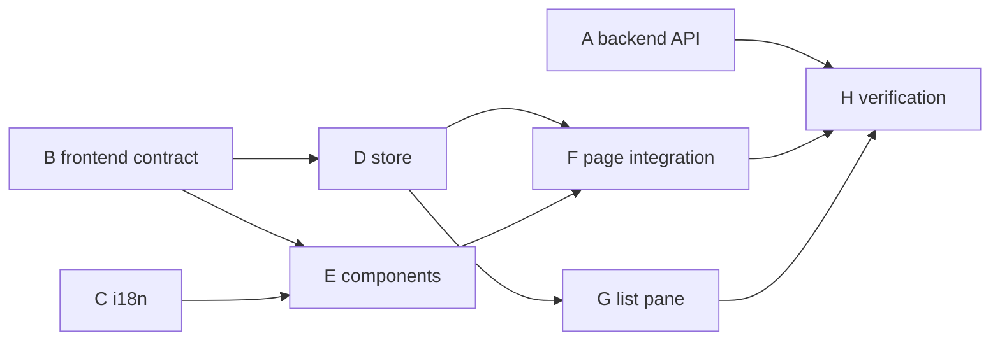

# План: фильтр списка юнитов — параллельная реализация

Цель: превратить плоскую форму фильтра в единый поисковый опыт — один тулбар, полоса активных
фильтров, фильтр по статусу, серверный поиск по имени/ветке и корректная сортировка.

Работа делится на 8 независимых задач с непересекающимся набором файлов. Задачи выполняются
субагентами по волнам; внутри волны файлы не пересекаются.

## Принципы

- Каждая задача владеет **только своими файлами**. Правки чужих файлов запрещены — при
  необходимости изменения в чужом файле задача сообщает об этом и не вносит его.
- Контракты ниже заморожены. Если контракт кажется неверным — задача останавливается и
  возвращает вопрос, а не меняет контракт в одностороннем порядке.
- Никаких новых зависимостей в `composer.json` / `package.json`.
- Бэкенд-проверки и любые `docker compose` / `rr reset` выполняются только в задачах A и H.
  Остальные задачи docker не трогают (иначе `cache:clear` в параллельных задачах конфликтует).
- Стили — только токены из `src/styles/_tokens.scss` (`--app-*`), никаких магических цветов.

## Волны и зависимости



- Волна 1: A, B, C
- Волна 2: D, E
- Волна 3: F, G
- Волна 4: H

## Общие решения

- Поиск в UI — одно поле `search` (подстрока по имени ИЛИ ветке). Поля `name` и `branch`
  остаются в модели и API ради обратной совместимости, но в тулбаре не показываются: если они
  пришли из старого localStorage, они отображаются чипами и снимаются пользователем.
- Фильтр статусов — **серверный** (`statuses[]`), чтобы счётчики и список не расходились на
  объёме больше `limit`.
- Сортировка по умолчанию на сервере остаётся прежней (`created_desc`), чтобы не менять
  поведение существующих клиентов и тестов. Фронтенд явно отправляет `updated_desc`.
- `total` в конверт ответа **не добавляем** (это затронуло бы общий `Response` и `apiClient`).
  Вместо этого UI показывает «Показано N» и предупреждение об обрезке, когда `N === limit`.
- Пагинация, сохранённые наборы фильтров и агрегированные счётчики по всему объёму — вне
  объёма этой итерации.

## Замороженные контракты

### 1. API `POST /api/unit/list`

`GetUnitListFilter` (новые параметры добавляются в конец, чтобы именованные аргументы в тестах
не сломались):

```php
public function __construct(
    public readonly bool $onlyMine = false,
    public readonly ?string $name = null,
    public readonly ?string $branch = null,
    public readonly ?string $projectId = null,
    public readonly ?string $unitId = null,
    /** @var string[] */
    public readonly array $unitIds = [],
    /** Подстрока по имени ИЛИ ветке */
    public readonly ?string $search = null,
    /** @var string[] running|busy|prepared|stopped|error */
    public readonly array $statuses = [],
    /** created_desc|updated_desc|name_asc|status_priority */
    public readonly string $sort = 'created_desc',
)
```

Семантика `statuses` повторяет порядок и приоритет `deriveUnitUiState`:
`error` → `busy` → `running` → `prepared` → `stopped` (взаимоисключающие предикаты по этому
порядку). `busy` = `z.tip = 'opencode_hod'` ИЛИ есть незавершённый процесс в
`payload->'prozesi'` (состояние не в `SUCCESS|ERROR|CANCLED`).
`prepared` = не запущен, не занят, без ошибки, `payload->'commands'` содержит `nachatZapusk`.

Сортировки:

- `created_desc` — текущая `ORDER BY t.id DESC` (поведение по умолчанию, не меняется);
- `updated_desc` — `(payload->>'unixtimePoslednegoObnovleniyaUnita')::bigint DESC NULLS LAST, t.id DESC`;
- `name_asc` — `lower(payload->>'name') ASC, t.id DESC`;
- `status_priority` — ранг статуса (`error`=0, `busy`=1, `running`=2, `prepared`=3, `stopped`=4),
  затем `updated_desc`.

### 2. TypeScript-модель фильтра

Новый файл `../unitman-front/src/modules/unit/store/SpisokUnitov/model/UnitFilters.ts`:

```ts
import type {UnitUiStatus} from "@/modules/unit/utils/unitStatus";

export type UnitFilterStatus = UnitUiStatus; // running|busy|prepared|stopped|error

/** `broken` в deriveUnitUiState не возвращается, но статус-бейдж его знает. */
export type UnitSort = "created_desc" | "updated_desc" | "name_asc" | "status_priority";

export type UnitFilters = {
    /** Подстрока по имени ИЛИ ветке. */
    search: string | null;
    /** Устаревшие поля: поддерживаются API, в тулбаре не показываются. */
    name: string | null;
    branch: string | null;
    projectId: string | null;
    onlyMine: boolean;
    statuses: UnitFilterStatus[];
    /** Deep-link ?id= — юнит, на который ведёт ссылка. */
    unitId: string | null;
    /** Связи через помощник переменной. */
    unitIds: string[];
    sort: UnitSort;
};

export const DEFAULT_UNIT_FILTERS: UnitFilters = {
    search: null,
    name: null,
    branch: null,
    projectId: null,
    onlyMine: false,
    statuses: [],
    unitId: null,
    unitIds: [],
    sort: "updated_desc",
};

export type UnitFilterKey = Exclude<keyof UnitFilters, "sort">;

/** Описание активного фильтра для полосы чипов. */
export type UnitFilterChip = {
    key: UnitFilterKey;
    /** Значение чипа: для statuses/unitIds — конкретный элемент. */
    value?: string;
    /** Готовое имя (проект, юнит, ветка); если не задано — переводится по key. */
    label?: string;
};

/** Приводит произвольный объект из localStorage/URL к валидному UnitFilters. */
export function normalizovatFiltri(raw: unknown): UnitFilters;
```

`normalizovatFiltri` обязан: отбросить неизвестные статусы и сортировки, привести `unitIds` к
массиву строк, привести пустые строки к `null`, отсутствующие поля взять из
`DEFAULT_UNIT_FILTERS`.

### 3. Компоненты фильтра (только presentational, без store)

`UnitFilterBar.vue`

```ts
props: {
  filters: UnitFilters;
  projects: {value: string; label: string}[];
  counts: Record<UnitFilterStatus, number>;
  total: number;
  loading: boolean;
  lastUpdatedAt: number | null;
  viewMode: UnitListViewMode;
  showViewMode: boolean;
}
emits: {
  change: [{filters: UnitFilters; immediate: boolean}];
  submit: [];   // кнопка «обновить»
  reset: [];
  create: [];
  "update:viewMode": [mode: UnitListViewMode];
}
```

Правило `immediate`: текстовый поиск — `false` (страница применит debounce), всё остальное —
`true`. Логика debounce в компоненте не дублируется.

`UnitFilterStatus.vue`

```ts
props: {modelValue: UnitFilterStatus[]; counts: Record<UnitFilterStatus, number>; total: number}
emits: {"update:modelValue": [value: UnitFilterStatus[]]}
```

`UnitFilterChips.vue`

```ts
props: {chips: UnitFilterChip[]}
emits: {remove: [{key: UnitFilterKey; value?: string}]; clear: []}
```

### 4. Публичный API стора (после задачи D)

```ts
// state
nastroikiSpiska: {filter: UnitFilters; limit: number; offset: number}
// actions
primenitFiltri(patch: Partial<UnitFilters>, immediate = true): Promise<void>
sbrozitFiltri(): Promise<void>
ustanovitSort(sort: UnitSort): Promise<void>
poluchitSpisokUnitov(): Promise<ApiResponse>   // немедленный запрос, контракт сохраняется
zaprositSpisokUnitov(): void                   // debounce 300 мс, отмена устаревших ответов
sohranitNastroiki(): void
// getters
estAktivnieFiltri: boolean
kolichestvoAktivnihFiltrov: number
aktivnieFiltri: UnitFilterChip[]
statusiSoSchetchikami: Record<UnitFilterStatus, number>
obrezanSpisok: boolean
```

### 5. Пропсы `UnitListPane` (после задачи G)

```ts
props: {items: Unit[]; selectedId: string | null; emptyFiltered?: boolean}
emits: {select: [unitId: string]; reset: []}   // reset добавлен
```

## Задачи

### A. Бэкенд: фильтры `search`/`statuses`, сортировки

Файлы (только эти):

- `src/Unitman/Business/Command/Unit/GetUnitList/GetUnitListFilter.php`
- `src/Unitman/Infra/Repository/Unit/SpisokUnitovRepository.php`
- `src/Unitman/Infra/Controller/UnitController.php` — только OA-аннотация `POST /api/unit/list`
- `src/Unitman/Tests/UseCase/Unit/GetUnitListQueryTest.php`
- `docs/openapi.json`
- `../unitman-front/openapi/unitman.json`
- `../unitman-front/src/api/generated/unitman.d.ts`
- `../unitman-front/src/api/__typecheck__.ts`

Работа:

1. Добавить в `GetUnitListFilter` параметры `search`, `statuses`, `sort` с docblock-описанием
   (Nelmio строит схему из типов и docblock).
2. В `getList()`:
   - `search`: `(payload->>'name' ILIKE :search OR payload->>'branch' ILIKE :search)`, параметр
     `%...%`; пустая строка = фильтр отсутствует;
   - `statuses`: одно условие `AND (cond_1 OR cond_2 ...)` по предикатам из контракта; для
     занятости использовать уже существующий `LEFT JOIN` из `sqlSNanyatostyu()` и `EXISTS` по
     `jsonb_array_elements(t.payload->'prozesi')`; значения статусов валидировать по списку
     (неизвестные игнорировать);
   - `sort`: явный `ORDER BY` по контракту, дефолт `created_desc` (поведение не меняется);
   - вынести построение предикатов статуса в приватные методы, чтобы не дублировать SQL.
3. Тесты: расширить провайдер `GetUnitListQueryTest` кейсами на `search` (имя, ветка, оба),
   каждый статус, комбинацию статусов, `updated_desc`, `name_asc`, `status_priority`. Существующие
   кейсы не менять: дефолтная сортировка остаётся `created_desc`.
4. Перегенерировать спецификацию и типы (в docker, с очисткой кэша):
   `php bin/console cache:clear --no-warmup` → `composer run openapi-dump` → скопировать
   `docs/openapi.json` в `../unitman-front/openapi/unitman.json` → в `../unitman-front`
   выполнить `yarn gen:api --file openapi/unitman.json`.
5. Проверки: `composer run check-openapi`, целевой phpunit по `GetUnitListQueryTest`.

Критерии приёмки: новый фильтр работает в SQL и покрыт тестами; `docs/openapi.json` и
`unitman.d.ts` содержат `search`, `statuses`, `sort`; старые кейсы зелёные.

Если контейнер не запущен — запросить у пользователя запуск, не поднимать его самостоятельно.

### B. Фронтенд: модель и нормализация фильтра

Файлы: только `../unitman-front/src/modules/unit/store/SpisokUnitov/model/UnitFilters.ts` (новый).

Работа: создать файл строго по контракту §2; реализовать `normalizovatFiltri` без внешних
зависимостей; `UnitSort`/`UnitFilterStatus` экспортировать типами.

Критерии: `vue-tsc --noEmit` в `../unitman-front` проходит; файл не импортирует Quasar и Pinia.

### C. i18n: ключи фильтра (ru + en)

Файлы: `../unitman-front/src/translator/ru.json`, `../unitman-front/src/translator/en.json`.

Работа: **дополнить** существующий блок `unit.spisok_unitov` не меняя порядок и не удаляя ключи.
Одинаковый набор ключей в обеих локалях:

```
filter.search            — Название или ветка / Name or branch
filter.all_projects      — Все проекты / All projects
filter.status_label      — Статус / Status
filter.status_all        — Все / All
filter.sort.label        — Сортировка / Sort
filter.sort.created_desc — Сначала новые / Newest first
filter.sort.updated_desc — Сначала недавно обновлённые / Recently updated first
filter.sort.name_asc     — По имени / By name
filter.sort.status_priority — Сначала с ошибками / Problems first
filter.active            — Активные фильтры / Active filters
filter.reset_all         — Сбросить всё / Reset all
filter.reset             — Сбросить фильтры / Reset filters
filter.chip.name / branch / search / project / only_mine / statuses / unit_id / svyazi
filter.found             — Показано: {count} / Showing: {count}
filter.truncated         — Показаны первые {limit} юнитов — уточните фильтр / Showing first {limit} units — narrow the filter
filter.updated_at        — обновлено {time} / updated {time}
filter.filters_button    — Фильтры / Filters
list.empty_filtered      — Ничего не найдено по фильтрам / Nothing matches the filters
```

Работа только с JSON: docker-команды и `app:translations:audit` не запускать (это задача H).
Проверка: оба файла остаются валидным JSON, наборы ключей совпадают.

### D. Фронтенд: стор, debounce, отмена, производные данные

Файлы:

- `../unitman-front/src/modules/unit/store/SpisokUnitovStore.ts`
- `../unitman-front/src/modules/unit/utils/unitFiltersUrl.ts` (новый)
- `../unitman-front/src/modules/unit/services/UnitiService.ts` — только при необходимости типов

Работа:

1. Заменить тип `NastroikiSpiska.filter` на `UnitFilters`; при инициализации использовать
   `normalizovatFiltri(localStorage)`; битый JSON не должен ронять приложение.
2. Persist: вынести запись в `sohranitNastroiki()`, вызывать при изменении фильтра, а не на каждый
   запрос.
3. `zaprositSpisokUnitov()` — debounce 300 мс (таймер в замыкании стора, не в state) с
   коалесценцией; `poluchitSpisokUnitov()` — немедленный и сохраняет прежний контракт возврата
   `ApiResponse`.
4. Защита от гонок: счётчик-токен запроса; ответ применяется только если его токен последний.
5. `primenitFiltri`/`sbrozitFiltri`/`ustanovitSort`: обновляют state, persist, дёргают загрузку.
6. `unitFiltersUrl.ts`: `serializovatFiltriVQuery(filters)`, `prochitatFiltriIzQuery(query)` —
   чистые функции, только примитивы; пустые/дефолтные значения в query не пишутся.
7. Геттеры: `estAktivnieFiltri`, `kolichestvoAktivnihFiltrov`, `aktivnieFiltri`,
   `statusiSoSchetchikami` (считать через `deriveUnitUiState` по загруженному списку),
   `obrezanSpisok` (`spisok.length >= limit`).
8. Исправить `esliJdemRunner`: занятость = незавершённый процесс ИЛИ `item.zanyat` (в частности
   `prichinaZanyatosti === 'opencode_hod'`), чтобы бейдж и серверный фильтр `busy` совпадали.
9. Отправлять `sort`, `statuses`, `search` в `UnitiService.list`; не отправлять пустые
   `statuses`/`unitIds`.

Критерии: `vue-tsc --noEmit` проходит; быстрый ввод в поиск даёт один запрос; устаревший ответ не
перетирает новый.

### E. Фронтенд: компоненты фильтра

Файлы (новые, только эти):

- `../unitman-front/src/modules/unit/view/Unit/SpisokUnitov/UnitFilterBar.vue`
- `../unitman-front/src/modules/unit/view/Unit/SpisokUnitov/UnitFilterStatus.vue`
- `../unitman-front/src/modules/unit/view/Unit/SpisokUnitov/UnitFilterChips.vue`

Работа строго по контракту §3:

- Тулбар: поле поиска с `clearable` и крестиком; `q-select` проектов с «Все проекты» (значение
  `null`); кнопка-переключатель «Только мои» (`aria-pressed`); компактный `q-select` сортировки;
  иконочная кнопка «обновить» с `tooltip` и подписью `updated_at`; primary-кнопка «создать»;
  переключатель режима (`showViewMode`).
- Статусы — ряд чипов/кнопок `Все` + 5 статусов с иконками и цветами как в `UnitStatusBadge`
  (`positive`/`info`/`primary`/`text-secondary`/`negative`), счётчики в подписи, `aria-pressed`.
  На `<1024px` статусы уезжают в `q-menu` по кнопке «Фильтры».
- Чипы активных фильтров: `q-chip` с `removable`, подпись из `label` либо `t(filter.chip.*)`,
  «Сбросить всё» в конце; полоса скрыта при пустом массиве.
- Стили только на токенах; на `<1024px` тулбар переносится в две строки, ничего не обрезается.

Критерии: компоненты не импортируют стор; все тексты через `$t`; `vue-tsc --noEmit` проходит.

### F. Фронтенд: интеграция страницы списка

Файлы: только `../unitman-front/src/modules/unit/view/SpisokUnitov.vue`.

Работа:

1. Удалить старый блок фильтров, отдельные блоки чипов и переключатель режима из зоны фильтра.
2. Подключить `UnitFilterBar` (`:filters`, `:projects`, `:counts`, `:total`, `:loading`,
   `:last-updated-at`, `:view-mode`, `show-view-mode`, события `change`/`submit`/`reset`/`create`)
   и `UnitFilterChips` (`:chips`, `remove`, `clear`).
3. Обработчик `change`: записать `filters` в `nastroikiSpiska.filter`, затем
   `immediate ? poluchitSpisokUnitov() : zaprositSpisokUnitov()`. `reset` → `sbrozitFiltri()`.
4. Синхронизация с URL: читать `route.query` на setup (не внутри `onMounted`), писать фильтры в
   query через `router.replace` при изменении; `?id=` больше не подменяет фильтр напрямую, а идёт
   в `filter.unitId`.
5. Сохранить существующие диалоги, подписку на WebSocket, `watch` синхронизации выбора в
   workspace-режиме.
6. Передать в `UnitListPane` `:empty-filtered` и `@reset` (контракт §5).

Критерии: сценарии «ввёл поиск → один запрос», «снял чип → список обновился», «вернулся по ссылке
с query → фильтр восстановлен», «сброс → все фильтры дефолтные», «режим workspace продолжает
работать» проходят вручную; `vue-tsc --noEmit` проходит.

### G. Фронтенд: пустое состояние компактного списка

Файлы: только `../unitman-front/src/modules/unit/view/Unit/SpisokUnitov/UnitListPane.vue`.

Работа: добавить пропс `emptyFiltered` и событие `reset` (контракт §5); при пустом списке
показывать `list.empty_filtered` + кнопку «Сбросить фильтры», иначе — прежний `list.empty_result`;
добавить `aria-live="polite"` на счётчик/пустое состояние; не менять раскладку строк.

Критерии: `vue-tsc --noEmit` проходит; текст и кнопка зависят только от `emptyFiltered`.

### H. Проверка и регрессии

Файлы: правки только в файлах, уже затронутых задачами A–G (точечные исправления).

Работа:

1. Бэкенд в docker: `php bin/console cache:clear`, `composer run check-openapi`,
   phpunit по `GetUnitListQueryTest` и `OpenApiDocumentationTest`, `app:translations:audit`.
2. `composer run check-deptrac` (изменений быть не должно, но проверка дешёвая).
3. Фронтенд: `yarn gen:api:check`, `yarn build` (`vue-tsc --noEmit` + vite build).
4. Рестарт RoadRunner внутри контейнера: `rr reset`.
5. Сводка: что сделано, какие проверки прошли, что осталось (пагинация, `total`, сохранённые
   наборы фильтров).

Если контейнер не запущен — запросить запуск у пользователя.
