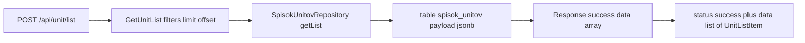

# Strict OpenAPI response contract for /api/unit/list

## 1. Problem

[`UnitConroller::list()`](src/Unitman/Infra/Controller/UnitController.php:120) documents its `200`
response as `oneOf: [SuccessEnvelope, ErrorEnvelope]`, where
[`SuccessEnvelope.data`](config/packages/nelmio_api_doc.yaml:80) is a bare `type: object`.
Generated JSON at [openapi.json](docs/openapi.json:2519) therefore says nothing about the payload:
no item shape, no `data` cardinality, no required fields.

## 2. What the endpoint actually returns

`GetUnitListQuery::handle()` returns `array` straight from
[`SpisokUnitovRepository::getList()`](src/Unitman/Infra/Repository/Unit/SpisokUnitovRepository.php:110),
which does `json_decode($row['payload'], true)` per row. So `data` is a **JSON array** (list,
possibly empty), never an object and never `null`.



Per-item fields come from [`SpisokUnitovReadModel`](src/Unitman/Business/ReadModel/Unit/SpisokUnitovReadModel.php:30)
and the projection that fills it ([`SpisokUnitovProjection`](src/Unitman/Infra/Projection/SpisokUnitovProjection.php:112)):

| field | type | source |
|---|---|---|
| `id` | string | `SpisokUnitovReadModel::$id` |
| `authorId` | string | same |
| `authorName` | string | email or nickname |
| `name` | string | unit name |
| `projectId` | string | same |
| `projectName` | string | resolved from project |
| `branch` | string | same |
| `commands` | string[] | `StateUserCommand` values of current state |
| `prozesi` | object[] | `UnitProcess::toArray()` |
| `error` | bool | projection flags |
| `zapushen` | bool | projection flags |
| `links` | object[] | `{service, path, port, protocol, startUri}` |
| `unixtimePoslednegoObnovleniyaUnita` | int \| null | projection |
| `unixtimePoslednegoObnovleniyaVHranilishe` | int \| null | projection |
| `peremenie` | object[] | `{id, value}` |
| `unitSozdanSystemoi` | bool | projection |
| `deistviya` | object[] | `KonfigDeistviya::toArray()` |
| `statistikaKonteinera` | object \| null | `ProjectListContainerStats` |

Important detail: `prozesi` items are stored from `UnitProcess::toArray()`
([`UnitProcess.php:136`](src/Unitman/Business/Model/Unit/UnitProcess.php:136)), which emits
`id, userId, type, state, jobs` and **no `unitId`**, even though
[`ProzesUnita`](src/Unitman/Business/ReadModel/Unit/ProzesUnita.php:12) declares one. The schema must
therefore keep `unitId` optional, otherwise it would lie about the payload.

## 3. Where the schema lives

All component schemas in this project are declared declaratively in
[`config/packages/nelmio_api_doc.yaml`](config/packages/nelmio_api_doc.yaml:70)
(`SuccessEnvelope`, `ErrorEnvelope`, `SozdatUnit`, …), and the controller references them by string
`$ref` — this keeps [deptrac.yaml](deptrac.yaml) and modulite happy (no cross-module imports) and
matches the existing convention.

Two options were considered:

1. **Declarative components in the YAML (recommended).** `UnitListItem` plus 6 small nested
   schemas, referenced from the controller. Reusable by `/api/unit/moi` and `/api/unit/obnovit`.
2. Fully inline `new OA\Property(...)` trees in the attribute. Precedent exists at
   [`ProjectController.php:700`](src/Unitman/Infra/Controller/ProjectController.php:700), but here it
   would be ~150 lines of nested attributes — unreadable and duplicated three times.

## 4. Contract to add

### 4.1 Controller attribute (replaces lines 106-117)

```php
responses: [
    new OA\Response(
        response: 200,
        description: 'Список юнитов, ограниченный limit и offset',
        content: new OA\JsonContent(
            required: ['status', 'data'],
            properties: [
                new OA\Property(property: 'status', type: 'string', enum: ['success'], example: 'success'),
                new OA\Property(
                    property: 'data',
                    type: 'array',
                    items: new OA\Items(ref: '#/components/schemas/UnitListItem')
                ),
            ],
            type: 'object'
        )
    ),
    new OA\Response(response: 401, description: 'Не авторизован'),
]
```

`SuccessEnvelope` cannot be reused here: its `data` is `type: object`, while this endpoint returns
an array. Do **not** reshape `SuccessEnvelope` — it is shared by ~80 operations.

`ErrorEnvelope` on `200` is dropped for this operation only. Errors do not come back as `200` from
this action: [`BaseExceptionListener::onKernelException()`](src/Utils/Converter/BaseExceptionListener.php:39)
sets `HTTP_INTERNAL_SERVER_ERROR` for every exception class. Because the action has no `try/catch`,
a thrown domain exception surfaces as `500` with `FailResponse` or `ErrorResponse`.

### 4.2 New components in `nelmio_api_doc.yaml`

Append under `components.schemas`:

```yaml
                UnitListItem:
                    type: object
                    description: Элемент списка юнитов (payload read-модели spisok_unitov)
                    required: [id, authorId, authorName, name, projectId, projectName, branch, commands, prozesi, error, zapushen, links, peremenie, unitSozdanSystemoi, deistviya]
                    properties:
                        id:
                            type: string
                            format: uuid
                        authorId:
                            type: string
                            format: uuid
                        authorName:
                            type: string
                            example: user@example.com
                        name:
                            type: string
                            example: feature-123
                        projectId:
                            type: string
                            format: uuid
                        projectName:
                            type: string
                            example: my-app
                        branch:
                            type: string
                            example: feature/123
                        commands:
                            type: array
                            description: Команды, доступные пользователю в текущем состоянии юнита
                            items:
                                type: string
                                enum: [nachatSborku, nachatObnovlenie, zapolnitPeremenie, nachatPodgotovku, ustanovitResultatPodgotovki, nachatSbrosPodgotovki, nachatZapusk, nachatOstanovku, nachatUdalenie, udalitVruchnuyu, nachatObnovleniePosleZapuska, nachatUdaleniePosleZapuska, vipolnitDeistvie, ustanovitResultatDeistviya, proveritKonteinerUnita]
                        prozesi:
                            type: array
                            items:
                                $ref: '#/components/schemas/UnitProcess'
                        error:
                            type: boolean
                        zapushen:
                            type: boolean
                        links:
                            type: array
                            items:
                                $ref: '#/components/schemas/UnitLink'
                        unixtimePoslednegoObnovleniyaUnita:
                            type: integer
                            nullable: true
                            example: 1730000000
                        unixtimePoslednegoObnovleniyaVHranilishe:
                            type: integer
                            nullable: true
                        peremenie:
                            type: array
                            items:
                                $ref: '#/components/schemas/UnitVariableValue'
                        unitSozdanSystemoi:
                            type: boolean
                        deistviya:
                            type: array
                            items:
                                $ref: '#/components/schemas/UnitAction'
                        statistikaKonteinera:
                            oneOf:
                                - $ref: '#/components/schemas/ContainerStats'
                                - type: 'null'
                UnitProcess:
                    type: object
                    description: Процесс юнита (UnitProcess::toArray)
                    required: [id, userId, type, state, jobs]
                    properties:
                        id:
                            type: string
                        unitId:
                            type: string
                            description: Объявлено в read-модели, но проекция сохраняет процесс без этого поля
                        userId:
                            type: string
                        type:
                            type: string
                            enum: [SBORKA, OBNOVLENIE, PODGOTOVKA, ZAPUSK, OSTANOVKA, SBROS_PODGOTOVKI, UDALENIE, DEISTVIE]
                        state:
                            type: string
                            enum: [NEW, ZADACHI_DOBAVLENI, PENDING, SUCCESS, ERROR, CANCLED]
                        jobs:
                            type: array
                            items:
                                $ref: '#/components/schemas/UnitProcessJob'
                UnitProcessJob:
                    type: object
                    required: [id, type, state, steps]
                    properties:
                        id:
                            type: string
                        type:
                            type: string
                            enum: [SBORKA, OBNOVLENIE, PODGOTOVKA, ZAPUSK, OSTANOVKA, SBROS_PODGOTOVKI, UDALENIE, DEISTVIE]
                        state:
                            type: string
                            enum: [NEW, PENDING, CANCLED, SUCCESS, ERROR]
                        steps:
                            type: array
                            items:
                                $ref: '#/components/schemas/UnitProcessJobStep'
                UnitProcessJobStep:
                    type: object
                    required: [command, response, success, unixtime]
                    properties:
                        command:
                            type: string
                        response:
                            type: string
                        success:
                            type: boolean
                        unixtime:
                            type: integer
                            example: 1730000000
                UnitLink:
                    type: object
                    description: Ссылка на сервис запущенного юнита
                    required: [service, path, port, protocol]
                    properties:
                        service:
                            type: string
                            example: backend
                        path:
                            type: string
                            example: http://8080.feature-123.my-app.proxy.example
                        port:
                            type: integer
                            example: 8080
                        protocol:
                            type: string
                            example: http
                        startUri:
                            type: string
                            nullable: true
                            example: /api/health
                UnitVariableValue:
                    type: object
                    required: [id, value]
                    properties:
                        id:
                            type: string
                        value:
                            type: string
                UnitAction:
                    type: object
                    description: Действие, доступное для юнита (KonfigDeistviya::toArray)
                    required: [id, name, variables, commands, prepare]
                    properties:
                        id:
                            type: string
                        name:
                            type: string
                        variables:
                            type: array
                            items:
                                $ref: '#/components/schemas/UnitActionVariable'
                        commands:
                            type: array
                            items:
                                type: string
                        prepare:
                            type: boolean
                UnitActionVariable:
                    type: object
                    required: [id, label, type, defaultValue, options, helper]
                    properties:
                        id:
                            type: string
                        label:
                            type: string
                        type:
                            type: string
                            enum: [string, integer, float, collection]
                        defaultValue:
                            type: string
                        options:
                            type: object
                            nullable: true
                        helper:
                            type: object
                            nullable: true
                ContainerStats:
                    type: object
                    description: Статистика контейнера юнита
                    required: [cpuPercent, memoryPercent, memoryUsage, netIO]
                    properties:
                        cpuPercent:
                            type: string
                            example: '12.5'
                        memoryPercent:
                            type: string
                            example: '34.1'
                        memoryUsage:
                            type: string
                            example: 120MiB / 512MiB
                        netIO:
                            type: string
                            example: 1.2kB / 3.4kB
```

## 5. Stricter enum alternative (decision)

`commands`, `prozesi[].type/state`, `jobs[].type/state` are closed PHP enums
([`StateUserCommand`](src/Unitman/Business/Model/Unit/State/StateUserCommand.php:5),
[`UnitProcessType`](src/Unitman/Business/Model/Unit/UnitProcess/UnitProcessType.php:5),
[`UnitProcessState`](src/Unitman/Business/Model/Unit/UnitProcess/UnitProcessState.php:5),
[`RunnerJobType`](src/Unitman/Business/Model/Unit/Runner/RunnerJobType.php:5),
[`RunnerJobState`](src/Unitman/Business/Model/Unit/Runner/RunnerJobState.php:5)), so `enum` is
accurate. Cost: every new enum case must be mirrored in the YAML by hand. Alternative: declare them
as plain `type: string` and only keep the description. Recommendation: keep `enum` — the contract is
the point of this task, and drift is caught by review of these five files.

## 6. Sibling operations (applied in the same pass)

Same payload shape is returned by:

* [`moi()`](src/Unitman/Infra/Controller/UnitController.php:207) — array of the same read model
  (`getMyUnits` deserializes into `SpisokUnitovReadModel`), so `data` = `array<UnitListItem>`.
* [`read()`](src/Unitman/Infra/Controller/UnitController.php:178) — a single read model, so `data` =
  `UnitListItem`.

All three operations were annotated in this pass, so the three read APIs expose the same precision.

## 6a. Applied result

| operation | `data` |
|---|---|
| `POST /api/unit/list` | `array<UnitListItem>` |
| `POST /api/unit/moi` | `array<UnitListItem>` |
| `POST /api/unit/obnovit` | `UnitListItem` |

Each operation now documents `200` (strict success body), `401`, and `500` — `FailEnvelope` for
`DomainException` and `ErrorEnvelope` otherwise, per
[`BaseExceptionListener`](src/Utils/Converter/BaseExceptionListener.php:43). `SuccessEnvelope` is no
longer referenced by these three operations but remains shared by the other ~80.

## 7. Verification

Per project rules, inside Docker, cache cleared first:

```bash
docker compose exec web php bin/console cache:clear
docker compose exec web composer openapi-dump          # refresh docs/openapi.json
docker compose exec web composer check-openapi         # no dangling refs, paths in sync
docker compose exec web composer check-psalm
docker compose exec web composer check-unitman-deptrac
docker compose exec web rr reset
```

`OpenApiDocumentationTest` already asserts there are no dangling `$ref`s
([`OpenApiDocumentationTest.php:94`](src/App/Tests/Documentation/OpenApiDocumentationTest.php:94)),
so a typo in any new schema name fails the build. Deptrrac is unaffected: only YAML and one
attribute block change, no new imports.

Manual check: `/api/doc` → `POST /api/unit/list` must show `data` as an array of `UnitListItem`
with a fully expanded item model, not `object`.

## 8. Risks

| Risk | Mitigation |
|---|---|
| Payload drifts from schema silently (projection adds a field) | Nested shapes are taken from the projection code, not guessed; the `unitId` caveat is documented inline |
| `oneOf: [$ref, type: null]` renders differently across nelmio minors | Verify rendered JSON in `docs/openapi.json` after dump |
| Enum lists rot as enums grow | Enums are named in the description/decision; alternative is plain `string` |
| Changing `SuccessEnvelope` would break ~80 operations | It is left untouched; only this operation stops referencing it |
