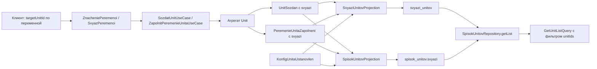

# Связи «юнит → выбранный юнит» для переменных с хелпером

## 1. Цель

Фиксировать юнит, который пользователь выбрал через хелпер переменной:
- при создании юнита;
- при редактировании конфига/значений переменных юнита.

Далее:
- отдавать эти связи в read-модели юнита;
- иметь отдельную проекцию, где лежат сами связи;
- в юзкейсе получения списка юнитов поддержать фильтр `unitIds`, который возвращает
  и переданные юниты, и связанные с ними.

## 2. Принятое решение по источнику данных

Хелпер [`PomoschnikSsylki`](src/Unitman/Business/Model/Unit/ConfigUnita/PomoschnikSsylki.php:1)
хранит только `projectId/service/port/suffix` — id юнита в нём нет. Единственное место,
где сейчас известен выбранный юнит, — команда
[`PoluchitSsylkuPoPomoschniku`](src/Unitman/Business/Command/Unit/PoluchitSsylkuPoPomoschniku.php:7)
(`targetUnitId`), но она возвращает только строку-ссылку и ничего не пишет.

Поэтому выбранный юнит передаётся **явно с клиента** при сохранении значений переменных.

## 3. Контракт HTTP API

### Создание юнита

[`ZnacheniePeremenoi`](src/Unitman/Business/Command/Unit/SozdatUnit/ZnacheniePeremenoi.php:5)
расширяется необязательным полем:

```php
public readonly ?string $targetUnitId = null
```

`null` — хелпер не использовался. Для переменных без хелпера значение игнорируется.

### Редактирование значений/конфига

[`ZapolnitPeremenieUnita`](src/Unitman/Business/Command/Unit/ZapolnitPeremenieUnita.php:8)
получает параллельный список, а не встраивание в `values`: `values` полиморфен
(map `id => value` либо список объектов `{id, value, type}`), поэтому встраивание
дополнительного поля сломало бы один из форматов.

Новый DTO `src/Unitman/Business/Command/Unit/ZapolnitPeremenieUnita/SvyazPeremenoi.php`:

```php
final class SvyazPeremenoi
{
    public function __construct(
        public readonly string $variableId,
        public readonly string $targetUnitId,
    ) {}
}
```

В команде:

```php
/** @param SvyazPeremenoi[] $svyazi */
public function __construct(
    public readonly string $id,
    public readonly array $values = [],
    public readonly array $volumes = [],
    public readonly array $svyazi = [],
) {}
```

Семантика: `svyazi` не передан (пустой массив) — связи не меняются; передан непустой
список — **полная замена** набора связей юнита. Это же правило фиксируется в docblock
команды, чтобы не было двусмысленности при частичном апдейте только томов.

### OpenAPI

Обновить в [`docs/openapi.json`](docs/openapi.json:1) и в атрибутах
[`UnitConroller`](src/Unitman/Infra/Controller/UnitConroller.php:1):

- схема `ZnacheniePeremenoi` — добавить `targetUnitId` (`type: string`, nullable);
- схема `SvyazPeremenoi`;
- схема `ZapolnitPeremenieUnita` — добавить `svyazi`;
- схема read-модели юнита — добавить `svyazi`;
- схема фильтра списка — добавить `unitIds` (`type: array`, `items: string`).

Документ генерируется из атрибутов, поэтому правки идут в атрибуты DTO/контроллера,
а `docs/openapi.json` перегенерируется (см. [`plans/openapi-generation.md`](plans/openapi-generation.md:1)).

## 4. Домен

### Value Object

`src/Unitman/Business/Model/Unit/PeremennayaSvyaz.php`:

```php
final class PeremennayaSvyaz
{
    public function __construct(
        public readonly string $variableId,
        public readonly string $targetUnitId,
    ) {}
}
```

Инварианты: оба id непустые; `trim` от пробелов; `fromArray/toArray` для событий.

### Агрегат [`Unit`](src/Unitman/Business/Model/Unit.php:441)

- новое свойство `private array $svyaziPeremenih = []` (тип `PeremennayaSvyaz[]`);
- приватный хелпер `makeSvyaziCollection(array $svyazi): array` — нормализация,
  запрет двух связей на одну переменную, запрет `targetUnitId === $this->getId()`;
- в `sozdatUnit()` — собирать связи из `ZnacheniePeremenoi::$targetUnitId` и класть
  в событие создания;
- в `zapolnitPeremenie()` — принимать `array $svyazi = []` и писать **полный снимок**
  связей в событие (по аналогии с `values`, которые тоже пишутся снимком ради replay);
- в `applyUnitSozdan()` и `applyPeremenieUnitaZapolneni()` — восстанавливать связи
  из события (с `?? []` для совместимости со старыми событиями в сторе);
- геттер `poluchitSvyaziPeremenih(): array`.

### События

Расширяем существующие события, а не вводим новые:

- [`UnitSozdan`](src/Unitman/Business/Model/Unit/Event/UnitSozdan.php:1) — новое поле
  `public readonly array $svyazi = []`;
- [`PeremenieUnitaZapolneni`](src/Unitman/Business/Model/Unit/Event/PeremenieUnitaZapolneni.php:1) —
  новое поле `public readonly array $svyazi = []`.

Причины: дефолт `= []` сохраняет гидратацию старых событий из `unitman_event_store`;
не требуется править [`UnitmanClassNameMapEnum`](src/Unitman/Business/Utils/UnitmanClassNameMapEnum.php:39)
и [`ClassNameMapFactory`](src/Unitman/Business/Utils/ClassNameMapFactory.php:55);
новая проекция при rebuild видит те же события.

Отдельное событие `SvyaziPeremenihUstanovleni` не нужно: изменение связей всегда
происходит вместе с созданием юнита или заполнением переменных.

### Валидация в use case

В [`SozdatUnitUseCase`](src/Unitman/Business/UseCase/Unit/SozdatUnitUseCase.php:29) и
[`ZapolnitPeremenieUnitaUseCase`](src/Unitman/Business/UseCase/Unit/ZapolnitPeremenieUnitaUseCase.php:27):

- `targetUnitId` должен существовать и быть доступным пользователю —
  через [`CanGetUnitReadModelById`](src/Unitman/Business/Port/Unit/CanGetUnitReadModelById.php:1)
  плюс проверка `projectId` по списку доступных проектов
  (`UmeetPoluchatSpisokProektovDlyPolzovatelya`);
- `targetUnitId` не равен id текущего юнита;
- для переменной с `targetUnitId` конфиг должен содержать хелпер. На создании юнита
  конфиг ещё неизвестен (приходит позже событием `KonfigUnitaUstanovlen`), поэтому
  здесь проверка опциональна: если порт конфига из хранилища доступен — проверять,
  иначе полагаться на реконсиляцию в проекции (раздел 5).

## 5. Проекция связей

### Таблица `svyazi_unitov`

```
svyazi_unitov
  unit_id         varchar(128) not null   -- юнит-источник
  variable_id     varchar(128) not null   -- переменная конфига с хелпером
  target_unit_id  varchar(128) not null   -- выбранный юнит
  project_id      varchar(128) not null   -- проект цели, денормализация для фильтра
  created_at      integer      not null
  primary key (unit_id, variable_id)
index svyazi_unitov_target_idx (target_unit_id)
```

PK по `(unit_id, variable_id)` отражает инвариант «на одну переменную — один выбранный
юнит» и делает замену набора идемпотентной (`upsert`/delete+insert).

`project_id` цели нужен, чтобы не джойнить `spisok_unitov` при проверке прав.

### Проекция `SvyaziUnitovProjection`

`src/Unitman/Infra/Projection/SvyaziUnitovProjection.php`:

- `CODE = 'svyazi_unitov'`, stream `UnitmanClassNameMapEnum::Unit`;
- `isSyncProjection() = true`, `getPriority() = 900` (после `spisok_unitov` = 1000);
- реализует [`UnitmanProjection`](src/Unitman/Infra/Projection/UnitmanProjection.php:8) —
  тег `unitman.projection` подхватывается автоматически, отдельная регистрация в
  [`di.php`](src/Unitman/di.php:45) не нужна;
- переопределяет `handle(Message)` через `match` по классу события (как
  [`ProzesUnitaProjection`](src/Unitman/Infra/Projection/ProzesUnitaProjection.php:60)),
  потому что проекция получает **все** события потока `Unit`, а `AbstractProjection`
  бросает исключение на необработанное событие.

Обработчики:

| Событие | Действие |
|---|---|
| `UnitSozdan` | `replaceForUnit(unitId, svyazi)` из поля события |
| `UnitSozdanSystemoi` | no-op |
| `KonfigUnitaUstanovlen` | реконсиляция: собрать map `variableId => helper`; удалить связи переменных, у которых хелпера больше нет; для связей с хелпером проставить `project_id` цели |
| `PeremenieUnitaZapolneni` | `replaceForUnit(unitId, svyazi)` из поля события |
| `UspehUdaleniyaUnitaUstanovlen`, `SlomaniyUnitUdalen` | удалить строки, где `unit_id = unitId` **и** где `target_unit_id = unitId` |

Реконсиляция на `KonfigUnitaUstanovlen` закрывает случай создания юнита, когда конфиг
приходит позже, и случай изменения конфига в хранилище.

### Репозиторий `SvyaziUnitovRepository`

`src/Unitman/Infra/Repository/Unit/SvyaziUnitovRepository.php` (DBAL, без ORM):

- `init()/destroy()/truncate()/resetById()` — по образцу
  [`SpisokUnitovRepository`](src/Unitman/Infra/Repository/Unit/SpisokUnitovRepository.php:25);
- `replaceForUnit(string $unitId, array $svyazi): void` — delete по `unit_id` + insert;
- `deleteByUnit(string $unitId): void` — удаление в обе стороны;
- `getByUnitId(string $unitId): array` — для read-модели;
- `getRelatedUnitIds(array $unitIds, bool $bothDirections = true): array` — для фильтра.

### Порты

`src/Unitman/Business/Port/Unit/UmeetPoluchatSvyaziUnita.php` с методом
`getByUnitId(string $unitId): array` — если read-модель будет обогащаться из
отдельного репозитория, а не только из события.

### Миграция

`src/Unitman/Migrations/Version<YYYYMMDDHHMMSS>.php` — создание `svyazi_unitov` и
индексов (`create table if not exists`, как в
[`Version20261108130000`](src/Unitman/Migrations/Version20261108130000.php:25)).
Дублировать `init()` в репозитории — по принятому в проекте паттерну.

## 6. Read-модель юнита

[`SpisokUnitovReadModel`](src/Unitman/Business/ReadModel/Unit/SpisokUnitovReadModel.php:31):

- новое свойство `public readonly array $svyazi = []`;
- элемент списка: `{variableId, targetUnitId, projectId, service, port, suffix}` —
  `service/port/suffix` берутся из хелпера, чтобы фронт мог отрисовать связь без
  повторного запроса конфига;
- `copyAndUpdateData()` — добавить разбор `svyazi` через `array_key_exists`
  (пустой массив — валидное значение, `!empty` использовать нельзя, иначе связи
  не очистятся).

Обновление в [`SpisokUnitovProjection`](src/Unitman/Infra/Projection/SpisokUnitovProjection.php:112):

- `handleUnitSozdan` — инициализировать `svyazi` из события;
- `handlePeremenieUnitaZapolneni` — заменить `svyazi` из события;
- `handleKonfigUnitaUstanovlen` — реконсилировать `svyazi` с фактическим набором
  переменных-хелперов (та же логика, что в `SvyaziUnitovProjection`; вынести в общий
  приватный хелпер/утилиту проекций, чтобы не дублировать).

## 7. Фильтр списка юнитов

[`GetUnitListFilter`](src/Unitman/Business/Command/Unit/GetUnitList/GetUnitListFilter.php:5):

```php
/** @var string[] */
public readonly array $unitIds = []
```

[`SpisokUnitovRepository::getList()`](src/Unitman/Infra/Repository/Unit/SpisokUnitovRepository.php:110):

- при непустом `unitIds` добавить условие:

```
(
  payload->>'id' IN (:unitIds)
  OR EXISTS (
    SELECT 1 FROM svyazi_unitov s
    WHERE (s.unit_id IN (:unitIds) AND s.target_unit_id = payload->>'id')
       OR (s.target_unit_id IN (:unitIds) AND s.unit_id = payload->>'id')
  )
)
```

- параметры массива передавать через `ArrayParameterType::STRING`, а не конкатенацией;
- условие объединяется через `AND` с существующими (`onlyMine`, `name`, `branch`,
  `projectId`) и **обязательно** с ограничением по доступным проектам — иначе фильтр
  станет обходом прав. Проверять: цель может лежать в проекте, недоступном пользователю,
  поэтому `project_id` из `svyazi_unitov` тоже должен входить в `$projectIds`;
- существующую конкатенацию `payload->>'projectId' in ('...')` заменить на
  `ArrayParameterType::STRING` — сейчас это потенциальная инъекция и лишний риск
  при добавлении нового условия;
- при пустом `unitIds` поведение не меняется.

Семантика «связанные» = связи в обе стороны. Если нужна только прямая (юнит выбрал
других), флаг `bothDirections` добавляется в фильтр и прокидывается в SQL.

[`GetUnitListQuery`](src/Unitman/Business/UseCase/Unit/GetUnitListQuery.php:21) — без
изменений: фильтр едет внутри команды.

## 8. Поток данных



## 9. Тесты

- `src/Unitman/Tests/UseCase/Unit/SozdanieUnitaTest.php` — создать юнит с
  `targetUnitId`, проверить `svyazi` в read-модели;
- `src/Unitman/Tests/UseCase/Unit/ZapolnitPeremenieUnita...` — замена связей,
  очистка связей, отсутствие `svyazi` не затирает существующие;
- `src/Unitman/Tests/UseCase/Unit/PoluchitSsylkuPoPomoschnikuQueryTest.php` —
  регресс: `targetUnitId` по-прежнему резолвит ссылку;
- `src/Unitman/Tests/UseCase/Unit/GetUnitListQueryTest.php` — новые кейсы data provider:
  один переданный id, несколько, связанные в обе стороны, недоступный проект цели,
  пустой `unitIds`;
- тест проекции: `rebuildSpisokUnitov` восстанавливает `svyazi_unitov` и `svyazi`
  в read-модели из истории событий.

## 10. Порядок выката и проверки

1. Миграция `svyazi_unitov`.
2. Прогрев/пересборка: эндпоинт `/api/unit/rebuildSpisokUnitov` (после рестарта воркеров).
3. `php bin/console cache:clear` + `rr reset` в контейнере.
4. `composer run all-checks` (psalm + phpunit + deptrac).
