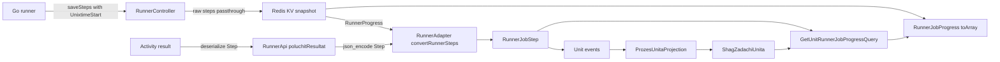

# Время начала шага задачи раннера (обратная совместимость)

## 1. Проблема

Сейчас шаг задачи раннера фиксирует только время окончания — `unixtime`.
Длительность каждого шага фронтенд вынужден вычислять как разницу между
`unixtime` соседних шагов, что:

- неверно для первого шага (нет предыдущего; используется абсолютная дата);
- неверно при паузах между шагами (разница = ожидание + выполнение);
- неверно для шагов, пришедших с `unixtime = 0`;
- теряет информацию о шаге, если он единственный в задаче.

Нужна возможность передавать время начала шага, не ломая:

1. уже сохранённые события в event store (без нового ключа);
2. уже сохранённые read-модели `prozesi_unitov` / `spisok_unitov`;
3. уже лежащие в Redis KV снапшоты прогресса (TTL 2 часа);
4. старую версию Go-раннера, которая не присылает новое поле;
5. существующий ответ API и OpenAPI-контракт для фронтенда.

## 2. Контракт

### 2.1. Входящий контракт раннера

Необязательный ключ времени начала шага в элементе `stepsContent`:

```json
{
  "Command": "docker build ...",
  "Response": "...",
  "Success": true,
  "Unixtime": 1730000000,
  "UnixtimeStart": 1729999975
}
```

- `Unixtime` — семантика **не меняется**: время окончания шага (как сейчас).
- `UnixtimeStart` — необязательное время начала шага, unix-секунды.
- Допускается также camelCase `unixtimeStart` (на случай, если раннер сериализует
  структуру Go-тегами в нижнем регистре). Разбор — регистронезависимый по этому ключу.
- Отсутствие ключа = `null`, поведение полностью идентично текущему.

### 2.2. Исходящий контракт API

`RunnerJobStep` получает необязательное поле `unixtimeStart`:

```json
{
  "command": "docker build ...",
  "response": "...",
  "success": true,
  "unixtime": 1730000000,
  "unixtimeStart": 1729999975
}
```

**Ключ не эмитится, если значение `null`.** Это ключевое решение:

- payload старых шагов остаётся байт-в-байт прежним (event store, проекции, API, push);
- существующие тесты с точным сравнением массива шага проходят без правок;
- старый фронтенд не видит новых ключей и не требует изменений;
- проекции можно **не пересобирать**.

В OpenAPI поле добавляется как необязательное (`required` остаётся прежним),
поэтому клиенты, сгенерированные по схеме, не ломаются.

## 3. Схема потока



Два пути шагов должны одинаково сохранять новое поле:

- **живой прогресс** — шаги в KV хранятся сырыми массивами, поле проходит как есть;
- **терминальный результат** — шаги проходят через десериализацию в `Step`
  и обратную сериализацию. Без правки `Step` новое поле здесь потеряется.

## 4. Изменения в модуле Runner

| Файл | Изменение |
|---|---|
| `Business/Model/GolangRunner/Unit/Step.php` | добавить `?int $UnixtimeStart = null` последним параметром |
| `Business/Model/GolangRunner/Project/Step.php` | то же (шаги проекта используют тот же транспорт) |
| `Business/Model/RunnerProgress.php` | без изменений структуры: `steps` остаются сырыми массивами |
| `Infra/Controller/RunnerController.php` | в `decodeSteps()` нормализовать необязательный ключ: отсутствие не добавлять, значение приводить к int |

Требования к `decodeSteps()`:

- не мутировать состав ключей: если раннер не прислал время начала, ключ в снапшот не добавляется;
- невалидное значение (не число, отрицательное, `null`) — не ошибка запроса,
  просто считать поле отсутствующим;
- если `UnixtimeStart > Unixtime` — считать поле отсутствующим (защита от мусора).

## 5. Изменения в модуле Unitman

| Файл | Изменение |
|---|---|
| `Business/Model/Unit/Runner/RunnerJobStep.php` | новый параметр `?int $unixtimeStart = null` последним; `toArray()` эмитит ключ условно; `fromArray()` читает `?? null` |
| `Business/ReadModel/Unit/ProzesUnita/ShagZadachiUnita.php` | новый параметр `?int $unixtimeStart = null` последним |
| `Infra/Projection/ProzesUnitaProjection.php` | в обеих ветках (`obnovlen`, `dobavit`) передавать `$stepData['unixtimeStart'] ?? null` |
| `Acl/RunnerAdapter.php` | `convertRunnerSteps()` читает `UnixtimeStart`/`unixtimeStart` регистронезависимо, отсутствие → `null` |
| `Business/UseCase/Unit/GetUnitRunnerJobProgressQuery.php` | в `progressIzBd()` передавать `unixtimeStart` из `ShagZadachiUnita` |
| `Business/Model/Runner/RunnerJobProgress.php` | обновить psalm-array-shape: `unixtimeStart?: int`; сама логика `toArray()` делегируется шагу |

Явно **не меняются**: `ZadachaProzesaUnita::getLastUnixtime()`, модель `Unit`
и его события (`RunnerJobStep::toArray()` используется внутри `RunnerJob::toArray()` —
условная эмиссия автоматически сохраняет обратную совместимость событий).

## 6. Обратная совместимость по слоям

| Слой | Риск | Решение |
|---|---|---|
| Event store (старые сообщения без ключа) | `fromArray()` падал бы на undefined key | `$data['unixtimeStart'] ?? null` |
| Проекции `prozesi_unitov` (старый payload) | serializer ищет конструктор-аргумент | параметр nullable с дефолтом `null` |
| Redis KV (снапшоты, созданные до релиза) | ключа нет | `RunnerProgressKvStorage::poluchit()` не трогаем: шаги остаются как есть |
| Старый Go-раннер | не присылает поле | поле `null`, ключ не эмитится |
| Новый раннер + старый бэкенд | поле игнорируется десериализатором | допустимо, потерь нет |
| Фронтенд (старый) | новый ключ в JSON | игнорируется; `required` в схеме не меняется |
| Фронтенд (новый) | отсутствие ключа | проверять наличие, не подставлять `0` |
| Пересборка проекций | не требуется | новые события для старых шагов идентичны прежним |

## 7. Тесты

Модуль Runner:

- `RunnerControllerSaveStepsTest`: шаг с `UnixtimeStart` сохраняется в сыром снапшоте и в `RunnerProgress`;
- шаг без ключа — снапшот побайтово равен отправленному, ключ не появляется;
- `UnixtimeStart > Unixtime` и нечисловое значение — поле отбрасывается, запрос успешен.

Модуль Unitman:

- `RunnerJobStep::toArray()` — без времени начала массив ровно из 4 ключей; с временем — 5 ключей;
- `RunnerJobStep::fromArray()` — старый массив без ключа даёт `null`;
- `GetUnitRunnerJobProgressQueryTest` — DB-ветка передаёт `unixtimeStart` в шаг;
- прогон существующих тестов без правок их ожиданий (контроль обратной совместимости).

## 8. Документация и контракт

- `config/packages/nelmio_api_doc.yaml`: `RunnerJobStep` — добавить опциональное свойство `unixtimeStart` (integer) с описанием семантики;
- перегенерировать `docs/openapi.json` (`composer run openapi-dump`);
- `docs/runner-progress-streaming.md`: описать новое поле, правила отсутствия и признак «ключ не эмитится»;
- `plans/frontend-runner-progress-streaming-task.md`: пометить, что длительность шага следует считать как `unixtime - unixtimeStart` при наличии поля, иначе прежней дельтой.

## 9. Порядок выполнения и проверки

1. Модели Runner (`Step`, `Step` проекта) — чтобы поле не терялось на терминальном пути.
2. Нормализация входа в `RunnerController::decodeSteps()`.
3. Модель и read-модель Unitman, проекция, адаптер, query.
4. Тесты обоих модулей.
5. OpenAPI и документация.
6. Проверки по правилам проекта: `php bin/console cache:clear`,
   `composer run all-checks`, `rr reset` в контейнере.
