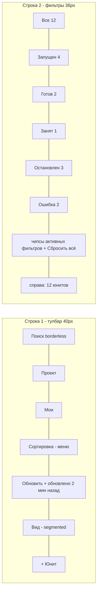
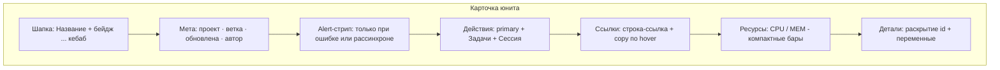

# Unitman — редизайн экрана юнитов (SpisokUnitov)

Ревью UI/UX в роли Senior Product Designer (B2B SaaS / DevOps-инструменты).
Анализ выполнен по фактическому коду фронтенда `unitman-front` — он точнее скриншота:
описанное состояние (фильтры + статус-табы + карточка «Ошибка») полностью воспроизводится
в компонентах.

---

## 0. Аудит текущего состояния

### Шапка (фактически 4–5 строк, а не 3)

| Строка | Содержимое | Где |
|---|---|---|
| 1 | поиск, проект, «только мои», сортировка, reset, spacer, refresh, «обновлено …», «+ Юнит», переключатель вида | `UnitFilterBar.vue` `.unit-filter__row` (flex-wrap → непредсказуемые переносы) |
| 2 | статус-чипсы «Все / Запущен / …» со счётчиками в скобках | `UnitFilterStatus.vue` |
| 3 | «Найдено: N» (правый край, отдельная строка) | `UnitFilterBar.vue` `.unit-filter__footer` |
| 4 | чипсы активных фильтров (ярко-синие `q-chip` square) + «очистить» | `UnitFilterChips.vue` |
| 5 | «список обрезан до N» | `SpisokUnitov.vue` `.unit-filter-truncated` |

Проблемы: в строке 1 смешаны 4 типа контролов (запрос / представление / действия /
метаданные); статус-чипсы выглядят как табы, но работают как мультивыбор; «Найдено N» —
целая строка ради одной цифры; два механизма сброса (круглая `filter_alt_off` + «очистить»
в чипсах).

### Карточка юнита (`UnitCard.vue`, сверху вниз)

1. Индетерминированный лоадер процесса (3px, верхняя кромка).
2. Строка: бейдж статуса + **кебаб №1** (`more_vert`, админ: пересобрать / сломан / удалить) — `UnitCardMenu.vue`.
3. Название (20px), мета (проект · ветка), «обновлено … · автор» — `UnitCardHeader.vue`.
4. **Дубликат статуса**: строка «Последняя операция завершилась ошибкой» + красная рамка карточки — `UnitCard.vue` `.unit-card__error`, `.unit-card--error`.
5. Warning-бокс рассинхрона контейнера — `UnitCardContainerState.vue`.
6. Иконка-кнопка «редактор» (code) — `UnitCardEditor.vue`.
7. Действия: primary («Подготовить») + до 4 round icon-кнопок (settings / info / forum / refresh) + **кебаб №2** (`more_horiz`, команды + действия) — `UnitActions.vue`.
8. Ссылки: URL с обрезкой справа + 2 round-кнопки (open_in_new + content_copy) — `UnitCardLinks.vue`.
9. Связанные юниты — `UnitCardRelated.vue`.
10. CPU/MEM: `q-linear-progress` 6px с `track-color="grey-3"` — `UnitCardStats.vue`.
11. Separator + раскрытие «Детали» (id, переменные) — `UnitCardDetails.vue`.

Ключевые дефекты: **два кебаб-меню на одной карточке**, тройное кодирование ошибки
(бейдж + текст + рамка), icon-only кнопки с tooltip-единственной подписью, обрезка URL
справа (теряется уникальный хвост), `grey-3` трек ломает тёмную тему.

### Цвета (`_tokens.scss`, `main.ts`)

- Два почти неразличимых синих: `--app-primary #2f6fb0` и `--app-info #3f8fbf`.
- Статусы красят карточку в 5 цветов: running=зелёный, busy=синий-info, prepared=синий-primary, stopped=серый, error=красный; плюс красная рамка, плюс жёлтый mismatch-бокс, плюс зелёно-жёлто-красные бары ресурсов.
- Quasar-палитра (`grey-3` в треке) не синхронизирована с токенами.

---

## 1. Шапка и фильтры: 3+ строки → 2 строки

### Целевая структура

### Строка 1 — тулбар (действия и запрос)

- **Поиск**: borderless-инпут с иконкой (фон `--app-surface-muted`, бордер только на
  hover/focus — паттерн Linear/Vercel). `flex: 1 1 220px`. Убрать outlined-рамку и
  floating label Quasar — label съедает высоту и создаёт «тяжёлую» строку.
- **Проект**: компактный select 150–170px, тот же borderless-стиль.
- **«Мои»**: оставить toggle-кнопку, но в стиле chip (32px, pill), не outlined-кнопка
  с иконкой person/group — иконка меняется и «прыгает».
- **Сортировка**: select 190px → иконка `sort` с меню (сортировка — редкая операция,
  не заслуживает постоянного селекта). Текущее значение — одной строкой в кнопке.
- **Справа**: refresh (icon-btn) + «обновлено 2 мин назад» (relative time, caption);
  переключатель вида → **segmented control** (два сегмента в одной 1px рамке, активный
  сегмент с заливкой `--app-surface-muted`) вместо `q-btn-toggle` с двумя отдельными
  кнопками; primary «+ Юнит».
- **Убрать**: круглую reset-кнопку из тулбара (сброс остаётся в строке 2 — «Сбросить всё»
  рядом с чипсами; когда чипсов нет, сбрасывать нечего).
- Запрет `flex-wrap` на десктопе: `flex-wrap: nowrap` + `min-width: 0` + усечение
  подписей; на <1024px — горизонтальный скролл строки.

### Строка 2 — статусы + активные фильтры + счётчик

- Статус-чипсы: вместо иконки — **цветная точка 8px** (иконки play/pause/sync/error
  в 6 чипсах создают визуальный шум); счётчик — muted цифра **без скобок**,
  `font-variant-numeric: tabular-nums`; активный чип — цветной текст + точка + тонкий
  бордер, **без 12%-заливки** (меньше цвета, чётче скан). «Все» — первый, без точки.
- Чипсы активных фильтров переезжают в эту же строку (после статусных): neutral-стиль
  (бордер + текст-secondary + крестик), не primary-заливка. В конце — текстовая кнопка
  «Сбросить всё» (заменяет и круглую reset, и icon-btn clear).
- «Найдено: N» и «список обрезан до N» — правый край этой же строки (caption, muted).
  Строки 3 и 5 исчезают как отдельные сущности.
- Итог: шапка всегда ровно 2 строки (~76px) на любом десктопном разрешении.

### Мобилка (<1024px)

- Строка 2 → кнопка «Фильтры (2)» с бейджем-счётчиком → bottom sheet со статусами
  (механика `q-menu` уже есть — заменить на `q-dialog` position bottom).
- Поиск → иконка, раскрывающая инпут на всю ширину.

### Затронутые файлы

- `UnitFilterBar.vue` — переразметка, borderless-контролы, sort → меню, segmented view,
  перенос «Найдено/обрезан» в строку 2.
- `UnitFilterStatus.vue` — точка вместо иконки, счётчик без скобок, rest-стиль без заливки.
- `UnitFilterChips.vue` — neutral-чипсы, встраивание в строку 2, «Сбросить всё» текстом.
- `SpisokUnitov.vue` — убрать `.unit-filter__footer`-логику и `.unit-filter-truncated`
  как отдельные блоки.

---

## 2. Карточка юнита

### 2.1 Один статус вместо трёх сигналов

Сейчас «Ошибка» кодируется трижды: бейдж, текст-строка, красная рамка. Решение:

- **Бейдж — единственный компактный индикатор** (остаётся в шапке, см. 2.5).
- Строку `.unit-card__error` удалить. Человеческое сообщение об ошибке объединяется
  с mismatch-боксом в один компонент **`UnitCardAlert.vue`** (эволюция
  `UnitCardContainerState.vue`): иконка, заголовок, сообщение, время, ссылка
  «Задачи» → `unit_jobs`. Варианты: `error` (красный) и `warning` (жёлтый, mismatch).
  Показывается только когда есть содержимое — в здоровом состоянии карточка чище.
- Красная рамка всей карточки → **левый акцент**: `border-left: 3px solid
  var(--app-negative)` (паттерн Linear: состояние читается периферийным зрением,
  но не «кричит» на всю рамку). `unit-card--error` остаётся, меняется только CSS.

### 2.2 Действия: один кебаб, подписанные кнопки, защита от промаха

Проблемы: два кебаба (админский `more_vert` вверху и `more_horiz` в блоке действий)
делят команды по непонятному пользователю признаку; 4 icon-only кнопки опознаются
только по tooltip; `refresh`-кнопка «ждём runner» дублирует busy-состояние бейджа.

Решение:

- **Один кебаб на карточку** — в правом верхнем углу шапки (где сейчас админский).
  `UnitCardMenu.vue` расширяется до полного меню со сгруппированными секциями:
  - «Жизненный цикл»: собрать, обновить код, запустить, остановить, проверить контейнер;
  - «Ещё»: конфиг, задачи, сессия, действия, редактор;
  - «Админ» (только админ): пересобрать, пометить сломанным;
  - separator → «Удалить» красным текстом внизу (confirm-диалог уже есть).
  Группы с `q-item-label header` (11px uppercase) — сканируемость вместо «плоского списка».
- **Строка действий** (`UnitActions.vue`) — только частотное, с подписями:
  `[primary: Запустить / Подготовить / …] [Задачи] [Сессия]` — ghost-кнопки no-caps,
  13px, высота 28px. Icon-only round-кнопки убрать вовсе: подпись стоит 20px ширины,
  но убирает необходимость «угадывать иконку».
- `refresh` (esliJdemRunner) → не кнопка, а **спиннер внутри бейджа статуса**
  (busy-вариант уже рендерит `q-spinner`) + tooltip «ожидание runner».
- Кнопка «редактор» (`UnitCardEditor.vue`) — это ссылка: переехать в кебаб («Открыть
  редактор») или в секцию «Ссылки» первой строкой.
- Safety-правила: hit-area ≥ 32px; деструктив — только в меню, красный текст,
  отделён separator; между primary и вторичной группой 8px (сейчас 4px — кнопки
  сливаются); меню закрывается по Esc/клик вне (Quasar из коробки).

### 2.3 Ссылки: строка = ссылка, copy по hover, хвост URL виден

Проблемы: URL обрезается справа (теряется уникальная часть пути), две round-кнопки
с разной геометрией → «неровная» колонка иконок, два клика там, где нужен один.

Решение (паттерн Vercel/Supabase):

- Вся строка — один `<a target="_blank">`: `[иконка link 14px] [хост — body-шрифт,
  muted] [путь — mono 12px] [copy — появляется на hover, на таче виден всегда]`.
- Кнопку `open_in_new` удалить — открывает сама строка. Минус одна иконка на строку,
  выравнивание иконок по фиксированной правой колонке 28px — идеально ровно.
- Обрезка с сохранением хвоста: контейнер с `direction: rtl; text-align: left` +
  `text-overflow: ellipsis` на inner-спане (bidi-трюк) — видно начало домена и конец
  пути; полный URL в `title`.
- Копирование: иконка `content_copy` морфится в `check` на 1.2с вместо `Notify` —
  при 3+ ссылках тосты спамят; локальный фидбек точнее.
- Остановленный юнит: строки disabled (opacity .5, без href), один hint под заголовком
  секции (как сейчас) — ок, оставить.

### 2.4 Ресурсы CPU/MEM

Проблемы: `track-color="grey-3"` — светло-серый Quasar на тёмной теме (баг); три цвета
заливки (зелёный/жёлтый/красный) добавляют шум; абсолютные значения спрятаны в title.

Решение:

- Трек: `var(--app-surface-muted)` (тема-осознанный токен вместо `grey-3`).
- Заливка всегда нейтральная (`--app-primary`), пороги 70/90% красят **только значение**
  (warning/negative текст) — минус два цветных бара в каждой карточке.
- Высота 4px, `border-radius: pill`; grid-колонки `44px 1fr 72px`; значения mono,
  `tabular-nums`, выровнены вправо — бары и цифры стоят в аккуратную колонку.
- Значение: `12%` + абсолют рядом (`· 512 MiB`) caption-модом; `memoryUsage` уже есть
  в данных — вывести из title в интерфейс.
- Секция без заголовка «Ресурсы» (компактнее): две строки по 20px, отступ 6px.

### 2.5 Шапка карточки: минус одна строка

- Объединить `unit-card__status-row` и `UnitCardHeader`:
  `[Название 15px/600] [бейдж статуса] …spacer… [кебаб]`,
  вторая строка: `проект · ветка (mono) · обновлена 5 мин назад · автор`.
- Relative time («5 мин назад»), абсолют — в tooltip (уже есть `convertDateTime`).
- Название 20px → 15–16px: карточка в сетке 300px+ — заголовок-«газета» не нужен,
  иерархию держит вес и цвет.
- Экономия: ~32px высоты карточки × N карточек = заметно больше юнитов на экран.

### Целевая анатомия карточки

---

## 3. Визуальный стиль и «воздух»

### Цвет: роль вместо оттенка

| Роль | Токен | Где разрешён |
|---|---|---|
| Бренд/интерактив | `--app-primary` | кнопки, ссылки, фокус, активный сегмент, заливка баров |
| Успех | `--app-positive` | только статус «Запущен» (точка/бейдж) |
| Ошибка/деструктив | `--app-negative` | статус «Ошибка», alert, «Удалить», левый акцент |
| Предупреждение | `--app-warning` | только mismatch-бокс |
| Занят | `--app-primary` (не info) | busy-бейдж: «в работе» — процесс бренда, второй синий не нужен |

- `--app-info #3f8fbf` упразднить (или зарезервировать за пределами этого экрана):
  рядом с `#2f6fb0` он читается как «случайный второй синий» — это и есть жалоба
  на «много оттенков синего».
- Правило скана: **цвет в карточке = состояние**, всё остальное — нейтральная шкала.
  Здоровая карточка содержит максимум 1 акцент (зелёная точка running), больная — 2
  (красный бейдж + левый акцент).
- Синхронизировать Quasar brand (`main.ts`) с токенами: убрать `info`, track-цвета
  не брать из Quasar-палитры (`grey-3` → токен).

### Радиусы

- Внешняя оболочка 12 (`--app-radius-lg`) — ок; внутренние блоки (alert, инпуты,
  кнопки) — 8 (`--app-radius-md`); чипсы/бейджи — pill. Правило вложенности:
  inner = outer − padding, сейчас в целом соблюдено — зафиксировать.
- Кнопки Quasar по умолчанию полукруглые (pill) — на фоне карточек 12px это даёт
  лишнюю «резиновость»; задать кнопкам `border-radius: var(--app-radius-md)`.

### Отступы (8pt-сетка)

- Карточка: горизонтальный padding 12 → **16px** (`--app-space-4`), вертикальный 12px;
  между секциями 12px, внутри секции 6–8px.
- Секции разделять заголовками `.unit-card__section-title` (11px/600/uppercase/0.06em)
  + 8px снизу, а не линиями; `q-separator` перед «Деталями» заменить на `border-top`
  + заголовок внутри раскрытия.
- Тулбар: высота контролов 32px (dense), вертикальные пробелы между строками 8px.

### Типографика

- Шрифт: Roboto → **Inter** (Vercel/Linear-стандарт; `font-feature-settings: "cv11","ss01"`
  опционально). Mono: оставить системный стек или JetBrains Mono для URL/id/значений.
- Шкала: карточка-заголовок 15px/600; мета 12px; caption 11–12px; значения статов и
  URL — mono 12px `tabular-nums`; заголовки секций 11px uppercase.
- Все счётчики (чипсы, «Найдено», проценты) — `font-variant-numeric: tabular-nums`,
  чтобы цифры не «дёргались» при обновлении по WebSocket.
- Время в карточках и тулбаре — relative («2 мин назад»), абсолют в tooltip.

### Тени и границы

- Border-first: карточка в покое — 1px `--app-border` без тени (или shadow-sm только
  в светлой теме), тень появляется на hover (`shadow-md`). Сейчас shadow-sm висит
  всегда — на сетке 4+ карточек это серая «каша» по краям.
- Alert-боксы — без тени: 1px бордер + 8–10% фон (уже так в mismatch — сохранить).

### Сетка

- `minmax(300px, 1fr)` → `minmax(320px, 1fr)`, gap 16px — карточка после уплотнения
  станет ниже, 4 колонки на 1440px сохранятся; `--app-content-max-width: 1440px` — ок.
- Первая загрузка: скелетоны (`.app-skeleton` уже есть в `quasar.scss`) вместо
  пустоты + linear-progress.

### Надёжность

- `SpisokUnitov.vue:408` — `v-html="oshibkaZagruzkiSpiska"` заменить на компонент
  ErrorState (иконка, текст, «Повторить»): безопаснее (XSS) и в стиле системы.

---

## 4. Чеклист реализации

- [ ] `UnitFilterBar.vue` — 2 строки, borderless-контролы, sort → меню, segmented view, nowrap
- [ ] `UnitFilterStatus.vue` — точка-индикатор, счётчик без скобок, rest без заливки
- [ ] `UnitFilterChips.vue` — neutral-чипсы, встраивание в строку 2, «Сбросить всё»
- [ ] `SpisokUnitov.vue` — убрать footer/truncated-строки, ErrorState вместо v-html, скелетоны
- [ ] `UnitCard.vue` — merge шапки, left-accent вместо рамки, удалить error-строку
- [ ] `UnitCardAlert.vue` (новый, из `UnitCardContainerState.vue`) — error + warning
- [ ] `UnitCardMenu.vue` — единый кебаб с группами, переезд в шапку
- [ ] `UnitActions.vue` — primary + подписанные ghost-кнопки, убрать icon-only и второй кебаб
- [ ] `UnitCardEditor.vue` — ссылка в кебаб или секцию «Ссылки»
- [ ] `UnitCardLinks.vue` — строка-ссылка, hover-copy, tail-truncation, ровная иконка-колонка
- [ ] `UnitCardStats.vue` — токен-трек, нейтральная заливка, цвет у значения, абсолюты
- [ ] `UnitCardHeader.vue` — 15px заголовок, relative time
- [ ] `_tokens.scss` — упразднить/зарезервировать `--app-info`, добавить токен трека
- [ ] `main.ts` — синхронизировать brand с токенами
- [ ] i18n — ключи: relative time, группы меню, alert, «Сбросить всё»
- [ ] Проверка тёмной темы: треки, чипсы, left-accent, скелетоны
