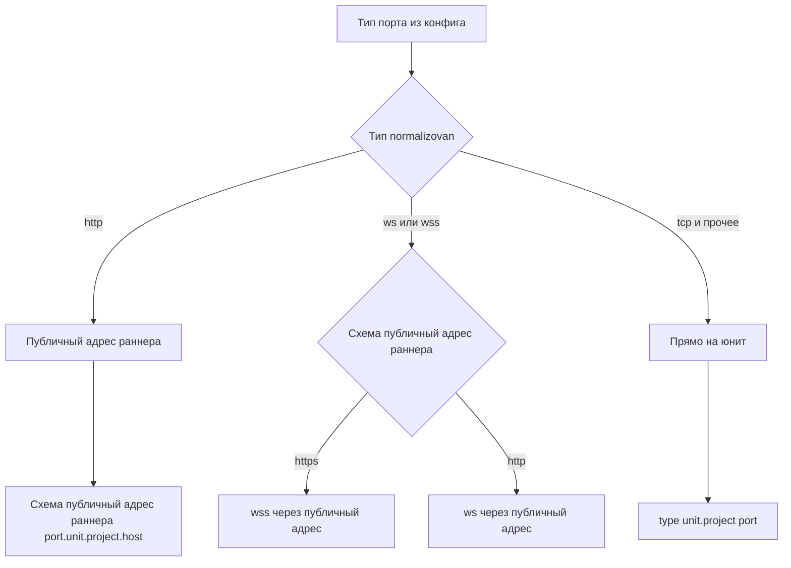

# WS-ссылки через proxy и компактные метки ссылок

## 1. Принятые решения

### Бэкенд

- Ссылки с протоколом `ws` и `wss` строятся как `http`, но со схемой под proxy:
  - `https`-публичный адрес раннера → `wss`;
  - `http`-публичный адрес раннера → `ws`;
  - часть `{port}.{unit}.{project}.{host}[:{proxyPort}]` идентична http-ссылке.
- `tcp` и любые остальные протоколы остаются прямыми: `{type}://{unit}.{project}:{port}`.
- Пустой или невалидный публичный адрес раннера для `ws`/`wss` теперь даёт `unit.runner_public_address_missing`
  (как для `http`), потому что без proxy такую ссылку построить нельзя.

### Фронтенд

- Строка ссылки показывает метку `service:port` (например `web:8080`).
- `startUri` из `UnitLink` выводится отдельным приглушённым хвостом с обрезкой слева;
  пустой `startUri` или `"/"` не выводится.
- Полный URL — только в `title` и при копировании.
- Для не-http протоколов добавляется компактный бейдж протокола (`ws`, `tcp`), чтобы
  отличать ссылки одного сервиса и порта.
- Кликабельными остаются только `http`/`https`; `ws`/`tcp` показываются как текст
  с кнопкой копирования, потому что браузер не открывает такие URL.

## 2. Схема правила

## 3. Бэкенд

### 3.1. [`SsylkaServisaUtil`](src/Unitman/Business/Utils/SsylkaServisaUtil.php:21)

Изменить [`sformirovat()`](src/Unitman/Business/Utils/SsylkaServisaUtil.php:40):

1. После [`normalizovatTip()`](src/Unitman/Business/Utils/SsylkaServisaUtil.php:26) определить,
   идёт ли протокол через proxy: `http`, `ws`, `wss`.
2. Для остальных протоколов вернуть текущую прямую ссылку
   `{type}://{unit}.{project}:{port}`.
3. Для протоколов через публичный адрес распарсить `publicAddress` и требовать `scheme` + `host`,
   иначе `\DomainException('unit.runner_public_address_missing')`.
4. Выбрать итоговую схему:
   - `http` → схема публичный адрес раннера (`http` или `https`);
   - `ws`/`wss` → `https` даёт `wss`, иначе `ws`.
5. Собрать `{scheme}://{port}.{unit}.{project}.{host}`, при наличии дописать `:{proxyPort}`.

Обновить docblock класса: ws больше не «напрямую на юнит».

### 3.2. [`SpisokUnitovProjection`](src/Unitman/Infra/Projection/SpisokUnitovProjection.php:203)

Логика не меняется — проекция вызывает утилиту. Обновить комментарий у
[`SsylkaServisaUtil::sformirovat()`](src/Unitman/Infra/Projection/SpisokUnitovProjection.php:222),
чтобы он не утверждал, что ws идёт напрямую.

### 3.3. [`PoluchitSsylkuPoPomoschnikuQuery`](src/Unitman/Business/UseCase/Unit/PoluchitSsylkuPoPomoschnikuQuery.php:12)

Логика поиска и построения уже делегирована утилите. Обновить docblock
[`sformirovatSsylku()`](src/Unitman/Business/UseCase/Unit/PoluchitSsylkuPoPomoschnikuQuery.php:46):
ws использует публичный адрес раннера, `suffix` по-прежнему заменяет `startUri`.

### 3.4. Уже существующие юниты

Ссылки лежат в read-модели `spisok_unitov.links` и пересчитываются только на
`KonfigUnitaUstanovlen` или пересборке проекции. После деплоя старые ws-ссылки
останутся прямыми, пока юнит не будет пересобран.
Для обновления использовать существующий эндпоинт
[`POST /api/unit/rebuildSpisokUnitov`](src/Unitman/Infra/Controller/UnitController.php:995)
(по одному юниту) или дождаться следующего события конфига.

## 4. Фронтенд

### 4.1. [`UnitCardLinks.vue`](../unitman-front/src/modules/unit/view/Unit/SpisokUnitov/UnitCardLinks.vue:1)

Заменить разбор полного URL на построение строк из полей `UnitLink`:

- `label = link.service + ":" + link.port`;
- `tail = link.startUri`, если значение непустое и не `"/"`;
- `protocol = link.protocol.toLowerCase()`;
- `canNavigate = canOpen && (protocol === "http" || protocol === "https")`;
- fallback: если `service` пуст — оставить текущий разбор `path` (host + path),
  чтобы не ломаться на старых данных.

Шаблон:

- для `canNavigate` — `<a :href="link.path" target="_blank" rel="noopener noreferrer">`;
- для остальных — `` с тем же набором частей;
- `title` — полный `link.path`;
- бейдж протокола показывать только для `protocol !== "http"`;
- кнопку копирования и её фидбек `check` оставить без изменений.

Стили:

- метка `service:port` — основной цвет, без моноширинного шрифта;
- хвост `startUri` — `text-mono`, приглушённый, `flex: 1 1 auto`, `min-width: 0`,
  `text-overflow: ellipsis`, обрезка слева сохраняется;
- бейдж протокола — `flex: 0 0 auto`, pill, caption-размер.

Новые ключи i18n не нужны: метка и протокол — данные. Для `aria-label` переиспользовать
существующий `unit.spisok_unitov.card.buttons.open_link`.

## 5. Тесты

### Бэкенд

- [`SsylkaServisaUtilTest`](src/Unitman/Tests/Unit/Unit/SsylkaServisaUtilTest.php:16):
  - `ws` + `https` proxy → `wss://8080.myunit.myproject.unitman.example.ru`;
  - `ws` + `http` proxy → `ws://8080...`;
  - `WS` и ` ws ` нормализуются;
  - `ws` + публичный адрес раннера с портом → `wss://...:8443`;
  - `tcp` по-прежнему `tcp://myunit.myproject:8000`;
  - `ws` без валидного публичный адрес раннера → `unit.runner_public_address_missing`.
- [`PoluchitSsylkuPoPomoschnikuQueryTest`](src/Unitman/Tests/UseCase/Unit/PoluchitSsylkuPoPomoschnikuQueryTest.php:82):
  - ws-ссылка теперь `wss://8080.task-789.uwin.testcase.ru`;
  - с `suffix` → `wss://8080.task-789.uwin.testcase.ru/socket`.
- [`SpisokUnitovProjectionRedaktorLinkTest`](src/Unitman/Tests/UseCase/Unit/SpisokUnitovProjectionRedaktorLinkTest.php:34):
  добавить тест на `KonfigUnitaUstanovlen` с портом `type: ws` и `startUri`,
  проверить `links[].path` через proxy.
- [`UnitUspeshnoOstanovlenIUdalenTest`](src/Unitman/Tests/UseCase/Unit/UnitUspeshnoOstanovlenIUdalenTest.php:154):
  существующие ожидания `tcp` не меняются, регрессия по прямым протоколам.

### Фронтенд

- `npm run build` в `../unitman-front` (включает `vue-tsc --noEmit`);
- ручная проверка карточки с http, ws и tcp ссылками на узком экране.

## 6. Документация

- [`docs/unitman-config.md`](docs/unitman-config.md:223): обновить таблицу шаблонов —
  `http`, `ws`/`wss` через публичный адрес раннера, остальные напрямую.
- [`docs/unitman-config.md`](docs/unitman-config.md:303): обновить описание хелпера.
- В [`plans/helper-type-protocol.md`](plans/helper-type-protocol.md:19) добавить короткую
  пометку, что решение по ws пересмотрено (историю не переписывать).
- OpenAPI-схема `UnitLink` не меняется: `service`, `port`, `protocol`, `startUri`
  уже есть, регенерация [`docs/openapi.json`](docs/openapi.json:1) не требуется.

## 7. Проверка

1. Убедиться, что контейнер запущен; если нет — попросить запустить.
2. В контейнере: `php bin/console cache:clear`, затем целевые phpunit-тесты и
   `composer run check-deptrac`.
3. Перезапустить RoadRunner: `rr reset`.
4. Проверить, что proxy поддерживает WebSocket upgrade для поддоменов
   `{port}.{unit}.{project}.{publicAddress}`: заголовки `Upgrade`/`Connection`
   в конфиге proxy (файл у пользователя вне репозитория).
5. На стенде открыть карточку юнита с ws-портом:
   - ссылка имеет вид `wss://8080.<unit>.<project>.<host>`;
   - метка в карточке `web:8080`, бейдж `ws`, хвост `/socket`;
   - полный URL виден в tooltip и копируется;
   - http-ссылки по-прежнему открываются в новой вкладке.

## 8. Декомпозиция на параллельные подзадачи

Подзадачи ниже не пересекаются по файлам и могут выполняться субагентами параллельно.
Зависимости указаны явно.

### Подзадача A — правило ws-ссылок в бэкенде

Файлы:

- [`SsylkaServisaUtil.php`](src/Unitman/Business/Utils/SsylkaServisaUtil.php:1)
- [`SpisokUnitovProjection.php`](src/Unitman/Infra/Projection/SpisokUnitovProjection.php:203)
- [`PoluchitSsylkuPoPomoschnikuQuery.php`](src/Unitman/Business/UseCase/Unit/PoluchitSsylkuPoPomoschnikuQuery.php:12)

Что сделать:

- реализовать proxy-ветку для `http`, `ws`, `wss`;
- маппинг схемы `https` → `wss`, `http` → `ws`;
- `tcp` и прочие оставить прямыми;
- обновить docblock-и.

Зависимости: нет.

### Подзадача B — бэкенд-тесты нового правила

Файлы:

- [`SsylkaServisaUtilTest.php`](src/Unitman/Tests/Unit/Unit/SsylkaServisaUtilTest.php:1)
- [`PoluchitSsylkuPoPomoschnikuQueryTest.php`](src/Unitman/Tests/UseCase/Unit/PoluchitSsylkuPoPomoschnikuQueryTest.php:82)
- [`SpisokUnitovProjectionRedaktorLinkTest.php`](src/Unitman/Tests/UseCase/Unit/SpisokUnitovProjectionRedaktorLinkTest.php:34)

Что сделать:

- обновить ожидания ws-ссылок на `wss://...` через proxy;
- добавить проверки `ws` + http proxy и `ws` без публичный адрес раннера;
- добавить тест проекции на ws-порт с `startUri`.

Зависимости: контракт зафиксирован в разделах 1 и 3; файлы не пересекаются с A,
поэтому можно писать параллельно. Зелёный прогон возможен только после A.

### Подзадача C — документация правила

Файлы:

- [`docs/unitman-config.md`](docs/unitman-config.md:223)
- [`plans/helper-type-protocol.md`](plans/helper-type-protocol.md:19)

Что сделать:

- обновить таблицу шаблонов ссылок и раздел хелпера;
- добавить пометку о пересмотре прежнего решения по ws.

Зависимости: нет.

### Подзадача D — компактное отображение ссылок на фронте

Файлы:

- [`UnitCardLinks.vue`](../unitman-front/src/modules/unit/view/Unit/SpisokUnitov/UnitCardLinks.vue:1)

Что сделать:

- метка `service:port`;
- хвост `startUri` с обрезкой;
- бейдж не-http протокола;
- кликабельность только для `http`/`https`;
- полный URL в `title`.

Зависимости: нет, данные `UnitLink` уже содержат нужные поля. Проект лежит вне
текущего workspace, поэтому субагенту нужно работать по относительному пути
`../unitman-front`.

### Подзадача E — проверки после A и B

Зависит от A и B. Выполняется последовательно после их завершения:

- `php bin/console cache:clear` в контейнере;
- целевые phpunit и `composer run check-deptrac`;
- `rr reset`;
- `npm run build` в `../unitman-front` после D.

### Подзадача F — инфраструктурная проверка proxy

Независима:

- проверить поддержку WebSocket upgrade для поддоменов
  `{port}.{unit}.{project}.{publicAddress}` в конфиге proxy.

### Подзадача G — обновление существующих юнитов

Зависит от деплоя A:

- пересобрать read-модели через `POST /api/unit/rebuildSpisokUnitov`
  или дождаться события `KonfigUnitaUstanovlen`.
