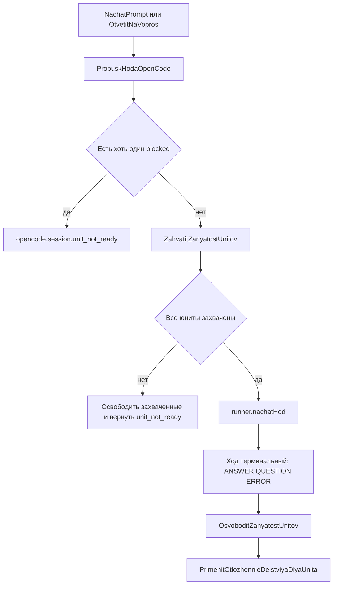
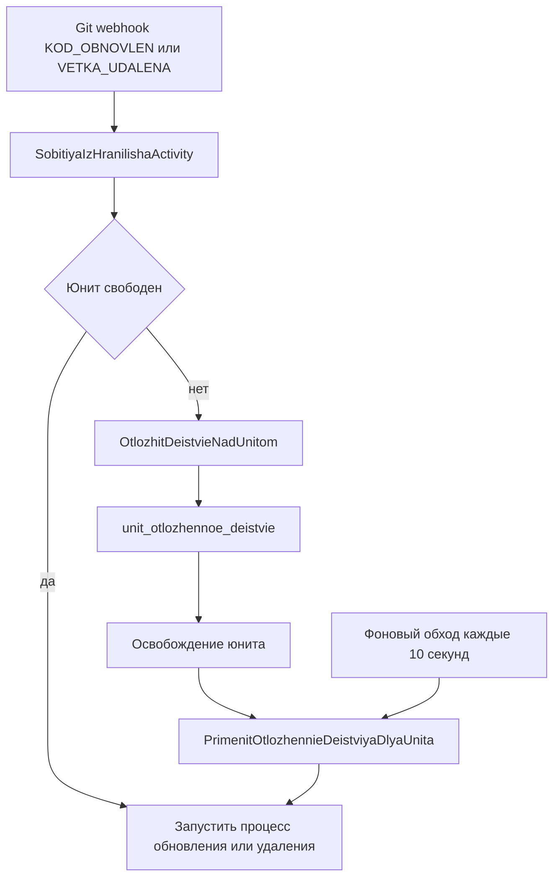

# Занятость юнита и отложенные действия из вебхука

## 1. Цель

1. **Взаимное исключение**: пока над юнитом выполняется любая активити (сборка, обновление,
   подготовка, запуск, остановка, сброс подготовки, удаление, действие), отправка сообщений
   в сессию OpenCode, привязанную к этому юниту, блокируется. И наоборот: пока выполняется
   ход OpenCode, другие действия над юнитом блокируются.
2. **Вебхук**: событие Git-вебхука (`KOD_OBNOVLEN` / `VETKA_UDALENA`) не теряется и не
   ломает идущую работу. Если юнит занят — событие сохраняется как **отложенное намерение**
   в durable-таблице и применяется автоматически сразу после освобождения юнита.
   Идущий ход OpenCode не прерывается, юнит не удаляется насильно.

## 2. Текущее состояние и найденные разрывы

| Что уже есть | Где | Разрыв |
|---|---|---|
| Гейт старта хода | `OpenCode/Business/Utils/PropuskHodaOpenCode` | Опирается только на код состояния юнита |
| Матрица готовности | `OpenCode/Business/Utils/OcenkaGotovnostiUnita` | `USPESHNO_ZAPUSHEN` считается `ready` даже когда идёт DEISTVIE-процесс |
| Код состояния наружу | `Unit::poluchitKodSostoyaniya` | Отражает состояние, но не незавершённые процессы |
| Обратный гейт | — | Отсутствует полностью: ничто не мешает запустить действие над юнитом в момент хода OpenCode |
| Вебхук → обновление | `Unitman/Infra/Jobs/SobitiyaIzHranilisha/SobitiyaIzHranilishaActivity` | `handleSystem` вызывает `dobavitProzesObnovleniya`/`dobavitProzesUdaleniya` с `neproveryatProzesi = true`, то есть **обходит** проверку незавершённых процессов |
| Потеря события | там же | При `!esliSobran()` пишется ошибка `invalid status`, при `unit.wait_another_proccess` событие пропадает после 3 ретраев job'а |

Вывод: обе стороны нуждаются в едином, явно хранимом признаке занятости — без него
гонки неизбежны независимо от того, насколько точна матрица состояний.

## 3. Принятые решения

1. **Владелец признака занятости — модуль `Unitman`.** `Unitman` не импортирует `OpenCode`;
   `OpenCode` работает через `UnitmanApi` и `OpenCode/Acl/UnitmanAdapter`.
2. **Признак занятости двухсоставный:**
   - *процессы юнита* — вычисляются по агрегату (`esliEstNeobrabotanieProzesi() ||
     isWaitResultFromRunner()`), это же значение уже лежит в event store, отдельного
     хранения не нужно;
   - *внешние владельцы* — таблица `unit_zanyatost` (сейчас единственный владелец —
     `opencode_hod`). Токен владельца непрозрачен для `Unitman`: `opencode:<turnId>`.
3. **Захват строго атомарный и все-или-ничего.** Для мультиюнитной сессии (до 10 юнитов)
   либо захватываются все юниты, либо ни один. Идентификаторы сортируются перед захватом,
   чтобы исключить взаимные блокировки между параллельными ходами.
4. **Один пользовательский ключ ошибки** для гейта: существующий
   `opencode.session.unit_not_ready`. Занятость входит в матрицу готовности, поэтому
   контракт с фронтендом не меняется — добавляется только причина блокировки.
5. **Обратный гейт — доменный отказ** в мутирующих UseCase `Unitman`, по аналогии с
   `unit.wait_another_proccess`. Новый ключ: `unit.zanyat_hodom_opencode`.
6. **Политика вебхука — отложенное намерение** (выбрано пользователем): сохраняем событие
   в durable-таблицу, применяем автоматически после освобождения юнита, ход не прерываем.
7. **Отложенное намерение ставится только при транзиентной занятости.** Если юнит не занят
   процессами, но `!esliSobran()`, поведение остаётся текущим — пишется ошибка, потому что
   такое состояние само не пройдёт. Это защищает от вечного «хвоста» отложенных строк.
8. **TTL-страховка для захватов.** `istekaet_v = now + 20 минут`; это строго больше
   `WorkflowExecutionTimeout = 15 минут` у `OpenCodeTurnWorkflow`, поэтому действующий ход
   не может потерять захват, а забытый `release` не блокирует юнит навсегда.
9. **Освобождение = немедленная попытка применения** отложенных действий; дополнительно
   работает периодический обход как страховка.

## 4. Схема данных

### 4.1 Миграция `Unitman`: `unit_zanyatost`

```
unit_id       varchar primary key
vladelec      varchar not null          -- непрозрачный токен, например opencode:<turnId>
tip           varchar not null          -- opencode_hod | prozes
zahvacheno_v  timestamptz not null
istekaet_v    timestamptz not null
```

Индекс: `(istekaet_v)` — для очистки просроченных захватов.

### 4.2 Миграция `Unitman`: `unit_otlozhennoe_deistvie`

```
id              bigserial primary key
unit_id         varchar not null
project_id      varchar not null
tip_sobitiya    varchar not null        -- KOD_OBNOVLEN | VETKA_UDALENA
payload         jsonb not null          -- vetka, unixtime
created_at      timestamptz not null
attempts        int not null default 0
next_attempt_at timestamptz not null
last_error      text null
```

Индексы:
- `unique (unit_id, tip_sobitiya)` — повторный вебхук по той же ветке обновляет строку,
  а не плодит дубликаты;
- `(next_attempt_at)` — для выборки пачки в фоновом job'е.

Правила:
- `KOD_OBNOVLEN` при наличии `VETKA_UDALENA` для того же юнита — не создаётся, удаление
  старше по приоритету;
- при появлении `VETKA_UDALENA` строки `KOD_OBNOVLEN` по этому юниту удаляются;
- строки старше 24 часов удаляются обходом с записью в лог.

## 5. Модульные границы и deptrac

Новых зависимостей между модулями не появляется: `OpenCode → Unitman` уже разрешён и
идёт только через `Acl` + `Api`. `Unitman` об `OpenCode` не знает — токен владельца
непрозрачен, тип `opencode_hod` передаётся вызывающим модулем как значение перечисления
`Unitman`, живущего в `Business/Model`.

```
OpenCode                                    Unitman
  ZapuskatelHodaOpenCode                      UnitmanApi
    -> UmeetBronirovatUniti  ------------>      zahvatitZanyatostUnitov
    -> Acl/UnitmanAdapter                     osvoboditZanyatostUnitov
                                              poluchitZanyatostUnita
                                            Business/Port/Unit/ZanyatostUnitaRepository
                                            Infra/Repository/Unit/SqlZanyatostUnitaRepository
```

## 6. Занятость в `Unitman`

### 6.1 Модели и порты

- `Unitman/Business/Model/Unit/TipZanyatosti.php` — enum: `OPENCODE_HOD`, `PROZES`.
- `Unitman/Business/Model/Unit/ZanyatostUnita.php` — `unitId`, `vladelec`, `tip`,
  `zahvachenoV`, `istekaetV`.
- `Unitman/Business/ReadModel/Unit/ZanyatostUnitaReadModel.php` — `exists`, `vladelec`,
  `tip`, `istekaetV`, `zanyatProzesami`.
- `Unitman/Business/Port/Unit/ZanyatostUnitaRepository.php`:
  - `zahvatit(string $unitId, string $vladelec, TipZanyatosti $tip, \DateTimeImmutable $istekaetV): bool`
  - `osvobodit(string $unitId, string $vladelec): void`
  - `poluchitAktivnuyu(string $unitId): ?ZanyatostUnita`
  - `udalitProsrochennie(\DateTimeImmutable $now): int`
- `Unitman/Business/Port/Unit/OtlozhennieDeistviyaRepository.php` — `otlozhit`,
  `poluchitGotovie`, `udovletvorit`, `otmetitPopytku`, `udalitPoUnituITipu`,
  `udalitUstarevshie`.

### 6.2 Репозиторий захватов

`Unitman/Infra/Repository/Unit/SqlZanyatostUnitaRepository::zahvatit` — один атомарный
`INSERT ... ON CONFLICT (unit_id) DO UPDATE SET ... WHERE unit_zanyatost.istekaet_v < now()`
с проверкой `rowCount()`: `0` означает, что юнит держит кто-то другой (или тот же владелец
в прошлом ходе — тогда `WHERE` не срабатывает, и это корректный отказ).

### 6.3 UseCase

- `ZahvatitZanyatostUnitovUseCase::handle(array $unitIds, TipZanyatosti $tip, string $vladelec)`
  — сортирует `unitIds`, захватывает по одному, при первом отказе освобождает уже
  захваченные и бросает `\DomainException('unit.zanyat')`.
- `OsvoboditZanyatostUnitovUseCase::handle(array $unitIds, string $vladelec)` — идемпотентно
  освобождает, затем вызывает `PrimenitOtlozhennieDeistviyaDlyaUnitaUseCase` по каждому юниту.
- `PoluchitZanyatostUnitaQuery::handle(string $unitId): ZanyatostUnitaReadModel` —
  объединяет активный захват и `zanyatProzesami` из агрегата.
- `OtlozhitDeistvieNadUnitomUseCase::handle(...)` — upsert отложенного намерения
  с учётом приоритета `VETKA_UDALENA`.
- `PrimenitOtlozhennieDeistviyaDlyaUnitaUseCase::handle(string $unitId)` — берёт готовые
  намерения юнита, проверяет свободу, вызывает `DobavitProzesObnovleniyaUseCase::handleSystem`
  либо `DobavitProzesUdaleniyaUseCase::handleSystem`, удаляет строку. Классификация ошибок:
  `unit.zanyat` / `unit.wait_another_proccess` -> отложить с backoff; `unit.udalen` ->
  удалить строку; прочее -> лог и backoff.

### 6.4 Утилита проверки

`Unitman/Business/Utils/ProverkaSvobodyUnita` — единая точка для обратного гейта и для
вебхука: `proverit(Unit $unit): void` бросает `unit.zanyat_hodom_opencode`, если есть
активный захват `OPENCODE_HOD`. `svoboden(Unit $unit): bool` — без исключения, для
принятия решения об отложении.

### 6.5 Обратный гейт: где проверяем

Проверка `ProverkaSvobodyUnita::proverit($unit)` добавляется сразу после
`unitRepository->getById()` в мутирующих UseCase:

- `DobavitProzesSborkiUseCase`
- `DobavitProzesPodgotovkiUseCase`
- `DobavitProzesZapuskaUseCase`
- `DobavitProzesOstanovkiUseCase`
- `DobavitProzesSbrosaPodgotovkiUseCase`
- `DobavitProzesObnovleniyaUseCase` (оба метода)
- `DobavitProzesUdaleniyaUseCase` (оба метода)
- `DobavitProzesVipolneniyaDeistviyaUseCase`
- `ZapolnitPeremenieUseCase`
- `ObnovitKodUnitaUseCase`
- `UdalitUnitUseCase`, `UdalitSlomaniyUnitUseCase`

Не блокируем: чтение, `ProdvinutCiklUnitaUseCase` (идемпотентный, вызывается самим
OpenCode), `UstanovitResultat*` (завершение уже начатого процесса).

### 6.6 `UnitmanApi`

```php
function zahvatitZanyatostUnitov(array $unitIds, string $vladelec, string $tip): void;
function osvoboditZanyatostUnitov(array $unitIds, string $vladelec): void;
function poluchitZanyatostUnita(string $unitId): ZanyatostUnitaReadModel;
```

`tip` принимается строкой и маппится на `TipZanyatosti` внутри, чтобы не отдавать наружу
внутренний enum по значению.

## 7. Гейт `OpenCode`

### 7.1 Чтение занятости

- `Unitman/Business/ReadModel/Unit/SostoyanieUnitaReadModel` получает поля
  `zanyat: bool`, `prichinaZanyatosti: ?string` (`prozes` | `opencode_hod`).
  Заполняется в `PoluchitSostoyanieUnitaQuery` из агрегата и `ZanyatostUnitaRepository`.
- `OpenCode/Business/Model/SostoyanieUnita` получает те же два поля.
- `OpenCode/Business/Utils/OcenkaGotovnostiUnita`: если `zanyat === true` и группа не
  `archived`, возвращается `blocked`. Порядок проверок сохраняется: `archived` важнее.

Это закрывает главный разрыв: юнит в `USPESHNO_ZAPUSHEN`, но с идущим DEISTVIE/OSTANOVKA
теперь `blocked`, а не `ready`.

### 7.2 Захват и освобождение

- Новый порт `OpenCode/Business/Port/UmeetBronirovatUniti`:
  `zahvatit(array $unitIds, string $vladelec): void`, `osvobodit(array $unitIds, string $vladelec): void`.
- `OpenCode/Acl/UnitmanAdapter` реализует его через `UnitmanApi`, тип передаёт
  `UnitmanApi::TIP_OPENCODE_HOD`.
- `ZapuskatelHodaOpenCode::zapustit`: после создания объекта хода (нужен его id для токена)
  и **до** `runner->nachatHod` — `zahvatit($unitIds, 'opencode:'.$turn->getId())` в
  `try/catch`: при исключении раннера захват освобождается и исключение пробрасывается.
  Порядок обязателен: TTL должен начаться раньше, чем раннер начнёт работу.
- `PoluchitResultatHodaQuery::handle`: при получении терминального результата
  (`ANSWER`, `QUESTION`, `ERROR` — то есть статус перестал быть `RUNNING`) вызывается
  `osvobodit`. При `QUESTION`/`AWAITING_INPUT` следующий ход захватит юнит заново.
- `PropuskHodaOpenCode` не меняется по логике: он уже бросает
  `opencode.session.unit_not_ready`; занятость приходит к нему через матрицу.

### 7.3 Мультиюнитность

Захват выполняется для всех юнитов сессии (`$units` из `PropuskHodaOpenCode`), а не только
для первого. Иначе второй юнит остаётся доступным для действий, пока OpenCode пишет в него
файлы.

## 8. Вебхук: отложенные действия

### 8.1 Изменения в `SobitiyaIzHranilishaActivity`

`obnovitUnixtimePoslednegoIzmeneniya` — обновление метки времени остаётся **немедленным**
(это событие event store, раннер не участвует), а вот запуск процесса обновления — нет.

```php
// после izmenitVremyaPoslednegoIzmeneniyaKodaVHranilishe
if ($project->poluchitNastroikiHuka()->avtoobnovlenie && $unit->esliNugnoObnovitKodUnita()) {
    if (!$this->proverkaSvobody->svoboden($unit)) {
        $this->otlozhit->handle($unit, TipSobitiya::KOD_OBNOVLEN, $dannieSobitiya);
        return 'deferred';
    }
    if ($unit->esliSobran()) {
        $this->dobavitProzesObnovleniyaUseCase->handleSystem($id);
    } else {
        // как и раньше: состояние не транзиентное, откладывать бессмысленно
    }
}
```

`udalitUniti`: при `avtoudalenie` и занятости юнита — отложить `VETKA_UDALENA` вместо
`handleSystem`.

Ключевое: проверка свободы выполняется **явно**, потому что `handleSystem` вызывает
`dobavitProzesUdaleniya(..., neproveryatProzesi: true)` и агрегат не остановит удаление.

### 8.2 Применение

- Немедленно: `OsvoboditZanyatostUnitovUseCase` вызывает
  `PrimenitOtlozhennieDeistviyaDlyaUnitaUseCase` по освобождённым юнитам.
- Немедленно для процессов юнита: `ObrabotatProzesiUnitaUseCase::handle`, когда
  `poluchitJobuDlyObravotki()` вернул `null` (у юнита не осталось незавершённых заданий) —
  это и есть «юнит освободился после активити».
- Страховка: новый `Unitman/Infra/BackgroundJob/OtlozhennieDeistviya/OtlozhennieDeistviyaBackgroundJob`
  (`AbstractBackgroundJob`, задержка 10 с, батч 50, выборка
  `FOR UPDATE SKIP LOCKED` по `next_attempt_at`, как в `OcheredUnitovRepository`).
  Он же удаляет просроченные захваты (`ZanyatostUnitaRepository::udalitProsrochennie`)
  и намерения старше 24 часов.

### 8.3 Backoff и лимиты

`attempts` инкрементируется при отложенной попытке; `next_attempt_at = now + min(30 * 2^attempts, 900)`
секунд. После 40 попыток намерение удаляется с записью в лог.

## 9. Потоки





## 10. Ошибки и переводы

| Ключ | Где | Смысл |
|---|---|---|
| `unit.zanyat_hodom_opencode` | обратный гейт `Unitman` | Действие отклонено: идёт ход OpenCode |
| `unit.zanyat` | `ZahvatitZanyatostUnitovUseCase` | Не удалось захватить, юнит занят; в `OpenCode` маппится в `opencode.session.unit_not_ready` |
| `opencode.session.unit_not_ready` | без изменений | Причина блокировки уточняется полем `prichinaZanyatosti` |
| `unit.otlozhennoe_deistvie.postupilo` | лог | Не ошибка для пользователя: событие принято и отложено |

Переводы добавляются в `translations/` рядом с существующими ключами `unit.*`.

## 11. Тесты

- `OcenkaGotovnostiUnitaTest`: занятость переводит `USPESHNO_ZAPUSHEN` в `blocked`;
  `archived` сильнее занятости.
- `SqlZanyatostUnitaRepositoryTest`: атомарность (два захвата подряд), освобождение
  идемпотентно, просроченный захват перехватывается.
- `ZahvatitZanyatostUnitovUseCaseTest`: мультиюнитный отказ освобождает уже захваченные;
  сортировка id.
- `ZapuskatelHodaOpenCodeTest`: исключение раннера освобождает захват.
- `PoluchitResultatHodaQueryTest`: терминальный статус освобождает, `RUNNING` — нет.
- `SobitiyaIzHranilishaActivityTest`: занятый юнит -> строка в `unit_otlozhennoe_deistvie`,
  свободный -> немедленный процесс; `VETKA_UDALENA` вытесняет `KOD_OBNOVLEN`.
- `PrimenitOtlozhennieDeistviyaDlyaUnitaUseCaseTest`: `unit.udalen` удаляет намерение,
  `unit.zanyat` даёт backoff.
- Гейт `Unitman`: по одному тесту на `unit.zanyat_hodom_opencode` для
  `DobavitProzesUdaleniyaUseCase`, `DobavitProzesObnovleniyaUseCase`,
  `DobavitProzesVipolneniyaDeistviyaUseCase`.

## 12. Проверки

`php bin/console cache:clear` -> `rr reset` в контейнере -> `composer run all-checks`
(psalm level 1, phpunit, deptrac корневой и пер-модульные). Отдельно проверить, что
`Unitman` не получил зависимость от `OpenCode`.

## 13. Порядок работ

1. Миграции `unit_zanyatost` и `unit_otlozhennoe_deistvie`.
2. Модели, порты, репозитории `ZanyatostUnitaRepository` и `OtlozhennieDeistviyaRepository`, `di.php`.
3. `ProverkaSvobodyUnita` + UseCase захвата/освобождения/чтения + `UnitmanApi`.
4. Расширение `SostoyanieUnitaReadModel`, `PoluchitSostoyanieUnitaQuery`, `SostoyanieUnita`,
   `OcenkaGotovnostiUnita` в `OpenCode`.
5. Порт `UmeetBronirovatUniti`, `UnitmanAdapter`, захват в `ZapuskatelHodaOpenCode`,
   освобождение в `PoluchitResultatHodaQuery`.
6. Обратный гейт в перечисленных UseCase `Unitman`.
7. Отложенные действия: `OtlozhitDeistvieNadUnitomUseCase`,
   `PrimenitOtlozhennieDeistviyaDlyaUnitaUseCase`, правки `SobitiyaIzHranilishaActivity`.
8. Триггеры применения: `OsvoboditZanyatostUnitovUseCase` и
   `ObrabotatProzesiUnitaUseCase`.
9. Фоновый job обхода и очистки.
10. Переводы, тесты, `docs/opencode-sessions.md`, `docs/unitman-config.md`.

## 14. Решения по открытым вопросам

1. **Занятость показываем в списке юнитов.** `unit_zanyatost` не является потоком событий,
   поэтому поле не пишется в payload проекции — иначе данные устаревали бы сразу после
   захвата. Вместо этого `SpisokUnitovRepository::getList()` делает
   `LEFT JOIN unit_zanyatost z ON z.unit_id = payload->>'id' AND z.istekaet_v > now()`
   и обогащает каждую строку ответа полями `zanyat` и `prichinaZanyatosti`. Проекция
   `SpisokUnitovProjection` и `SpisokUnitovReadModel` не меняются — фронтенд получает
   признак из того же эндпоинта списка.
2. **Ручной разбор отложенных намерений в интерфейсе не делаем.** Только лог-записи
   и счётчики в фоновом job'е.
3. **Несобранный юнит (`!esliSobran()`) не откладываем** — сохраняется текущее поведение
   с ошибкой, чтобы не копить вечные намерения.

## 15. Влияние на список юнитов

- `Unitman/Infra/Repository/Unit/SpisokUnitovRepository::getList()` — LEFT JOIN и два поля
  `zanyat` / `prichinaZanyatosti` в результирующем массиве.
- `Unitman/Infra/Repository/Unit/SpisokUnitovRepository::getMyUnits()` — тот же JOIN.
- `Unitman/Business/ReadModel/Unit/SpisokUnitovReadModel` не расширяется: поля добавляются
  в массив ответа, а не в сериализуемый payload.
- `docs/openapi.json` для списка юнитов дополняется необязательными полями `zanyat`
  и `prichinaZanyatosti`.
