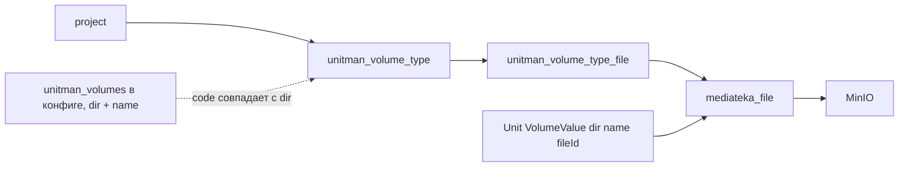

# План: каталог типов `unitman_volumes` и проектные архивы

## 1. Цель

1. Каталог типов томов **на уровне проекта**: тип = `{code, name}`, хранится в отдельной таблице.
2. Архивы медиатеки можно прикреплять к типу; у типа — много файлов. Связи файлов и типов лежат отдельно и привязаны к проекту.
3. Тип, к которому прикреплён хотя бы один файл, удалить нельзя.
4. При создании юнита в блоке `unitman_volumes` в `fileId` можно указать ид файла из проекта (архива, прикреплённого к типу).

Каталог **дополняет** конфиг: блок `unitman_volumes` в конфиге юнита (`[{dir, name}]`) остаётся источником `dir`/`name` для юнита, каталог — источник архивов.

## 2. Принятые решения

| # | Тема | Решение |
|---|---|---|
| 1 | Область каталога | Каждый проект имеет свой каталог; типы в отдельной таблице, связи файлов и типов — в отдельной таблице с `project_id` |
| 2 | Отношение к конфигу | Каталог **дополнительный**: `unitman_volumes` в конфиге по-прежнему задаёт `dir`/`name` тома юнита |
| 3 | Владение архивом | Файл каталога — **общий проектный**: `mediateka_file.project_id` заполнен, `unit_id = null`; к юниту не перепривязывается и при удалении юнита не удаляется |
| 4 | Допустимые `fileId` в томе | Только черновик (`unit_id is null and project_id is null`) либо архив каталога своего проекта. Произвольный проектный файл без связи с типом — отказ. Правило одинаково для `sozdat` и `zapolnitPeremenie` |
| 5 | Связь `code` ↔ `dir` | Жёстко: `fileId` архива каталога принимается только для тома, у которого `dir` совпадает с `code` типа, иначе `DomainException` |
| 6 | Права | Только `ProjectUserRole::ADMIN` создаёт/удаляет типы и управляет связями файлов. `USER` — только чтение и использование при создании юнита |
| 7 | Персистентность | DBAL без EventSauce (как `Mediateka`): простой справочник + чтение связей для guard-ов; проекции и replay не нужны |
| 8 | Удаление файла | Удаление файла медиатеки, привязанного к типу, блокируется (`mediateka.file.is_linked`); снятие связи — отдельная операция |

## 3. Схема данных



### 3.1 `mediateka_file` (модуль `Mediateka`)

```sql
alter table mediateka_file add column project_id varchar(36) null;
create index if not exists mediateka_file_project_id_idx on mediateka_file (project_id);
alter table mediateka_file add constraint mediateka_file_owner_chk
    check (unit_id is null or project_id is null);
```

Семантика владельца:

| `unit_id` | `project_id` | Что это | Привязка к юниту | Удаление с юнитом |
|---|---|---|---|---|
| `null` | `null` | черновик (текущий сценарий) | да | нет |
| `X` | `null` | файл юнита (текущий сценарий) | — | да |
| `null` | `P` | архив каталога проекта (новое) | нет | нет |

Ключ в MinIO для проектного файла: `projects/{projectId}/{fileId}.zip`.

### 3.2 `unitman_volume_type` (модуль `Unitman`)

```sql
create table if not exists unitman_volume_type
(
    id         varchar(36) not null primary key,
    project_id varchar(36) not null,
    code       varchar(100) not null,
    name       varchar(255) not null,
    created_at integer not null
);

create unique index if not exists unitman_volume_type_project_code_uniq
    on unitman_volume_type (project_id, code);
```

`code` — публичный ключ типа, совпадает с `dir` тома; сравнивается после `trim()`, без приведения регистра.

### 3.3 `unitman_volume_type_file` (модуль `Unitman`)

```sql
create table if not exists unitman_volume_type_file
(
    type_id    varchar(36) not null,
    project_id varchar(36) not null,
    file_id    varchar(36) not null,
    created_at integer not null,
    primary key (type_id, file_id)
);

create index if not exists unitman_volume_type_file_project_file_idx
    on unitman_volume_type_file (project_id, file_id);

alter table unitman_volume_type_file
    add constraint unitman_volume_type_file_type_fk
    foreign key (type_id) references unitman_volume_type (id);
```

`on delete` не указываем: удаление типа с файлами блокируется и в use case, и на уровне БД.

## 4. Модульность

- Каталог — в `Unitman` (проектная область, `Project` уже там). Связи `file ↔ type` — тоже `Unitman`, т.к. тип принадлежит `Unitman`.
- `Mediateka` не знает про типы. Guard «файл привязан к типу» реализуется инверсией зависимости:
  - интерфейс `src/Mediateka/Business/Port/FileLinkChecker.php` — `esliFaylPrivyazan(string $fileId): bool`;
  - реализация `App\Unitman\Infra\Service\VolumeTypeFileLinkChecker` регистрируется в [`src/Unitman/di.php`](src/Unitman/di.php:39) (автоконфигурация по интерфейсу);
  - `UdalitFaylUseCase` получает `iterable<FileLinkChecker>` (пустой по умолчанию).
  - Направление зависимостей: `Unitman → Mediateka` — разрешено в [`deptrac.yaml`](deptrac.yaml:40); обратной зависимости нет.
- Файл проектного архива загружается через существующий upload медиатеки (multipart уже реализован в [`MediatekaController::upload()`](src/Mediateka/Infra/Controller/MediatekaController.php:88)), права ADMIN проверяются при **привязке** к типу в `Unitman`.
- Новых зависимостей в `composer.json` нет; `check-mediateka-deptrac` / `check-unitman-deptrac` уже в `all-checks`.

## 5. Модуль `Mediateka`: проектные файлы

### 5.1 Модель

[`FaylUnita`](src/Mediateka/Business/Model/FaylUnita.php:17):

- новый `private readonly ?string $projectId` (последним параметром конструктора — по образцу расширения `Volume::$FileId` в [`plans/volumes-decoupling.md`](plans/volumes-decoupling.md:130));
- `toArray()` — добавить `projectId`;
- `fromRow()` — читать `project_id`;
- `esliChernovik()` — **переопределить**: `$this->unitId === null && $this->projectId === null` (сейчас проверяется только `unitId`);
- новый `esliFaylProekta(): bool` — `$this->projectId !== null`;
- `prikrepitKUnitu()` — запрещать для проектного файла: `DomainException('mediateka.file.is_project_file')`.

### 5.2 Загрузка

- [`ZagruzitFaylUnita`](src/Mediateka/Business/Command/ZagruzitFaylUnita.php:12): добавить `public readonly string $projectId = ''` (последним параметром).
- [`ZagruzitFaylUnitaUseCase::handle()`](src/Mediateka/Business/UseCase/ZagruzitFaylUnitaUseCase.php:27):
  - владелец ровно один: `unitId` xor `projectId`, иначе `mediateka.upload.owner_is_ambiguous`;
  - `projectId` нормализуется так же, как `unitId` (`opredelitUnitId()`, [`строка 85`](src/Mediateka/Business/UseCase/ZagruzitFaylUnitaUseCase.php:85));
  - `makeStorageKey()` ([`строка 92`](src/Mediateka/Business/UseCase/ZagruzitFaylUnitaUseCase.php:92)): `projects/{projectId}/{fileId}.zip` для проектного файла;
  - передавать `$projectId` в `new FaylUnita(...)`.
- [`MediatekaApi::zagruzitFaylUnita()`](src/Mediateka/Api/MediatekaApi.php:38) — без смены сигнатуры (команда уже содержит `projectId`); добавить `poluchitFaylProektaPoImProekta(string $fileId, string $projectId): ?FaylUnita` и `poluchitVladelcevFaylov(array $fileIds): array`.

### 5.3 Репозиторий

[`FaylUnitaRepository`](src/Mediateka/Business/Port/FaylUnitaRepository.php:9) / [`SqlFaylUnitaRepository`](src/Mediateka/Infra/Repository/SqlFaylUnitaRepository.php:12):

- `save()` — колонка `project_id`;
- `najtiPoProektu(string $projectId): FaylUnita[]`;
- `udalitPoUnitu()` — без изменений (проектные файлы `unit_id is null` не затрагиваются).

### 5.4 Запрет удаления связанного файла

- [`UdalitFaylUseCase`](src/Mediateka/Business/UseCase/UdalitFaylUseCase.php): перед удалением пройти по `FileLinkChecker`; если хотя бы один вернул `true` → `DomainException('mediateka.file.is_linked')`.
- Новый порт `src/Mediateka/Business/Port/FileLinkChecker.php`; в [`src/Mediateka/di.php`](src/Mediateka/di.php:20) — аргумент `iterable $linkCheckers = []` (тег через автоконфигурацию интерфейса).

### 5.5 HTTP

[`MediatekaController::upload()`](src/Mediateka/Infra/Controller/MediatekaController.php:88): читать `projectId` из `$request->request->get('projectId', '')`, прокинуть в команду; при одновременной передаче `unitId` и `projectId` use case вернёт ошибку. OpenAPI-описание обновить.

## 6. Модуль `Unitman`: каталог типов

### 6.1 Модель

```
src/Unitman/Business/Model/VolumeType/
  VolumeType.php          — id, projectId, code, name; валидация непустых code/name, trim
  VolumeTypeFile.php      — typeId, projectId, fileId, createdAt
```

### 6.2 Порты

```
src/Unitman/Business/Port/VolumeType/
  VolumeTypeRepository.php
      save(VolumeType $type): void
      getByProjectAndCode(string $projectId, string $code): VolumeType
      findCodeList(string $projectId): string[]
      udalit(string $typeId): void
      esliEstFayly(string $typeId): bool
  VolumeTypeFileRepository.php
      save(VolumeTypeFile $link): void
      esliSvyazEst(string $typeId, string $fileId): bool
      udalitSvyaz(string $typeId, string $fileId): void
      najtiPoTipu(string $typeId): VolumeTypeFile[]
      najtiPoProektuIFaylam(string $projectId, array $fileIds): array  // fileId => string[] code
      udalitPoProektu(string $projectId): void
```

### 6.3 Read-модели

```
src/Unitman/Business/ReadModel/VolumeType/VolumeTypeList.php      — code, name, files[]
src/Unitman/Business/ReadModel/VolumeType/VolumeTypeFileItem.php  — fileId, name, size, createdAt
```

Список файлов типа обогащается метаданными из медиатеки через [`MediatekaService`](src/Unitman/Business/Port/MediatekaService.php:10) (`poluchitFaylyProekta`).

### 6.4 Use cases (проверка прав внутри use case, по правилам проекта)

| Use case | Проверка прав | Логика |
|---|---|---|
| `PoluchitTipyVolumovQuery` | член проекта | типы проекта + их файлы |
| `DobavitTipVolumaUseCase` | `ProjectUserRole::ADMIN` | `code`/`name` непустые; `(project_id, code)` уникален → `unit.volume_type.code_is_not_unique` |
| `UdalitTipVolumaUseCase` | `ADMIN` | если есть связи с файлами → `unit.volume_type.has_files`; иначе удалить |
| `PrikrepitFaylKTipuVolumaUseCase` | `ADMIN` | файл существует, проектный, `project_id` = проект, не привязан к другому типу, не привязан к юниту → `mediateka.file.*` / `unit.volume_type.file_*` |
| `OtkrepitFaylOtTipaVolumaUseCase` | `ADMIN` | снять связь; опционально удалить файл из медиатеки (флаг `udalitFayl`) |

Проверка доступа: `$project = $projectRepository->getById($projectId)`; `$project->getProjectUserById($securityService->getCurrentUserId())`; для записи — доп. проверка `userRole === ProjectUserRole::ADMIN`, иначе `security.access_denied` (как в [`AddUserToProjectUseCase`](src/Unitman/Business/UseCase/Project/AddUserToProjectUseCase.php:19)).

### 6.5 Порт медиатеки (расширение)

[`MediatekaService`](src/Unitman/Business/Port/MediatekaService.php:10):

```php
/**
 * Владельцы файлов: unitId — файл юнита, projectId — архив каталога проекта,
 * оба null — черновик.
 * @param string[] $fileIds
 * @return array<string, array{unitId: ?string, projectId: ?string}>
 */
public function poluchitVladelcevFaylov(array $fileIds): array;

/** @return array{name: string, url: string}|null */
public function poluchitFaylProektaDlyaVoluma(string $fileId, string $projectId, ?int $ttl = null): ?array;

/** @return array{name: string, size: int, createdAt: int}|null */
public function poluchitFaylProekta(string $fileId, string $projectId): ?array;

public function udaliFaylProekta(string $fileId, string $projectId): void;
```

Реализация — в [`src/Unitman/Acl/MediatekaAdapter.php`](src/Unitman/Acl/MediatekaAdapter.php:10) через `MediatekaApi`.

## 7. HTTP API каталога

Новый контроллер `src/Unitman/Infra/Controller/VolumeTypeController.php`, `#[Route('/api/volumeType')]`, ответы — [`Response::success()`](src/Utils/Model/Reponse/Response.php:1)/`successStub()`, DTO implements `JsonBodySerializableInterface` (как [`SozdatUnit`](src/Unitman/Business/Command/Unit/SozdatUnit.php:9)).

| Метод | Путь | Тело | Права | Результат |
|---|---|---|---|---|
| POST | `/api/volumeType/list` | `{projectId}` | член проекта | `[{code, name, files: [{fileId, name, size, createdAt}]}]` |
| POST | `/api/volumeType/add` | `{projectId, code, name}` | ADMIN проекта | пустой ответ |
| POST | `/api/volumeType/delete` | `{projectId, code}` | ADMIN проекта | пустой ответ; `unit.volume_type.has_files` если есть файлы |
| POST | `/api/volumeType/file/add` | `{projectId, code, fileId}` | ADMIN проекта | пустой ответ |
| POST | `/api/volumeType/file/delete` | `{projectId, code, fileId, udalitFayl?}` | ADMIN проекта | пустой ответ |

Загрузка архива — существующим `POST /api/mediateka/upload` с `projectId` (multipart, потоковая запись уже реализована), затем `POST /api/volumeType/file/add`. Отдельный `GET /api/mediateka/project/{projectId}` не добавляем: список файлов отдаётся в `/api/volumeType/list`.

Все пути уникальны (требование [`plans/all-endpoints-strict-contracts.md`](plans/all-endpoints-strict-contracts.md)).

## 8. Проверка `fileId` при создании юнита и заполнении переменных

Правило (одинаково для `POST /api/unit/sozdat` и `POST /api/unit/zapolnitPeremenie`), для каждого тома с непустым `fileId`:

1. `fileId` — черновик (`unitId === null && projectId === null`) → **разрешено**, файл привязывается к новому юниту (текущее поведение).
2. `fileId` — архив каталога (`projectId === projectId` юнита) **и** он связан с типом, у которого `code === dir` этого тома → **разрешено**, файл остаётся общим.
3. `fileId` уже привязан к этому юниту → **разрешено** (сценарий повторного заполнения в `zapolnitPeremenie`).
4. Иначе → `DomainException`:
   - файла нет / он чужого проекта → `unit.files.not_found`;
   - архив проекта связан с типом другого `code` → `unit.volumes.file_type_mismatch`;
   - проектный файл без связи с типом → `unit.volumes.file_not_in_catalog`.

### 8.1 `SozdatUnitUseCase`

[`SozdatUnitUseCase`](src/Unitman/Business/UseCase/Unit/SozdatUnitUseCase.php:16):

- убрать одиночную проверку `vseFaylyDostupnyDlyaPrivyazki()` ([`строка 48`](src/Unitman/Business/UseCase/Unit/SozdatUnitUseCase.php:48));
- собрать владельцев: `$this->mediatekaService->poluchitVladelcevFaylov($fileIds)`; связки типов: `volumeTypeFileRepository->najtiPoProektuIFaylam($projectId, $fileIds)`;
- валидация по правилам 1–3 (правило 3 для создания неприменимо — юнита ещё нет);
- `prikrepitFaylyKUnitu()` вызывать **только для черновиков**; проектные архивы не перепривязываются.

### 8.2 `ZapolnitPeremenieUnitaUseCase`

[`proveritFaylyVolumes()`](src/Unitman/Business/UseCase/Unit/ZapolnitPeremenieUnitaUseCase.php:50): та же логика, проект берётся из `$unit->getProjectId()`, к правилам 1–3 добавляется проверка `unit.volume_type` по `dir` (агрегат уже валидирует `dir` по конфигу в [`makeVolumeCollectionFromZapros()`](src/Unitman/Business/Model/Unit.php:557)).

`dir` при создании юнита по-прежнему не сверяется с конфигом (конфиг парсится на этапе сборки) — см. открытый вопрос D1.

## 9. Runner: ссылка на проектный архив

[`RunnerAdapter::makeVolumesListFromUnit()`](src/Unitman/Acl/RunnerAdapter.php:267):

- сначала `poluchitFaylDlyaVoluma($fileId, $unit->getId())` (файл юнита);
- если `null` — `poluchitFaylProektaDlyaVoluma($fileId, $project->getId())`;
- если снова `null` — `unit.volumes.file_not_found`.

Требует передачи `Project` в метод (в адаптере проект уже доступен в `nachatPodgotovkuUnita()`; см. [`makeVariablesListFromUnit()`](src/Unitman/Acl/RunnerAdapter.php:249)).

`config/workflows.php` и Go-activity не меняются — контракт `Volume{Dir, Name, Url, FileName, FileId}` уже содержит всё нужное ([`plans/volumes-decoupling.md`](plans/volumes-decoupling.md:130)).

## 10. Удаление

- Удаление юнита: [`udaliFayliUnita()`](src/Mediateka/Business/UseCase/UdaliFayliUnitaUseCase.php) удаляет по `unit_id` → проектные архивы не затрагиваются (проверить тестом).
- Удаление типа: guard `esliEstFayly()` + FK без `cascade`.
- Удаление файла: guard через `FileLinkChecker` → `mediateka.file.is_linked`.
- Форс-удаление проекта (`ForceRemoveProjectUseCase`): добавить `volumeTypeFileRepository->udalitPoProektu($projectId)` и удаление типов проекта; удаление проектных архивов — по флагу, отдельным шагом (см. D2).

## 11. OpenAPI

[`config/packages/nelmio_api_doc.yaml`](config/packages/nelmio_api_doc.yaml:1278):

- новые схемы: `UnitmanVolumeType`, `UnitmanVolumeTypeFile`, `VolumeTypeList`, `AddVolumeType`, `DeleteVolumeType`, `AddVolumeTypeFile`, `DeleteVolumeTypeFile`;
- [`MediatekaFaylUnita`](config/packages/nelmio_api_doc.yaml:1279): добавить `projectId` (uuid, nullable) и уточнить описание `unitId`;
- upload: параметр `projectId` в `multipart/form-data`, описание «проектный архив, не привязывается к юниту»;
- [`SozdatUnitVolume`](config/packages/nelmio_api_doc.yaml:330): описание `fileId` — «черновик либо архив каталога проекта, привязанный к типу с `code` = `dir`»;
- [`UnitVolume`](config/packages/nelmio_api_doc.yaml:900)/`UnitVolumeConfig` — уточнить, что `dir` соответствует `code` типа;
- перегенерировать [`docs/openapi.json`](docs/openapi.json) и проверить `composer check-openapi`.

## 12. Тесты

- `src/Unitman/Tests/Unit/VolumeType/` (in-memory репозитории, фейковый `UnitmanSecurityService`):
  - создание типа: успех, пустой `code`/`name`, дубликат `code` в проекте, одинаковый `code` в разных проектах — ок;
  - удаление: без файлов — успех; с файлами — `unit.volume_type.has_files`; не-ADMIN — `security.access_denied`;
  - привязка файла: успех, файл не найден, файл другого проекта, файл юнита, повторная привязка;
  - открепление: успех, отсутствующая связь, `udalitFayl: true` → вызов `udaliFaylProekta`.
- `src/Unitman/Tests/Unit/Unit/SozdanieUnitaVolumesTest.php` — дополнить:
  - черновик — ok и привязывается;
  - архив каталога с `code === dir` — ok, не привязывается;
  - архив каталога с другим `code` — `unit.volumes.file_type_mismatch`;
  - проектный файл без связи с типом — `unit.volumes.file_not_in_catalog`;
  - архив чужого проекта — `unit.files.not_found`.
- `src/Unitman/Tests/Unit/Unit/ZapolnitPeremenieUnitaVolumesTest.php` — те же сценарии + файл, уже привязанный к этому юниту.
- `src/Mediateka/Tests/Business/ZagruzitFaylUnitaUseCaseTest.php` — загрузка с `projectId`, ключ `projects/{id}/{fileId}.zip`, конфликт `unitId`+`projectId`.
- `src/Mediateka/Tests/Business/UdalitFaylUseCaseTest.php` — удаление заблокировано при связанном файле (фейковый `FileLinkChecker`).
- `src/Mediateka/Tests/Business/UdaliFayliUnitaUseCaseTest.php` — проектные файлы остаются.
- Тест `RunnerAdapter` (или существующий инфраструктурный тест подготовки): том с проектным архивом получает `Url`/`FileName`.
- `src/App/Tests/Documentation/OpenApiDocumentationTest.php` — зелёный после `openapi-dump`.

## 13. Порядок работ

1. Миграции: `mediateka_file.project_id` (+ check) и две таблицы каталога.
2. `Mediateka`: `FaylUnita::$projectId`, репозиторий, загрузка проектного архива, HTTP-параметр `projectId`.
3. `Mediateka`: порт `FileLinkChecker` + блокировка удаления связанного файла.
4. `Unitman`: модели `VolumeType`/`VolumeTypeFile`, репозитории и порты, регистрация в [`di.php`](src/Unitman/di.php:39).
5. `Unitman`: use cases каталога с проверкой `ProjectUserRole::ADMIN`.
6. `Unitman`: `VolumeTypeController`, `routing.php` подхватывает атрибуты автоматически.
7. `Unitman`: расширение `MediatekaService` и `MediatekaAdapter`.
8. `Unitman`: валидация `fileId` при создании юнита и заполнении переменных (правило `code === dir`).
9. `Unitman`: `RunnerAdapter::makeVolumesListFromUnit()` — резолв проектного архива.
10. Удаление/форс-удаление проекта: очистка типов и связей.
11. OpenAPI: схемы, `docs/openapi.json`.
12. Тесты.
13. Проверки (раздел 14).

## 14. Проверки

```bash
docker compose exec web php bin/console cache:clear
docker compose exec web php vendor/bin/phpunit --testsuite unitman
docker compose exec web php vendor/bin/phpunit --testsuite mediateka
docker compose exec web rr reset
docker compose exec web composer run all-checks
docker compose exec web composer openapi-dump
docker compose exec web composer check-openapi
```

Ручная проверка требования 4: загрузить zip (`POST /api/mediateka/upload` с `projectId`), привязать к типу с `code = config`, создать юнит с `volumes: [{dir: "config", name: "config-volume", fileId: "<fileId>"}]` → юнит создан, файл остался проектным (`unitId = null`), подготовка юнита передаёт в Runner `Url`/`FileName` этого архива.

## 15. Открытые вопросы

| # | Вопрос | Рекомендация |
|---|---|---|
| D1 | Сверять ли `dir` из запроса создания юнита с блоком `unitman_volumes` конфига | Сейчас не сверяется (конфиг доступен только после сборки); оставить как есть, проверять только `code === dir` по каталогу |
| D2 | Удалять ли проектные архивы при удалении типа/проекта | По умолчанию — нет: сначала снять связи, файл удаляется только с `udalitFayl: true`; при форс-удалении проекта файлы оставить (отдельная задача очистки) |
| D3 | Нужен ли `GET /api/mediateka/project/{projectId}` | Не нужен: файлы типа отдаются в `/api/volumeType/list` |
| D4 | Переименование типа | Вне скоупа; при появлении — запрет смены `code`, если есть связанные файлы (иначе связка `code ↔ dir` ломается) |
