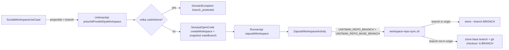

# Workspace: локальное создание ветки + запрет защищённых веток

## 1. Диагноз

Пользователь прав. Ошибка `fatal: Remote branch feature-test not found in
upstream origin` возникает потому, что ветка workspace сейчас **обязана
существовать в origin**, хотя по UX это свободный ввод новой ветки.

Цепочка:

1. Форма создания workspace — ветка вводится свободным текстом
   (`../unitman-front/src/modules/opencode/view/FormaSozdaniyaWorkspace.vue:72`,
   `q-input` без выбора из списка). Пользователь может ввести ветку, которой
   нет в origin (например, `feature-test`).
2. `SozdatWorkspaceUseCase` → `RunnerAdapter::zapustit` →
   `RunnerApi::zapustitWorkspace` → Temporal `ZapustitWorkspace` →
   Go `ZapustitWorkspaceActivity` → `syncProject()` передаёт
   `UNITMAN_REPO_BRANCH=<ветка>` в скрипт.
3. `unitman-runner/temporal/activity/workspace/docker-dind/workspace-repo-sync.sh:35`
   делает `git clone --branch "$BRANCH" "$URL" "$DIR"`. `git clone --branch`
   требует существования ветки на удалённом репозитории → при отсутствии ветки
   git падает с `Remote branch ... not found in upstream origin`, скрипт
   переводит это в `opencode.workspace.project_branch_not_found`, workspace
   уходит в `ERROR`.

Дополнительно найдены две смежные проблемы:

- **Путь обновления тоже сломан для локальных веток**: в
  `workspace-repo-sync.sh:59` проверяется `origin/$BRANCH` и при отсутствии
  ветки в origin синхронизация повторного запуска (retry, восстановление из
  `ERROR`) снова упадёт с `project_branch_not_found`, даже если локальная ветка
  в контейнере уже создана.
- **Защищённые ветки не проверяются**: в цепочке создания workspace
  (`SozdatWorkspaceUseCase` → `PoluchitProektiDlyaWorkspaceQuery`) ветка вообще
  не доходит до Unitman, поэтому проверка `Project::soderzhitZashishennuyuVetku()`
  не выполняется. При этом Unitman уже умеет проверять защищённые ветки
  (`src/Unitman/Business/Model/Project.php:722`), а юниты используют это
  в `SozdatUnitUseCase::handleSVetkoy`.

## 2. Решение

Два изменения:

1. **Локальное создание ветки в workspace-контейнере.** Если ветки нет в
   origin — клонировать базовую ветку проекта (`mainBranch` из Unitman) и
   создать ветку workspace локально (`git checkout -b`). Если ветка есть в
   origin — текущее поведение сохраняется.
2. **Запрет защищённых веток при создании workspace.** Ветка workspace общая
   для всех проектов; если хотя бы у одного проекта она попадает под шаблон
   защищённых веток — создание отклоняется с ошибкой
   `opencode.workspace.branch_protected`.



## 3. Изменения в PHP (репозиторий unitman)

### 3.1 Unitman: проверка защищённой ветки + mainBranch

- `src/Unitman/Business/ReadModel/Project/ProektDlyaWorkspaceReadModel.php` —
  добавить поле `public readonly string $mainBranch`.
- `src/Unitman/Business/UseCase/Project/PoluchitProektiDlyaWorkspaceQuery.php`:
  - сигнатура `handle(array $projectIds, string $accountId, string $branch = '')`;
  - заполнять `mainBranch` из `Project::getMainBranchName()`;
  - если `$branch !== ''` и `$project->soderzhitZashishennuyuVetku($branch)` —
    бросать `new \DomainException('opencode.workspace.branch_protected')`.
    Прецедент уже есть: этот же Query бросает `opencode.workspace.project_not_found`
    и `opencode.workspace.project_conflict`.
- `src/Unitman/Api/UnitmanApi.php:142` — прокинуть третий параметр
  `$branch = ''` в `poluchitProektiDlyaWorkspace`.

### 3.2 OpenCode: передача ветки и снимок mainBranch

- `src/OpenCode/Business/Port/UmeetUpravlyatProektamiWorkspace.php` —
  `poluchitProekti(array $projectIds, string $accountId, string $branch = '')`.
- `src/OpenCode/Acl/UnitmanAdapter.php:95` — передавать `$branch` в UnitmanApi
  и маппить `mainBranch` в `ProektWorkspace`.
- `src/OpenCode/Business/UseCase/SozdatWorkspaceUseCase.php:54` — вызывать
  `poluchitProekti($projectIds, $accountId, $branch)`.
- `src/OpenCode/Business/Model/ProektWorkspace.php` — добавить
  `public readonly string $mainBranch` (снимок, как `canPush`).
- `src/OpenCode/Infra/Repository/SqlSessiyaOpenCodeRepository.php` —
  сохранение/чтение `main_branch` в `opencode_workspace_project`
  (INSERT ~строка 410, SELECT ~строка 489).
- Новая миграция в `src/OpenCode/Migrations/`:

```sql
alter table opencode_workspace_project
    add column if not exists main_branch varchar(256) not null default '';
```

### 3.3 Runner: контракт команды

- `src/Runner/Business/Command/Workspace/ProektWorkspaceZapros.php` —
  добавить `public readonly string $MainBranch`.
- `src/Runner/Business/Command/Workspace/ProektWorkspaceCommand.php` —
  добавить `public readonly string $MainBranch`.
- `src/OpenCode/Acl/RunnerAdapter.php:255` (`sobratZapros`) — передавать
  `$project->mainBranch`.
- `src/Runner/Api/RunnerApi.php:626` (`zapustitWorkspace`) — копировать
  `MainBranch` из запроса в команду активности.

Почему снимок, а не запрос Runner'ом у Unitman: при повторном запуске
(восстановление из `ERROR`, retry Temporal) команда собирается заново из
снимка сессии (`RunnerAdapter::sobratZapros`), поэтому `mainBranch` должен
храниться в БД вместе с проектом workspace.

### 3.4 Тесты PHP

- `src/Unitman/Tests/Unit/Project/PoluchitProektiDlyaWorkspaceQueryTest.php`:
  защищённая ветка → `branch_protected`; `mainBranch` заполняется; пустая
  ветка — проверка не выполняется (обратная совместимость для
  `poluchitSsylkuRedaktora`).
- `src/OpenCode/Tests/Business/UseCase/SozdatWorkspaceUseCaseTest.php`:
  защищённая ветка у одного из проектов → ошибка, сессия не создаётся.
- `src/OpenCode/Tests/Acl/RunnerAdapterWorkspaceTest.php` и
  `src/Runner/Tests/Business/Command/Workspace/WorkspaceDtoTest.php`:
  `MainBranch` проходит по всей цепочке.
- `src/OpenCode/Tests/Infra/Repository/SqlSessiyaOpenCodeRepositoryWorkspaceTest.php`:
  `main_branch` сохраняется и читается.

## 4. Изменения в Go-раннере (репозиторий unitman-runner)

### 4.1 Контракт

- `temporal/activity/workspace/workspace.go` — `Project` получает
  `MainBranch string`; `syncProject()` добавляет env
  `UNITMAN_REPO_BASE_BRANCH=<MainBranch>`.

### 4.2 `workspace-repo-sync.sh`

Клонирование (нет `.git`):

1. `git clone --branch "$BRANCH" ...` — если успех, ветка существовала в
   origin (текущее поведение).
2. Если ошибка содержит `not found in upstream origin` / `Could not find
   remote branch` / `Remote branch`:
   - база = `UNITMAN_REPO_BASE_BRANCH`, если задана, иначе HEAD origin
     (`git clone "$URL" "$DIR"` без `--branch`);
   - если база задана: `git clone --branch "$BASE" ...`; при неудаче —
     fallback на клон без `--branch` (дефолтная ветка origin);
   - `git checkout -b "$BRANCH"` — локальная ветка без upstream.
3. Прочие ошибки клонирования → `opencode.workspace.project_clone_failed`.

Обновление (`.git` существует):

1. Обновить `origin`, `git fetch --prune origin` (как сейчас).
2. Если `origin/$BRANCH` существует — текущее поведение
   (`checkout -B`, `pull --rebase`).
3. Если `origin/$BRANCH` нет, но локальная `refs/heads/$BRANCH` есть —
   `git checkout "$BRANCH"` (со stash/pop локальных изменений), без
   `pull` (upstream отсутствует). Это делает повторный запуск идемпотентным
   для локально созданных веток.
4. Иначе → `opencode.workspace.project_branch_not_found`.

Read-only блокировка (токен из origin + `pre-push`-хук) остаётся без изменений
и применяется к обоим путям.

### 4.3 Документация и тесты раннера

- `docs/workspaces.md` (репозиторий раннера) — обновить раздел
  `workspace-repo-sync.sh`: локальное создание ветки от базовой, поведение
  повторного запуска.
- `temporal/activity/workspace/workspace_test.go` — вынести сборку env
  `syncProject` в тестируемую функцию и проверить
  `UNITMAN_REPO_BASE_BRANCH`.
- Опционально: shell-тест скрипта на локальных git-фикстурах (bare origin +
  временные каталоги): ветка есть / ветки нет + base задана / ветки нет + base
  не задана / повторный запуск локальной ветки.

## 5. Изменения во фронтенде (репозиторий unitman-front)

- `src/translator/ru.json` и `src/translator/en.json`: добавить перевод
  ключа `opencode.workspace.branch_protected` (backend-ключ показывается
  как есть через `perevodKlyucha`, поэтому нужен путь, совпадающий с ключом;
  существующие backend-ключи workspace в translator отсутствуют — можно
  добавить блок рядом с `opencode.workspace.errors`).
- Опционально: уточнить `opencode.workspace.form.hint_branch` — «Если ветки
  нет в репозитории, она будет создана локально от основной ветки проекта».

## 6. Порядок внедрения

1. PHP: Unitman (read model + query + api) → тесты.
2. PHP: OpenCode (порт, адаптер, UseCase, модель, репозиторий, миграция) → тесты.
3. PHP: Runner (DTO + RunnerApi) → тесты; `composer run all-checks`.
4. Go-раннер: контракт + скрипт + тесты + docs.
5. Фронт: переводы.
6. Проверка вручную: создать workspace с новой веткой (нет в origin) и с
   защищённой веткой (ожидаем `branch_protected` до старта контейнера).

## 7. Риски и заметки

- Проверка защищённой ветки выполняется в Unitman на момент создания; если
  позже ветку добавят в защищённые, существующий workspace не трогаем
  (снимок, как `canPush`).
- `mainBranch` проекта может не существовать в origin (некорректная настройка)
  — скрипт fallback'ится на дефолтную ветку origin, чтобы workspace всё равно
  поднялся.
- Локальная ветка без upstream: первый push делает пользователь
  (`git push -u origin <ветка>`); OpenCode-промпт это не меняет.
- Обратная совместимость: пустой `$branch` в
  `poluchitProektiDlyaWorkspace` сохраняет старое поведение для
  `poluchitSsylkuRedaktora`.
