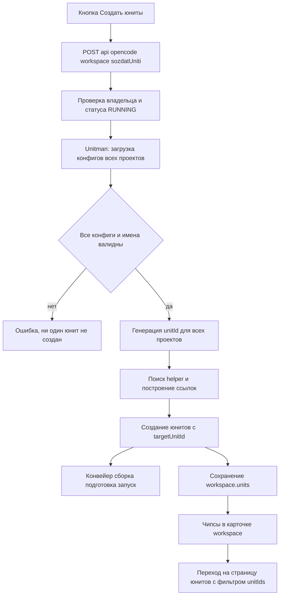

# План: кнопка «Создать юниты» в workspace и связи через хелперы

## 1. Что выяснено

- Workspace — это сессия OpenCode с набором проектов; юнитов у неё нет ([`Workspace`](src/OpenCode/Business/Model/Workspace.php:13), [`docs/workspaces.md`](docs/workspaces.md:34)).
- Создание юнита сразу добавляет конвейер `SBORKA → PODGOTOVKA → ZAPUSK` ([`Unit::sozdatUnit()`](src/Unitman/Business/Model/Unit.php:464)), а очередь обрабатывает его автоматически ([`OcheredUnitovProjection::handleUnitSozdan()`](src/Unitman/Infra/Projection/OcheredUnitovProjection.php:106)). Поэтому отдельный вызов «запустить» после создания не нужен.
- Селектор хелпера запрашивает `/api/unit/list` только с `projectId` и `limit` ([`StorPomoschnikaSsylki.poluchitSpisokUnitovProekta()`](../unitman-front/src/modules/unit/store/SpisokUnitov/StorPomoschnikaSsylki.ts:77)). Бэкенд возвращает все юниты из `spisok_unitov` сразу после создания — фильтра по `zapushen` нет ([`SpisokUnitovRepository::getList()`](src/Unitman/Infra/Repository/Unit/SpisokUnitovRepository.php:122)).
- Ссылка на сервис целевого юнита строится только при наличии `links` ([`PoluchitSsylkuPoPomoschnikuQuery::handle()`](src/Unitman/Business/UseCase/Unit/PoluchitSsylkuPoPomoschnikuQuery.php:22)). `links` заполняются в [`SpisokUnitovProjection::handleKonfigUnitaUstanovlen()`](src/Unitman/Infra/Projection/SpisokUnitovProjection.php:216), то есть после успешной сборки. Запуск для этого не требуется.
- Итог: сейчас юниты видны в списке сразу, но выбрать можно только после сборки. В интерфейсе это не выражено: показываются и юниты без подходящей ссылки, поэтому клик по ним падает с `unit.pomoschnik.servis_ne_naiden`.

## 2. Целевое поведение

1. В карточке workspace появляется действие «Создать юниты».
2. Кнопка доступна только пока у workspace нет созданных юнитов. Как только юниты созданы и сохранены в workspace, кнопка больше не показывается и не может быть нажата.
3. По нажатию создаётся по одному юниту на каждый проект workspace.
4. Перед созданием система читает `unitman.yaml` каждого проекта и ищет переменные с `helper`.
5. Если `helper.projectId` указывает на проект из этого workspace, создаётся связь:
   - переменной подставляется ссылка на целевой юнит;
   - в `ZnacheniePeremenoi.targetUnitId` передаётся id целевого юнита;
   - связь фиксируется в `svyazi_unitov`.
6. Юниты создаются с общим именем на основе slug workspace и запускаются штатным конвейером.
7. Созданные юниты сохраняются в workspace и показываются чипсами в карточке.
8. Клик по чипсам ведёт на страницу юнитов с фильтром `unitIds` — существующий фильтр вернёт эти юниты и связанные с ними.
9. Селектор хелпера показывает только те юниты, у которых уже есть подходящая ссылка `service/port/type`; `zapushen` не требуется.



## 3. Backend Unitman

### 3.1 Команды и read-модели

Новые файлы:

- `src/Unitman/Business/Command/Unit/SozdatUnitiDlyaProektov.php` — DTO с `unitName`, `projects[]`, `memoryLimit`.
- `src/Unitman/Business/Command/Unit/SozdatUnitiDlyaProektov/ProektDlyaSozdaniyaUnita.php` — `projectId`, `branch`.
- `src/Unitman/Business/ReadModel/Unit/SozdannieUnitiReadModel.php` — список созданных юнитов.
- `src/Unitman/Business/ReadModel/Unit/SozdanniyUnitReadModel.php` — `unitId`, `projectId`, `unitName`, `branch`.

### 3.2 UseCase

Новый `src/Unitman/Business/UseCase/Unit/SozdatUnitiDlyaProektovUseCase.php`.

Порядок работы:

1. Нормализовать `unitName` и проверить через [`UnitName`](src/Unitman/Business/Model/Unit/UnitName.php:5).
2. Проверить проекты: непустые, без дублей, не больше 20, доступны пользователю и не отключены.
3. Для каждого проекта получить [`Project`](src/Unitman/Business/Model/Project.php:56), [`Repo`](src/Unitman/Business/Model/Repo.php) и скачать `unitman.yaml` через [`UmeetPoluchatKonfigProekta`](src/Unitman/Business/Port/Project/UmeetPoluchatKonfigProekta.php:8).
4. Разобрать YAML через [`CanParseYaml`](src/Unitman/Business/Port/CanParseYaml.php) и провалидировать [`ConfigUnita::fromArray()`](src/Unitman/Business/Model/Unit/ConfigUnita.php:118).
5. Проверить коллизии имён через [`CanFindUnitDouble::isExistsDoubleByName()`](src/Unitman/Business/Port/Unit/CanFindUnitDouble.php:11). При любом совпадении остановить операцию до первой записи.
6. Сгенерировать `unitId` и `prozesId` для всех проектов заранее через [`CanGenerateGuid`](src/Unitman/Business/Port/CanGenerateGuid.php).
7. Построить карту проектов workspace: по `projectId` и по `projectCode` — для совместимости с конфигами, где в `helper.projectId` указан код проекта.
8. Для каждой переменной с хелпером через [`SvyaziPeremenihUtil::poluchitPomoschnikiPoPeremennim()`](src/Unitman/Business/Utils/SvyaziPeremenihUtil.php:23) найти целевой проект.
9. Если цель найдена:
   - построить ссылку через [`SsylkaServisaUtil::sformirovat()`](src/Unitman/Business/Utils/SsylkaServisaUtil.php:48);
   - дописать `suffix`;
   - сформировать `ZnacheniePeremenoi` с `targetUnitId`.
10. Если цель не найдена — оставить `defaultValue` переменной без связи.
11. Создать юниты через [`SozdatUnitUseCase`](src/Unitman/Business/UseCase/Unit/SozdatUnitUseCase.php:17) с заранее сгенерированными id и отключённой повторной проверкой связей.
12. Вернуть список созданных юнитов.

Ошибки пробрасывать существующими ключами: `unit.name_already_exists`, `unit.project_is_disabled`, `unit.config_is_empty`, `unit.invalid_proxy_host` и доменные ключи `ConfigUnita`.

### 3.3 Изменения в `SozdatUnitUseCase`

Добавить в [`handleDlyaPolzovatelya()`](src/Unitman/Business/UseCase/Unit/SozdatUnitUseCase.php:61) необязательные параметры:

- `?string $unitId = null`;
- `?string $prozesId = null`;
- `bool $proveritSvyazi = true`.

Существующие вызовы не меняются. Batch-сценарий передаёт готовые id и `proveritSvyazi = false`, потому что все цели уже проверены по плану и ещё не существуют в read-модели на момент создания.

### 3.4 Публичный API модуля

Добавить в [`UnitmanApi`](src/Unitman/Api/UnitmanApi.php:27):

```php
function sozdatUnitiDlyaProektov(
    SozdatUnitiDlyaProektov $command,
    string $accountId,
): SozdannieUnitiReadModel;
```

Метод вызывает новый UseCase через `handleDlyaPolzovatelya()`.

### 3.5 Тесты Unitman

- `src/Unitman/Tests/UseCase/Unit/SozdatUnitiDlyaProektovUseCaseTest.php`:
  - создание по одному юниту на проект;
  - связь по `helper.projectId = UUID` и по `helper.projectId = projectCode`;
  - корректная ссылка для `http`, `ws` и `tcp`, с `suffix`;
  - хелпер на проект вне workspace остаётся без связи;
  - коллизия имени в любом проекте отменяет всю операцию;
  - ошибка конфига в любом проекте отменяет всю операцию;
  - невалидный proxy host отменяет операцию;
  - `memoryLimit` берётся из проекта;
  - в событиях `UnitSozdan` есть `svyazi` с `targetUnitId`.
- `src/Unitman/Tests/UseCase/Unit/PoluchitSsylkuPoPomoschnikuQueryTest.php`: ссылка строится при `zapushen = false`, если `links` уже заполнены.

## 4. Backend OpenCode

### 4.1 Порт и Acl

Расширить [`UmeetUpravlyatUnitami`](src/OpenCode/Business/Port/UmeetUpravlyatUnitami.php:14):

```php
/**
 * @param list<array{projectId: string, branch: string}> $projects
 * @return list<SozdanniyUnit>
 */
public function sozdatUnitiDlyaProektov(
    array $projects,
    string $unitName,
    string $accountId,
): array;
```

Новая нейтральная модель `src/OpenCode/Business/Model/SozdanniyUnit.php` с `unitId`, `projectId`, `unitName`, `branch`.

Реализация в [`UnitmanAdapter`](src/OpenCode/Acl/UnitmanAdapter.php:30) собирает `SozdatUnitiDlyaProektov` и маппит `SozdanniyUnitReadModel` в `SozdanniyUnit`.

### 4.2 Хранение созданных юнитов

Миграция `src/OpenCode/Migrations/Version2026...php`:

```sql
create table if not exists opencode_workspace_unit (
    workspace_id varchar(64) not null,
    unit_id varchar(64) not null,
    project_id varchar(64) not null,
    unit_name varchar(128) not null,
    created_at integer not null,
    primary key (workspace_id, unit_id)
);
create index if not exists opencode_workspace_unit_workspace_idx
    on opencode_workspace_unit (workspace_id);
```

Изменения:

- [`Workspace`](src/OpenCode/Business/Model/Workspace.php:13) получает `units` и методы `getUnits()`, `zapomnitUniti()`.
- [`SqlSessiyaOpenCodeRepository`](src/OpenCode/Infra/Repository/SqlSessiyaOpenCodeRepository.php:19):
  - запись `opencode_workspace_unit` в `sohranitWorkspace()`;
  - batch-чтение в `zagruzitWorkspaces()`;
  - удаление в `deleteWorkspace()`.
- [`WorkspaceReadModel`](src/OpenCode/Business/ReadModel/WorkspaceReadModel.php:18) и [`SostoyanieWorkspaceReadModel`](src/OpenCode/Business/ReadModel/SostoyanieWorkspaceReadModel.php:13) получают `units`.
- Новая read-модель `src/OpenCode/Business/ReadModel/WorkspaceUnitReadModel.php`.

### 4.3 UseCase и endpoint

Новые файлы:

- `src/OpenCode/Business/Command/SozdatUnitiWorkspace.php` — `workspaceId`.
- `src/OpenCode/Business/UseCase/SozdatUnitiWorkspaceUseCase.php`.

Логика UseCase:

1. Получить текущий accountId через [`UmeetProveryatRekvizityOpenCode`](src/OpenCode/Business/Port/UmeetProveryatRekvizityOpenCode.php).
2. Загрузить сессию и проверить владельца через `trebovatVladelca()`.
3. Проверить, что это workspace, статус `RUNNING`, сессия не в архиве.
4. Если `workspace->getUnits() !== []` — ошибка `opencode.workspace.units_already_created`.
5. Собрать `projects` из снимка workspace: `projectId`, `branch` (ветка проекта или общая ветка workspace).
6. Вычислить имя юнита через [`SlugWorkspace::dlya()`](src/OpenCode/Business/Utils/SlugWorkspace.php:21).
7. Вызвать `UmeetUpravlyatUnitami::sozdatUnitiDlyaProektov()`.
8. Сохранить результат в `Workspace::zapomnitUniti()` и `sessionRepository->update()`.
9. Вернуть список юнитов.

Endpoint в [`WorkspaceController`](src/OpenCode/Infra/Controller/WorkspaceController.php:36):

- `POST /api/opencode/workspace/sozdatUniti`;
- тело `{ workspaceId }`;
- ответ `{ units: WorkspaceUnit[] }`;
- OA-атрибуты и схема `WorkspaceUnit`.

### 4.4 Тесты OpenCode

- `src/OpenCode/Tests/Business/UseCase/SozdatUnitiWorkspaceUseCaseTest.php`:
  - успешное создание и сохранение units;
  - запрет для чужого workspace;
  - запрет при статусе не `RUNNING`;
  - запрет при уже созданных units;
  - ошибка Unitman не сохраняет units.
- `src/OpenCode/Tests/Infra/Repository/SqlSessiyaOpenCodeRepositoryWorkspaceTest.php`: units сохраняются и читаются.
- `src/OpenCode/Tests/Api/WorkspaceControllerTest.php`: новый endpoint и схема ответа.

## 5. Frontend

### 5.1 Карточка workspace

В [`WorkspaceCard.vue`](../unitman-front/src/modules/opencode/view/Workspace/WorkspaceCard.vue:78):

- пункт меню «Создать юниты» с иконкой `package`;
- пункт меню рендерится только при `workspace.status === "RUNNING"` и `workspace.units.length === 0`;
- если `workspace.units.length > 0`, пункт меню не показывается вовсе — ни в меню, ни отдельной кнопкой;
- новый emit `create-units`;
- блок созданных юнитов: чипсы `unitName` с tooltip `projectName · unitId`;
- клик по чипсу или по заголовку блока — emit `open-units` со списком `unitId`.

В [`SpisokWorkspace.vue`](../unitman-front/src/modules/opencode/view/SpisokWorkspace.vue:380):

- обработчик `createUnits(workspace)`: диалог подтверждения со списком проектов и веток, затем `stor.sozdatUniti(workspace.id)`;
- обработчик `openUnits(unitIds)`: `router.push({ path: '/', query: { unitIds: unitIds.join(',') } })`;
- после успеха — перечитать список workspace.

### 5.2 Сервис и стор

- [`OpenCodeService`](../unitman-front/src/modules/opencode/services/OpenCodeService.ts:171): метод `sozdatUnitiWorkspace({ workspaceId })`.
- [`StorSpiskaWorkspace`](../unitman-front/src/modules/opencode/store/StorSpiskaWorkspace.ts:50):
  - добавить `create_units` в `DejstvieWorkspace`;
  - действие `sozdatUniti(id)`: вызвать сервис, обновить список, выставить `oshibkaDejstviya` при ошибке.
- [`Workspace`](../unitman-front/src/modules/opencode/model/Workspace.ts:10): тип `units` появится из сгенерированной схемы.

### 5.3 Селектор хелпера

В [`StorPomoschnikaSsylki.ts`](../unitman-front/src/modules/unit/store/SpisokUnitov/StorPomoschnikaSsylki.ts:28):

- добавить `podhodyashayaSsylka(unit, helper)` — проверяет, что в `unit.links` есть запись с тем же `service`, `port` и нормализованным `protocol`.
- при открытии диалога всегда перечитывать список, а не брать кэш.

В [`OknoViboraUnitaDlyaSsylki.vue`](../unitman-front/src/modules/unit/view/Unit/Konfig/OknoViboraUnitaDlyaSsylki.vue:45):

- фильтровать `spisok` по `podhodyashayaSsylka` до текстового поиска;
- пустое состояние с подсказкой: юнит появится после успешной сборки, запуск не требуется;
- юнит с `links`, но `zapushen = false`, остаётся доступным.

### 5.4 Переводы и контракты

- [`ru.json`](../unitman-front/src/translator/ru.json) и [`en.json`](../unitman-front/src/translator/en.json): ключи для кнопки, подтверждения, ошибок, блока units, подсказки селектора.
- Регенерация `docs/openapi.json` и `../unitman-front/src/api/generated/unitman.d.ts`.

## 6. Документация

- [`docs/unitman-config.md`](docs/unitman-config.md:292): добавить, что селектор хелпера показывает юниты с готовой ссылкой `service/port/type`; ссылка появляется после сборки, запуск не обязателен.
- [`docs/workspaces.md`](docs/workspaces.md:83): описать `POST /api/opencode/workspace/sozdatUniti`, таблицу `opencode_workspace_unit`, поле `units` в ответах workspace.
- OpenAPI: новые схемы `SozdatUnitiDlyaProektov`, `WorkspaceUnit`, поле `units`.

## 7. Проверки

1. Поднять контейнер, если не запущен.
2. В контейнере: `php bin/console cache:clear`.
3. Целевые phpunit:
   - `SozdatUnitiDlyaProektovUseCaseTest`;
   - `PoluchitSsylkuPoPomoschnikuQueryTest`;
   - `SozdatUnitiWorkspaceUseCaseTest`;
   - `SqlSessiyaOpenCodeRepositoryWorkspaceTest`;
   - `WorkspaceControllerTest`.
4. `composer run check-psalm`, `composer run check-deptrac`, пер-модульные deptrac.
5. `composer run openapi-dump`, проверить diff `docs/openapi.json`.
6. `rr reset`.
7. Во фронтенде: `yarn gen:api --file openapi/unitman.json`, `yarn build`.
8. Ручной сценарий:
   - открыть workspace в статусе `RUNNING`;
   - нажать «Создать юниты»;
   - дождаться сборки;
   - убедиться, что в карточке появились чипсы;
   - клик по чипсам открывает страницу юнитов с фильтром `unitIds`;
   - в форме переменной с хелпером юнит без запуска, но со сборкой, доступен для выбора.

## 8. Принятые допущения

- `helper.projectId` может быть как Unitman `projectId`, так и кодом проекта; поддерживаются оба варианта.
- Цель хелпера вне workspace не связывается, переменная остаётся со значением по умолчанию.
- Имя юнита — slug workspace через `SlugWorkspace`; одинаковое для всех проектов.
- Любая коллизия имени или ошибка конфига отменяет создание всех юнитов.
- Кнопка доступна для `RUNNING` workspace без созданных юнитов; как только units сохранены, кнопка исчезает из интерфейса.
- Повторный вызов защищён и на бэкенде: при непустом `workspace.units` возвращается `opencode.workspace.units_already_created`.
- Созданные юниты не переиспользуются: повторная операция при уже сохранённых units запрещена.
