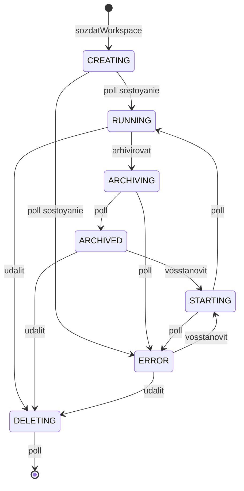
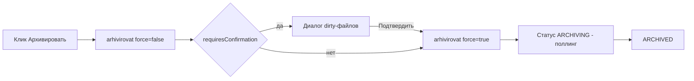

# Workspace: интерфейс фронтенда (вариант)

## 0. Контекст и границы

- Бэкенд готов: [`WorkspaceController`](../src/OpenCode/Infra/Controller/WorkspaceController.php) отдаёт
  `/api/opencode/workspace/{sozdat,spisok,sostoyanie,arhivirovat,vosstanovit,udalit}`; контракты —
  `docs/openapi.json`, схемы уже сгенерированы в `unitman-front/openapi/unitman.json`
  (`Workspace`, `SostoyanieWorkspace`, `RezultatArhivaciiWorkspace`, `SozdatWorkspace`, …).
- Workspace — это сессия OpenCode с `tip = workspace`: промпты, история, ходы и уведомления
  работают через существующие `/opencode/*` маршруты, где `sessionId = workspaceId`.
  Значит **чат переиспользуется полностью**, нового чата не нужно.
- Задача — только фронтенд (`unitman-front`, модуль `src/modules/opencode`).
  Изменения бэкенда не требуются; два опциональных улучшения — в §9.

## 1. Ключевые решения

| # | Тема | Решение |
|---|---|---|
| 1 | Навигация | Отдельный маршрут `/opencode/workspaces` + segmented-переключатель «Сессии \| Workspace» в шапках обоих списков |
| 2 | Чат | Общий `opencode_chat` для обоих типов; workspace-состояние — надстройка над чатом |
| 3 | Сервис | Методы workspace в `OpenCodeService` (типы из `Schema<...>` сгенерированной схемы) |
| 4 | Сторы | `StorSpiskaWorkspace`, `StorFormiSozdaniyaWorkspace`; workspace-состояние чата — в `StorChataOpenCode` |
| 5 | Тип сессии в чате | Probe `workspace/sostoyanie`: успех → workspace-режим, fail `not_found` → unit-режим. Если тип известен из списка/уведомления — probe пропускается |
| 6 | Блокировка ввода | По `canAcceptMessages` из `SostoyanieWorkspace` (сейчас чат блокирует только по `hodVipolnyaetsya`) |
| 7 | Архив | Двухфазный: `force=false` → при `requiresConfirmation` диалог со списком dirty-файлов → `force=true` |
| 8 | Поллинг | `sostoyanie` каждые 4с, пока статус транзитный: `CREATING/STARTING/ARCHIVING/DELETING` |
| 9 | canPush в форме | До создания недоступен (в публичном списке проектов его нет) — честная подсказка «права push проверятся при создании»; read-only виден после создания |

## 2. Маршруты и навигация

```ts
// opencode/routes/index.ts — добавляется ребёнок OpenCodeLayout
{
    path: "workspaces",
    component: SpisokWorkspace,
    name: "opencode_workspaces",
    meta: { titleKey: "app.tabs.opencode" },
},
```

- `OpenCodeLayout` остаётся голым `router-view`.
- Переключатель «Сессии | Workspace» — segmented control в шапке `SpisokSessiyOpenCode`
  и `SpisokWorkspace` (паттерн из `plans/unit-ui-redesign.md`), навигация `router.push`.
- Чат: маршрут не меняется, `opencode_chat` обслуживает оба типа.

## 3. Сервис

```ts
// OpenCodeService.ts
spisokWorkspace(params?: { onlyActive?: boolean; search?: string | null })
    : Promise<ApiResponse<Schema<"Workspace">[]>>;
sozdatWorkspace(params: Schema<"SozdatWorkspace">)
    : Promise<ApiResponse<{ id: string; status: string }>>;
sostoyanieWorkspace(params: Schema<"PoluchitSostoyanieWorkspace">)
    : Promise<ApiResponse<Schema<"SostoyanieWorkspace">>>;
arhivirovatWorkspace(params: Schema<"ArhivirovatWorkspace">)
    : Promise<ApiResponse<Schema<"RezultatArhivaciiWorkspace">>>;
vosstanovitWorkspace(params: Schema<"VosstanovitWorkspace">)
    : Promise<ApiResponse<{ status: string }>>;
udalitWorkspace(params: Schema<"UdalitWorkspace">)
    : Promise<ApiResponse<null>>;
```

## 4. Список workspace

`SpisokWorkspace.vue`:

- шапка: поиск (borderless, debounce, `search`), toggle «только активные» (`onlyActive`),
  refresh, primary «+ Workspace» (disabled без реквизитов — как в списке сессий),
  segmented «Сессии | Workspace»;
- фильтры синхронизируются с URL (паттерн `unitFiltersUrl`).

`WorkspaceCard.vue` (+ `WorkspaceCardHeader/Menu/StatusBadge` по образцу юнитов):

1. строка 1: статус-бейдж + кебаб-меню;
2. строка 2: название + бейджи `read-only` и `архив`;
3. строка 3: ветка · N проектов;
4. строка 4: чипсы проектов, у `canPush=false` — иконка `lock`;
5. строка 5: обновлено · создано;
6. действия: «Чат» (primary ghost) + ideLink (`open_in_new`, если не null);
7. кебаб: «Архивировать» / «Восстановить» (ARCHIVED, ERROR) / «Удалить» (красным, внизу).

Цвета статусов: `RUNNING` — positive; `CREATING/STARTING` — info; `ARCHIVING/ARCHIVED/DELETING` — grey;
`ERROR` — negative. Для `ERROR` — alert-бокс с переводом `errorKey` и кнопками
«Восстановить» / «Удалить».

Поллинг: пока в списке есть карточки в транзитном статусе — таймер 4с перечитывает список.

## 5. Форма создания

`FormaSozdaniyaWorkspace.vue` (диалог, по образцу `FormaSozdaniyaSessii`):

- имя (required, ≤256, уникальность на сервере);
- реквизиты OpenCode (select, required — из `StorSpiskaRekvizitovOpenCode`);
- ветка (required, ≤256, одна на все проекты);
- проекты (multi-select с сохранением порядка, 1..20; порядок = порядок папок в workspace);
- первый промпт (textarea, required);
- подсказка: «Права push проверятся при создании; если у проекта нет push —
  workspace будет только для чтения»;
- ошибки бэкенда (`opencode.workspace.*`) показываются в форме;
- после успеха — переход в чат нового workspace: там баннер `CREATING` с поллингом,
  первый промпт появится как ход автоматически.

## 6. Чат

Определение типа сессии при открытии `ChatOpenCode`:

1. тип из списка сессий / из уведомления (`sessionType`) — probe не нужен;
2. иначе probe `sostoyanieWorkspace`: успех → workspace, fail `not_found` → unit;
3. тип кешируется в `StorChataOpenCode` по `sessionId`.

Workspace-режим чата:

- баннер над историей: `CREATING/STARTING` — спиннер «Окружение разворачивается»;
  `ERROR` — alert с переводом `errorKey` + «Восстановить» / «Удалить»;
  `ARCHIVED` — «Архив» + «Восстановить»; `ARCHIVING/DELETING` — спиннер;
- шапка: readOnly-бейдж + кнопка ideLink;
- ввод заблокирован по `canAcceptMessages`, placeholder объясняет причину;
- поллинг `sostoyanie` 4с в транзитных статусах; переход в `RUNNING` — разблокировка
  и перечитывание истории (первый промпт приезжает как ход);
- unit-режим — без изменений.

## 7. Уведомления и список сессий

- `UvedomlenieOpenCode.sessionType = 'workspace'`: клик ведёт в `opencode_chat` как сейчас,
  тип передаётся в стор чата (probe пропускается); в списке уведомлений — бейдж «workspace».
- `SpisokSessiyOpenCode`: у элементов с `type === 'workspace'` — бейдж «workspace»,
  кнопка «привязать юниты» скрыта, вместо юнитов — чипсы проектов из `sessiya.workspace`.

## 8. Переводы

`opencode.workspace.*` в ru/en: статусы, действия, диалоги, причины, ошибки
(ключи ошибок зафиксированы бэкендом — §11 `docs/workspaces.md`).

## 9. Опциональные улучшения бэкенда (не блокер)

- `canPush` в публичной read-модели проекта → форма создания сразу предупреждает о read-only.
- `type` в `SostoyanieSessiiReadModel` → чату не нужен probe-запрос.

## 10. Жизненный цикл в UI



Поток архивации:



## 11. Проверки

- `yarn gen:api` — типы уже в схеме; lint; сборка фронтенда.
- Ручной E2E: создание (`CREATING → RUNNING`, первый промпт), архив с dirty-подтверждением,
  restore, delete, уведомления, deep-link чата по прямой ссылке.
